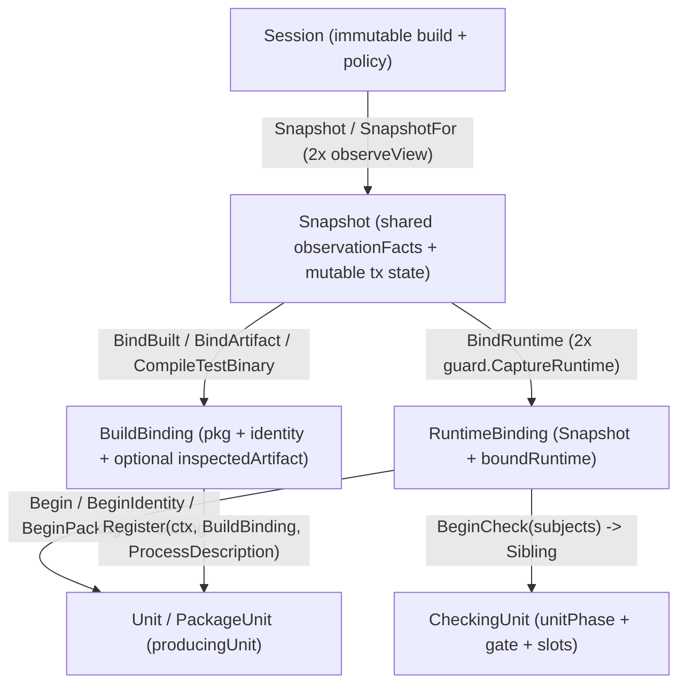

# Audit 02: Root Package Session, View, Unit, Verdict & Orchestration Files

**Audit Scope**: 17 root-package files (`7,547` lines total, 100% read line-by-line).

| # | File | Lines | Role |
| :--- | :--- | ---: | :--- |
| 1 | [`applicability.go`](file:///home/nikolas/repos/github.com/greatliontech/gofresh/applicability.go#L1-L243) | 243 | Inert test-variant applicability extension types, checking, and deferred validation |
| 2 | [`artifact.go`](file:///home/nikolas/repos/github.com/greatliontech/gofresh/artifact.go#L1-L322) | 322 | Compiled test-binary artifact inspection, SHA-256 digesting, compilation helper, and re-validation |
| 3 | [`builddescription.go`](file:///home/nikolas/repos/github.com/greatliontech/gofresh/builddescription.go#L1-L190) | 190 | Session build-environment digest (`gofresh/build-environment@2`) and `GOGCCFLAGS` normalization |
| 4 | [`checking.go`](file:///home/nikolas/repos/github.com/greatliontech/gofresh/checking.go#L1-L557) | 557 | Ordered batch checking kernel (`checkRecords`) and transactional `CheckingUnit` state machine |
| 5 | [`explain.go`](file:///home/nikolas/repos/github.com/greatliontech/gofresh/explain.go#L1-L591) | 591 | Interactive shared-dynamic-state refusal derivation chains (`ExplainDynamicState`, `CulpritFromReason`) |
| 6 | [`fingerprint_record.go`](file:///home/nikolas/repos/github.com/greatliontech/gofresh/fingerprint_record.go#L1-L234) | 234 | Canonical JSON serialization and shape validation for `Fingerprint` |
| 7 | [`gofresh.go`](file:///home/nikolas/repos/github.com/greatliontech/gofresh/gofresh.go#L1-L1409) | 1,409 | Core domain types, strategy constants, memo controls, `engine` & options, and pure verdict ladder (`decide`) |
| 8 | [`judgment.go`](file:///home/nikolas/repos/github.com/greatliontech/gofresh/judgment.go#L1-L209) | 209 | Structured semantic verdict accounting (`JudgmentGround`, `Cause`, `AcceptedAuthority`, `JudgmentScope`) |
| 9 | [`membership.go`](file:///home/nikolas/repos/github.com/greatliontech/gofresh/membership.go#L1-L136) | 136 | Subject membership validation (`UnknownSubjectsError`) and batch preparation errors (`RecordedBatchError`) |
| 10 | [`outcome.go`](file:///home/nikolas/repos/github.com/greatliontech/gofresh/outcome.go#L1-L75) | 75 | Pre-execution outcome support preparation (`PrepareOutcomeSupport`, `outcomeSubject`) |
| 11 | [`processaccount.go`](file:///home/nikolas/repos/github.com/greatliontech/gofresh/processaccount.go#L1-L119) | 119 | Non-authorizing process execution telemetry (`ProcessAccount`, `RuntimeInputSpanError`) |
| 12 | [`provenance.go`](file:///home/nikolas/repos/github.com/greatliontech/gofresh/provenance.go#L1-L170) | 170 | Binary-vs-ambient Go toolchain language-series skew check (`ToolchainProvenance`, `ToolchainSkew`) |
| 13 | [`session.go`](file:///home/nikolas/repos/github.com/greatliontech/gofresh/session.go#L1-L528) | 528 | Explicit `Session`, `SessionPolicy`, `BuildDescription`, `RuntimeDescription`, `RuntimeBinding`, and convenience check wrappers |
| 14 | [`subject_facts.go`](file:///home/nikolas/repos/github.com/greatliontech/gofresh/subject_facts.go#L1-L66) | 66 | Per-subject immutable closure facts and consumer-tier refusal obligations (`subjectFacts`, `subjectRefusal`) |
| 15 | [`unit.go`](file:///home/nikolas/repos/github.com/greatliontech/gofresh/unit.go#L1-L677) | 677 | Producing execution transactions (`Unit`, `PackageUnit`, `producingUnit`, `Contribution`, `Finalized`, `FinalizedProcess`) |
| 16 | [`view.go`](file:///home/nikolas/repos/github.com/greatliontech/gofresh/view.go#L1-L1922) | 1,922 | `Snapshot` construction, double-observation agreement, capture, check wrappers, sibling derivation, and producer validation |
| 17 | [`vouchfile.go`](file:///home/nikolas/repos/github.com/greatliontech/gofresh/vouchfile.go#L1-L99) | 99 | Vouch file reader and `IMPORT-PATH:VARIABLE` parser (`ReadVouchFile`, `ParseVouchEntry`, `ParseVouchEntries`) |
| **Total** | **17 files** | **7,547** | **100% read** |

---

## Part I: Exhaustive File-by-File, Type-by-Type, and Function-by-Function Inventory

### 1. [`applicability.go`](file:///home/nikolas/repos/github.com/greatliontech/gofresh/applicability.go#L1-L243) (243 lines)

- **Constants**:
  - [`InertTestVariantExtension`](file:///home/nikolas/repos/github.com/greatliontech/gofresh/applicability.go#L14) (`L14`, exported): `"gofresh/inert-test-variant-extension@1"` strategy identifier.
- **Types**:
  - [`InertTestVariantApplicability`](file:///home/nikolas/repos/github.com/greatliontech/gofresh/applicability.go#L19-L22) (`L19-L22`, exported struct):
    - `Strategy string` (`L20`)
    - `TestVariantClosure string` (`L21`)
  - [`applicabilityCheck`](file:///home/nikolas/repos/github.com/greatliontech/gofresh/applicability.go#L139-L143) (`L139-L143`, unexported struct):
    - `recorded Fingerprint` (`L140`)
    - `subject Subject` (`L141`)
    - `observed bool` (`L142`)
- **Methods & Functions**:
  - [`(Fingerprint).EffectiveTestVariantClosure() string`](file:///home/nikolas/repos/github.com/greatliontech/gofresh/applicability.go#L27-L32) (`L27-L32`, exported): returns `f.InertTestVariantApplicability.TestVariantClosure` when non-zero, else `f.TestVariantClosure`.
  - [`(Fingerprint).recognizedApplicability() bool`](file:///home/nikolas/repos/github.com/greatliontech/gofresh/applicability.go#L34-L37) (`L34-L37`, unexported): returns true when `InertTestVariantApplicability` is zero or has `Strategy == InertTestVariantExtension` and both `a.TestVariantClosure` and `f.TestVariantClosure` non-empty.
  - [`(*Snapshot).CheckInertTestVariantExtension(ctx, recorded, prior, subject) (Fingerprint, TestVariantLedger, Verdict, error)`](file:///home/nikolas/repos/github.com/greatliontech/gofresh/applicability.go#L47-L49) (`L47-L49`, exported): delegates to `checkInertTestVariantExtension(..., false)`.
  - [`(*Snapshot).CheckObservedInertTestVariantExtension(ctx, recorded, prior, subject) (Fingerprint, TestVariantLedger, Verdict, error)`](file:///home/nikolas/repos/github.com/greatliontech/gofresh/applicability.go#L55-L57) (`L55-L57`, exported): delegates to `checkInertTestVariantExtension(..., true)`.
  - [`(*Snapshot).checkInertTestVariantExtension(ctx, recorded, prior, subject, observed)`](file:///home/nikolas/repos/github.com/greatliontech/gofresh/applicability.go#L59-L95) (`L59-L95`, unexported): validates snapshot/ctx, runs `prepareCandidates`, calls `prepareInertExtension`, runs `v.Check` or `v.CheckObserved` on the candidate with substituted applicability endpoint, and if `Valid` records obligation via `retainApplicabilityCheck`.
  - [`(*Snapshot).prepareInertExtension(recorded, prior, subject)`](file:///home/nikolas/repos/github.com/greatliontech/gofresh/applicability.go#L101-L134) (`L101-L134`, unexported): verifies `recognizedApplicability`, `EffectiveTestVariantClosure() != ""`, `recorded.ClosureStrategy == ClosureStrategy`, constructs candidate with `InertTestVariantApplicability{InertTestVariantExtension, cl.TestVariants}`, checks `recordedEvidenceVerdict(candidate, cl)` and `guard.CompareFacts`, fetches current `v.TestVariantLedger(subject)`, and checks `InertTestVariantLedgersForSubject(prior, ledger, subject.Symbol)`.
  - [`(*Snapshot).retainApplicabilityCheck(ctx, rec, subject, observed) error`](file:///home/nikolas/repos/github.com/greatliontech/gofresh/applicability.go#L145-L159) (`L145-L159`, unexported): appends `applicabilityCheck` under `v.mu.Lock()` if not sealed and not already present.
  - [`(*Snapshot).currentApplicabilityObservable(subject, outcomeMethod) bool`](file:///home/nikolas/repos/github.com/greatliontech/gofresh/applicability.go#L161-L169) (`L161-L169`, unexported): under `v.mu.RLock()`, checks whether `v.observable[subject]` is observable and matches `outcome.StaticMethod` (`EffectFree`) or `outcome.Method`.
  - [`(*Snapshot).validateApplicabilityChecks(ctx) error`](file:///home/nikolas/repos/github.com/greatliontech/gofresh/applicability.go#L171-L184) (`L171-L184`, unexported): copies `v.applicabilityChecks`, constructs `newSeededValidationView`, and calls `validateApplicabilityBatches`.
  - [`applicabilityRecords(checks []applicabilityCheck) []recordCheck`](file:///home/nikolas/repos/github.com/greatliontech/gofresh/applicability.go#L188-L194) (`L188-L194`, unexported): converts `[]applicabilityCheck` into `[]recordCheck`.
  - [`(*Snapshot).validateApplicabilityBatches(ctx, current, checks) error`](file:///home/nikolas/repos/github.com/greatliontech/gofresh/applicability.go#L196-L231) (`L196-L231`, unexported): runs `current.checkRecords(ctx, records, true, false)`, verifies every check still resolves to `Valid` (deferring `ErrAnalysisUnavailable`), calls `current.reobserveBase(ctx)`, checks `cutUnavailable` on `v` and `current`.
  - [`deferValidationUnavailability(err error, unavailable *error) error`](file:///home/nikolas/repos/github.com/greatliontech/gofresh/applicability.go#L235-L243) (`L235-L243`, unexported): captures first `ErrAnalysisUnavailable` into `*unavailable` and returns `nil` so concrete drift/cancellation errors take precedence.

---

### 2. [`artifact.go`](file:///home/nikolas/repos/github.com/greatliontech/gofresh/artifact.go#L1-L322) (322 lines)

- **Types**:
  - [`ArtifactDescription`](file:///home/nikolas/repos/github.com/greatliontech/gofresh/artifact.go#L20-L23) (`L20-L23`, exported struct):
    - `Identity string` (`L21`)
    - `Path string` (`L22`)
  - [`inspectedArtifact`](file:///home/nikolas/repos/github.com/greatliontech/gofresh/artifact.go#L28-L33) (`L28-L33`, unexported struct):
    - `path string` (`L29`)
    - `file os.FileInfo` (`L30`)
    - `bytes []byte` (`L31`)
    - `digest [sha256.Size]byte` (`L32`)
- **Methods & Functions**:
  - [`(*Snapshot).BindArtifact(ctx, pkg, description) (BuildBinding, error)`](file:///home/nikolas/repos/github.com/greatliontech/gofresh/artifact.go#L40-L72) (`L40-L72`, exported): binds `description.Identity` via `BindBuilt`, resolves `description.Path` against `s.session.build.Directory`, reads and double-checks the regular file via `readArtifact` + `artifact.validate`.
  - [`(*Snapshot).BindArtifactByDigest(ctx, pkg, path) (BuildBinding, error)`](file:///home/nikolas/repos/github.com/greatliontech/gofresh/artifact.go#L77-L113) (`L77-L113`, exported): checks `s.BuildDescription(pkg)`, resolves `path` against `s.session.build.Directory`, reads and validates the file via `readArtifact` + `artifact.validate`, computes `"sha256:" + hex`, and calls `s.BindBuilt(pkg, identity)`.
  - [`(*Snapshot).CompileTestBinary(ctx, pkg, outputPath, extraFlags...) (BuildBinding, error)`](file:///home/nikolas/repos/github.com/greatliontech/gofresh/artifact.go#L118-L146) (`L118-L146`, exported): gets `s.BuildDescription(pkg)`, rebases `outputPath`, builds `desc.TestCompileArgs(resolved, extraFlags...)`, runs `go test -c -o ...` via `s.session.engine.runner.Run`, and calls `s.BindArtifactByDigest(ctx, pkg, resolved)`.
  - [`(BuildBinding).Package() string`](file:///home/nikolas/repos/github.com/greatliontech/gofresh/artifact.go#L149-L151) (`L149-L151`, exported): returns `b.pkg`.
  - [`(BuildBinding).Identity() string`](file:///home/nikolas/repos/github.com/greatliontech/gofresh/artifact.go#L154-L156) (`L154-L156`, exported): returns `b.identity`.
  - [`(BuildBinding).Path() string`](file:///home/nikolas/repos/github.com/greatliontech/gofresh/artifact.go#L160-L165) (`L160-L165`, exported): returns `b.inspected.path` or `""`.
  - [`(BuildBinding).Digest() string`](file:///home/nikolas/repos/github.com/greatliontech/gofresh/artifact.go#L169-L174) (`L169-L174`, exported): returns `"sha256:" + hex` of `b.inspected.digest` or `""`.
  - [`(BuildBinding).Bytes() []byte`](file:///home/nikolas/repos/github.com/greatliontech/gofresh/artifact.go#L178-L183) (`L178-L183`, exported): returns `slices.Clone(b.inspected.bytes)` or `nil`.
  - [`(BuildBinding).Validate(ctx) error`](file:///home/nikolas/repos/github.com/greatliontech/gofresh/artifact.go#L187-L198) (`L187-L198`, exported): re-observes `b.inspected` via `b.inspected.validate(ctx)`, refusing if `b.inspected == nil`.
  - [`(*inspectedArtifact).validate(ctx) error`](file:///home/nikolas/repos/github.com/greatliontech/gofresh/artifact.go#L204-L216) (`L204-L216`, unexported): no-op if `a == nil`; otherwise calls `readArtifact(ctx, a.path, a)` and wraps non-context errors in `ErrViewChanged`.
  - [`readArtifact(ctx, path, expected) (*inspectedArtifact, error)`](file:///home/nikolas/repos/github.com/greatliontech/gofresh/artifact.go#L227-L322) (`L227-L322`, unexported): stats `path`, opens `path`, stats open fd, verifies `os.SameFile` and regular mode, streams in 64 KiB chunks checking `ctx.Err()` before/after each read, either capturing bytes + SHA-256 (`expected == nil`) or comparing against `expected.bytes`, then re-stats both fd and `path` afterward to detect concurrent replacement or size change.

---

### 3. [`builddescription.go`](file:///home/nikolas/repos/github.com/greatliontech/gofresh/builddescription.go#L1-L190) (190 lines)

- **Variables**:
  - [`completeBuildGoEnvKeys`](file:///home/nikolas/repos/github.com/greatliontech/gofresh/builddescription.go#L23-L55) (`L23-L55`, unexported `[]string`): 31 `go env -json` keys that affect compilation output (excluding local paths like `GOMOD`, `GOCACHE`, `GOROOT`, etc.).
  - [`completeBuildOSEnvKeys`](file:///home/nikolas/repos/github.com/greatliontech/gofresh/builddescription.go#L59-L74) (`L59-L74`, unexported `[]string`): 14 OS environment keys (`CGO_*_ALLOW`/`DISALLOW`, `PKG_CONFIG_*`, `SOURCE_DATE_EPOCH`).
- **Functions**:
  - [`completeBuildEnvironment(ctx, snapshot, dir, env) (string, error)`](file:///home/nikolas/repos/github.com/greatliontech/gofresh/builddescription.go#L84-L168) (`L84-L168`, unexported): unmarshals `snapshot.JSON`, normalizes `GOGCCFLAGS`, hashes `"gofresh/build-environment@2"`, `completeBuildOSEnvKeys`, `completeBuildGoEnvKeys`, `gowork=on/off`, normalized `GOGCCFLAGS`, and `GOENV` file contents (if regular file), returning hex SHA-256.
  - [`normalizedGCCFlags(text string) ([]string, error)`](file:///home/nikolas/repos/github.com/greatliontech/gofresh/builddescription.go#L170-L190) (`L170-L190`, unexported): parses `GOGCCFLAGS` with `buildflags.Fields` and normalizes at most one `-ffile-prefix-map=<abs-go-build-dir>=/tmp/go-build` or `-fdebug-prefix-map=...` flag to `<generated-work-directory>=/tmp/go-build`.

---

### 4. [`checking.go`](file:///home/nikolas/repos/github.com/greatliontech/gofresh/checking.go#L1-L557) (557 lines)

- **Types**:
  - [`Candidate`](file:///home/nikolas/repos/github.com/greatliontech/gofresh/checking.go#L14-L17) (`L14-L17`, exported struct): `Subject Subject`, `Recorded Fingerprint`.
  - [`InertRequest`](file:///home/nikolas/repos/github.com/greatliontech/gofresh/checking.go#L22-L25) (`L22-L25`, exported struct): `Index int`, `PriorLedger TestVariantLedger`.
  - [`CheckedExtension`](file:///home/nikolas/repos/github.com/greatliontech/gofresh/checking.go#L29-L32) (`L29-L32`, exported struct): `Fingerprint Fingerprint`, `Ledger TestVariantLedger`.
  - [`ProvisionalCheck`](file:///home/nikolas/repos/github.com/greatliontech/gofresh/checking.go#L36-L41) (`L36-L41`, exported struct): `Index int`, `Subject Subject`, `Verdict Verdict`, `Extension *CheckedExtension`.
  - [`CheckedCandidate`](file:///home/nikolas/repos/github.com/greatliontech/gofresh/checking.go#L46-L51) (`L46-L51`, exported struct): `Index int`, `Subject Subject`, `Verdict Verdict`, `Extension *CheckedExtension`.
  - [`recordCheck`](file:///home/nikolas/repos/github.com/greatliontech/gofresh/checking.go#L55-L59) (`L55-L59`, unexported struct): embeds `Candidate`, plus `observed bool`, `refusal Verdict`.
  - [`recordResult`](file:///home/nikolas/repos/github.com/greatliontech/gofresh/checking.go#L61-L68) (`L61-L68`, unexported struct): `verdict Verdict`, `evaluated bool`, `before runtimeinput.State`, `after runtimeinput.State`, `selected bool`, `unavailable error`.
  - [`CheckingUnit`](file:///home/nikolas/repos/github.com/greatliontech/gofresh/checking.go#L285-L293) (`L285-L293`, exported struct): `mu sync.Mutex`, `gate chan struct{}`, `phase unitPhase`, `view *Snapshot`, `slots []checkingSlot`, `busy bool`, `cancel context.CancelFunc`.
  - [`checkingSlot`](file:///home/nikolas/repos/github.com/greatliontech/gofresh/checking.go#L295-L300) (`L295-L300`, unexported struct): `record recordCheck`, `result recordResult`, `extension bool`, `ledger TestVariantLedger`.
- **Methods & Functions**:
  - [`orderedCandidates(recorded map[Subject]Fingerprint) []Candidate`](file:///home/nikolas/repos/github.com/greatliontech/gofresh/checking.go#L70-L76) (`L70-L76`, unexported): converts map to slice sorted by `orderedRecordedSubjects`.
  - [`validateCandidates(candidates []Candidate, kind Kind) error`](file:///home/nikolas/repos/github.com/greatliontech/gofresh/checking.go#L78-L95) (`L78-L95`, unexported): validates `candidate.Recorded.Validate()` (tier `RecordShapeRefusal`) and `candidate.Recorded.ResultKind == kind` (tier `RecordKindRefusal`), returning `*RecordedBatchError`.
  - [`(*Snapshot).prepareCandidates(candidates []Candidate) error`](file:///home/nikolas/repos/github.com/greatliontech/gofresh/checking.go#L97-L106) (`L97-L106`, unexported): runs `validateCandidates` then `v.requireMembers(subjects)`.
  - [`(*Snapshot).observeRecordInputs(ctx, records, results) ([]runtimeinput.State, error)`](file:///home/nikolas/repos/github.com/greatliontech/gofresh/checking.go#L110-L134) (`L110-L134`, unexported): emits `"runtime"` progress once if any evaluated record has `RuntimeInputs != ""`, and evaluates `v.currentRuntimeContext` per record sharing a per-pass map cache.
  - [`(*Snapshot).runtimeMotion(ctx, candidate, prior, before, after) Verdict`](file:///home/nikolas/repos/github.com/greatliontech/gofresh/checking.go#L138-L147) (`L138-L147`, unexported): if `before != after` and `prior.Status != Stale`, downgrades verdict to `Stale` (`RuntimeInputsCause`, `Changed`) with moved inputs attribution.
  - [`(*Snapshot).checkRecords(ctx, records, deferClose, retain) ([]recordResult, error)`](file:///home/nikolas/repos/github.com/greatliontech/gofresh/checking.go#L152-L252) (`L152-L252`, unexported): core batch checking kernel. Runs `recordedEvidenceVerdict`, observes `before` runtime inputs, determines if any inert-extension observed record requires `ensureObservable`, runs `decideAfterClosure` / `decideAfterClosureObserved`, observes `after` runtime inputs, closes check window (`closeCheckWindow`), checks `runtimeMotion`, and optionally retains applicability check obligations.
  - [`(*Snapshot).checkMap(ctx, recorded, observed, deferClose) (map[Subject]Verdict, error)`](file:///home/nikolas/repos/github.com/greatliontech/gofresh/checking.go#L254-L279) (`L254-L279`, unexported): orders map, prepares candidates, calls `checkRecords(..., deferClose, true)`, returns `map[Subject]Verdict`.
  - [`(*RuntimeBinding).BeginCheck(subjects []Subject) (*CheckingUnit, error)`](file:///home/nikolas/repos/github.com/greatliontech/gofresh/checking.go#L304-L310) (`L304-L310`, exported): creates a sibling view bound to `b.runtime` and returns an open `*CheckingUnit`.
  - [`(*CheckingUnit).CheckBatch(ctx, candidates) ([]ProvisionalCheck, error)`](file:///home/nikolas/repos/github.com/greatliontech/gofresh/checking.go#L314-L326) (`L314-L326`, exported): runs a round preparing and checking `candidates` under `observed: true`.
  - [`(*CheckingUnit).ExtendInertBatch(ctx, requests) ([]ProvisionalCheck, error)`](file:///home/nikolas/repos/github.com/greatliontech/gofresh/checking.go#L330-L355) (`L330-L355`, exported): validates slot indices, prepares inert extensions via `u.view.prepareInertExtension`, and runs a checking round.
  - [`(*CheckingUnit).round(ctx, prepare) ([]ProvisionalCheck, error)`](file:///home/nikolas/repos/github.com/greatliontech/gofresh/checking.go#L357-L415) (`L357-L415`, unexported): serializes rounds via `u.gate`, checks `u.phase == unitOpen`, calls `prepare()`, sets `u.busy = true` and `u.cancel`, runs `u.view.checkRecords(work, records, true, false)`, appends slots, and returns `[]ProvisionalCheck`.
  - [`(*CheckingUnit).finishWork(ctx, err) error`](file:///home/nikolas/repos/github.com/greatliontech/gofresh/checking.go#L419-L434) (`L419-L434`, unexported): resolves error precedence at commit boundary (`ctx.Err()` > `ErrUnitAborted` > `ErrUnitClosed` > `err`).
  - [`(checkingSlot).checked(index int) CheckedCandidate`](file:///home/nikolas/repos/github.com/greatliontech/gofresh/checking.go#L436-L442) (`L436-L442`, unexported): projects slot to `CheckedCandidate`, cloning `Ledger` into `Extension` when `s.extension && result.Verdict.Status == Valid`.
  - [`(*CheckingUnit).Abort()`](file:///home/nikolas/repos/github.com/greatliontech/gofresh/checking.go#L446-L458) (`L446-L458`, exported): transitions `unitOpen`/`unitClosing` to `unitAborted` and calls `u.cancel()`.
  - [`(*CheckingUnit).Close(ctx) ([]CheckedCandidate, error)`](file:///home/nikolas/repos/github.com/greatliontech/gofresh/checking.go#L463-L502) (`L463-L502`, exported): transitions `unitOpen` -> `unitClosing`, refuses with `ErrUnitIncomplete` if `u.busy`, runs `u.close(work)`, transitions to `unitClosed`.
  - [`(*CheckingUnit).close(ctx) ([]CheckedCandidate, error)`](file:///home/nikolas/repos/github.com/greatliontech/gofresh/checking.go#L504-L557) (`L504-L557`, unexported): creates `newSeededValidationView`, re-runs `current.checkRecords` over all slots, checks cross-round runtime input motion (`slot.result.before` vs `result.before` and `slot.result.after` vs `result.after`), verifies that any valid extension or selected applicability slot remains `Valid`, re-observes base via `current.reobserveBase(ctx)`, and checks `cutUnavailable`.

---

### 5. [`explain.go`](file:///home/nikolas/repos/github.com/greatliontech/gofresh/explain.go#L1-L591) (591 lines)

- **Constants & Package-Global Variables**:
  - [`explainMu`](file:///home/nikolas/repos/github.com/greatliontech/gofresh/explain.go#L22) (`L22`, unexported `sync.Mutex`): global lock serializing `explainCulprit` runs.
  - [`chainLinkCap`](file:///home/nikolas/repos/github.com/greatliontech/gofresh/explain.go#L66) (`L66`, unexported `const = 24`): maximum links in a `Chain`.
  - [`explainHooks`](file:///home/nikolas/repos/github.com/greatliontech/gofresh/explain.go#L96) (`L96`, unexported `atomic.Pointer[explainHookSet]`): package-global callback pointer read by `dynamicstate.go` during AST/SSA fact derivation.
- **Types**:
  - [`ChainLink`](file:///home/nikolas/repos/github.com/greatliontech/gofresh/explain.go#L32-L50) (`L32-L50`, exported struct): `Kind`, `Package`, `Symbol`, `Callee`, `Clause`, `Pos` (all `string`).
  - [`Chain`](file:///home/nikolas/repos/github.com/greatliontech/gofresh/explain.go#L53-L62) (`L53-L62`, exported struct): `Arm string`, `Links []ChainLink`, `Omitted int`.
  - [`explainHookSet`](file:///home/nikolas/repos/github.com/greatliontech/gofresh/explain.go#L73-L88) (`L73-L88`, unexported struct): callbacks `site`, `store`, `deferral`, `refusal`.
- **Methods & Functions**:
  - [`CulpritFromReason(reason string) (Subject, bool)`](file:///home/nikolas/repos/github.com/greatliontech/gofresh/explain.go#L103-L120) (`L103-L120`, exported): parses `<pkg>: <pkg>.<sym>` from a diagnostic reason string unless it contains `" (reachability unjudged: "`.
  - [`(*Snapshot).ExplainDynamicState(ctx, pkgPath, varName) (Chain, error)`](file:///home/nikolas/repos/github.com/greatliontech/gofresh/explain.go#L129-L157) (`L129-L157`, exported): reloads all packages in `v.packages` using `gotool.LoadPackages(ctx, packages.LoadAllSyntax|packages.NeedModule, ...)`, resolves `closure.ToolchainSelectionNoticeResolved`, and calls `explainCulprit`.
  - [`explainCulprit(audited, roots, pkgPath, varKey, varName, singleSubject) (Chain, error)`](file:///home/nikolas/repos/github.com/greatliontech/gofresh/explain.go#L164-L433) (`L164-L433`, unexported): locks `explainMu`, installs `explainHooks`, visits all module-owned packages, computes `dynamicStateFactOf`, resolves `carrierLinkGraph` and `newDeferralResolution`, collects mutation/escape/deferral links or environment-audit trail (`envAuditTrail`) + local refusal expressions, and bounds the chain via `boundChain`.
  - [`envAuditTrail(variants, facts, linkedKeys, varName) ([]ChainLink, string, string)`](file:///home/nikolas/repos/github.com/greatliontech/gofresh/explain.go#L440-L545) (`L440-L545`, unexported): runs `resolveEnvAudit(facts, nil)` and walks unresolved return/insertion dependency edges depth-first to find the first locally undeclared function.
  - [`dedupeLinks(links []ChainLink) []ChainLink`](file:///home/nikolas/repos/github.com/greatliontech/gofresh/explain.go#L549-L560) (`L549-L560`, unexported): deduplicates identical `ChainLink` entries in order.
  - [`boundChain(c Chain, protect int) Chain`](file:///home/nikolas/repos/github.com/greatliontech/gofresh/explain.go#L565-L581) (`L565-L581`, unexported): caps `c.Links` at `chainLinkCap` (24) while preserving index `protect` (the innermost refusal/site).
  - [`paramKeyDisplay(paramKey string) string`](file:///home/nikolas/repos/github.com/greatliontech/gofresh/explain.go#L585-L591) (`L585-L591`, unexported): formats NUL-separated `pkg\x00fn\x00idx` parameter keys as `pkg.fn parameter idx`.

---

### 6. [`fingerprint_record.go`](file:///home/nikolas/repos/github.com/greatliontech/gofresh/fingerprint_record.go#L1-L234) (234 lines)

- **Types**:
  - [`fingerprintRecord`](file:///home/nikolas/repos/github.com/greatliontech/gofresh/fingerprint_record.go#L19-L40) (`L19-L40`, unexported struct): wire JSON representation of `Fingerprint`.
  - [`observationProofRecord`](file:///home/nikolas/repos/github.com/greatliontech/gofresh/fingerprint_record.go#L44-L51) (`L44-L51`, unexported struct): wire JSON representation of `ObservationProof`.
  - [`inertTestVariantApplicabilityRecord`](file:///home/nikolas/repos/github.com/greatliontech/gofresh/fingerprint_record.go#L210-L213) (`L210-L213`, unexported struct): wire JSON representation of `InertTestVariantApplicability`.
- **Methods**:
  - [`(Fingerprint).Validate() error`](file:///home/nikolas/repos/github.com/greatliontech/gofresh/fingerprint_record.go#L62-L67) (`L62-L67`, exported): checks that non-zero `InertTestVariantApplicability` has both `Strategy` and `TestVariantClosure` non-empty, then calls `validateRecordedKind(f)`.
  - [`(Fingerprint).MarshalJSON() ([]byte, error)`](file:///home/nikolas/repos/github.com/greatliontech/gofresh/fingerprint_record.go#L72-L111) (`L72-L111`, exported): validates `f.Validate()` and marshals `fingerprintRecord`.
  - [`(*Fingerprint).UnmarshalJSON(data []byte) error`](file:///home/nikolas/repos/github.com/greatliontech/gofresh/fingerprint_record.go#L123-L185) (`L123-L185`, exported): enforces unique fields, no null values, decodes `fingerprintRecord`, runs `decoded.Validate()`, and verifies `jsonrecord.CanonicalEqual(canonical, data, true)`.
  - [`(*observationProofRecord).UnmarshalJSON(data []byte) error`](file:///home/nikolas/repos/github.com/greatliontech/gofresh/fingerprint_record.go#L187-L208) (`L187-L208`, unexported): enforces unique fields, no nulls, presence of `"observable"`, and that `Observable == true` carries no `"reason"`.
  - [`(*inertTestVariantApplicabilityRecord).UnmarshalJSON(data []byte) error`](file:///home/nikolas/repos/github.com/greatliontech/gofresh/fingerprint_record.go#L215-L234) (`L215-L234`, unexported): enforces unique fields, no nulls, and non-empty `Strategy` and `TestVariantClosure`.

---

### 7. [`gofresh.go`](file:///home/nikolas/repos/github.com/greatliontech/gofresh/gofresh.go#L1-L1409) (1,409 lines)

- **Exported Type Aliases & Constants**:
  - [`Kind`](file:///home/nikolas/repos/github.com/greatliontech/gofresh/gofresh.go#L36) (`L36`, exported alias `= guard.Kind`), [`CodeResult`](file:///home/nikolas/repos/github.com/greatliontech/gofresh/gofresh.go#L39) (`L39`), [`Measurement`](file:///home/nikolas/repos/github.com/greatliontech/gofresh/gofresh.go#L40) (`L40`).
  - Test-variant ledger aliases (`L46-L55`, exported aliases to `testvariant.*`): `TestVariantLedger`, `TestVariantDeclaration`, `TestVariantFileHeader`, `TestVariantFileBindings`, `TestVariantImport`, `TestVariantDelta`, `TestVariantDeclarationChange`, `TestVariantHeaderChange`.
  - [`DefaultMemoMaxBytes`](file:///home/nikolas/repos/github.com/greatliontech/gofresh/gofresh.go#L90) (`L90`, exported const `= closure.DefaultMemoMaxBytes`).
  - [`MemoPruneReport`](file:///home/nikolas/repos/github.com/greatliontech/gofresh/gofresh.go#L93) (`L93`, exported alias `= closure.MemoPruneReport`).
  - [`DynamicStateStrategy`](file:///home/nikolas/repos/github.com/greatliontech/gofresh/gofresh.go#L239) (`L239`, exported const `= "gofresh/dynamic-state@48"` — preceded by a 129-line changelog comment `L110-L238`!).
  - [`ClosureStrategy`](file:///home/nikolas/repos/github.com/greatliontech/gofresh/gofresh.go#L249) (`L249`, exported const `= closure.IdentityStrategy`).
  - [`ObservationRTA`](file:///home/nikolas/repos/github.com/greatliontech/gofresh/gofresh.go#L462) (`L462`, exported const `= "gofresh/observation-rta@57"` — preceded by a 211-line changelog comment `L251-L461`!).
  - [`Status`](file:///home/nikolas/repos/github.com/greatliontech/gofresh/gofresh.go#L560) (`L560`, exported `string` type), [`Valid`](file:///home/nikolas/repos/github.com/greatliontech/gofresh/gofresh.go#L563) (`"valid"`), [`Stale`](file:///home/nikolas/repos/github.com/greatliontech/gofresh/gofresh.go#L564) (`"stale"`), [`Unverifiable`](file:///home/nikolas/repos/github.com/greatliontech/gofresh/gofresh.go#L565) (`"unverifiable"`).
  - [`ReasonTestVariants`](file:///home/nikolas/repos/github.com/greatliontech/gofresh/gofresh.go#L572) (`L572`, exported const `= "test variants"`).
- **Exported Structs**:
  - [`Subject`](file:///home/nikolas/repos/github.com/greatliontech/gofresh/gofresh.go#L73-L76) (`L73-L76`): `Package string`, `Symbol string`.
  - [`ObservationProof`](file:///home/nikolas/repos/github.com/greatliontech/gofresh/gofresh.go#L466-L472) (`L466-L472`): `Strategy string`, `Subject Subject`, `Observable bool`, `Reason string`, `Evidence string`.
  - [`Fingerprint`](file:///home/nikolas/repos/github.com/greatliontech/gofresh/gofresh.go#L485-L557) (`L485-L557`): 18 fields (`MaximalClosure`, `ToolchainContent`, `AdmissionPolicy`, `TestVariantClosure`, `InertTestVariantApplicability`, `ObservationAssertion`, `ObservationProof`, `Guards`, `PurityAssertion`, `DynamicStateVouches`, `SingleSubjectDischarges`, `PackageProcessDischarges`, `DynamicStateStrategy`, `ClosureStrategy`, `RuntimeInputs`, `RuntimeDigest`, `ResultKind`).
  - [`Verdict`](file:///home/nikolas/repos/github.com/greatliontech/gofresh/gofresh.go#L579-L583) (`L579-L583`): `Status Status`, `Reason string`, `Ground JudgmentGround`.
  - [`Progress`](file:///home/nikolas/repos/github.com/greatliontech/gofresh/gofresh.go#L747-L760) (`L747-L760`): `Phase string`, `Package string`, `Index int`, `Total int`, `Served string`, `Detail string`.
- **Unexported Types & Globals**:
  - [`engine`](file:///home/nikolas/repos/github.com/greatliontech/gofresh/gofresh.go#L589-L626) (`L589-L626`, unexported struct): holds `unauditedNotice`, `assumePure`, `buildFlags`, `buildInputs`, `dir`, `env`, `envSet`, `completeBuild`, `evidenceRoot`, `analysisBudget`, `runner`, `progress`, `deferredCheckClose`, `dynamicStateVouches`, `withoutRepositoryVouches`, `executionModel`.
  - [`viewTestHooks`](file:///home/nikolas/repos/github.com/greatliontech/gofresh/gofresh.go#L631-L678) (`L631-L678`, unexported global struct): 12 test hooks (`observe`, `runtimeGuards`, `snapshot`, `dynamicStateMissLoad`, `guardDir`, `typedLoad`, `runtimeWindow`, `maximalBatch`, `beforeAnalysis`, `beforeDischarge`, `analysisBound`, `scanMemoOff`, `factScope`).
  - [`option`](file:///home/nikolas/repos/github.com/greatliontech/gofresh/gofresh.go#L681) (`L681`, unexported `func(*engine)`).
  - [`unitPhases`](file:///home/nikolas/repos/github.com/greatliontech/gofresh/gofresh.go#L767) (`L767`, unexported `[]string`).
- **Functions & Methods**:
  - [`DiffTestVariantLedgers(before, after TestVariantLedger) TestVariantDelta`](file:///home/nikolas/repos/github.com/greatliontech/gofresh/gofresh.go#L61-L63) (`L61-L63`, exported): wraps `testvariant.DiffTestVariantLedgers`.
  - [`InertTestVariantLedgersForSubject(before, after TestVariantLedger, subjectSymbol string) bool`](file:///home/nikolas/repos/github.com/greatliontech/gofresh/gofresh.go#L67-L69) (`L67-L69`, exported): wraps `testvariant.InertForSubject`.
  - [`SetMemoRoot(dir string)`](file:///home/nikolas/repos/github.com/greatliontech/gofresh/gofresh.go#L86) (`L86`, exported): wraps `closure.SetMemoRoot`.
  - [`SetMemoMaxBytes(maxBytes int64)`](file:///home/nikolas/repos/github.com/greatliontech/gofresh/gofresh.go#L99) (`L99`, exported): wraps `closure.SetMemoMaxBytes`.
  - [`PruneMemos(maxBytes int64) (MemoPruneReport, error)`](file:///home/nikolas/repos/github.com/greatliontech/gofresh/gofresh.go#L103) (`L103`, exported): wraps `closure.PruneMemos`.
  - [`PreviewPruneMemos(maxBytes int64) (MemoPruneReport, error)`](file:///home/nikolas/repos/github.com/greatliontech/gofresh/gofresh.go#L107-L109) (`L107-L109`, exported): wraps `closure.PreviewPruneMemos`.
  - [`UnitPhases() []string`](file:///home/nikolas/repos/github.com/greatliontech/gofresh/gofresh.go#L772-L774) (`L772-L774`, exported): returns clone of `unitPhases`.
  - [`(Progress).IsUnit() bool`](file:///home/nikolas/repos/github.com/greatliontech/gofresh/gofresh.go#L778-L780) (`L778-L780`, exported).
  - [`(Progress).Diagnostic() (string, bool)`](file:///home/nikolas/repos/github.com/greatliontech/gofresh/gofresh.go#L798-L807) (`L798-L807`, exported).
  - [`DiagnosticsTo(w io.Writer) func(Progress)`](file:///home/nikolas/repos/github.com/greatliontech/gofresh/gofresh.go#L818-L827) (`L818-L827`, exported).
  - Unexported engine options (`L687-L1011`): `withBuildFlags` (`L687`), `withGoRunner` (`L699`), `withBuildInputs` (`L714`), `withProgress` (`L787`), `withAnalysisBudget` (`L843`), `withAssumePure` (`L851`), `withDynamicStateVouches` (`L870`), `withoutRepositoryVouches` (`L892`), `withSingleSubjectExecution` (`L914`), `withPackageProcessExecution` (`L946`), `withDeferredCheckClose` (`L965`), `withDir` (`L972`), `withEvidenceRoot` (`L986`), `withEnv` (`L1005`).
  - Engine helpers (`L705-L1180`): `(*engine).newPassReader` (`L705`), `(*engine).evidenceRootFor` (`L992`), `(*engine).evidenceEnv` (`L1015`), `newEngine` (`L1022`), `newEngineContext` (`L1029-L1110`), `(*engine).capture` (`L1124`), `(*engine).captureFor` (`L1134`), `(*engine).check` (`L1146`), `(*engine).checkObserved` (`L1159`), `validKind` (`L1170`), `validateRecordedKind` (`L1172`), `(*engine).guardInputs` (`L1182`), `(*engine).coherentDir` (`L1388-L1409`).
  - Verdict decision ladder (`L1201-L1382`, unexported): `decide` (`L1201`), `recordedEvidenceVerdict` (`L1218`), `compartmentStale` (`L1264`), `decideAfterClosure` (`L1268`), `decideAfterClosureObserved` (`L1272`), `decideKnownGuards` (`L1341`), `runtimeInputVerdict` (`L1352`), `reasonOr` (`L1377`).

---

### 8. [`judgment.go`](file:///home/nikolas/repos/github.com/greatliontech/gofresh/judgment.go#L1-L209) (209 lines)

- **Types & Constants**:
  - [`CauseKind`](file:///home/nikolas/repos/github.com/greatliontech/gofresh/judgment.go#L12) (`L12`, exported `uint8`) and 17 constants (`L14-L32`): `NoCause`, `ClosureCause`, `TestVariantsCause`, `ToolchainContentCause`, `DynamicStateStrategyCause`, `ClosureStrategyCause`, `RuntimeInputsCause`, `ToolchainCause`, `BuildConfigCause`, `MachineCause`, `RuntimeConfigCause`, `ResultKindCause`, `ExternalDirectiveCause`, `ClosureDependenceCause`, `SharedDynamicStateCause`, `OpenWorldCause`, `AmbiguousSubjectCause`.
  - [`CauseCondition`](file:///home/nikolas/repos/github.com/greatliontech/gofresh/judgment.go#L37) (`L37`, exported `uint8`) and 6 constants (`L39-L46`): `NoCondition`, `Missing`, `Changed`, `Unsupported`, `Unavailable`, `Refused`.
  - [`Cause`](file:///home/nikolas/repos/github.com/greatliontech/gofresh/judgment.go#L52-L56) (`L52-L56`, exported struct): `Kind CauseKind`, `Condition CauseCondition`, `Culprit Subject`.
  - [`ExecutionAssertions`](file:///home/nikolas/repos/github.com/greatliontech/gofresh/judgment.go#L60-L63) (`L60-L63`, exported struct): `SingleSubject bool`, `PackageProcess bool`.
  - [`JudgmentScope`](file:///home/nikolas/repos/github.com/greatliontech/gofresh/judgment.go#L68-L72) (`L68-L72`, exported struct): `Subject Subject`, `ResultKind Kind`, `ExecutionModel ExecutionAssertions`.
  - [`PurityAttribution`](file:///home/nikolas/repos/github.com/greatliontech/gofresh/judgment.go#L75) (`L75`, exported `uint8`) and 4 constants (`L77-L82`): `NoPurity`, `CallerPurity`, `SourcePurity`, `CallerAndSourcePurity`.
  - [`PurityAuthority`](file:///home/nikolas/repos/github.com/greatliontech/gofresh/judgment.go#L86-L89) (`L86-L89`, exported struct): `Recorded PurityAttribution`, `Current PurityAttribution`.
  - [`ObservationAuthority`](file:///home/nikolas/repos/github.com/greatliontech/gofresh/judgment.go#L97-L102) (`L97-L102`, exported struct): `Assertion string`, `ProofStrategy string`, `OutcomeMethod string`, `CurrentApplicability bool`.
  - [`AcceptedAuthority`](file:///home/nikolas/repos/github.com/greatliontech/gofresh/judgment.go#L112-L127) (`L112-L127`, exported struct): `GuardAgreement bool`, `RuntimeInputs bool`, `Purity PurityAuthority`, `DynamicStateVouches string`, `SingleSubjectDischarges string`, `PackageProcessDischarges string`, `Observation ObservationAuthority`, `Applicability InertTestVariantApplicability`.
  - [`JudgmentGround`](file:///home/nikolas/repos/github.com/greatliontech/gofresh/judgment.go#L131-L135) (`L131-L135`, exported struct): `Cause Cause`, `Scope JudgmentScope`, `Accepted AcceptedAuthority`.
- **Methods & Functions**:
  - [`(PurityAuthority).accepted() bool`](file:///home/nikolas/repos/github.com/greatliontech/gofresh/judgment.go#L91) (`L91`, unexported).
  - [`(ObservationAuthority).accepted() bool`](file:///home/nikolas/repos/github.com/greatliontech/gofresh/judgment.go#L104) (`L104`, unexported).
  - [`refusal(status, kind, condition, reason) Verdict`](file:///home/nikolas/repos/github.com/greatliontech/gofresh/judgment.go#L137-L139) (`L137-L139`, unexported).
  - [`closureStrategyVerdict(rec Fingerprint) Verdict`](file:///home/nikolas/repos/github.com/greatliontech/gofresh/judgment.go#L141-L147) (`L141-L147`, unexported).
  - [`guardVerdict(mismatch guard.Mismatch) Verdict`](file:///home/nikolas/repos/github.com/greatliontech/gofresh/judgment.go#L149-L162) (`L149-L162`, unexported).
  - [`purityAttribution(assertion string) PurityAttribution`](file:///home/nikolas/repos/github.com/greatliontech/gofresh/judgment.go#L164-L175) (`L164-L175`, unexported).
  - [`admittedObservation(rec Fingerprint, subject Subject, cl closure.Closure) ObservationAuthority`](file:///home/nikolas/repos/github.com/greatliontech/gofresh/judgment.go#L177-L189) (`L177-L189`, unexported).
  - [`(*Snapshot).judgmentFor(subject Subject, verdict Verdict) Verdict`](file:///home/nikolas/repos/github.com/greatliontech/gofresh/judgment.go#L191-L209) (`L191-L209`, unexported): populates `verdict.Ground.Scope`, downgrades `SharedDynamicStateCause` condition to `Unavailable` (clearing `Culprit`) when `v.facts.cut[subject]` is true, and populates discharge strings on `verdict.Ground.Accepted` when `GuardAgreement` is true.

---

### 9. [`membership.go`](file:///home/nikolas/repos/github.com/greatliontech/gofresh/membership.go#L1-L136) (136 lines)

- **Types & Constants**:
  - [`SubjectScope`](file:///home/nikolas/repos/github.com/greatliontech/gofresh/membership.go#L13) (`L13`, exported `uint8`) and 3 constants (`L15-L19`): `SelectedSource`, `SelectedView`, `ParentView`.
  - [`UnknownSubjectsError`](file:///home/nikolas/repos/github.com/greatliontech/gofresh/membership.go#L26-L29) (`L26-L29`, exported struct): `Subjects []Subject`, `Scope SubjectScope`.
  - [`RecordedRefusalKind`](file:///home/nikolas/repos/github.com/greatliontech/gofresh/membership.go#L90) (`L90`, exported `uint8`) and 2 constants (`L92-L95`): `RecordShapeRefusal`, `RecordKindRefusal`.
  - [`RecordedFailure`](file:///home/nikolas/repos/github.com/greatliontech/gofresh/membership.go#L99-L103) (`L99-L103`, exported struct): `Subject Subject`, `Shape error`, `Kind Kind`.
  - [`RecordedBatchError`](file:///home/nikolas/repos/github.com/greatliontech/gofresh/membership.go#L108-L112) (`L108-L112`, exported struct): `Tier RecordedRefusalKind`, `ViewKind Kind`, `Failures []RecordedFailure`.
- **Methods & Functions**:
  - [`(*UnknownSubjectsError).Error() string`](file:///home/nikolas/repos/github.com/greatliontech/gofresh/membership.go#L31-L48) (`L31-L48`, exported).
  - [`requireSubjects(subjects []Subject, contains func(Subject) bool, scope SubjectScope) error`](file:///home/nikolas/repos/github.com/greatliontech/gofresh/membership.go#L50-L63) (`L50-L63`, unexported): deduplicates `subjects` in request order and returns `*UnknownSubjectsError` if any fail `contains`.
  - [`(*Snapshot).requireMembers(subjects []Subject) error`](file:///home/nikolas/repos/github.com/greatliontech/gofresh/membership.go#L68-L73) (`L68-L73`, unexported): checks membership in `v.facts.maximal` with scope `SelectedView`.
  - [`orderedRecordedSubjects(recorded map[Subject]Fingerprint) []Subject`](file:///home/nikolas/repos/github.com/greatliontech/gofresh/membership.go#L75-L87) (`L75-L87`, unexported): sorts map keys by `Package` then `Symbol`.
  - [`(*RecordedBatchError).Error() string`](file:///home/nikolas/repos/github.com/greatliontech/gofresh/membership.go#L114-L124) (`L114-L124`, exported).
  - [`(*RecordedBatchError).Unwrap() []error`](file:///home/nikolas/repos/github.com/greatliontech/gofresh/membership.go#L128-L136) (`L128-L136`, exported).

---

### 10. [`outcome.go`](file:///home/nikolas/repos/github.com/greatliontech/gofresh/outcome.go#L1-L75) (75 lines)

- **Methods & Functions**:
  - [`(*Snapshot).PrepareOutcomeSupport(ctx, frame, process) (runtimeinput.OutcomeSupport, error)`](file:///home/nikolas/repos/github.com/greatliontech/gofresh/outcome.go#L22-L28) (`L22-L28`, exported): validates snapshot and calls `prepareOutcomeSupport`.
  - [`(*Snapshot).prepareOutcomeSupport(ctx, frame, process) (runtimeinput.OutcomeSupport, map[Subject]Fingerprint, error)`](file:///home/nikolas/repos/github.com/greatliontech/gofresh/outcome.go#L30-L67) (`L30-L67`, unexported): resolves `gotool.EnvForCommand(v.evidenceEnv(), frame.PkgDir)`, calls `frame.OutcomeBinding(process, env)`, calls `v.CaptureObservedBatch(ctx)`, checks `v.sealed`, computes `outcomeSubject` per subject, and returns `outcome.Prepare(binding, subjects, reason)`.
  - [`outcomeSubject(fingerprint Fingerprint, subject Subject) string`](file:///home/nikolas/repos/github.com/greatliontech/gofresh/outcome.go#L69-L75) (`L69-L75`, unexported): SHA-256 hex of JSON string-array `[outcome.Method, subject.Package, subject.Symbol, fingerprint.MaximalClosure, fingerprint.TestVariantClosure, fingerprint.Guards.Toolchain, fingerprint.Guards.BuildConfig, fingerprint.ToolchainContent, fingerprint.AdmissionPolicy, fingerprint.ObservationProof.Strategy]`.

---

### 11. [`processaccount.go`](file:///home/nikolas/repos/github.com/greatliontech/gofresh/processaccount.go#L1-L119) (119 lines)

- **Types**:
  - [`RuntimeInputSpanError`](file:///home/nikolas/repos/github.com/greatliontech/gofresh/processaccount.go#L8-L10) (`L8-L10`, exported struct): `Reason string`.
  - [`ProcessAccount`](file:///home/nikolas/repos/github.com/greatliontech/gofresh/processaccount.go#L33-L43) (`L33-L43`, exported struct): `Process string`, `Artifact string`, `Prepared bool`, `Terminal Terminal`, `Observation ObservationDisposition`, `ObservationReason string`, `OutcomeReason string`, `Attribution string`, `Inputs runtimeinput.State`.
  - [`finalizedProcessObservation`](file:///home/nikolas/repos/github.com/greatliontech/gofresh/processaccount.go#L62-L66) (`L62-L66`, unexported struct): `inputs runtimeinput.State`, `reason string`, `attribution string`.
- **Methods**:
  - [`(*RuntimeInputSpanError).Error() string`](file:///home/nikolas/repos/github.com/greatliontech/gofresh/processaccount.go#L12-L14) (`L12-L14`, exported).
  - [`(*RuntimeInputSpanError).Cause() Cause`](file:///home/nikolas/repos/github.com/greatliontech/gofresh/processaccount.go#L17-L19) (`L17-L19`, exported): returns `Cause{Kind: RuntimeInputsCause, Condition: Changed}`.
  - [`(*Unit).Account() (ProcessAccount, bool)`](file:///home/nikolas/repos/github.com/greatliontech/gofresh/processaccount.go#L49-L51) (`L49-L51`, exported): delegates to `u.transaction().account()`.
  - [`(*PackageUnit).Account() (ProcessAccount, bool)`](file:///home/nikolas/repos/github.com/greatliontech/gofresh/processaccount.go#L56-L58) (`L56-L58`, exported): delegates to `u.transaction().account()`.
  - [`(*producingUnit).account() (ProcessAccount, bool)`](file:///home/nikolas/repos/github.com/greatliontech/gofresh/processaccount.go#L68-L105) (`L68-L105`, unexported): under `u.mu.Lock()`, computes `ObservationDisposition` (`UnknownObservation`, `SupportedObservation`, `IdentityObservation`, or `IncompleteObservation`) and returns `ProcessAccount`.
  - [`(*producingUnit).recordObservation(observation runtimeinput.Observation, reason string) error`](file:///home/nikolas/repos/github.com/greatliontech/gofresh/processaccount.go#L110-L119) (`L110-L119`, unexported): extracts `runtimeinput.CompletedState(observation)` and stores `finalizedProcessObservation` under `u.mu.Lock()`.

---

### 12. [`provenance.go`](file:///home/nikolas/repos/github.com/greatliontech/gofresh/provenance.go#L1-L170) (170 lines)

- **Variables / Errors**:
  - [`ErrNoSampler`](file:///home/nikolas/repos/github.com/greatliontech/gofresh/provenance.go#L128) (`L128`, exported error).
- **Types**:
  - [`ToolchainProvenanceError`](file:///home/nikolas/repos/github.com/greatliontech/gofresh/provenance.go#L87) (`L87`, exported struct): `Err error`.
  - [`ToolchainSampler`](file:///home/nikolas/repos/github.com/greatliontech/gofresh/provenance.go#L96-L98) (`L96-L98`, exported interface): `Sample(ctx context.Context, dir string, env []string) (string, error)`.
  - [`SampleFunc`](file:///home/nikolas/repos/github.com/greatliontech/gofresh/provenance.go#L101) (`L101`, exported function type).
  - [`ToolchainProvenance`](file:///home/nikolas/repos/github.com/greatliontech/gofresh/provenance.go#L121-L123) (`L121-L123`, exported struct): `sampler ToolchainSampler`.
- **Methods & Functions**:
  - [`ToolchainSkew(ambient string) error`](file:///home/nikolas/repos/github.com/greatliontech/gofresh/provenance.go#L51-L53) (`L51-L53`, exported): calls `toolchainSkew(closure.AnalyzingFrontend(), ambient)`.
  - [`toolchainSkew(binary, ambient string) error`](file:///home/nikolas/repos/github.com/greatliontech/gofresh/provenance.go#L56-L73) (`L56-L73`, unexported): compares `gotool.LanguageSeries` of `binary` and `ambient`; refuses unidentifiable series, cross-major differences, or `version.Compare(bs, as) < 0`.
  - [`majorOf(series string) string`](file:///home/nikolas/repos/github.com/greatliontech/gofresh/provenance.go#L76-L79) (`L76-L79`, unexported).
  - [`(*ToolchainProvenanceError).Error() string`](file:///home/nikolas/repos/github.com/greatliontech/gofresh/provenance.go#L89) (`L89`, exported).
  - [`(*ToolchainProvenanceError).Unwrap() error`](file:///home/nikolas/repos/github.com/greatliontech/gofresh/provenance.go#L90) (`L90`, exported).
  - [`(SampleFunc).Sample(ctx, dir, env) (string, error)`](file:///home/nikolas/repos/github.com/greatliontech/gofresh/provenance.go#L104-L106) (`L104-L106`, exported).
  - [`NewToolchainProvenance(sampler ToolchainSampler) (*ToolchainProvenance, error)`](file:///home/nikolas/repos/github.com/greatliontech/gofresh/provenance.go#L134-L147) (`L134-L147`, exported): rejects untyped or typed-nil `sampler` with `ErrNoSampler`.
  - [`(*ToolchainProvenance).Check(ctx, dir, env) (string, error)`](file:///home/nikolas/repos/github.com/greatliontech/gofresh/provenance.go#L158-L170) (`L158-L170`, exported): samples ambient toolchain and checks `ToolchainSkew`, wrapping sample or skew failures in `*ToolchainProvenanceError`.

---

### 13. [`session.go`](file:///home/nikolas/repos/github.com/greatliontech/gofresh/session.go#L1-L528) (528 lines)

- **Types & Constants**:
  - [`BuildDescription`](file:///home/nikolas/repos/github.com/greatliontech/gofresh/session.go#L22-L28) (`L22-L28`, exported struct): `Directory string`, `Package string`, `Environment []string`, `Flags []string`, `Inputs []string`.
  - [`RuntimeDescription`](file:///home/nikolas/repos/github.com/greatliontech/gofresh/session.go#L47-L50) (`L47-L50`, exported struct): `Directory string`, `Environment []string`.
  - [`ExecutionModel`](file:///home/nikolas/repos/github.com/greatliontech/gofresh/session.go#L53) (`L53`, exported `uint8`) and 3 constants (`L55-L63`): `GeneralExecution`, `PackageExecution`, `SingleSubjectExecution`.
  - [`SessionPolicy`](file:///home/nikolas/repos/github.com/greatliontech/gofresh/session.go#L71-L80) (`L71-L80`, exported struct): `EvidenceRoot string`, `Vouches []string`, `PureSubjects []Subject`, `AssumePure func(Subject) bool`, `Execution ExecutionModel`, `AnalysisBudget time.Duration`, `Runner gotool.Runner`, `Progress func(Progress)`.
  - [`Session`](file:///home/nikolas/repos/github.com/greatliontech/gofresh/session.go#L85-L89) (`L85-L89`, exported struct): `engine *engine`, `build BuildDescription`, `roots runtimeinput.Roots`.
  - [`RuntimeBinding`](file:///home/nikolas/repos/github.com/greatliontech/gofresh/session.go#L211-L214) (`L211-L214`, exported struct): `snapshot *Snapshot`, `runtime boundRuntime`.
  - [`boundRuntime`](file:///home/nikolas/repos/github.com/greatliontech/gofresh/session.go#L218-L222) (`L218-L222`, unexported struct): `dir string`, `env []string`, `guards guard.RuntimeGuards`.
  - [`BuildBinding`](file:///home/nikolas/repos/github.com/greatliontech/gofresh/session.go#L352-L357) (`L352-L357`, exported struct): `snapshot *Snapshot`, `pkg string`, `identity string`, `inspected *inspectedArtifact`.
- **Methods & Functions**:
  - [`(BuildDescription).TestCompileArgs(outputPath string, extraFlags ...string) []string`](file:///home/nikolas/repos/github.com/greatliontech/gofresh/session.go#L32-L39) (`L32-L39`, exported): returns `["test", "-c", "-o", outputPath, Flags..., extraFlags..., Package]`.
  - [`NewSession(ctx, build, policy) (*Session, error)`](file:///home/nikolas/repos/github.com/greatliontech/gofresh/session.go#L94-L169) (`L94-L169`, exported): validates `build` and `policy`, normalizes `buildDir` and `buildEnv`, validates `policy.Vouches` via `canonicalSessionVouches`, constructs `*engine` via `newEngineContext` with functional options, sets `e.completeBuild = true`, and returns `*Session`.
  - [`canonicalSessionVouches(identities []string) ([]string, error)`](file:///home/nikolas/repos/github.com/greatliontech/gofresh/session.go#L174-L189) (`L174-L189`, unexported): splits each identity at the last `.` after `/` and validates via `ParseVouchEntry(pkg + ":" + name)`.
  - [`rebaseProcessPath(directory, path string) (string, error)`](file:///home/nikolas/repos/github.com/greatliontech/gofresh/session.go#L195-L206) (`L195-L206`, unexported): resolves `path` relative to `directory` without lexical `filepath.Clean` symlink cancellation.
  - [`(*RuntimeBinding).Snapshot() *Snapshot`](file:///home/nikolas/repos/github.com/greatliontech/gofresh/session.go#L225-L230) (`L225-L230`, exported).
  - [`(*Snapshot).BindRuntime(ctx, execution) (*RuntimeBinding, error)`](file:///home/nikolas/repos/github.com/greatliontech/gofresh/session.go#L236-L280) (`L236-L280`, exported): canonicalizes runtime directory, prepares runtime environment, double-observes runtime guards (`r.observe(ctx, s.kind)`) for agreement, and returns `*RuntimeBinding`.
  - [`(*boundRuntime).observe(ctx, kind) (guard.RuntimeGuards, error)`](file:///home/nikolas/repos/github.com/greatliontech/gofresh/session.go#L282-L294) (`L282-L294`, unexported): calls `guard.CaptureRuntime(ctx, r.env, kind)` and invokes `viewTestHooks.runtimeGuards`.
  - [`(*RuntimeBinding).newView(subjects []Subject) (*Snapshot, error)`](file:///home/nikolas/repos/github.com/greatliontech/gofresh/session.go#L298-L308) (`L298-L308`, unexported): calls `b.snapshot.Sibling(subjects)` and sets `v.runtime = &b.runtime`.
  - [`(*Session).Snapshot(ctx, subjects, kind) (*Snapshot, error)`](file:///home/nikolas/repos/github.com/greatliontech/gofresh/session.go#L312-L317) (`L312-L317`, exported): delegates to `s.SnapshotFor(ctx, subjects, s.build.Directory, kind)`.
  - [`(*Session).SnapshotFor(ctx, subjects, moduleDir, kind) (*Snapshot, error)`](file:///home/nikolas/repos/github.com/greatliontech/gofresh/session.go#L322-L332) (`L322-L332`, exported): calls `s.engine.newViewFor` and sets `v.session = s`.
  - [`(*Snapshot).BuildDescription(pkg string) (BuildDescription, error)`](file:///home/nikolas/repos/github.com/greatliontech/gofresh/session.go#L337-L345) (`L337-L345`, exported): clones `s.session.build` with `Package = pkg` if `pkg` is in `s.packages`.
  - [`(*Snapshot).BindBuilt(pkg, identity string) (BuildBinding, error)`](file:///home/nikolas/repos/github.com/greatliontech/gofresh/session.go#L361-L369) (`L361-L369`, exported): checks `s.BuildDescription(pkg)` and non-empty `identity`, returning `BuildBinding`.
  - [`(*RuntimeBinding).Check(ctx, subject, recorded) (Verdict, error)`](file:///home/nikolas/repos/github.com/greatliontech/gofresh/session.go#L374-L388) (`L374-L388`, exported): single-subject convenience wrapper over `BeginCheck` -> `CheckBatch` -> `Close`.
  - [`(*RuntimeBinding).CurrentFacts(ctx, subject) (Fingerprint, error)`](file:///home/nikolas/repos/github.com/greatliontech/gofresh/session.go#L393-L413) (`L393-L413`, exported): creates `b.newView([]Subject{subject})` and calls `v.Capture(ctx, subject)`.
  - [`(*RuntimeBinding).CheckInertExtension(ctx, subject, recorded, prior) (Fingerprint, TestVariantLedger, Verdict, error)`](file:///home/nikolas/repos/github.com/greatliontech/gofresh/session.go#L418-L439) (`L418-L439`, exported): single-subject convenience wrapper over `BeginCheck` -> `CheckBatch` -> `ExtendInertBatch` -> `Close`.
  - [`(*RuntimeBinding).CheckBatchWithLedgers(ctx, candidates, ledgers) ([]CheckedCandidate, error)`](file:///home/nikolas/repos/github.com/greatliontech/gofresh/session.go#L446-L513) (`L446-L513`, exported): batch convenience wrapper over `BeginCheck` -> `CheckBatch` -> conditional `ExtendInertBatch` (for `Stale` + `ReasonTestVariants` slots present in `ledgers`) -> `Close`.
  - [`(*RuntimeBinding).CheckWithLedger(ctx, subject, recorded, prior) (CheckedCandidate, error)`](file:///home/nikolas/repos/github.com/greatliontech/gofresh/session.go#L518-L528) (`L518-L528`, exported): single-subject wrapper over `CheckBatchWithLedgers`.

---

### 14. [`subject_facts.go`](file:///home/nikolas/repos/github.com/greatliontech/gofresh/subject_facts.go#L1-L66) (66 lines)

- **Types**:
  - [`subjectFacts`](file:///home/nikolas/repos/github.com/greatliontech/gofresh/subject_facts.go#L9-L15) (`L9-L15`, unexported struct): `source closure.MaximalFacts`, `openWorld *subjectRefusal`, `sharedState *subjectRefusal`, `ambiguous *subjectRefusal`, `external bool`.
  - [`subjectRefusal`](file:///home/nikolas/repos/github.com/greatliontech/gofresh/subject_facts.go#L19-L22) (`L19-L22`, unexported struct): `reason string`, `culprit Subject`.
- **Methods & Functions**:
  - [`sameRefusal(a, b *subjectRefusal) bool`](file:///home/nikolas/repos/github.com/greatliontech/gofresh/subject_facts.go#L24-L29) (`L24-L29`, unexported).
  - [`(subjectFacts).closure() closure.Closure`](file:///home/nikolas/repos/github.com/greatliontech/gofresh/subject_facts.go#L35-L53) (`L35-L53`, unexported): projects `f.source.Closure()` and overlays `openWorld`, `sharedState`, `ambiguous`, and `external` in increasing priority order (`external` highest, then `ambiguous`, `sharedState`, `openWorld`).
  - [`(subjectFacts).equal(other subjectFacts, cut bool) bool`](file:///home/nikolas/repos/github.com/greatliontech/gofresh/subject_facts.go#L58-L62) (`L58-L62`, unexported): compares all fields (skipping `sharedState` when `cut` is true).
  - [`(*observationFacts).closure(subject Subject) closure.Closure`](file:///home/nikolas/repos/github.com/greatliontech/gofresh/subject_facts.go#L64-L66) (`L64-L66`, unexported).

---

### 15. [`unit.go`](file:///home/nikolas/repos/github.com/greatliontech/gofresh/unit.go#L1-L677) (677 lines)

- **Exported Errors**:
  - [`ErrUnitClosed`](file:///home/nikolas/repos/github.com/greatliontech/gofresh/unit.go#L15) (`L15`), [`ErrUnitIncomplete`](file:///home/nikolas/repos/github.com/greatliontech/gofresh/unit.go#L19) (`L19`), [`ErrUnitAborted`](file:///home/nikolas/repos/github.com/greatliontech/gofresh/unit.go#L23) (`L23`).
- **Types & Constants**:
  - [`ProcessDescription`](file:///home/nikolas/repos/github.com/greatliontech/gofresh/unit.go#L32-L39) (`L32-L39`, exported struct): `Identity string`, `Capture string`, `BracketPaths []string`, `ExcludedPaths []string`, `ScratchRoot string`, `ScratchNamespaces []runtimeinput.ScratchNamespace`.
  - [`TerminalKind`](file:///home/nikolas/repos/github.com/greatliontech/gofresh/unit.go#L42) (`L42`, exported `uint8`) and 3 constants (`L44-L52`): `NormalCompletion`, `AbnormalCompletion`, `NeverStarted`.
  - [`Terminal`](file:///home/nikolas/repos/github.com/greatliontech/gofresh/unit.go#L57-L60) (`L57-L60`, exported struct): `Kind TerminalKind`, `Reason string`.
  - [`Contribution`](file:///home/nikolas/repos/github.com/greatliontech/gofresh/unit.go#L64-L67) (`L64-L67`, exported struct): `unit *producingUnit`, `execution *unitExecution`.
  - [`unitPhase`](file:///home/nikolas/repos/github.com/greatliontech/gofresh/unit.go#L102) (`L102`, unexported `uint8`) and 5 constants (`L104-L110`): `unitOpen`, `unitClosing`, `unitClosed`, `unitFailed`, `unitAborted`.
  - [`unitExecution`](file:///home/nikolas/repos/github.com/greatliontech/gofresh/unit.go#L112-L126) (`L112-L126`, unexported struct): holds `process`, `artifact`, `inspected`, `env`, `frame`, `support`, `fingerprints`, `observed`, `outcomeReason`, `observation`, `terminal`, `ready`, `cancel`.
  - [`Unit`](file:///home/nikolas/repos/github.com/greatliontech/gofresh/unit.go#L131-L133) (`L131-L133`, exported struct): `producing *producingUnit`.
  - [`PackageUnit`](file:///home/nikolas/repos/github.com/greatliontech/gofresh/unit.go#L139-L141) (`L139-L141`, exported struct): `producing *producingUnit`.
  - [`producingUnit`](file:///home/nikolas/repos/github.com/greatliontech/gofresh/unit.go#L145-L153) (`L145-L153`, unexported struct): `mu sync.Mutex`, `phase unitPhase`, `snapshot *Snapshot`, `view *Snapshot`, `execution *unitExecution`, `closingCancel context.CancelFunc`, `identityOnly bool`.
  - [`Finalized`](file:///home/nikolas/repos/github.com/greatliontech/gofresh/unit.go#L413-L421) (`L413-L421`, exported struct): `Fingerprint`, `Verdict`, `Terminal`, `Observation`, `ObservationReason`, `OutcomeReason`, `Attribution`.
  - [`FinalizedSubject`](file:///home/nikolas/repos/github.com/greatliontech/gofresh/unit.go#L426-L430) (`L426-L430`, exported struct): `Subject`, `Fingerprint`, `Verdict`.
  - [`FinalizedProcess`](file:///home/nikolas/repos/github.com/greatliontech/gofresh/unit.go#L437-L446) (`L437-L446`, exported struct): `Process`, `Artifact`, `Subjects []FinalizedSubject`, `Terminal`, `Observation`, `ObservationReason`, `OutcomeReason`, `Attribution`.
  - [`ObservationDisposition`](file:///home/nikolas/repos/github.com/greatliontech/gofresh/unit.go#L450) (`L450`, exported `uint8`) and 4 constants (`L452-L464`): `UnknownObservation`, `SupportedObservation`, `IdentityObservation`, `IncompleteObservation`.
- **Methods & Functions**:
  - [`(Contribution).Subjects() []Subject`](file:///home/nikolas/repos/github.com/greatliontech/gofresh/unit.go#L71-L76) (`L71-L76`, exported).
  - [`(Contribution).Environment() []string`](file:///home/nikolas/repos/github.com/greatliontech/gofresh/unit.go#L79-L84) (`L79-L84`, exported).
  - [`(Contribution).Directory() string`](file:///home/nikolas/repos/github.com/greatliontech/gofresh/unit.go#L87-L92) (`L87-L92`, exported).
  - [`(Contribution).Capture() string`](file:///home/nikolas/repos/github.com/greatliontech/gofresh/unit.go#L95-L100) (`L95-L100`, exported).
  - [`(*RuntimeBinding).Begin(subject Subject) (*Unit, error)`](file:///home/nikolas/repos/github.com/greatliontech/gofresh/unit.go#L156-L162) (`L156-L162`, exported).
  - [`(*RuntimeBinding).BeginIdentity(subject Subject) (*Unit, error)`](file:///home/nikolas/repos/github.com/greatliontech/gofresh/unit.go#L167-L173) (`L167-L173`, exported).
  - [`(*RuntimeBinding).BeginPackage(subjects []Subject) (*PackageUnit, error)`](file:///home/nikolas/repos/github.com/greatliontech/gofresh/unit.go#L179-L185) (`L179-L185`, exported).
  - [`(*RuntimeBinding).begin(subjects []Subject, identityOnly bool) (*producingUnit, error)`](file:///home/nikolas/repos/github.com/greatliontech/gofresh/unit.go#L187-L199) (`L187-L199`, unexported): creates sibling view, enforces single package (`len(v.packages) == 1`) and single-subject execution constraint (`len(v.subjects) <= 1 || !SingleSubject`).
  - [`(*Unit).Register(ctx, build, process) (Contribution, error)`](file:///home/nikolas/repos/github.com/greatliontech/gofresh/unit.go#L203-L205) (`L203-L205`, exported) & [`(*PackageUnit).Register(ctx, build, process) (Contribution, error)`](file:///home/nikolas/repos/github.com/greatliontech/gofresh/unit.go#L210-L212) (`L210-L212`, exported): delegate to `u.transaction().register`.
  - [`(*Unit).transaction() *producingUnit`](file:///home/nikolas/repos/github.com/greatliontech/gofresh/unit.go#L214-L219) (`L214-L219`, unexported) & [`(*PackageUnit).transaction() *producingUnit`](file:///home/nikolas/repos/github.com/greatliontech/gofresh/unit.go#L221-L226) (`L221-L226`, unexported).
  - [`(*producingUnit).register(ctx, build, process) (Contribution, error)`](file:///home/nikolas/repos/github.com/greatliontech/gofresh/unit.go#L228-L341) (`L228-L341`, unexported): validates `build`, rebases `process.Capture`, validates scratch namespaces and `OutcomeBinding`, reserves `u.execution`, captures `ProducerFrame`, captures base fingerprints (`u.view.CaptureBatch`), determines if any subject requires observation (`decide(...) != Valid`), prepares outcome support if needed (`u.view.prepareOutcomeSupport`), validates `x.inspected.validate`, and marks `x.ready = true`.
  - [`(*Unit).Submit(c, terminal) error`](file:///home/nikolas/repos/github.com/greatliontech/gofresh/unit.go#L345-L347) (`L345-L347`, exported) & [`(*PackageUnit).Submit(c, terminal) error`](file:///home/nikolas/repos/github.com/greatliontech/gofresh/unit.go#L352-L354) (`L352-L354`, exported): delegate to `u.transaction().submit`.
  - [`(*producingUnit).submit(c, terminal) error`](file:///home/nikolas/repos/github.com/greatliontech/gofresh/unit.go#L356-L376) (`L356-L376`, unexported): validates contribution ownership and terminal disposition and records `c.execution.terminal = terminal`.
  - [`(*Unit).Abort()`](file:///home/nikolas/repos/github.com/greatliontech/gofresh/unit.go#L382-L384) (`L382-L384`, exported) & [`(*PackageUnit).Abort()`](file:///home/nikolas/repos/github.com/greatliontech/gofresh/unit.go#L388-L390) (`L388-L390`, exported): delegate to `u.transaction().abort()`.
  - [`(*producingUnit).abort()`](file:///home/nikolas/repos/github.com/greatliontech/gofresh/unit.go#L392-L407) (`L392-L407`, unexported): sets `u.phase = unitAborted` and cancels `u.execution.cancel` and `u.closingCancel`.
  - [`(*Unit).Close(ctx) (Finalized, error)`](file:///home/nikolas/repos/github.com/greatliontech/gofresh/unit.go#L470-L480) (`L470-L480`, exported): delegates to `u.transaction().close(ctx)` and unwraps `result.Subjects[0]` into `Finalized`.
  - [`(*PackageUnit).Close(ctx) (FinalizedProcess, error)`](file:///home/nikolas/repos/github.com/greatliontech/gofresh/unit.go#L486-L488) (`L486-L488`, exported): delegates to `u.transaction().close(ctx)`.
  - [`(*Unit).Execute(ctx, build, process, run) (Finalized, error)`](file:///home/nikolas/repos/github.com/greatliontech/gofresh/unit.go#L493-L513) (`L493-L513`, exported) & [`(*PackageUnit).Execute(ctx, build, process, run) (FinalizedProcess, error)`](file:///home/nikolas/repos/github.com/greatliontech/gofresh/unit.go#L518-L538) (`L518-L538`, exported): convenience `Register` -> `run` -> `Submit` -> `Close` with `defer u.Abort()`.
  - [`(*RuntimeBinding).Execute(ctx, subject, build, process, run) (Finalized, error)`](file:///home/nikolas/repos/github.com/greatliontech/gofresh/unit.go#L542-L548) (`L542-L548`, exported) & [`(*RuntimeBinding).ExecutePackage(ctx, subjects, build, process, run) (FinalizedProcess, error)`](file:///home/nikolas/repos/github.com/greatliontech/gofresh/unit.go#L552-L558) (`L552-L558`, exported): convenience `Begin`/`BeginPackage` -> `Execute`.
  - [`(*producingUnit).close(ctx) (FinalizedProcess, error)`](file:///home/nikolas/repos/github.com/greatliontech/gofresh/unit.go#L560-L677) (`L560-L677`, unexported): transitions `unitOpen` -> `unitClosing`, ingests runtime observation (`x.frame.Observe` or `x.frame.ObserveInputs`), attaches runtime state (`u.view.attachRuntimeState`), checks fingerprints (`u.view.checkMap(ctx, fingerprints, true, true)`), validates view (`u.view.Validate(ctx)`), checks `observation.BracketMoved` (`*RuntimeInputSpanError`), re-validates `x.inspected.validate(ctx)`, and returns `FinalizedProcess`.

---

### 16. [`view.go`](file:///home/nikolas/repos/github.com/greatliontech/gofresh/view.go#L1-L1922) (1,922 lines)

- **Exported Errors & Constants**:
  - [`ErrViewChanged`](file:///home/nikolas/repos/github.com/greatliontech/gofresh/view.go#L28) (`L28`), [`ErrViewSealed`](file:///home/nikolas/repos/github.com/greatliontech/gofresh/view.go#L31) (`L31`), [`ErrAnalysisUnavailable`](file:///home/nikolas/repos/github.com/greatliontech/gofresh/view.go#L43) (`L43`).
  - [`analysisUnavailablePrefix`](file:///home/nikolas/repos/github.com/greatliontech/gofresh/view.go#L1318) (`L1318`, unexported const `= "observation analysis unavailable"`).
- **Types**:
  - [`Snapshot`](file:///home/nikolas/repos/github.com/greatliontech/gofresh/view.go#L50-L84) (`L50-L84`, exported struct): 18 fields (`mu`, `session`, `engine`, `subjects`, `requests`, `packages`, `moduleDir`, `kind`, `facts`, `runtime`, `observable`, `capturedObserved`, `attachedObservations`, `sealed`, `applicabilityChecks`, `cutUnavailable`, `runtimeCurrent`, `beforePreciseAnalysis`, `beforeOutcomeIssue`).
  - [`observationFacts`](file:///home/nikolas/repos/github.com/greatliontech/gofresh/view.go#L222-L263) (`L222-L263`, unexported struct): 13 fields (`snapshot`, `reader`, `maximal`, `source`, `guards`, `purity`, `vouchDischarges`, `discharges`, `cut`, `sourceFiles`, `sourceFilesBySubject`, `fileDigests`, `testVariantLedgers`).
  - [`opAccount`](file:///home/nikolas/repos/github.com/greatliontech/gofresh/view.go#L284-L287) (`L284-L287`, unexported struct) & [`opAccountKey`](file:///home/nikolas/repos/github.com/greatliontech/gofresh/view.go#L289) (`L289`, unexported struct).
- **Exported Methods on `Snapshot`**:
  - [`(*Snapshot).Capture(ctx, subject) (Fingerprint, error)`](file:///home/nikolas/repos/github.com/greatliontech/gofresh/view.go#L564-L580) (`L564-L580`).
  - [`(*Snapshot).SourceFiles() []string`](file:///home/nikolas/repos/github.com/greatliontech/gofresh/view.go#L584-L591) (`L584-L591`).
  - [`(*Snapshot).SourceFilesFor(subject) ([]string, error)`](file:///home/nikolas/repos/github.com/greatliontech/gofresh/view.go#L595-L605) (`L595-L605`).
  - [`(*Snapshot).TestVariantLedger(subject) (TestVariantLedger, error)`](file:///home/nikolas/repos/github.com/greatliontech/gofresh/view.go#L615-L628) (`L615-L628`).
  - [`(*Snapshot).CaptureBatch(ctx) (map[Subject]Fingerprint, error)`](file:///home/nikolas/repos/github.com/greatliontech/gofresh/view.go#L632-L650) (`L632-L650`).
  - [`(*Snapshot).CaptureObserved(ctx, subject) (Fingerprint, error)`](file:///home/nikolas/repos/github.com/greatliontech/gofresh/view.go#L670-L692) (`L670-L692`).
  - [`(*Snapshot).CaptureObservedBatch(ctx) (map[Subject]Fingerprint, error)`](file:///home/nikolas/repos/github.com/greatliontech/gofresh/view.go#L696-L719) (`L696-L719`).
  - [`(*Snapshot).AttachObservation(subject, fingerprint, observation) (Fingerprint, error)`](file:///home/nikolas/repos/github.com/greatliontech/gofresh/view.go#L738-L743) (`L738-L743`).
  - [`(*Snapshot).Check(ctx, recorded, subject) (Verdict, error)`](file:///home/nikolas/repos/github.com/greatliontech/gofresh/view.go#L788-L794) (`L788-L794`).
  - [`(*Snapshot).CheckBatch(ctx, recorded) (map[Subject]Verdict, error)`](file:///home/nikolas/repos/github.com/greatliontech/gofresh/view.go#L800-L805) (`L800-L805`).
  - [`(*Snapshot).CheckObserved(ctx, recorded, subject) (Verdict, error)`](file:///home/nikolas/repos/github.com/greatliontech/gofresh/view.go#L816-L827) (`L816-L827`).
  - [`(*Snapshot).CheckObservedBatch(ctx, recorded) (map[Subject]Verdict, error)`](file:///home/nikolas/repos/github.com/greatliontech/gofresh/view.go#L837-L842) (`L837-L842`).
  - [`(*Snapshot).Validate(ctx) error`](file:///home/nikolas/repos/github.com/greatliontech/gofresh/view.go#L888-L959) (`L888-L959`).
  - [`(*Snapshot).Sibling(subjects) (*Snapshot, error)`](file:///home/nikolas/repos/github.com/greatliontech/gofresh/view.go#L1025-L1126) (`L1025-L1126`).
- **Unexported Methods & Functions**:
  - [`(*engine).newView(ctx, subjects, moduleDir) (*Snapshot, error)`](file:///home/nikolas/repos/github.com/greatliontech/gofresh/view.go#L90-L92) (`L90-L92`).
  - [`(*engine).newViewFor(ctx, subjects, moduleDir, kind) (*Snapshot, error)`](file:///home/nikolas/repos/github.com/greatliontech/gofresh/view.go#L96-L213) (`L96-L213`).
  - [`(*engine).wireProgress(hasher *closure.Hasher)`](file:///home/nikolas/repos/github.com/greatliontech/gofresh/view.go#L267-L277) (`L267-L277`).
  - [`(*engine).beginOperation(ctx) (context.Context, func(*error))`](file:///home/nikolas/repos/github.com/greatliontech/gofresh/view.go#L295-L318) (`L295-L318`).
  - [`accountPass(ctx, hasher)`](file:///home/nikolas/repos/github.com/greatliontech/gofresh/view.go#L321-L340) (`L321-L340`).
  - [`(*engine).observeView(ctx, subjects, requests, packages, moduleDir, kind) (observationFacts, error)`](file:///home/nikolas/repos/github.com/greatliontech/gofresh/view.go#L342-L560) (`L342-L560`).
  - [`(*Snapshot).fingerprintLocked(subject, cl) Fingerprint`](file:///home/nikolas/repos/github.com/greatliontech/gofresh/view.go#L654-L666) (`L654-L666`).
  - [`(*Snapshot).observedFingerprintLocked(subject) Fingerprint`](file:///home/nikolas/repos/github.com/greatliontech/gofresh/view.go#L721-L734) (`L721-L734`).
  - [`(*Snapshot).attachObservation(subject, fingerprint, observation, observed) (Fingerprint, error)`](file:///home/nikolas/repos/github.com/greatliontech/gofresh/view.go#L747-L753) (`L747-L753`).
  - [`(*Snapshot).attachRuntimeState(subject, fingerprint, state, observed) (Fingerprint, error)`](file:///home/nikolas/repos/github.com/greatliontech/gofresh/view.go#L757-L783) (`L757-L783`).
  - [`(*Snapshot).purityMatches(recorded, subject) PurityAuthority`](file:///home/nikolas/repos/github.com/greatliontech/gofresh/view.go#L844-L846) (`L844-L846`).
  - [`validPurityAssertion(assertion string) bool`](file:///home/nikolas/repos/github.com/greatliontech/gofresh/view.go#L848-L850) (`L848-L850` — **Note**: dead/unused in these files, let's check if used anywhere else!).
  - [`(*Snapshot).currentRuntimeContext(ctx, recorded, shared) (runtimeinput.State, error)`](file:///home/nikolas/repos/github.com/greatliontech/gofresh/view.go#L852-L880) (`L852-L880`).
  - [`scopeSubjects(subjects []Subject)`](file:///home/nikolas/repos/github.com/greatliontech/gofresh/view.go#L965-L984) (`L965-L984`).
  - [`sortedUniqueUnion(groups [][]string) []string`](file:///home/nikolas/repos/github.com/greatliontech/gofresh/view.go#L992-L1004) (`L992-L1004`).
  - [`(*Snapshot).newSeededValidationView(ctx) (*Snapshot, error)`](file:///home/nikolas/repos/github.com/greatliontech/gofresh/view.go#L1135-L1164) (`L1135-L1164`).
  - [`(*Snapshot).validateObserved(ctx) error`](file:///home/nikolas/repos/github.com/greatliontech/gofresh/view.go#L1168-L1252) (`L1168-L1252`).
  - [`(*Snapshot).holdCutUnavailable(err error) error`](file:///home/nikolas/repos/github.com/greatliontech/gofresh/view.go#L1257-L1267) (`L1257-L1267`).
  - [`compareObservationProof(subject, observed, captured) error`](file:///home/nikolas/repos/github.com/greatliontech/gofresh/view.go#L1275-L1286) (`L1275-L1286`).
  - [`budgetExhausted(budget time.Duration) string`](file:///home/nikolas/repos/github.com/greatliontech/gofresh/view.go#L1290-L1292) (`L1290-L1292`).
  - [`countNoun(n int, noun string) string`](file:///home/nikolas/repos/github.com/greatliontech/gofresh/view.go#L1295-L1300) (`L1295-L1300`).
  - [`keptOnCancelDetail(proofs, scans int) string`](file:///home/nikolas/repos/github.com/greatliontech/gofresh/view.go#L1305-L1307) (`L1305-L1307`).
  - [`unavailableReason(cause string) string`](file:///home/nikolas/repos/github.com/greatliontech/gofresh/view.go#L1314-L1316) (`L1314-L1316`).
  - [`analysisUnavailable(reason string) bool`](file:///home/nikolas/repos/github.com/greatliontech/gofresh/view.go#L1323-L1325) (`L1323-L1325`).
  - [`movedIdentitySuffix(captured, current, capturedDigests, currentDigests) string`](file:///home/nikolas/repos/github.com/greatliontech/gofresh/view.go#L1334-L1369) (`L1334-L1369`).
  - [`differingGuard(a, b guard.Guards) string`](file:///home/nikolas/repos/github.com/greatliontech/gofresh/view.go#L1374-L1387) (`L1374-L1387`).
  - [`describeObservability(o closure.Observability) string`](file:///home/nikolas/repos/github.com/greatliontech/gofresh/view.go#L1391-L1399) (`L1391-L1399`).
  - [`movedInputsForView(ctx, v, encoded) ([]string, error)`](file:///home/nikolas/repos/github.com/greatliontech/gofresh/view.go#L1403-L1408) (`L1403-L1408`).
  - [`(*Snapshot).runtimeCheck()`](file:///home/nikolas/repos/github.com/greatliontech/gofresh/view.go#L1414-L1425) (`L1414-L1425`).
  - [`observedGuardDir(dir string) string`](file:///home/nikolas/repos/github.com/greatliontech/gofresh/view.go#L1430-L1435) (`L1430-L1435`).
  - [`(*Snapshot).evidenceRoot() string`](file:///home/nikolas/repos/github.com/greatliontech/gofresh/view.go#L1440-L1445) (`L1440-L1445`).
  - [`(*Snapshot).withMovedInputs(ctx, verdict, recorded) Verdict`](file:///home/nikolas/repos/github.com/greatliontech/gofresh/view.go#L1451-L1461) (`L1451-L1461`).
  - [`requireCompletedAttachments(attached, subjects) error`](file:///home/nikolas/repos/github.com/greatliontech/gofresh/view.go#L1467-L1474) (`L1467-L1474`).
  - [`(*Snapshot).compareAttachedObservations(ctx, attached, subjects) error`](file:///home/nikolas/repos/github.com/greatliontech/gofresh/view.go#L1476-L1507) (`L1476-L1507`).
  - [`(*Snapshot).closeCheckWindow(ctx, hasRuntimeInputs, deferClose) error`](file:///home/nikolas/repos/github.com/greatliontech/gofresh/view.go#L1515-L1520) (`L1515-L1520`).
  - [`(*Snapshot).reobserveBase(ctx) error`](file:///home/nikolas/repos/github.com/greatliontech/gofresh/view.go#L1528-L1534) (`L1528-L1534`).
  - [`(*Snapshot).compareBaseContext(ctx, current) error`](file:///home/nikolas/repos/github.com/greatliontech/gofresh/view.go#L1536-L1538) (`L1536-L1538`).
  - [`(*Snapshot).guards() guard.Guards`](file:///home/nikolas/repos/github.com/greatliontech/gofresh/view.go#L1542-L1548) (`L1542-L1548`).
  - [`(*Snapshot).evidenceEnv() []string`](file:///home/nikolas/repos/github.com/greatliontech/gofresh/view.go#L1550-L1555) (`L1550-L1555`).
  - [`(*Snapshot).observe(ctx) (observationFacts, error)`](file:///home/nikolas/repos/github.com/greatliontech/gofresh/view.go#L1561-L1574) (`L1561-L1574`).
  - [`(*Snapshot).compareObservationContext(ctx, observation) error`](file:///home/nikolas/repos/github.com/greatliontech/gofresh/view.go#L1576-L1578) (`L1576-L1578`).
  - [`(*observationFacts).takeCut(other, subject)`](file:///home/nikolas/repos/github.com/greatliontech/gofresh/view.go#L1582-L1591) (`L1582-L1591`).
  - [`analysisBound(ctx, budget)`](file:///home/nikolas/repos/github.com/greatliontech/gofresh/view.go#L1597-L1605) (`L1597-L1605`).
  - [`reportBudgetCut(progress, budget, cut, state)`](file:///home/nikolas/repos/github.com/greatliontech/gofresh/view.go#L1610-L1615) (`L1610-L1615`).
  - [`(*Snapshot).compareFactsContext(ctx, guards, sourceFiles, maximal, purity, sourceFilesBySubject, fileDigests, cut) error`](file:///home/nikolas/repos/github.com/greatliontech/gofresh/view.go#L1624-L1685) (`L1624-L1685`).
  - [`subjectNames(subjects []Subject) string`](file:///home/nikolas/repos/github.com/greatliontech/gofresh/view.go#L1688-L1698) (`L1688-L1698`).
  - [`(*Snapshot).ensureObservable(ctx, subjects) error`](file:///home/nikolas/repos/github.com/greatliontech/gofresh/view.go#L1705-L1845) (`L1705-L1845`).
  - [`compatibleObservationProof(recorded, subject) bool`](file:///home/nikolas/repos/github.com/greatliontech/gofresh/view.go#L1847-L1850) (`L1847-L1850`).
  - [`compatibleObservationProofMode(recorded, subject) (bool, bool)`](file:///home/nikolas/repos/github.com/greatliontech/gofresh/view.go#L1852-L1867) (`L1852-L1867`).
  - [`observationProofEvidence(recorded) string`](file:///home/nikolas/repos/github.com/greatliontech/gofresh/view.go#L1869-L1871) (`L1869-L1871`).
  - [`observationProofEvidenceMode(recorded, effectFree) string`](file:///home/nikolas/repos/github.com/greatliontech/gofresh/view.go#L1873-L1882) (`L1873-L1882`).
  - [`emitUnauditedToolchainNotice(once, notice, emit)`](file:///home/nikolas/repos/github.com/greatliontech/gofresh/view.go#L1894-L1904) (`L1894-L1904`).
  - [`(*engine).analysisScope(guards) closure.AnalysisScope`](file:///home/nikolas/repos/github.com/greatliontech/gofresh/view.go#L1911-L1922) (`L1911-L1922`).

---

### 17. [`vouchfile.go`](file:///home/nikolas/repos/github.com/greatliontech/gofresh/vouchfile.go#L1-L99) (99 lines)

- **Constants**:
  - [`RepositoryVouchFile`](file:///home/nikolas/repos/github.com/greatliontech/gofresh/vouchfile.go#L18) (`L18`, exported const `= "vouches"`).
- **Functions**:
  - [`ReadVouchFile(path string) ([]string, error)`](file:///home/nikolas/repos/github.com/greatliontech/gofresh/vouchfile.go#L25-L57) (`L25-L57`, exported): reads lines from `path` (missing file -> `nil, nil`), skips blank/comment lines, parses each via `ParseVouchEntry`, sorts and compacts.
  - [`ParseVouchEntry(entry string) (string, error)`](file:///home/nikolas/repos/github.com/greatliontech/gofresh/vouchfile.go#L64-L81) (`L64-L81`, exported): parses `IMPORT-PATH:VARIABLE` into canonical `pkg + "." + name`.
  - [`ParseVouchEntries(entries []string) ([]string, error)`](file:///home/nikolas/repos/github.com/greatliontech/gofresh/vouchfile.go#L88-L99) (`L88-L99`, exported): maps `ParseVouchEntry` across `entries`, sorts and compacts.

---

## Part II: Public Surface Audit

### 1. Inventory of Exported Surface Across the 17 Files

The 17 root-package files export **46 types** (including 10 type aliases), **46 constants**, **7 error variables**, **14 top-level functions**, and **51 methods** (117 exported callable/type/constant groups total).

#### A. Exported Types & Type Aliases (46)

| Symbol | File & Lines | Kind | Classification | Notes |
| :--- | :--- | :--- | :--- | :--- |
| [`InertTestVariantApplicability`](file:///home/nikolas/repos/github.com/greatliontech/gofresh/applicability.go#L19-L22) | `applicability.go:19-22` | Struct | Domain-Essential | Persisted field on `Fingerprint` and `AcceptedAuthority`. |
| [`ArtifactDescription`](file:///home/nikolas/repos/github.com/greatliontech/gofresh/artifact.go#L20-L23) | `artifact.go:20-23` | Struct | Redundant Wrapper Input | Only used by `Snapshot.BindArtifact`; `BindArtifactByDigest` takes `(pkg, path)` directly. |
| [`Candidate`](file:///home/nikolas/repos/github.com/greatliontech/gofresh/checking.go#L14-L17) | `checking.go:14-17` | Struct | Domain-Essential | Input element for `CheckingUnit.CheckBatch` and `CheckBatchWithLedgers`. |
| [`InertRequest`](file:///home/nikolas/repos/github.com/greatliontech/gofresh/checking.go#L22-L25) | `checking.go:22-25` | Struct | Domain-Essential | Input element for `CheckingUnit.ExtendInertBatch`. |
| [`CheckedExtension`](file:///home/nikolas/repos/github.com/greatliontech/gofresh/checking.go#L29-L32) | `checking.go:29-32` | Struct | Domain-Essential | Carries updated `Fingerprint` + `Ledger` on valid inert extension. |
| [`ProvisionalCheck`](file:///home/nikolas/repos/github.com/greatliontech/gofresh/checking.go#L36-L41) | `checking.go:36-41` | Struct | Duplicate Shape | Byte-for-byte identical fields (`Index`, `Subject`, `Verdict`, `Extension`) to `CheckedCandidate`. |
| [`CheckedCandidate`](file:///home/nikolas/repos/github.com/greatliontech/gofresh/checking.go#L46-L51) | `checking.go:46-51` | Struct | Domain-Essential | Final check result from `CheckingUnit.Close` / `CheckBatchWithLedgers`. |
| [`CheckingUnit`](file:///home/nikolas/repos/github.com/greatliontech/gofresh/checking.go#L285-L293) | `checking.go:285-293` | Struct | Domain-Essential | Multi-round transactional checking unit. |
| [`ChainLink`](file:///home/nikolas/repos/github.com/greatliontech/gofresh/explain.go#L32-L50) | `explain.go:32-50` | Struct | Domain-Essential | Diagnostic link for `ExplainDynamicState`. |
| [`Chain`](file:///home/nikolas/repos/github.com/greatliontech/gofresh/explain.go#L53-L62) | `explain.go:53-62` | Struct | Domain-Essential | Bounded diagnostic chain for `ExplainDynamicState`. |
| [`Kind`](file:///home/nikolas/repos/github.com/greatliontech/gofresh/gofresh.go#L36) | `gofresh.go:36` | Alias (`guard.Kind`) | Re-exported Alias | Re-exports `guard.Kind`. |
| [`TestVariantLedger`](file:///home/nikolas/repos/github.com/greatliontech/gofresh/gofresh.go#L47) (+ 7 element aliases) | `gofresh.go:46-55` | Aliases (`testvariant.*`) | Re-exported Aliases | 8 type aliases re-exporting the entire `closure/testvariant` package into root. |
| [`Subject`](file:///home/nikolas/repos/github.com/greatliontech/gofresh/gofresh.go#L73-L76) | `gofresh.go:73-76` | Struct | Domain-Essential | Core subject coordinate (`Package`, `Symbol`). Note: `closure.Subject` is a duplicate struct in subpackage `closure`. |
| [`MemoPruneReport`](file:///home/nikolas/repos/github.com/greatliontech/gofresh/gofresh.go#L93) | `gofresh.go:93` | Alias (`closure.MemoPruneReport`) | Re-exported Alias | Re-exports `closure.MemoPruneReport`. |
| [`ObservationProof`](file:///home/nikolas/repos/github.com/greatliontech/gofresh/gofresh.go#L466-L472) | `gofresh.go:466-472` | Struct | Domain-Essential | Persisted observation proof in `Fingerprint`. |
| [`Fingerprint`](file:///home/nikolas/repos/github.com/greatliontech/gofresh/gofresh.go#L485-L557) | `gofresh.go:485-557` | Struct | Domain-Essential | Core persisted evidence record. |
| [`Status`](file:///home/nikolas/repos/github.com/greatliontech/gofresh/gofresh.go#L560) | `gofresh.go:560` | `string` | Domain-Essential | `Valid`, `Stale`, `Unverifiable`. |
| [`Verdict`](file:///home/nikolas/repos/github.com/greatliontech/gofresh/gofresh.go#L579-L583) | `gofresh.go:579-583` | Struct | Domain-Essential | Core freshness verdict. |
| [`Progress`](file:///home/nikolas/repos/github.com/greatliontech/gofresh/gofresh.go#L747-L760) | `gofresh.go:747-760` | Struct | Domain-Essential | Progress/diagnostic event payload. |
| [`CauseKind`](file:///home/nikolas/repos/github.com/greatliontech/gofresh/judgment.go#L12) | `judgment.go:12` | `uint8` | Domain-Essential | Semantic refusal cause enum. |
| [`CauseCondition`](file:///home/nikolas/repos/github.com/greatliontech/gofresh/judgment.go#L37) | `judgment.go:37` | `uint8` | Domain-Essential | Semantic refusal condition enum. |
| [`Cause`](file:///home/nikolas/repos/github.com/greatliontech/gofresh/judgment.go#L52-L56) | `judgment.go:52-56` | Struct | Domain-Essential | Structured refusal cause + culprit. |
| [`ExecutionAssertions`](file:///home/nikolas/repos/github.com/greatliontech/gofresh/judgment.go#L60-L63) | `judgment.go:60-63` | Struct | Overlapping Representation | Duplicates `ExecutionModel` (`session.go:53`) as two booleans (`SingleSubject`, `PackageProcess`) instead of the enum. |
| [`JudgmentScope`](file:///home/nikolas/repos/github.com/greatliontech/gofresh/judgment.go#L68-L72) | `judgment.go:68-72` | Struct | Domain-Essential | Scope in `JudgmentGround`. |
| [`PurityAttribution`](file:///home/nikolas/repos/github.com/greatliontech/gofresh/judgment.go#L75) | `judgment.go:75` | `uint8` | Domain-Essential | Purity attribution enum. |
| [`PurityAuthority`](file:///home/nikolas/repos/github.com/greatliontech/gofresh/judgment.go#L86-L89) | `judgment.go:86-89` | Struct | Domain-Essential | Recorded vs Current purity attribution. |
| [`ObservationAuthority`](file:///home/nikolas/repos/github.com/greatliontech/gofresh/judgment.go#L97-L102) | `judgment.go:97-102` | Struct | Domain-Essential | Admitted observation authority in `AcceptedAuthority`. |
| [`AcceptedAuthority`](file:///home/nikolas/repos/github.com/greatliontech/gofresh/judgment.go#L112-L127) | `judgment.go:112-127` | Struct | Domain-Essential | Authority accepted by a check. |
| [`JudgmentGround`](file:///home/nikolas/repos/github.com/greatliontech/gofresh/judgment.go#L131-L135) | `judgment.go:131-135` | Struct | Domain-Essential | Semantic ground of a `Verdict`. |
| [`SubjectScope`](file:///home/nikolas/repos/github.com/greatliontech/gofresh/membership.go#L13) | `membership.go:13` | `uint8` | Domain-Essential | Scope of `UnknownSubjectsError`. |
| [`UnknownSubjectsError`](file:///home/nikolas/repos/github.com/greatliontech/gofresh/membership.go#L26-L29) | `membership.go:26-29` | Struct | Domain-Essential | Membership refusal error. |
| [`RecordedRefusalKind`](file:///home/nikolas/repos/github.com/greatliontech/gofresh/membership.go#L90) | `membership.go:90` | `uint8` | Domain-Essential | Tier of `RecordedBatchError`. |
| [`RecordedFailure`](file:///home/nikolas/repos/github.com/greatliontech/gofresh/membership.go#L99-L103) | `membership.go:99-103` | Struct | Domain-Essential | Element of `RecordedBatchError`. |
| [`RecordedBatchError`](file:///home/nikolas/repos/github.com/greatliontech/gofresh/membership.go#L108-L112) | `membership.go:108-112` | Struct | Domain-Essential | Batch preparation refusal error. |
| [`RuntimeInputSpanError`](file:///home/nikolas/repos/github.com/greatliontech/gofresh/processaccount.go#L8-L10) | `processaccount.go:8-10` | Struct | Domain-Essential | Typed error when runtime inputs move during producing span. |
| [`ProcessAccount`](file:///home/nikolas/repos/github.com/greatliontech/gofresh/processaccount.go#L33-L43) | `processaccount.go:33-43` | Struct | Domain-Essential | Non-authorizing process account telemetry. |
| [`ToolchainProvenanceError`](file:///home/nikolas/repos/github.com/greatliontech/gofresh/provenance.go#L87) | `provenance.go:87` | Struct | Domain-Essential | Typed error for toolchain skew/unidentifiable version. |
| [`ToolchainSampler`](file:///home/nikolas/repos/github.com/greatliontech/gofresh/provenance.go#L96-L98) | `provenance.go:96-98` | Interface | Domain-Essential | Sampler interface for `ToolchainProvenance`. |
| [`SampleFunc`](file:///home/nikolas/repos/github.com/greatliontech/gofresh/provenance.go#L101) | `provenance.go:101` | Func Type | Convenience Adapter | Function adapter for `ToolchainSampler`. |
| [`ToolchainProvenance`](file:///home/nikolas/repos/github.com/greatliontech/gofresh/provenance.go#L121-L123) | `provenance.go:121-123` | Struct | Domain-Essential | Toolchain provenance checker. |
| [`BuildDescription`](file:///home/nikolas/repos/github.com/greatliontech/gofresh/session.go#L22-L28) | `session.go:22-28` | Struct | Domain-Essential | Compilation description for `Session`. |
| [`RuntimeDescription`](file:///home/nikolas/repos/github.com/greatliontech/gofresh/session.go#L47-L50) | `session.go:47-50` | Struct | Domain-Essential | Execution environment description for `BindRuntime`. |
| [`ExecutionModel`](file:///home/nikolas/repos/github.com/greatliontech/gofresh/session.go#L53) | `session.go:53` | `uint8` | Domain-Essential | Execution model enum for `SessionPolicy`. |
| [`SessionPolicy`](file:///home/nikolas/repos/github.com/greatliontech/gofresh/session.go#L71-L80) | `session.go:71-80` | Struct | Domain-Essential | Policy configuration for `NewSession`. |
| [`Session`](file:///home/nikolas/repos/github.com/greatliontech/gofresh/session.go#L85-L89) | `session.go:85-89` | Struct | Domain-Essential | Top-level session owner. |
| [`RuntimeBinding`](file:///home/nikolas/repos/github.com/greatliontech/gofresh/session.go#L211-L214) | `session.go:211-214` | Struct | Domain-Essential | Bound runtime environment + runtime guards over a `Snapshot`. |
| [`BuildBinding`](file:///home/nikolas/repos/github.com/greatliontech/gofresh/session.go#L352-L357) | `session.go:352-357` | Struct | Domain-Essential | Bound compiled test binary artifact over a `Snapshot`. |
| [`ProcessDescription`](file:///home/nikolas/repos/github.com/greatliontech/gofresh/unit.go#L32-L39) | `unit.go:32-39` | Struct | Domain-Essential | Per-process registration parameters. |
| [`TerminalKind`](file:///home/nikolas/repos/github.com/greatliontech/gofresh/unit.go#L42) | `unit.go:42` | `uint8` | Domain-Essential | Terminal disposition enum. |
| [`Terminal`](file:///home/nikolas/repos/github.com/greatliontech/gofresh/unit.go#L57-L60) | `unit.go:57-60` | Struct | Domain-Essential | Terminal disposition submitted to `Unit`/`PackageUnit`. |
| [`Contribution`](file:///home/nikolas/repos/github.com/greatliontech/gofresh/unit.go#L64-L67) | `unit.go:64-67` | Struct | Domain-Essential | Prepared execution handle returned by `Register`. |
| [`Unit`](file:///home/nikolas/repos/github.com/greatliontech/gofresh/unit.go#L131-L133) | `unit.go:131-133` | Struct | Redundant Split Type | Single-subject wrapper around `*producingUnit`; 100% of its lifecycle is identical to `PackageUnit`. |
| [`PackageUnit`](file:///home/nikolas/repos/github.com/greatliontech/gofresh/unit.go#L139-L141) | `unit.go:139-141` | Struct | Domain-Essential | Multi-subject wrapper around `*producingUnit`. |
| [`Finalized`](file:///home/nikolas/repos/github.com/greatliontech/gofresh/unit.go#L413-L421) | `unit.go:413-421` | Struct | Redundant Split Type | Single-subject projection of `FinalizedProcess` (`Subjects[0]` flattened). |
| [`FinalizedSubject`](file:///home/nikolas/repos/github.com/greatliontech/gofresh/unit.go#L426-L430) | `unit.go:426-430` | Struct | Domain-Essential | Subject entry in `FinalizedProcess`. |
| [`FinalizedProcess`](file:///home/nikolas/repos/github.com/greatliontech/gofresh/unit.go#L437-L446) | `unit.go:437-446` | Struct | Domain-Essential | Closed producing execution result. |
| [`ObservationDisposition`](file:///home/nikolas/repos/github.com/greatliontech/gofresh/unit.go#L450) | `unit.go:450` | `uint8` | Domain-Essential | Observation support disposition enum. |
| [`Snapshot`](file:///home/nikolas/repos/github.com/greatliontech/gofresh/view.go#L50-L84) | `view.go:50-84` | Struct | Domain-Essential (Overloaded) | Serves both as an immutable source/build generation AND as a legacy manual producer/checking transaction. |

---

### 2. Redundant & Overlapping Entry Points

#### Finding S-1: Two Generations of Checking and Producing APIs Coexist on `Snapshot` vs. `RuntimeBinding` / Units

`Snapshot` exposes an entire first-generation manual producer and checking API alongside the second-generation `Session` -> `Snapshot` -> `RuntimeBinding` -> (`CheckingUnit` | `Unit` / `PackageUnit`) API:

1. **Checking Entry Points (11 distinct methods across 3 receivers)**:
   - **On `Snapshot` (6 methods)**:
     - [`(*Snapshot).Check(ctx, recorded, subject)`](file:///home/nikolas/repos/github.com/greatliontech/gofresh/view.go#L788-L794)
     - [`(*Snapshot).CheckBatch(ctx, recorded map[Subject]Fingerprint)`](file:///home/nikolas/repos/github.com/greatliontech/gofresh/view.go#L800-L805)
     - [`(*Snapshot).CheckObserved(ctx, recorded, subject)`](file:///home/nikolas/repos/github.com/greatliontech/gofresh/view.go#L816-L827)
     - [`(*Snapshot).CheckObservedBatch(ctx, recorded map[Subject]Fingerprint)`](file:///home/nikolas/repos/github.com/greatliontech/gofresh/view.go#L837-L842)
     - [`(*Snapshot).CheckInertTestVariantExtension(ctx, recorded, prior, subject)`](file:///home/nikolas/repos/github.com/greatliontech/gofresh/applicability.go#L47-L49)
     - [`(*Snapshot).CheckObservedInertTestVariantExtension(ctx, recorded, prior, subject)`](file:///home/nikolas/repos/github.com/greatliontech/gofresh/applicability.go#L55-L57)
   - **On `RuntimeBinding` (5 methods)**:
     - [`(*RuntimeBinding).BeginCheck(subjects)`](file:///home/nikolas/repos/github.com/greatliontech/gofresh/checking.go#L304-L310)
     - [`(*RuntimeBinding).Check(ctx, subject, recorded)`](file:///home/nikolas/repos/github.com/greatliontech/gofresh/session.go#L374-L388)
     - [`(*RuntimeBinding).CheckInertExtension(ctx, subject, recorded, prior)`](file:///home/nikolas/repos/github.com/greatliontech/gofresh/session.go#L418-L439)
     - [`(*RuntimeBinding).CheckWithLedger(ctx, subject, recorded, prior)`](file:///home/nikolas/repos/github.com/greatliontech/gofresh/session.go#L518-L528)
     - [`(*RuntimeBinding).CheckBatchWithLedgers(ctx, candidates, ledgers)`](file:///home/nikolas/repos/github.com/greatliontech/gofresh/session.go#L446-L513)
   - **On `CheckingUnit` (3 methods)**:
     - [`(*CheckingUnit).CheckBatch(ctx, candidates)`](file:///home/nikolas/repos/github.com/greatliontech/gofresh/checking.go#L314-L326)
     - [`(*CheckingUnit).ExtendInertBatch(ctx, requests)`](file:///home/nikolas/repos/github.com/greatliontech/gofresh/checking.go#L330-L355)
     - [`(*CheckingUnit).Close(ctx)`](file:///home/nikolas/repos/github.com/greatliontech/gofresh/checking.go#L463-L502)

   **Critical Inconsistencies Between the Two Generations**:
   - **Parameter Order Reversal**:
     - `Snapshot.Check(ctx, recorded Fingerprint, subject Subject)` takes `(recorded, subject)`.
     - `RuntimeBinding.Check(ctx, subject Subject, recorded Fingerprint)` takes `(subject, recorded)`.
     - `Snapshot.CheckInertTestVariantExtension(ctx, recorded Fingerprint, prior TestVariantLedger, subject Subject)` takes `(recorded, prior, subject)`.
     - `RuntimeBinding.CheckInertExtension(ctx, subject Subject, recorded Fingerprint, prior TestVariantLedger)` takes `(subject, recorded, prior)`.
   - **Ordinary vs. Observed Policy Split**:
     - On `Snapshot`, the caller must manually choose between `Check` (`observed=false`) and `CheckObserved` (`observed=true`), and between `CheckInertTestVariantExtension` and `CheckObservedInertTestVariantExtension`.
     - On `RuntimeBinding` and `CheckingUnit`, every check runs with `observed: true` (`checking.go:322`, `checking.go:351`) because `admittedObservation` automatically checks whether the recorded fingerprint carries a valid `ObservationProof` and outcome support! Thus the `Check` vs `CheckObserved` split on `Snapshot` is legacy ceremony for callers that do not use `RuntimeBinding`.
   - **Redundant Convenience Wrappers on `RuntimeBinding`**:
     - `RuntimeBinding.Check`, `RuntimeBinding.CheckInertExtension`, `RuntimeBinding.CheckWithLedger`, and `RuntimeBinding.CheckBatchWithLedgers` all construct a short-lived `CheckingUnit`, run one or two rounds, and immediately call `u.Close(ctx)`. Notice that `CheckInertExtension(ctx, subject, recorded, prior)` and `CheckWithLedger(ctx, subject, recorded, &prior)` do almost the exact same thing, except `CheckInertExtension` unconditionally calls `ExtendInertBatch` on slot 0 and returns `(Fingerprint, TestVariantLedger, Verdict, error)` (returning slot 1's verdict even if slot 0 failed for a non-`ReasonTestVariants` reason!), whereas `CheckWithLedger` only calls `ExtendInertBatch` if slot 0 failed with `Stale` + `ReasonTestVariants` and returns `(CheckedCandidate, error)`.

2. **Producing Entry Points (Manual `Snapshot` Protocol vs. `Unit` / `PackageUnit`)**:
   - In the `Unit`/`PackageUnit` model (`unit.go`), `producingUnit.register` (`L280-L303`) and `producingUnit.close` (`L617-L657`) orchestrate `CaptureBatch`, `prepareOutcomeSupport` (which calls `CaptureObservedBatch`), `attachRuntimeState`, `checkMap`, and `Validate` internally.
   - Yet `Snapshot` still exports all the low-level manual producer plumbing:
     - [`(*Snapshot).Capture`](file:///home/nikolas/repos/github.com/greatliontech/gofresh/view.go#L564)
     - [`(*Snapshot).CaptureBatch`](file:///home/nikolas/repos/github.com/greatliontech/gofresh/view.go#L632)
     - [`(*Snapshot).CaptureObserved`](file:///home/nikolas/repos/github.com/greatliontech/gofresh/view.go#L670)
     - [`(*Snapshot).CaptureObservedBatch`](file:///home/nikolas/repos/github.com/greatliontech/gofresh/view.go#L696)
     - [`(*Snapshot).PrepareOutcomeSupport`](file:///home/nikolas/repos/github.com/greatliontech/gofresh/outcome.go#L22)
     - [`(*Snapshot).AttachObservation`](file:///home/nikolas/repos/github.com/greatliontech/gofresh/view.go#L738)
     - [`(*Snapshot).Validate`](file:///home/nikolas/repos/github.com/greatliontech/gofresh/view.go#L888)
     - [`(*Snapshot).Sibling`](file:///home/nikolas/repos/github.com/greatliontech/gofresh/view.go#L1025)
   - Furthermore, for inspection/explanation of current facts on a `RuntimeBinding`, `session.go` adds yet another method: [`(*RuntimeBinding).CurrentFacts(ctx, subject)`](file:///home/nikolas/repos/github.com/greatliontech/gofresh/session.go#L393-L413), which simply creates a sibling view and calls `v.Capture(ctx, subject)`.

#### Finding S-2: `Unit` vs. `PackageUnit` and `Finalized` vs. `FinalizedProcess` Are 100% Structural Duplicates

In [`unit.go`](file:///home/nikolas/repos/github.com/greatliontech/gofresh/unit.go#L131-L558) and [`processaccount.go`](file:///home/nikolas/repos/github.com/greatliontech/gofresh/processaccount.go#L49-L58):
- `Unit` (`struct{ producing *producingUnit }`) and `PackageUnit` (`struct{ producing *producingUnit }`) wrap the exact same unexported `*producingUnit`.
- Every method on `Unit` and `PackageUnit` is a 3-line forwarder to `u.transaction()`:
  - `Unit.Register` (`L203-L205`) === `PackageUnit.Register` (`L210-L212`)
  - `Unit.Submit` (`L345-L347`) === `PackageUnit.Submit` (`L352-L354`)
  - `Unit.Abort` (`L382-L384`) === `PackageUnit.Abort` (`L388-L390`)
  - `Unit.Account` (`processaccount.go:49-51`) === `PackageUnit.Account` (`processaccount.go:56-58`)
  - `Unit.Execute` (`L493-L513`) === `PackageUnit.Execute` (`L518-L538`) (20 lines of identical `Register` -> `run` -> `Submit` -> `Close` logic duplicated verbatim!)
  - `RuntimeBinding.Execute` (`L542-L548`) === `RuntimeBinding.ExecutePackage` (`L552-L558`)
- The **only** difference is that `Unit.Close` (`L470-L480`) unpacks `result.Subjects[0]` from `FinalizedProcess` into `Finalized` (dropping `Process`, `Artifact`, and `Subject`), whereas `PackageUnit.Close` (`L486-L488`) returns `FinalizedProcess` directly.

#### Finding S-3: Four Overlapping Artifact Binding Methods on `Snapshot`

[`session.go`](file:///home/nikolas/repos/github.com/greatliontech/gofresh/session.go#L337-L369) and [`artifact.go`](file:///home/nikolas/repos/github.com/greatliontech/gofresh/artifact.go#L40-L146) export 4 ways to create a `BuildBinding`:
1. `s.BindBuilt(pkg, identity)` — declaration-only binding (`b.inspected == nil`). Note: calling `b.Validate(ctx)` on a `BuildBinding` from `BindBuilt` returns an error (`"gofresh: build binding has no inspected artifact"` at `artifact.go:195`), while `producingUnit` calls `x.inspected.validate(ctx)` which silently returns `nil` when `a == nil` (`artifact.go:205-207`)!
2. `s.BindArtifact(ctx, pkg, ArtifactDescription{Identity, Path})` — caller-supplied `Identity` + file inspection at `Path`.
3. `s.BindArtifactByDigest(ctx, pkg, path)` — file inspection at `path` with `Identity = "sha256:" + hex(digest)`.
4. `s.CompileTestBinary(ctx, pkg, outputPath, extraFlags...)` — runs `go test -c -o` and calls `BindArtifactByDigest`.

#### Finding S-4: `ProvisionalCheck` and `CheckedCandidate` Are Identical Structs

In [`checking.go:36-51`](file:///home/nikolas/repos/github.com/greatliontech/gofresh/checking.go#L36-L51):
```go
type ProvisionalCheck struct {
	Index     int
	Subject   Subject
	Verdict   Verdict
	Extension *CheckedExtension
}

type CheckedCandidate struct {
	Index     int
	Subject   Subject
	Verdict   Verdict
	Extension *CheckedExtension
}
```
In `(*CheckingUnit).round` (`checking.go:411-412`), `checked := slots[i].checked(index)` creates a `CheckedCandidate` and then copies its 4 fields into a `ProvisionalCheck{checked.Index, checked.Subject, checked.Verdict, checked.Extension}`.

#### Finding S-5: Dual Representation of Execution Model (`ExecutionModel` vs. `ExecutionAssertions`)

- [`SessionPolicy.Execution`](file:///home/nikolas/repos/github.com/greatliontech/gofresh/session.go#L53-L63) uses `ExecutionModel` (`GeneralExecution = 0`, `PackageExecution = 1`, `SingleSubjectExecution = 2`), where `PackageExecution` and `SingleSubjectExecution` are mutually exclusive enum values.
- [`JudgmentScope.ExecutionModel`](file:///home/nikolas/repos/github.com/greatliontech/gofresh/judgment.go#L60-L72) and `engine.executionModel` use `ExecutionAssertions{SingleSubject bool, PackageProcess bool}`, a two-boolean struct that exists only because the unexported legacy functional options `withSingleSubjectExecution()` and `withPackageProcessExecution()` (`gofresh.go:914-948`) can be passed together in internal tests!

---

## Part III: Architectural & State-Machine Audit

### 1. State Machines & Lifecycles



#### A. `Session` and Legacy `engine` Split-Brain (`gofresh.go` vs. `session.go`)
- `engine` (`gofresh.go:589-626`) was originally constructed via functional options (`newEngine(opts...)` / `newEngineContext(ctx, opts...)`).
- When `Session` was introduced in `session.go:85-169`, instead of replacing `engine` or constructing `engine` directly as a struct literal, `NewSession` translates `BuildDescription` and `SessionPolicy` into 12 functional `option` closures (`session.go:147-161`), calls `newEngineContext(ctx, opts...)`, and then mutates `e.completeBuild = true` after construction (`session.go:166`)!
- Meanwhile, `newEngineContext` still contains dead-to-`Session` branches:
  - If `!e.envSet`, it reads `os.Environ()` (`gofresh.go:1045-1047`) — never taken by `NewSession` because `NewSession` always passes `withEnv(buildEnv...)`.
  - If `e.dir == ""`, it reads `os.Getwd()` (`gofresh.go:1059-1068`) — never taken by `NewSession` because `NewSession` always passes `withDir(buildDir)`.
  - If `!e.withoutRepositoryVouches`, it reads `filepath.Join(e.dir, RepositoryVouchFile)` (`gofresh.go:1078-1087`) — never taken by `NewSession` because `NewSession` always passes `withoutRepositoryVouches()`.
  - `e.deferredCheckClose` (`withDeferredCheckClose`, `gofresh.go:965`) — never set by `NewSession` (`CheckingUnit` and `producingUnit` pass `deferClose = true` explicitly to `checkRecords`/`checkMap`).
  - `e.capture`, `e.captureFor`, `e.check`, `e.checkObserved`, `e.newView` (`gofresh.go:1124-1168`, `view.go:90-92`) — never called by `Session`, `Snapshot`, `RuntimeBinding`, `CheckingUnit`, or `Unit`! They exist solely for legacy unit tests in the root package.

#### B. `Snapshot`: Immutable Generation Coupled With Mutable Producer/Check State (`view.go`)
- `Snapshot` (`view.go:50-84`) conflates two distinct roles:
  1. **Immutable Source/Build Observation** (`facts *observationFacts`, `subjects`, `requests`, `packages`, `moduleDir`, `kind`, `session`, `engine`).
  2. **Mutable Transaction State** protected by `mu sync.RWMutex`:
     - `observable map[Subject]closure.Observability` (lazily populated by `ensureObservable` when `CaptureObserved`, `CheckObserved`, or `CheckingUnit` needs an RTA observability proof)
     - `capturedObserved map[Subject]bool`
     - `attachedObservations map[Subject]runtimeinput.State`
     - `applicabilityChecks []applicabilityCheck`
     - `sealed bool`
     - `cutUnavailable error`
- Because `Snapshot` holds mutable transaction state, `RuntimeBinding.newView` (`session.go:298-308`) must call `b.snapshot.Sibling(subjects)` on every `Begin`, `BeginPackage`, `BeginCheck`, and `CurrentFacts` call to clone the subject maps and allocate a fresh transaction seal.
- Even more subtly, `observable` (`map[Subject]closure.Observability`) is stored on `Snapshot` (not `observationFacts`), so when `RuntimeBinding` spawns multiple `CheckingUnit`s or `Unit`s via `b.newView`, any observability proofs computed by one unit's `Sibling` view are **not** shared with later `Sibling` views spawned from `b.snapshot` (though they hit the persistent disk memo or in-memory `closure` cache).

#### C. `CheckingUnit` vs. `producingUnit` State Machines (`checking.go` vs. `unit.go`)
Both `CheckingUnit` (`checking.go:285-557`) and `producingUnit` (`unit.go:145-677`) share the `unitPhase` enum (`unitOpen`, `unitClosing`, `unitClosed`, `unitFailed`, `unitAborted`), and both implement concurrent cancellation when `Abort()` or `Close()` races with active work, but they implement the state machine differently:
- **`CheckingUnit`**:
  - Uses a 1-buffered channel `gate chan struct{}` (`checking.go:367-372`) to serialize `round()` calls (`CheckBatch`, `ExtendInertBatch`), plus `mu sync.Mutex`, `busy bool`, and `cancel context.CancelFunc`.
  - If `Close(ctx)` is called while `u.busy == true` (a round is in progress), `Close` cancels `u.cancel()`, sets `u.phase = unitFailed`, and returns `ErrUnitIncomplete` (`checking.go:473-486`).
  - Uses `finishWork(ctx, err)` (`checking.go:419-434`) to prioritize `ctx.Err()` > `ErrUnitAborted` > `ErrUnitClosed` > `err`.
- **`producingUnit`**:
  - Uses `mu sync.Mutex`, `execution *unitExecution` (with `x.cancel` and `x.ready`), and `closingCancel context.CancelFunc`.
  - If `Close(ctx)` is called while `Register` is still running (`!x.ready`), `close` transitions `u.phase = unitClosing`, calls `x.cancel()` (`unit.go:578-580`), and then at `unit.go:606-608` sees `!x.ready` and returns `ErrUnitIncomplete`, while `register` sees `u.phase != unitOpen` and returns `ErrUnitClosed` (`unit.go:320-322`).
  - Error precedence at commit boundary is written inline in a `defer` closure inside `producingUnit.close` (`unit.go:582-599`) instead of using a shared helper with `CheckingUnit.finishWork`.

---

### 2. Duplicated Logic Across Files

#### Duplication D-1: Construction Double-Observation Comparison vs. `compareFactsContext` (`view.go`)
In [`view.go`](file:///home/nikolas/repos/github.com/greatliontech/gofresh/view.go), comparing two `observationFacts` is implemented twice in almost identical 60-line blocks:
1. **`engine.newViewFor` (`view.go:133-195`)**:
   - Compares `first.guards != second.guards` -> `differingGuard`
   - Loops over `unique` subjects:
     - Computes `cut := first.cut[subject] || second.cut[subject]`
     - Compares `first.maximal[subject].equal(second.maximal[subject], cut)` -> `movedIdentitySuffix`
     - Compares `first.purity[subject] != second.purity[subject]`
     - Compares `first.vouchDischarges[subject] != second.vouchDischarges[subject]`
     - Compares `!cut && first.discharges[subject] != second.discharges[subject]`
     - Calls `first.takeCut(second, subject)` if `second.cut[subject] && !first.cut[subject]`
     - Compares `slices.Equal(first.sourceFilesBySubject[subject], second.sourceFilesBySubject[subject])` -> `movedIdentitySuffix`
   - Compares `slices.Equal(first.sourceFiles, second.sourceFiles)` -> `movedIdentitySuffix`
2. **`(*Snapshot).compareFactsContext` (`view.go:1624-1685`)**:
   - Compares `guards != v.guards()` -> `differingGuard`
   - Compares `slices.Equal(sourceFiles, v.facts.sourceFiles)` -> `movedIdentitySuffix`
   - Loops over `v.subjects`:
     - Compares `slices.Equal(sourceFilesBySubject[subject], v.facts.sourceFilesBySubject[subject])` -> `movedIdentitySuffix`
     - Computes `cutHere := cut[subject] || v.facts.cut[subject]`
     - Compares `maximal[subject].equal(v.facts.maximal[subject], cutHere)` -> `movedIdentitySuffix`
     - Tracks `unjudged` when `cutHere && !maximal[subject].equal(v.facts.maximal[subject], false)`
     - Compares `purity[subject] != v.facts.purity[subject]`

   *Note*: Look at the signature of `compareFactsContext` (`view.go:1624`): it takes 7 unpacked fields of `observationFacts` (`guards`, `sourceFiles`, `maximal`, `purity`, `sourceFilesBySubject`, `fileDigests`, `cut`) instead of taking `observationFacts` directly! And `compareBaseContext` (`view.go:1536-1538`) is dead/unused in production code (only `compareObservationContext` at `view.go:1576-1578` is called).

#### Duplication D-2: Three Separate Validation-Close Pipelines (`view.go`, `applicability.go`, `checking.go`)
Closing a validation view and handling `ErrAnalysisUnavailable` + `cutUnavailable` is implemented in three separate places:
1. **`(*Snapshot).validateObserved` (`view.go:1200-1251`)**:
   - Calls `current, err := v.newSeededValidationView(ctx)`
   - Compares attached observations before and after `current.ensureObservable(ctx, subjects)`
   - Loops over ` []*Snapshot{v, current}` reading `held.cutUnavailable` into `unavailable`.
2. **`(*Snapshot).validateApplicabilityBatches` (`applicability.go:196-231`)**:
   - Calls `results, err := current.checkRecords(ctx, records, true, false)` wrapped in `deferValidationUnavailability`
   - Loops over `results` checking `result.verdict.Status == Valid` or capturing `result.unavailable`
   - Calls `deferValidationUnavailability(current.reobserveBase(ctx), &unavailable)`
   - Loops over `[]*Snapshot{v, current}` reading `view.cutUnavailable` via `deferValidationUnavailability`.
3. **`(*CheckingUnit).close` (`checking.go:504-557`)**:
   - Calls `current, err := u.view.newSeededValidationView(ctx)`
   - Calls `results, err := current.checkRecords(ctx, records, true, false)`
   - Loops over `u.slots` checking runtime motion and `(slot.extension && slot.result.verdict.Status == Valid || slot.result.selected) && result.verdict.Status != Valid`, capturing `result.unavailable` or returning `ErrViewChanged`
   - Calls `deferValidationUnavailability(current.reobserveBase(ctx), &unavailable)`
   - Loops over `[]*Snapshot{u.view, current}` reading `view.cutUnavailable` via `deferValidationUnavailability`.

   Notice that `validateApplicabilityChecks` (`applicability.go:171-231`) is just the legacy `Snapshot`-level version of `CheckingUnit.close` (`checking.go:504-557`)!

#### Duplication D-3: `BindArtifact` vs. `BindArtifactByDigest` (`artifact.go:40-113`)
`Snapshot.BindArtifact` (`L40-L72`) and `Snapshot.BindArtifactByDigest` (`L77-L113`) duplicate the entire artifact path resolution, `readArtifact(ctx, path, nil)`, `artifact.validate(ctx)`, context error defer recovery, and `BuildBinding` construction. `BindArtifact` could simply inspect the file via a shared helper `s.inspectArtifact(ctx, pkg, path)` and bind either the caller's `description.Identity` or `"sha256:" + hex(digest)`.

#### Duplication D-4: `canonicalSessionVouches` vs. `ParseVouchEntry` (`session.go` vs. `vouchfile.go`)
- `ParseVouchEntries` (`vouchfile.go:88-99`) parses `IMPORT-PATH:VARIABLE` strings into sorted, deduplicated canonical `import-path.Variable` strings.
- `SessionPolicy.Vouches` (`session.go:73`) takes already-parsed `import-path.Variable` strings, so `canonicalSessionVouches` (`session.go:174-189`) has to find the last `.` after `/`, rewrite the string back into `import-path:Variable`, and pass it back to `ParseVouchEntry` just to validate it!

---

### 3. Cross-File Interactions: `view.go`, `explain.go`, `purity.go`, `dynamicstate.go`, and `closure`

1. **`observeView` (`view.go:342-560`) <-> `purity.go` / `dynamicstate.go` / `closure`**:
   - `observeView` creates a `gotool.EnvReader`, takes one `gotool.EnvSnapshot`, constructs `closure.NewAt(ctx, reader, e.buildFlags...)`, captures `guard.Guards` (folding `completeBuildEnvironment` from `builddescription.go` when `e.completeBuild` is true), and sets `scope := hasher.SetAnalysisScope(e.analysisScope(guards))`.
   - It then calls `scanViewSubjects(ctx, hasher, scope, e.buildFlags, e.analysisBudget, packages...)` (defined in `purity.go`, which in turn orchestrates `dynamicstate.go`).
   - `scanViewSubjects` returns `(scan, source *closure.ViewLoad, cut map[Subject]bool, err)`:
     - `scan` contains `directivePure`, `known`, `openWorld`, `external`, `ambiguous`, `downgradeReason`, `downgradeCulprit`, `vouchDischarges`, and `discharges` (`singleSubject`, `packageProcess`).
   - Next, `observeView` verifies subject existence (`requireSubjects`), calls `hasher.ComputeMaximalFactsBatch(requests)` for maximal closure hashes and contributing file paths, retrieves `hasher.TestVariantLedger(pkg)` per package, and `hasher.FileDigest(path)` per source file.
   - Finally, it assembles `subjectFacts` (`subject_facts.go`) and `observation.purity[subject]` for each subject.

2. **`ensureObservable` (`view.go:1705-1845`) <-> `closure`**:
   - When an observation proof is needed (by `CaptureObserved`, `CaptureObservedBatch`, `PrepareOutcomeSupport`, or `checkRecords` when an inert-extended record relies on observation lift), `ensureObservable` opens a bracket via `closure.NewBracketAt(ctx, v.facts.reader, v.engine.buildFlags...)`.
   - Note that `observationFacts.source` (`*closure.ViewLoad`, stored at `view.go:238` and `view.go:451`) is **never read anywhere in any of the 17 files**! Let's highlight this: `observationFacts.source` is populated by `scanViewSubjects` and copied in `Sibling` (`view.go:1109`), with a comment at `view.go:236-238` saying *"source retains only typed inputs actually loaded by this generation"*, but nothing in `view.go` or any other file in our scope ever reads `facts.source`!
   - `ensureObservable` runs `hasher.ComputeObservabilityBatch(observableRequests)`. If the batch fails (e.g., due to a load error or analysis budget timeout), it falls back to a per-subject loop calling `hasher.ComputeObservabilityBatch([]closure.Subject{request})` one by one (`view.go:1796-1819`).
   - Afterward, it runs a full `after, err := v.observe(ctx)` pass (`view.go:1825`) — which re-runs `observeView` (including `scanViewSubjects` and `ComputeMaximalFactsBatch`) to verify the source tree did not drift while `ComputeObservabilityBatch` was running!

3. **`ExplainDynamicState` (`explain.go:129-433`) <-> `dynamicstate.go`**:
   - `ExplainDynamicState` does **not** use the `Snapshot`'s `facts` or `closure.Hasher`. Instead, it calls `gotool.LoadPackages(ctx, packages.LoadAllSyntax|packages.NeedModule, ...)` from scratch (`explain.go:142`).
   - It then acquires a package-global mutex `explainMu` (`explain.go:165`) and stores callbacks into a package-global `atomic.Pointer[explainHookSet]` (`explainHooks`, `explain.go:210`), then calls `dynamicStateFactOf(audited, p, singleSubject)` on every package in topological order (`explain.go:231`), followed by `carrierLinkGraph`, `newDeferralResolution`, and `resolveEnvAudit`.
   - Using a package-global `atomic.Pointer` + global mutex `explainMu` so `dynamicStateFactOf` can emit AST positions to `explain.go` is a classic hidden global coupling between `explain.go` and `dynamicstate.go`. Passing an optional `*explainHookSet` (or observer parameter) to `dynamicStateFactOf` would eliminate both `explainMu` and the global `explainHooks` atomic pointer!

---

## Part IV: Concrete First-Principles Consolidation & Simplification Opportunities

### 1. Retire Legacy `Snapshot`-Direct Checking & Producer Surface in Favor of `Session` -> `RuntimeBinding` -> Units
- **Evidence**:
  - `Snapshot` still exports 6 checking methods (`Check`, `CheckBatch`, `CheckObserved`, `CheckObservedBatch`, `CheckInertTestVariantExtension`, `CheckObservedInertTestVariantExtension`) and 6 manual producer methods (`Capture`, `CaptureBatch`, `CaptureObserved`, `CaptureObservedBatch`, `PrepareOutcomeSupport`, `AttachObservation`, `Validate`), while `engine` retains 14 unexported functional options (`withBuildFlags`, `withDeferredCheckClose`, `withoutRepositoryVouches`, etc.) and 5 direct helper methods (`e.capture`, `e.captureFor`, `e.check`, `e.checkObserved`, `e.newView`) (`gofresh.go:680-1169`, `view.go:562-959`, `applicability.go:47-184`).
- **Consolidation**:
  - Make `Session` -> `Snapshot` -> `RuntimeBinding` -> (`CheckingUnit` | `Unit`) the single public lifecycle.
  - Unexport `Snapshot`'s low-level producer/check methods (`capture`, `captureBatch`, `captureObservedBatch`, `prepareOutcomeSupport`, `attachRuntimeState`, `validate`, `checkMap`) so they are internal implementation details of `CheckingUnit` and `producingUnit`.
  - Delete `Snapshot.checkInertTestVariantExtension`, `Snapshot.retainApplicabilityCheck`, `Snapshot.validateApplicabilityChecks`, and `Snapshot.applicabilityChecks` (`applicability.go:47-231`): `CheckingUnit` (`checking.go:330-355`, `504-557`) already implements the exact same inert extension and closing validation cleanly via `checkingSlot`.
  - Construct `engine` directly inside `NewSession` (`session.go:94-169`) and delete the 14 unexported `with*` functional options, `withoutRepositoryVouches`, `withDeferredCheckClose`, and `e.capture`/`e.check` wrappers in `gofresh.go`.

### 2. Unify `Unit` and `PackageUnit` (and `Finalized` / `FinalizedProcess`)
- **Evidence**:
  - `Unit` and `PackageUnit` (`unit.go:131-141`) are both 1-field wrappers around `*producingUnit` with 6 duplicated forwarding methods (`Register`, `Submit`, `Abort`, `Account`, `Close`, `Execute`) plus duplicated `RuntimeBinding.Execute` / `ExecutePackage` (`unit.go:155-558`, `processaccount.go:49-58`).
- **Consolidation**:
  - A single-subject execution is simply a 1-element package execution (`subjects = []Subject{subject}`).
  - Either unify `Unit` and `PackageUnit` into one `Unit` type (where `Close` returns `FinalizedProcess`, or has a helper `Finalized.Subject(s)`), or at minimum extract the shared `execute` logic onto `*producingUnit` to eliminate the duplicated 20-line `Execute` methods (`unit.go:493-538`).

### 3. Consolidate Checking Entry Points on `RuntimeBinding` and Unify `ProvisionalCheck` / `CheckedCandidate`
- **Evidence**:
  - `ProvisionalCheck` and `CheckedCandidate` (`checking.go:36-51`) have identical fields.
  - `RuntimeBinding` has 5 overlapping checking methods (`BeginCheck`, `Check`, `CheckInertExtension`, `CheckWithLedger`, `CheckBatchWithLedgers` in `checking.go:304` and `session.go:374-528`), with `CheckWithLedger` and `CheckInertExtension` overlapping on single-subject inert extension.
- **Consolidation**:
  - Replace `ProvisionalCheck` and `CheckedCandidate` with a single `CheckedCandidate` type (the receiver method `CheckBatch` vs `Close` already distinguishes provisional round output from closed unit output).
  - Remove `RuntimeBinding.CheckInertExtension` in favor of `CheckWithLedger` / `CheckBatchWithLedgers` (or `BeginCheck` + `ExtendInertBatch`), eliminating the subtle trap where `CheckInertExtension` unconditionally runs an extension round even when the base candidate did not fail with `ReasonTestVariants`.

### 4. Unify Construction and Validation Observation Comparison (`view.go`)
- **Evidence**:
  - `engine.newViewFor` (`view.go:133-195`) and `(*Snapshot).compareFactsContext` (`view.go:1624-1685`) duplicate 60 lines of field-by-field comparison across `observationFacts`.
  - `compareFactsContext` takes 7 separate parameters unpacked from `observationFacts`, and `compareBaseContext` (`view.go:1536-1538`) is dead code.
  - `validPurityAssertion` (`view.go:848-850`) and `observationFacts.source` (`view.go:238`) are unused in this scope.
- **Consolidation**:
  - Replace `compareFactsContext` and the inline comparison loop in `newViewFor` with a single `compareObservationFacts(ctx, a, b observationFacts, phase string) error` function that takes two `observationFacts` structs directly.
  - Delete unused `compareBaseContext`, `validPurityAssertion`, and (if confirmed unused in `purity.go`/`dynamicstate.go`) `observationFacts.source`.

### 5. Deduplicate Artifact Inspection (`artifact.go`)
- **Evidence**:
  - `Snapshot.BindArtifact` (`artifact.go:40-72`) and `Snapshot.BindArtifactByDigest` (`artifact.go:77-113`) duplicate context handling, `BuildDescription` check, `rebaseProcessPath`, `readArtifact`, and `artifact.validate`.
- **Consolidation**:
  - Have `BindArtifactByDigest` delegate to a shared internal helper `s.bindArtifact(ctx, pkg, identity, path)` (where `identity == ""` means derive `"sha256:" + hex(artifact.digest[:])`), cutting `artifact.go:40-113` in half.

### 6. Unify `ExecutionModel` and `ExecutionAssertions` (`session.go` vs. `judgment.go`)
- **Evidence**:
  - `ExecutionModel` (`session.go:53-63`) is an enum (`GeneralExecution`, `PackageExecution`, `SingleSubjectExecution`), whereas `ExecutionAssertions` (`judgment.go:60-63`) is a struct of two booleans (`SingleSubject`, `PackageProcess`).
- **Consolidation**:
  - Use `ExecutionModel` directly in `JudgmentScope` and `engine` (or provide a single method on `ExecutionModel`), eliminating the impossible state where both `SingleSubject` and `PackageProcess` booleans are simultaneously true.

### 7. Replace Package-Global `explainHooks` and `explainMu` With Scoped Parameter (`explain.go`)
- **Evidence**:
  - `explain.go:19-96` uses a package-global `explainMu sync.Mutex` and `explainHooks atomic.Pointer[explainHookSet]` to intercept AST/SSA events inside `dynamicStateFactOf`.
- **Consolidation**:
  - Pass `*explainHookSet` (nil during normal analysis) as a parameter to `dynamicStateFactOf` (or via a lightweight context/options struct), eliminating global lock serialization (`explainMu`) and cross-view atomic pointer hooks.

### 8. Move 340 Lines of Historical Version Changelog Out of `gofresh.go` Constant Doc Comments
- **Evidence**:
  - `DynamicStateStrategy` (`gofresh.go:110-239`) has a 129-line `@26`..`@48` historical changelog comment.
  - `ObservationRTA` (`gofresh.go:251-462`) has a 211-line `@7`..`@57` historical changelog comment.
  - Together, these 340 lines make up 24% of `gofresh.go` and violate the project artifact rule that process/version history belongs in git commit history (or a dedicated internal audit note if current semantics are described), while exported Go doc comments should state current contract and meaning concisely.
