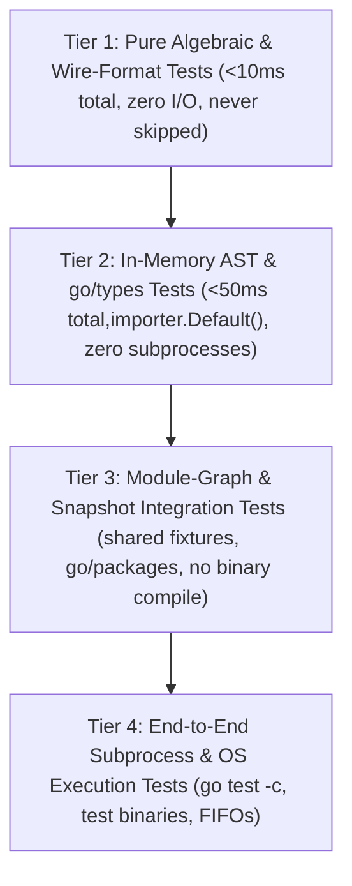

# Audit 07b: Root Package Tests — Part 1 (`ambiguity_test.go` through `gofresh_test.go`)

## 1. Executive Summary & Scope Verification

This report audits the first 26 test files in the root `gofresh` package, comprising **10,474 lines** of Go test code read 100% line-by-line without sampling or skipping:

| # | File | Lines | Primary Subject Area | Setup / Execution Weight |
| :--- | :--- | ---: | :--- | :--- |
| 1 | [`ambiguity_test.go`](file:///home/nikolas/repos/github.com/greatliontech/gofresh/ambiguity_test.go#L1-L270) | 270 | Internal vs external test package symbol collision (`AmbiguousSubjectCause`) | Heavy (`newEngine` + `newView` + `ScanPureDirectives` per test over temp module) |
| 2 | [`analysisbound_test.go`](file:///home/nikolas/repos/github.com/greatliontech/gofresh/analysisbound_test.go#L1-L75) | 75 | `analysisBound` context deadline/cancellation helper | Pure in-memory (`context` + `time`) |
| 3 | [`apihelpers_test.go`](file:///home/nikolas/repos/github.com/greatliontech/gofresh/apihelpers_test.go#L1-L79) | 79 | Ambient test wrappers (`closureNewAt`, `riFromTestLog`, `isolateProofCache`, etc.) | Test plumbing / helpers |
| 4 | [`apisurface_test.go`](file:///home/nikolas/repos/github.com/greatliontech/gofresh/apisurface_test.go#L1-L130) | 130 | AST lint forbidding ambient `os.Environ`/`os.Getenv` in production packages | Fast AST parse (`go/parser`) |
| 5 | [`applicability_batch_test.go`](file:///home/nikolas/repos/github.com/greatliontech/gofresh/applicability_batch_test.go#L1-L86) | 86 | Shared RTA proof analysis across `CheckObservedBatch` after inert extension | Heavy (`writeSupportedViewModule` + 3 `newView` loads) |
| 6 | [`applicability_test.go`](file:///home/nikolas/repos/github.com/greatliontech/gofresh/applicability_test.go#L1-L663) | 663 | `InertTestVariantApplicability` JSON grammar, guard gates, E2E binary + child reload | Mixed: pure unit (L23-175, L586-662) + very heavy E2E subprocess (L177-584) |
| 7 | [`applicability_validation_test.go`](file:///home/nikolas/repos/github.com/greatliontech/gofresh/applicability_validation_test.go#L1-L318) | 318 | `Validate` closing semantics over retained applicability checks | Mixed: 1 PRNG unit test + 5 heavy multi-`newView` tests |
| 8 | [`artifact_bench_test.go`](file:///home/nikolas/repos/github.com/greatliontech/gofresh/artifact_bench_test.go#L1-L65) | 65 | `BenchmarkArtifact` warm-FS capture and validation throughput (4MB, 32MB) | Benchmark (filesystem I/O on scope-only `Snapshot`) |
| 9 | [`artifact_test.go`](file:///home/nikolas/repos/github.com/greatliontech/gofresh/artifact_test.go#L1-L799) | 799 | `BindArtifact`, double-read agreement, inode/symlink identity, `CompileTestBinary`, `Execute` | Mixed: fast FS unit tests (L23-307) + heavy `go test -c` execution tests (L309-798) |
| 10 | [`builddescription_test.go`](file:///home/nikolas/repos/github.com/greatliontech/gofresh/builddescription_test.go#L1-L148) | 148 | `completeBuildEnvironment` & `normalizedGCCFlags` build-config hashing | Pure in-memory + 1 temp `GOENV` file |
| 11 | [`cacheisolation_test.go`](file:///home/nikolas/repos/github.com/greatliontech/gofresh/cacheisolation_test.go#L1-L31) | 31 | `TestMain` isolating `XDG_CACHE_HOME` while preserving `GOCACHE` | Package-wide test harness |
| 12 | [`checking_endpoints_test.go`](file:///home/nikolas/repos/github.com/greatliontech/gofresh/checking_endpoints_test.go#L1-L43) | 43 | `Snapshot.observeRuntimeInputs` & `finishRuntimeObservation` internal test adapters | Test plumbing / helpers |
| 13 | [`checking_test.go`](file:///home/nikolas/repos/github.com/greatliontech/gofresh/checking_test.go#L1-L761) | 761 | `CheckingUnit` rounds, `ExtendInertBatch`, `CheckBatchWithLedgers`, abort/cancellation | Heavy (`NewSession` + `Snapshot` + `go test -c` + `RuntimeBinding`) |
| 14 | [`construction_test.go`](file:///home/nikolas/repos/github.com/greatliontech/gofresh/construction_test.go#L1-L37) | 37 | `newEngineContext` pre-cancelled/nil context and mid-option cancellation attribution | Fast in-memory |
| 15 | [`construction_unix_test.go`](file:///home/nikolas/repos/github.com/greatliontech/gofresh/construction_unix_test.go#L1-L160) | 160 | Unix FIFO vouch non-read on cancel; `sh` shim for `go env -json` cancellation | Medium (`mkfifo`, `sh` subprocesses with 5ms polling loops) |
| 16 | [`cutprovenance_test.go`](file:///home/nikolas/repos/github.com/greatliontech/gofresh/cutprovenance_test.go#L1-L252) | 252 | `Snapshot.Sibling` budget-cut provenance preservation & `FuzzSiblingCutProjection` | Mixed: 1 heavy module test + 1 pure in-memory fuzz test |
| 17 | [`datamemo_test.go`](file:///home/nikolas/repos/github.com/greatliontech/gofresh/datamemo_test.go#L1-L62) | 62 | `sync.Map` data-memo exemption (`REQ-closure-shared-dynamic-state-memo`) | Heavy: 15 subtests each running full `writeViewModule` + `captureCheck` |
| 18 | [`dischargeprefix_test.go`](file:///home/nikolas/repos/github.com/greatliontech/gofresh/dischargeprefix_test.go#L1-L71) | 71 | Sorted discharged culprit prefix before first surviving culprit | Heavy: 2 full module loads (`newEngine` + `newView`) |
| 19 | [`dynamicstate_test.go`](file:///home/nikolas/repos/github.com/greatliontech/gofresh/dynamicstate_test.go#L1-L3046) | 3,046 | Shared dynamic state facts, memoization, vouches, audited stdlib/3p sets, seams, fuzzing | Very heavy: repeated `go list -m`, `go mod tidy`, `file://` GOPROXY, `newView`, plus fast unit/fuzz |
| 20 | [`environment_test.go`](file:///home/nikolas/repos/github.com/greatliontech/gofresh/environment_test.go#L1-L282) | 282 | `withEnv` workspace selection (`GOWORK`), env normalization, `GOPACKAGESDRIVER` pin | Heavy: 6 tests building multi-module `go.work` fixtures + `newEngine`/`newView` |
| 21 | [`explain_test.go`](file:///home/nikolas/repos/github.com/greatliontech/gofresh/explain_test.go#L1-L836) | 836 | `ExplainDynamicState` chains, deferral chains, link cap, hooks, `CulpritFromReason` | Mostly heavy: 24 full `writeModuleTree` + `newEngine` + `newView` + `ExplainDynamicState` runs |
| 22 | [`explainorder_test.go`](file:///home/nikolas/repos/github.com/greatliontech/gofresh/explainorder_test.go#L1-L272) | 272 | `ExplainDynamicState` link ordering, cycles, scope boundaries, insertion edges | Mixed: 5 heavy `explainView` runs + 2 pure in-memory `envAuditTrail` tests |
| 23 | [`fieldstore_test.go`](file:///home/nikolas/repos/github.com/greatliontech/gofresh/fieldstore_test.go#L1-L79) | 79 | Closed unexported interface field dispatch (`REQ-closure-shared-dynamic-state-receiver-proof`) | Very heavy: 23 parallel subtests each doing `writeViewModule` + `captureCheck` |
| 24 | [`fingerprint_record_test.go`](file:///home/nikolas/repos/github.com/greatliontech/gofresh/fingerprint_record_test.go#L1-L342) | 342 | `Fingerprint` canonical JSON wire format, round-trip property, refusal grammar | Pure in-memory |
| 25 | [`genericview_test.go`](file:///home/nikolas/repos/github.com/greatliontech/gofresh/genericview_test.go#L1-L86) | 86 | Generic function openness on type parameters at the view tier | Heavy (`newEngine` + `newView` + RTA over temp module) |
| 26 | [`gofresh_test.go`](file:///home/nikolas/repos/github.com/greatliontech/gofresh/gofresh_test.go#L1-L1481) | 1,481 | `decide` table & fuzzing, `Fingerprint` data shape, strategy pins, build flags, directives, 4 large fuzz suites | Mixed: pure in-memory unit/fuzz tests + 12 heavy `newEngine` module tests |
| **Total** | **26 files** | **10,474** | | |

---

## 2. Top-Level Architectural & Testing Findings

1. **Massive Overuse of Full-Engine / `go/packages` Subprocess Loads for AST/Types-Local Invariants**:
   - [`datamemo_test.go`](file:///home/nikolas/repos/github.com/greatliontech/gofresh/datamemo_test.go#L14-L61) spawns **15 separate temp modules** and runs full `newEngine` + `newView` + `Capture` + `Check` (`go env`, `go list`, `go/packages`, SSA/RTA, guard capture) just to test whether `dynamicStateFactOf` marks a package-level `sync.Map` variable!
   - [`fieldstore_test.go`](file:///home/nikolas/repos/github.com/greatliontech/gofresh/fieldstore_test.go#L16-L78) spawns **23 parallel temp modules** and runs full `newEngine` + `newView` + `Capture` + `Check` just to test single-package closed interface field store rules in `dynamicStateFactOf` + `composeDynamicState`!
   - [`explain_test.go`](file:///home/nikolas/repos/github.com/greatliontech/gofresh/explain_test.go#L56-L517) and [`explainorder_test.go`](file:///home/nikolas/repos/github.com/greatliontech/gofresh/explainorder_test.go#L15-L271) run **29 full temp-module engine + view + explain loads** (`newEngine`, `newView`, `Capture`, `Check`, and a second `packages.Load` inside `ExplainDynamicState`) for single-package 15-line snippets that can be typechecked in memory via `go/parser` + `go/types` in <1ms (exactly as [`TestBracketedSeamNodes`](file:///home/nikolas/repos/github.com/greatliontech/gofresh/dynamicstate_test.go#L2280-L2712) and [`TestExplainCarrierLinkedCulpritAndCallResultNonLink`](file:///home/nikolas/repos/github.com/greatliontech/gofresh/explain_test.go#L682-L784) already demonstrate!).
   - [`dynamicstate_test.go`](file:///home/nikolas/repos/github.com/greatliontech/gofresh/dynamicstate_test.go#L1577-L1987) runs **16 full `writePinnedDepModule` (`go list -m` + `go mod tidy` subprocesses) + `runScan` cycles** in `TestMalformedAttributedUseMarksEveryDeclaredKey`, `TestMalformedCarrierLinkMarksEveryDeclaredKey`, `TestMalformedParamUseMarksEveryDeclaredKey`, `TestMalformedFieldParamUseMarksEveryDeclaredKey`, and `TestMalformedFieldPopulationRecordsMarkEveryDeclaredKey` (11 subtests!) **solely to poison an in-memory `dynamicStateFact` struct and call `composeDynamicState`!** None of those 16 tests depend on `golang.org/x/sync/errgroup` or `go mod tidy` at all — they literally load `errgroup` from disk just to overwrite its cached `dynamicStateFact` in `processFactCache` and run `composeDynamicState`!

2. **Split-Brain Test Organization Across Artificial File Boundaries**:
   - **Explain Split**: [`explain_test.go`](file:///home/nikolas/repos/github.com/greatliontech/gofresh/explain_test.go#L1-L836) and [`explainorder_test.go`](file:///home/nikolas/repos/github.com/greatliontech/gofresh/explainorder_test.go#L1-L272) test the exact same `ExplainDynamicState`, `envAuditTrail`, and `boundChain` functions using the exact same `explainView` helper and near-identical `example.com/explain/reg` fixtures. Even worse, [`TestExplainEnvAuditOutsideScopeEndsAtEdges`](file:///home/nikolas/repos/github.com/greatliontech/gofresh/explainorder_test.go#L165-L187) and [`TestExplainEnvAuditInsertionChain`](file:///home/nikolas/repos/github.com/greatliontech/gofresh/explainorder_test.go#L193-L230) in `explainorder_test.go` have `if testing.Short() { t.Skip("builds a module fixture and runs the engine over it") }` copy-pasted at the top even though **they are pure in-memory unit tests that do not touch the filesystem or engine at all!**
   - **Applicability Split**: [`applicability_test.go`](file:///home/nikolas/repos/github.com/greatliontech/gofresh/applicability_test.go#L1-L663), [`applicability_batch_test.go`](file:///home/nikolas/repos/github.com/greatliontech/gofresh/applicability_batch_test.go#L1-L86), and [`applicability_validation_test.go`](file:///home/nikolas/repos/github.com/greatliontech/gofresh/applicability_validation_test.go#L1-L318) all test `InertTestVariantApplicability` and `Snapshot.Validate` over inert extensions, while [`checking_test.go`](file:///home/nikolas/repos/github.com/greatliontech/gofresh/checking_test.go#L94-L507) re-tests inert extension through `CheckingUnit.ExtendInertBatch`, `CheckBatchWithLedgers`, and `CheckWithLedger` using an almost identical fixture (`newCheckingFixture` vs `newApplicabilityValidationFixture`).
   - **Dynamic-State Split**: [`datamemo_test.go`](file:///home/nikolas/repos/github.com/greatliontech/gofresh/datamemo_test.go#L1-L62), [`fieldstore_test.go`](file:///home/nikolas/repos/github.com/greatliontech/gofresh/fieldstore_test.go#L1-L79), and [`dischargeprefix_test.go`](file:///home/nikolas/repos/github.com/greatliontech/gofresh/dischargeprefix_test.go#L1-L71) are single-function test files that belong directly to the dynamic-state fact derivation and composition suite in [`dynamicstate_test.go`](file:///home/nikolas/repos/github.com/greatliontech/gofresh/dynamicstate_test.go#L1-L3046).
   - **Fingerprint Record Split**: [`fingerprint_record_test.go`](file:///home/nikolas/repos/github.com/greatliontech/gofresh/fingerprint_record_test.go#L1-L342) tests `Fingerprint` JSON marshaling/unmarshaling, while [`TestInertApplicabilityRecordGrammar`](file:///home/nikolas/repos/github.com/greatliontech/gofresh/applicability_test.go#L23-L68) in `applicability_test.go` and [`TestFingerprintDataShape`](file:///home/nikolas/repos/github.com/greatliontech/gofresh/gofresh_test.go#L202-L264) / [`TestPropCommitIdentityAbsent`](file:///home/nikolas/repos/github.com/greatliontech/gofresh/gofresh_test.go#L328-L335) in `gofresh_test.go` test the exact same `Fingerprint` struct and JSON grammar.

3. **Legacy Unexported `engine` / `newView` Surface vs Public `Session` / `Snapshot` / `RuntimeBinding` Surface**:
   - Most older tests (`ambiguity_test.go`, `applicability_batch_test.go`, `applicability_test.go`, `applicability_validation_test.go`, `cutprovenance_test.go`, `datamemo_test.go`, `dischargeprefix_test.go`, `dynamicstate_test.go`, `environment_test.go`, `explain_test.go`, `fieldstore_test.go`, `genericview_test.go`, `gofresh_test.go`) bypass the public `NewSession` / `Session.Snapshot` / `Snapshot.BindRuntime` API and call unexported legacy helpers (`newEngine`, `withDir`, `withEnv`, `engine.newView`, `e.capture`, `e.check`).
   - Meanwhile, newer tests (`artifact_test.go`, `checking_test.go`, and `FuzzControlAndSessionAuthority` in `gofresh_test.go`) exercise `NewSession`, `Snapshot`, `RuntimeBinding`, `CheckingUnit`, and `ProducingUnit`. This dual surface means internal test shims (`newEngine`, `e.capture`, `e.check`, `checking_endpoints_test.go`) are kept alive solely to support legacy test call sites.

4. **Copy-Pasted False `testing.Short()` Skips on Pure In-Memory Tests**:
   - In [`explainorder_test.go`](file:///home/nikolas/repos/github.com/greatliontech/gofresh/explainorder_test.go#L165-L230), both `TestExplainEnvAuditOutsideScopeEndsAtEdges` and `TestExplainEnvAuditInsertionChain` skip under `-short` with `"builds a module fixture and runs the engine over it"`, despite constructing in-memory `dynamicStateFact` structs and calling `envAuditTrail` directly in microseconds.
   - In [`gofresh_test.go`](file:///home/nikolas/repos/github.com/greatliontech/gofresh/gofresh_test.go#L432-L452), `TestBuildInputsRejectFlags` and `TestBuildFlagsRejectOverlay` skip under `-short` even though flag rejection happens synchronously before any module fixture is built or loaded.
   - In [`environment_test.go`](file:///home/nikolas/repos/github.com/greatliontech/gofresh/environment_test.go#L184-L200), the malformed environment rejection table inside `TestWithEnvCopiesNormalizesAndRejectsAmbiguity` is gated behind `-short` only because it is bundled into the same test function as two heavy `writeWorkspaceEnvironmentFixture` + `newView` checks.

5. **Global Mutable State & Hook Contention Hazards**:
   - Tests mutate package-global `viewTestHooks` (`analysisBound`, `observe`, `beforeDischarge`, `beforeAnalysis`, `runtimeWindow`, `scanMemoOff`, `dynamicStateMissLoad`), `processFactCache`, and `explainHooks` (atomic pointer), as well as process working directory (`os.Chdir` in [`TestDefaultDirIsFrozenAtEngineConstruction`](file:///home/nikolas/repos/github.com/greatliontech/gofresh/gofresh_test.go#L608-L632)) and process environment (`t.Setenv`).
   - Meanwhile, [`fieldstore_test.go`](file:///home/nikolas/repos/github.com/greatliontech/gofresh/fieldstore_test.go#L47-L77) marks all 25 of its subtests with `t.Parallel()`! Running `t.Parallel()` subtests that invoke `newEngine` / `newView` (which read/write `processFactCache`, `viewTestHooks`, and `explainHooks`) alongside tests that mutate `viewTestHooks` or `t.Setenv` is fragile and only avoids races because top-level tests happen not to call `t.Parallel()`.

---

## 3. Exhaustive File-by-File & Test-by-Test Inventory

### 3.1 [`ambiguity_test.go`](file:///home/nikolas/repos/github.com/greatliontech/gofresh/ambiguity_test.go#L1-L270) (270 lines)

Tests subject-local refusal when a top-level symbol name (e.g., `mustHelper`) is declared in both an internal test file (`package amb`) and an external test file (`package amb_test`) in the same directory.

#### Helpers
- [`writeSharedHelperFixture`](file:///home/nikolas/repos/github.com/greatliontech/gofresh/ambiguity_test.go#L15-L61) (L15–61): Writes `go.mod`, `lib.go` (`Compute`), `internal_test.go` (`package amb`, `mustHelper`, `TestInternal`), and `external_test.go` (`package amb_test`, `mustHelper`, `TestExternal`) to `t.TempDir()`.
- [`mustCapture`](file:///home/nikolas/repos/github.com/greatliontech/gofresh/ambiguity_test.go#L262-L269) (L262–269): Calls `view.Capture(context.Background(), subject)` and fails on error.

#### Tests
| Test Function | Lines | Witnessed Invariant / `REQ-*` | Setup Mechanism | Overlap & Efficiency Analysis |
| :--- | :--- | :--- | :--- | :--- |
| [`TestSharedTestHelperNameKeepsPackageMeasurable`](file:///home/nikolas/repos/github.com/greatliontech/gofresh/ambiguity_test.go#L69-L97) | L69–97 | `REQ-purity-directive` refusal scope: colliding helper `mustHelper` does not degrade unambiguous siblings (`Compute`, `TestInternal`, `TestExternal`). | `writeSharedHelperFixture` + `newEngine` + `newView` + `CaptureObserved`. | **Redundant `newView` load**: `TestAmbiguousSubjectItselfIsRefusedCaptureAlone` (L103–151) already builds a view with `Compute` alongside `mustHelper` and asserts `Compute` is not degraded (L144–150). |
| [`TestAmbiguousSubjectItselfIsRefusedCaptureAlone`](file:///home/nikolas/repos/github.com/greatliontech/gofresh/ambiguity_test.go#L103-L151) | L103–151 | `REQ-purity-directive`: requesting `mustHelper` itself yields `!Observable`, `Unverifiable` with `AmbiguousSubjectCause` naming both `internal_test.go` and `external_test.go`, and empty `PurityAssertion`. | `writeSharedHelperFixture` + `newEngine` + `newView` + `CaptureObserved` + `CheckObserved`. | Supersedes `TestSharedTestHelperNameKeepsPackageMeasurable` if `TestInternal` and `TestExternal` are included in the same subject list. |
| [`TestAmbiguousSubjectCallerAssertionConfersNothing`](file:///home/nikolas/repos/github.com/greatliontech/gofresh/ambiguity_test.go#L156-L178) | L156–178 | `REQ-purity-directive`, `REQ-purity-responsibility`: `withAssumePure(true)` does not attribute `PurityAssertion` to an ambiguous subject. | Full `writeSharedHelperFixture` + `newEngine(withAssumePure)` + `newView` + `Capture`. | Spins up an entire `go/packages` + SSA view load just to test the guard `if ambiguous { purity = "" }` when `withAssumePure` is set. Could be combined into one fixture load. |
| [`TestAmbiguousSubjectDirectiveConfersNothing`](file:///home/nikolas/repos/github.com/greatliontech/gofresh/ambiguity_test.go#L183-L224) | L183–224 | `REQ-purity-directive`, `REQ-purity-responsibility`: `//gofresh:pure` on one colliding declaration confers neither `PurityAssertion` on `Capture` nor `true` from `ScanPureDirectives`. | Full `writeSharedHelperFixture` + `newEngine` + `newView` + `Capture` + `scanPureDirectivesIn`. | Runs **two** `go/packages` loads (one in `newView`, one in `ScanPureDirectives`). |
| [`TestAmbiguousSubjectExternalDirectiveConfersNothing`](file:///home/nikolas/repos/github.com/greatliontech/gofresh/ambiguity_test.go#L229-L260) | L229–260 | `REQ-purity-directive`: `//gofresh:external` on one colliding declaration still reports `ambiguous` rather than `external directive`. | Full `writeSharedHelperFixture` + `newEngine` + `newView` + `Capture` + `Check`. | All 5 tests in `ambiguity_test.go` compile/load the exact same 4-file module 6 times; consolidating into 1–2 table-driven module loads cuts 70% of `go/packages` invocations. |

---

### 3.2 [`analysisbound_test.go`](file:///home/nikolas/repos/github.com/greatliontech/gofresh/analysisbound_test.go#L1-L75) (75 lines)

Tests the unexported `analysisBound(parent, budget)` context deadline helper.

#### Tests
| Test Function | Lines | Witnessed Invariant / `REQ-*` | Setup Mechanism | Overlap & Efficiency Analysis |
| :--- | :--- | :--- | :--- | :--- |
| [`TestAnalysisBoundPreservesDeadlineContract`](file:///home/nikolas/repos/github.com/greatliontech/gofresh/analysisbound_test.go#L12-L74) | L12–74 | `REQ-fresh-context`: subtests `"requested duration"` (L17–31), `"actual expiry"` (L32–43), `"unbounded preserves parent"` (L44–52), `"parent cancellation"` (L53–62), `"earlier parent deadline"` (L63–73). | Pure in-memory `context` + `time`; clears `viewTestHooks.analysisBound`. | Clean, fast Tier 1 unit test. Complements `TestDischargeCutClassifiesByTheTwoContexts` in `dynamicstate_test.go` (L2260–2278). |

---

### 3.3 [`apihelpers_test.go`](file:///home/nikolas/repos/github.com/greatliontech/gofresh/apihelpers_test.go#L1-L79) (79 lines)

Contains package-level test convenience wrappers that inject `context.Background()` and `os.Environ()` into public subpackage entrypoints.

#### Helpers
- [`closureNewAt`](file:///home/nikolas/repos/github.com/greatliontech/gofresh/apihelpers_test.go#L16-L18) (L16–18): Wraps `closure.NewAt` with `context.Background()` and `gotool.NewEnvReader(..., os.Environ())`.
- [`riFromTestLog`](file:///home/nikolas/repos/github.com/greatliontech/gofresh/apihelpers_test.go#L20-L22) (L20–22): Wraps `runtimeinput.FromTestLog` with `os.Environ()`.
- [`riCaptureBracket`](file:///home/nikolas/repos/github.com/greatliontech/gofresh/apihelpers_test.go#L24-L26) (L24–26): Wraps `runtimeinput.CaptureBracket` with `context.Background()`.
- [`closureNewAtEnv`](file:///home/nikolas/repos/github.com/greatliontech/gofresh/apihelpers_test.go#L28-L30) (L28–30): Wraps `closure.NewAt` with explicit `ctx` and `env`.
- [`scanPureDirectives`](file:///home/nikolas/repos/github.com/greatliontech/gofresh/apihelpers_test.go#L32-L34) (L32–34): Wraps `ScanPureDirectives("", os.Environ(), nil, ...)`.
- [`scanPureDirectivesIn`](file:///home/nikolas/repos/github.com/greatliontech/gofresh/apihelpers_test.go#L36-L38) (L36–38): Wraps `ScanPureDirectives(dir, os.Environ(), nil, ...)`.
- [`closureLoadViewPackagesEnv`](file:///home/nikolas/repos/github.com/greatliontech/gofresh/apihelpers_test.go#L40-L42) (L40–42): Wraps `closure.LoadViewPackages` with `gotool.NewEnvReader`.
- [`riCurrentCtx`](file:///home/nikolas/repos/github.com/greatliontech/gofresh/apihelpers_test.go#L44-L46) (L44–46): Wraps `runtimeinput.Current` with `os.Environ()`.
- [`cgoEnabled`](file:///home/nikolas/repos/github.com/greatliontech/gofresh/apihelpers_test.go#L51-L58) (L51–58): Runs `(gotool.Runner{}).TakeEnvSnapshot` to check `CGO_ENABLED == "1"`.
- [`isolateProofCache`](file:///home/nikolas/repos/github.com/greatliontech/gofresh/apihelpers_test.go#L60-L68) (L60–68): Preserves `GOCACHE` via `testenv.GoBuildCache` and sets `XDG_CACHE_HOME` to `t.TempDir()`.
- [`unauditedTagEnv`](file:///home/nikolas/repos/github.com/greatliontech/gofresh/apihelpers_test.go#L74-L78) (L74–78): Delegates to `testenv.UnauditedTagGOROOTEnv(t, environmentWith(nil))`.

---

### 3.4 [`apisurface_test.go`](file:///home/nikolas/repos/github.com/greatliontech/gofresh/apisurface_test.go#L1-L130) (130 lines)

AST static check verifying that production packages (`guard`, `runtimeinput`, `closure`, `gotool`, `internal`, and `purity.go`) never call ambient environment readers (`os.Environ`, `os.Getenv`, `os.LookupEnv`, `os.ExpandEnv`, `syscall.Environ`, `syscall.Getenv`).

#### Helpers & Tests
- [`ambientReads`](file:///home/nikolas/repos/github.com/greatliontech/gofresh/apisurface_test.go#L50-L81) (L50–81): Parses Go files with `go/parser` and inspects `ast.CallExpr` for `os.*` / `syscall.*` ambient environment reads.
- [`TestPublicPackagesReadNoAmbientEnvironment`](file:///home/nikolas/repos/github.com/greatliontech/gofresh/apisurface_test.go#L24-L46) (L24–46): Witness for `REQ-closure-analysis` explicit environment input; walks `guard`, `runtimeinput`, `closure`, `gotool`, `internal`, and `purity.go`. Marked `//gofresh:pure`.
- [`TestAmbientReadsNameEveryAmbientReader`](file:///home/nikolas/repos/github.com/greatliontech/gofresh/apisurface_test.go#L90-L129) (L90–129): Meta-test over synthetic `dirty.go` and `clean.go` in `t.TempDir()` verifying `ambientReads` catches all 6 forbidden calls and ignores a method `.Environ()` on a custom struct. Marked `//gofresh:pure`.

---

### 3.5 [`applicability_batch_test.go`](file:///home/nikolas/repos/github.com/greatliontech/gofresh/applicability_batch_test.go#L1-L86) (86 lines)

Single-test file checking that `Snapshot.CheckObservedBatch` shares one RTA precise analysis pass across multiple subjects whose fingerprints carry `InertTestVariantApplicability`.

#### Tests
| Test Function | Lines | Witnessed Invariant / `REQ-*` | Setup Mechanism | Overlap & Efficiency Analysis |
| :--- | :--- | :--- | :--- | :--- |
| [`TestObservedApplicabilityBatchSharesCurrentProofAnalysis`](file:///home/nikolas/repos/github.com/greatliontech/gofresh/applicability_batch_test.go#L10-L85) | L10–85 | `REQ-fresh-applicability-transform`, `REQ-fresh-observation-lifecycle`: `CheckObservedBatch` over 2 inertly extended subjects runs `beforePreciseAnalysis` exactly once (`analyses == 1`). | `writeSupportedViewModule` + 3 `engine.newView` loads (`producer`, `extending`, `checking`). | **Direct overlap** with `applicability_validation_test.go` (`TestApplicabilityValidationSharesCompatibleBatches`, L245–284) and `checking_test.go` (`TestCheckingUnitCandidatesAndLifecycle` subtest `"historical admission stays candidate local"`, L196–232). Uses legacy `CheckObservedBatch` instead of `CheckingUnit`. Should be merged into `applicability_test.go` or `checking_test.go`. |

---

### 3.6 [`applicability_test.go`](file:///home/nikolas/repos/github.com/greatliontech/gofresh/applicability_test.go#L1-L663) (663 lines)

Tests `InertTestVariantApplicability` JSON encoding/decoding, algebraic guard requirements for inert extension, end-to-end benchmark execution + multi-step inert extension + child-process JSON reload, and seal/cancellation/runtime-drift behavior during inert extension.

#### Types & Helpers
- [`applicabilityFixture`](file:///home/nikolas/repos/github.com/greatliontech/gofresh/applicability_test.go#L70-L77) (L70–77): Pure in-memory constructor returning a synthetic `*Snapshot`, `Fingerprint`, `Subject`, and `TestVariantLedger`.
- [`applicabilityStoredPair`](file:///home/nikolas/repos/github.com/greatliontech/gofresh/applicability_test.go#L535-L539) (L535–539): Struct bundling `{Fingerprint, Ledger, Subject}` for JSON persistence across child process invocation.

#### Tests
| Test Function | Lines | Witnessed Invariant / `REQ-*` | Setup Mechanism | Overlap & Efficiency Analysis |
| :--- | :--- | :--- | :--- | :--- |
| [`TestInertApplicabilityRecordGrammar`](file:///home/nikolas/repos/github.com/greatliontech/gofresh/applicability_test.go#L23-L68) | L23–68 | `REQ-fresh-fingerprint-record`, `REQ-fresh-applicability-transform`: JSON grammar for `inertTestVariantApplicability` (14 malformed JSON strings rejected, partial struct marshaling rejected, unknown strategy decodes but yields `Stale` in `recordedEvidenceVerdict`). | Pure in-memory (`fullFingerprint()`, `json.Marshal`/`Unmarshal`, `recordedEvidenceVerdict`). | Belongs in `fingerprint_record_test.go` (which already uses `fullFingerprint()` and tests `InertTestVariantApplicability` shape and round-trip!). Also duplicated in `FuzzFreshnessVerdictAndObservationInvariants` (L1341–1345 of `gofresh_test.go`). |
| [`TestInertExtensionRequiresEveryGuardAndRecognizedEvidence`](file:///home/nikolas/repos/github.com/greatliontech/gofresh/applicability_test.go#L79-L175) | L79–175 | `REQ-fresh-applicability-transform`, `REQ-closure-test-variant-inert`: 18-case perturbation table over `applicabilityFixture` (core, missing core, missing compartment, closure/dynamic strategy, toolchain/content/build/machine/runtime guards, missing runtime manifest, unknown endpoint, missing/unknown binding strategy, removed declaration, external, unverifiable), plus ordinary/pure happy paths and `"sibling test edit or removal is inert for subject"` (L150–174). | Pure in-memory `applicabilityFixture`. | Excellent, fast Tier 1 algebraic test (runs in <1ms). |
| [`TestInertExtensionPreservesSupportedExecutionAcrossRestarts`](file:///home/nikolas/repos/github.com/greatliontech/gofresh/applicability_test.go#L177-L533) | L177–533 | `REQ-fresh-applicability-transform`, `REQ-fresh-observation-conjunction`, `REQ-fresh-unit-close`: E2E benchmark compile (`go test -c`) + run + `PrepareOutcomeSupport`/`frame.Observe`, two rounds of adding sibling tests (`TestArithmetic`, `TestMoreArithmetic`) + `CheckObservedInertTestVariantExtension` + spawning `os.Args[0] -test.run=^TestApplicabilityCheckerReload$`, followed by `"stable checking"` subtests (L359–515: `"missing support"`, `"independent purity"`, 8 `"damaged ..."` cases, `"environment drift"`, `"current cut"`, `"current unsupported"`, `"current budget cut"`, `"deferred validation"`, `"sibling validation"`, `"publication seal"`) and source-drift checks (L516–532). | **Extremely heavy**: `go test -c`, benchmark execution, **2 child `go test` subprocess spawns**, and **~24 full `engine.newViewFor` package loads**! | **Major optimization opportunity**: The 8 `"damaged ..."` subtests (L384–406), `"missing support"` (L360–367), `"current cut"` / `"current unsupported"` (L415–424), and `"publication seal"` (L466–514) each call `damageEngine.newViewFor` (doing a full `go/packages` load + guard capture) just to test in-memory `admittedObservation` / `compatibleObservationProof` / `sealed` checks that are already tested in-memory in `TestInertExtensionCannotPublishAcrossConcurrentValidation` (L600–635) and `FuzzFreshnessVerdictAndObservationInvariants` (`gofresh_test.go` L1128–1149)! |
| [`TestApplicabilityCheckerReload`](file:///home/nikolas/repos/github.com/greatliontech/gofresh/applicability_test.go#L541-L584) | L541–584 | Child-process helper invoked via `GOFRESH_CHECKER_RECORD` env var from `TestInertExtensionPreservesSupportedExecutionAcrossRestarts`. | Reads JSON file, runs `newEngine` + `newViewFor` + `Check` + `CheckObserved` + `TestVariantLedger` + `Validate`. | Subprocess reload adds little over in-process `json.Marshal` + `json.Unmarshal` into a fresh `Engine`/`Session` (since `Engine` state is already isolated per instance). |
| [`TestInertExtensionHonorsSealAndCancellation`](file:///home/nikolas/repos/github.com/greatliontech/gofresh/applicability_test.go#L586-L598) | L586–598 | `REQ-fresh-unit-close`, `REQ-fresh-context`: `CheckInertTestVariantExtension` refuses with `ErrViewSealed` when `v.sealed == true` and `context.Canceled` when `ctx` is cancelled. | Pure in-memory `applicabilityFixture`. | Fast Tier 1 unit test. |
| [`TestInertExtensionCannotPublishAcrossConcurrentValidation`](file:///home/nikolas/repos/github.com/greatliontech/gofresh/applicability_test.go#L600-L635) | L600–635 | `REQ-fresh-unit-close`: concurrent `Validate` (even when cancelled) seals the view so in-flight `checkInertTestVariantExtension` returns `ErrViewSealed` and zero `Fingerprint`/`TestVariantLedger`. | Pure in-memory `applicabilityFixture` + channels. | Fast Tier 1 concurrency test. Note how this tests the exact same seal invariant as L466–514 (`"publication seal"`) in `TestInertExtensionPreservesSupportedExecutionAcrossRestarts`, but in <1ms without `go/packages`! |
| [`TestInertExtensionRechecksRuntimeAndProofEvidence`](file:///home/nikolas/repos/github.com/greatliontech/gofresh/applicability_test.go#L637-L662) | L637–662 | `REQ-fresh-coherent-view`: `CheckObservedInertTestVariantExtension` refuses when `runtimeCurrent` returns `!OK`, moved digest, or `Unverifiable`, and returns `Stale` when `runtimeCurrent` moves between its two endpoint observations. | Pure in-memory `applicabilityFixture` + custom `v.runtimeCurrent`. | Fast Tier 1 unit test. |

---

### 3.7 [`applicability_validation_test.go`](file:///home/nikolas/repos/github.com/greatliontech/gofresh/applicability_validation_test.go#L1-L318) (318 lines)

Tests `Snapshot.Validate` closing semantics over retained `applicabilityChecks` (error precedence between `ErrViewChanged` and `ErrAnalysisUnavailable`, batch sharing of RTA proofs and runtime windows, and distinct historical manifests for the same subject).

#### Types & Helpers
- [`applicabilityValidationFixture`](file:///home/nikolas/repos/github.com/greatliontech/gofresh/applicability_validation_test.go#L42-L49) (L42–49), [`newApplicabilityValidationFixture`](file:///home/nikolas/repos/github.com/greatliontech/gofresh/applicability_validation_test.go#L51-L123) (L51–123), [`view`](file:///home/nikolas/repos/github.com/greatliontech/gofresh/applicability_validation_test.go#L125-L132) (L125–132), [`extend`](file:///home/nikolas/repos/github.com/greatliontech/gofresh/applicability_validation_test.go#L134-L140) (L134–140): Builds a module (`TestRead`, `TestOther`, `PureA`, `PureB`, `TestReadsFile`), captures observed batch + a separate file-guarded `fileRecord` for `PureA`, appends `TestArithmetic`, and provides `view()` and `extend()` helpers. **Note**: `newApplicabilityValidationFixture` alone performs **2 full `newView` + `Validate` cycles** (4 `go/packages` observations) every time one of the 5 tests below calls it!

#### Tests
| Test Function | Lines | Witnessed Invariant / `REQ-*` | Setup Mechanism | Overlap & Efficiency Analysis |
| :--- | :--- | :--- | :--- | :--- |
| [`TestApplicabilityBatchesPreserveRecordsAndPolicies`](file:///home/nikolas/repos/github.com/greatliontech/gofresh/applicability_validation_test.go#L18-L40) | L18–40 | `applicabilityRecords(checks)` preserves candidate order, `Recorded`, `Subject`, and `observed` policy across 300 PRNG draws. | Pure in-memory PRNG (`rand.NewSource(18341)`). | Fast Tier 1 property test. |
| [`TestApplicabilityValidationDefersUnavailableUntilAllObligationsClose`](file:///home/nikolas/repos/github.com/greatliontech/gofresh/applicability_validation_test.go#L142-L175) | L142–175 | `REQ-fresh-unit-exclusion`: when subject A's current proof cuts on budget (`ErrAnalysisUnavailable`), `Validate` still checks subject `PureA`'s runtime inputs so `ErrViewChanged` wins over `ErrAnalysisUnavailable`. | `newApplicabilityValidationFixture` + 2 subtests (`separate policies`, `same observed batch`), each running `f.view(t)` + 2 `v.Validate(ctx)` calls. | Tests the same `deferValidationUnavailability` precedence rule as `TestProducerUnavailabilityDoesNotSkipRetainedApplicability` (L177–209), `TestApplicabilityValidationClosesSourceAfterUnavailableProof` (L211–243), and `FuzzPreparationAndUnitCoherence` (`gofresh_test.go` L1470–1477). |
| [`TestProducerUnavailabilityDoesNotSkipRetainedApplicability`](file:///home/nikolas/repos/github.com/greatliontech/gofresh/applicability_validation_test.go#L177-L209) | L177–209 | `REQ-fresh-unit-exclusion`: a producer proof cut during `Validate` does not skip retained `applicabilityChecks`, so runtime drift on `PureA` still reports `ErrViewChanged`. | `newApplicabilityValidationFixture` + `f.view(t)` + `CaptureObservedBatch` + 2 `Validate` calls. | Shares the exact same `newApplicabilityValidationFixture` setup as the other 4 tests; fixture could be constructed once and shared across subtests. |
| [`TestApplicabilityValidationClosesSourceAfterUnavailableProof`](file:///home/nikolas/repos/github.com/greatliontech/gofresh/applicability_validation_test.go#L211-L243) | L211–243 | `REQ-fresh-unit-exclusion`, `REQ-fresh-unit-close`: source drift injected during the second runtime phase after a proof budget cut still reports `ErrViewChanged` rather than `ErrAnalysisUnavailable`. | `newApplicabilityValidationFixture` + `f.view(t)` + `Validate` with `f.engine.progress` hook mutating `observed_test.go`. | Could share the base fixture from `newApplicabilityValidationFixture` before the final source mutation. |
| [`TestApplicabilityValidationSharesCompatibleBatches`](file:///home/nikolas/repos/github.com/greatliontech/gofresh/applicability_validation_test.go#L245-L284) | L245–284 | `Validate` over 4 extended subjects (2 observed, 2 ordinary) performs 1 analysis, 1 runtime window, 2 runtime phases, and 2 manifest reads (1 per endpoint). | `newApplicabilityValidationFixture` + 2 `f.view(t)` + `Validate` + `validateApplicabilityBatches`. | Overlaps with `TestObservedApplicabilityBatchSharesCurrentProofAnalysis` in `applicability_batch_test.go` and `checking_test.go` L233–263. |
| [`TestApplicabilityValidationPreservesDistinctRecordsOfOneSubject`](file:///home/nikolas/repos/github.com/greatliontech/gofresh/applicability_validation_test.go#L286-L317) | L286–317 | Extending two distinct historical fingerprints (`f.recorded[PureA]` and `f.fileRecord`) for the same subject retains both in `v.applicabilityChecks` regardless of registration order. | `newApplicabilityValidationFixture` + 2 loop iterations (`fileFirst = false, true`) each calling `f.view(t)` and 2 `Validate` calls. | The registration and runtime-read logic (`validateApplicabilityBatches`) can be tested on a synthetic `Snapshot` with a mock `runtimeCurrent` in <1ms instead of running 6 full `go/packages` view loads! |

---

### 3.8 [`artifact_bench_test.go`](file:///home/nikolas/repos/github.com/greatliontech/gofresh/artifact_bench_test.go#L1-L65) (65 lines)

Benchmarks `Snapshot.BindArtifact` (double-read capture + SHA-256 + owned byte slice) and `inspected.validate` (streaming reopen comparison) over warm-filesystem 4 MiB and 32 MiB files.

#### Benchmarks
- [`BenchmarkArtifact`](file:///home/nikolas/repos/github.com/greatliontech/gofresh/artifact_bench_test.go#L18-L64) (L18–64): Uses a lightweight scope-only `Snapshot` (`&Snapshot{session: &Session{...}, packages: []string{pkg}}`) without invoking the Go toolchain. Marked `//gofresh:pure`. Well-isolated benchmark.

---

### 3.9 [`artifact_test.go`](file:///home/nikolas/repos/github.com/greatliontech/gofresh/artifact_test.go#L1-L799) (799 lines)

Tests `Snapshot.BindArtifact`, `BindBuilt`, `BindArtifactByDigest`, `CompileTestBinary`, `RuntimeBinding.Execute`, `ProducingUnit.Execute`, double-observation agreement during artifact capture, streaming 64 KiB chunk boundary comparison, symlink parent coordinate preservation, and closing validation of retained artifacts.

#### Types & Helpers
- [`artifactScopeFixture`](file:///home/nikolas/repos/github.com/greatliontech/gofresh/artifact_test.go#L23-L27) (L23–27): Returns a fast, scope-only `*Snapshot` rooted at `t.TempDir()` without invoking `go/packages`.
- [`writeArtifactFixture`](file:///home/nikolas/repos/github.com/greatliontech/gofresh/artifact_test.go#L29-L34) (L29–34): Writes bytes to `path` with mode `0600`.
- [`artifactProbeContext`](file:///home/nikolas/repos/github.com/greatliontech/gofresh/artifact_test.go#L219-L229) (L219–229): Custom `context.Context` wrapper counting `Err()` calls and firing a `probe(checks)` callback to deterministically inject cancellation or file mutation at exact read boundaries.

#### Tests
| Test Function | Lines | Witnessed Invariant / `REQ-*` | Setup Mechanism | Overlap & Efficiency Analysis |
| :--- | :--- | :--- | :--- | :--- |
| [`TestArtifactCaptureAndPersistentMotion`](file:///home/nikolas/repos/github.com/greatliontech/gofresh/artifact_test.go#L36-L100) | L36–100 | `BindArtifact` captures an owned immutable byte copy and SHA-256 digest; `inspected.validate` accepts `"unchanged"` and returns `ErrViewChanged` on `"content"`, `"same size and time"`, `"same-byte replacement"` (new inode while old FD held open), `"removed"`, and `"directory"`. | Fast `artifactScopeFixture` (no toolchain). | Model Tier 1/2 filesystem unit test: uses `artifactScopeFixture` to avoid `go/packages` overhead. |
| [`TestArtifactCoordinatePreservesSymlinkParent`](file:///home/nikolas/repos/github.com/greatliontech/gofresh/artifact_test.go#L102-L135) | L102–135 | Relative path `via/../package.test` resolves through symlink `via` rather than lexical `filepath.Clean`, and retargeting `via` to another directory with identical file bytes is caught as `ErrViewChanged`. | Fast `artifactScopeFixture` + symlinks. | Fast, high-value OS coordinate test. |
| [`TestArtifactStreamingBoundaries`](file:///home/nikolas/repos/github.com/greatliontech/gofresh/artifact_test.go#L137-L174) | L137–174 | Streaming validation across buffer boundaries (`0`, `1`, `65535`, `65536`, `65537`, `3*65536+17` bytes), flipping bytes at offsets `0`, `65535`, `65536`, `size-1`. | Fast `artifactScopeFixture`. | Fast boundary test. |
| [`TestArtifactAdmissionRefusals`](file:///home/nikolas/repos/github.com/greatliontech/gofresh/artifact_test.go#L176-L215) | L176–215 | Refuses empty `Identity`, empty `Path`, missing file, directory path, `nil`/empty/out-of-scope `Snapshot`, `nil` context, and unreadable (`chmod 0`) file; verifies `BindBuilt` has `inspected == nil`. | Fast `artifactScopeFixture`. | Fast input-validation test. |
| [`TestArtifactCaptureCancellationAndAgreement`](file:///home/nikolas/repos/github.com/greatliontech/gofresh/artifact_test.go#L231-L307) | L231–307 | Sweeps cancellation at every `ctx.Err()` boundary during `BindArtifact` and `inspected.validate` (512 KiB file), and injects in-place byte write or rename replacement at boundary 8 during `BindArtifact` to verify `ErrViewChanged`. | Fast `artifactScopeFixture` + `artifactProbeContext`. | Very clean deterministic boundary sweep. |
| [`TestArtifactClosingValidationFollowsViewObservation`](file:///home/nikolas/repos/github.com/greatliontech/gofresh/artifact_test.go#L309-L450) | L309–450 | `REQ-fresh-unit-close`: E2E `NewSession` + `Snapshot` + `go test -c` + `BindArtifact` + `BeginPackage` + `Register` + test binary execution + `Submit` + `Close`; injects in-place byte mutation on the binary inside `viewTestHooks.observe` after view seal to prove `u.Close` returns `ErrViewChanged` while preserving `u.Account()`. | Heavy: `NewSession` + `Snapshot` + `go test -c` + 2 test binary runs + `u.Close`. | Legitimate Tier 4 E2E integration test of the producing unit close lifecycle. |
| [`TestArtifactRetainedPackageExecutionAndSpan`](file:///home/nikolas/repos/github.com/greatliontech/gofresh/artifact_test.go#L452-L699) | L452–699 | Compares `BindBuilt` vs `BindArtifact` over 3 executions, checks artifact-free `execution.Check`, then runs 12 `"mechanical span controls"` subtests (`singleton`/`package` × `registration`/`close` × `same-size mutation`/`same-byte replacement`/`unreadable`), foreign-scope `BuildBinding` refusal, and 3 `"pending inspected registration/..."` (`close`, `abort`, `caller cancellation`) concurrency subtests. | Heavy initial `NewSession` + `Snapshot` + `go test -c` + 3 binary runs, then 18 subtests reusing `snapshot`/`execution` (each `u.close(ctx)` in the 6 `"close"` mechanical subtests triggers `u.producing.view.Validate(ctx)`, i.e. 6 full `go/packages` reloads!). | Reusing `snapshot` across subtests is good, though the 6 `"close"` mechanical subtests each pay a full `view.Validate` `go/packages` reload. |
| [`TestCompileTestBinaryAndExecuteHelpers`](file:///home/nikolas/repos/github.com/greatliontech/gofresh/artifact_test.go#L701-L798) | L701–798 | Tests `BuildDescription.TestCompileArgs`, `BuildBinding` accessors (`Package`, `Identity`, `Path`, `Digest`, `Bytes`, `Validate`), `Snapshot.CompileTestBinary`, `Snapshot.BindArtifactByDigest`, `RuntimeBinding.Execute`, and `ProducingUnit.Execute` error abort semantics. | Heavy: `NewSession` + `Snapshot` + `CompileTestBinary` (`go test -c`) + binary run. | Good Tier 4 integration test for the high-level compile/execute helpers; `TestCompileArgs` assertion (L726–730) is also duplicated in `FuzzControlAndSessionAuthority` (`gofresh_test.go` L939–943). |

---

### 3.10 [`builddescription_test.go`](file:///home/nikolas/repos/github.com/greatliontech/gofresh/builddescription_test.go#L1-L148) (148 lines)

Tests `completeBuildEnvironment` and `normalizedGCCFlags` directly on synthetic `gotool.EnvSnapshot` JSON maps without spawning `go env`.

#### Tests
| Test Function | Lines | Witnessed Invariant / `REQ-*` | Setup Mechanism | Overlap & Efficiency Analysis |
| :--- | :--- | :--- | :--- | :--- |
| [`TestCompleteBuildDescriptionIdentity`](file:///home/nikolas/repos/github.com/greatliontech/gofresh/builddescription_test.go#L17-L127) | L17–127 | `REQ-guard-buildconfig`: build-determining env keys (`CGO_CFLAGS_ALLOW`, `PKG_CONFIG_PATH`, `SOURCE_DATE_EPOCH`) and resolved Go settings (`GOAMD64`, `GOFIPS140`, `CGO_LDFLAGS`, `GODEBUG`, `GOWORK` mode boolean, `GOENV` file bytes) move identity, while env ordering, ambient vars (`ANTIGRAVITY_SOURCE_METADATA`, `TERM`, `SHLVL`, `PWD`, `GOMAXPROCS`, `XDG_CACHE_HOME`), local checkout paths (`GOMOD`, `GOCACHE`, `GOTMPDIR`, `GOPATH`, `GOMODCACHE`, `GOBIN`, `GOTOOLDIR`, `GOROOT`, specific `GOWORK` path), and generated `go-build` workdir paths in `GOGCCFLAGS` do not. | Pure in-memory `gotool.EnvSnapshot` JSON + 1 temp file for `GOENV`. | Exemplary Tier 1 unit test: tests 25+ build-identity cases in <1ms without spawning `go env`. |
| [`TestGeneratedCompilerFlagNormalization`](file:///home/nikolas/repos/github.com/greatliontech/gofresh/builddescription_test.go#L129-L147) | L129–147 | `normalizedGCCFlags` rejects unclosed quotes, non-generated source paths, non-`/tmp/go-build` targets, and conflicting workdirs, while preserving quoted spaces and normalizing `-ffile-prefix-map=` / `-fdebug-prefix-map=`. | Pure in-memory string parsing. | Exemplary Tier 1 unit test. |

---

### 3.11 [`cacheisolation_test.go`](file:///home/nikolas/repos/github.com/greatliontech/gofresh/cacheisolation_test.go#L1-L31) (31 lines)

Package-wide `TestMain` ensuring root package tests never read or pollute the user's real `XDG_CACHE_HOME` proof/fact memo cache while keeping `GOCACHE` warm.

#### Functions
- [`TestMain`](file:///home/nikolas/repos/github.com/greatliontech/gofresh/cacheisolation_test.go#L14-L30) (L14–30): Resolves `GOCACHE` via `testenv.GoBuildCache`, sets `GOCACHE` in process env, creates a temp dir for `XDG_CACHE_HOME`, runs `m.Run()`, and removes the temp dir.
  - **Observation**: Because `TestMain` already isolates `XDG_CACHE_HOME` for the entire test binary, the ~25 individual `t.Setenv("XDG_CACHE_HOME", t.TempDir())` and `isolateProofCache(t)` calls scattered across `cutprovenance_test.go`, `dynamicstate_test.go`, and `gofresh_test.go` are only needed when a test specifically wants an empty cache separate from earlier tests in the same binary.

---

### 3.12 [`checking_endpoints_test.go`](file:///home/nikolas/repos/github.com/greatliontech/gofresh/checking_endpoints_test.go#L1-L43) (43 lines)

Unexported helper methods on `*Snapshot` used by other test files (in Part 2 of the root test suite) to test two-endpoint runtime input observation directly on synthetic `Fingerprint` maps.

#### Helpers
- [`(*Snapshot).observeRuntimeInputs`](file:///home/nikolas/repos/github.com/greatliontech/gofresh/checking_endpoints_test.go#L11-L28) (L11–28): Adapts `orderedCandidates(recorded)` into `v.observeRecordInputs`.
- [`(*Snapshot).finishRuntimeObservation`](file:///home/nikolas/repos/github.com/greatliontech/gofresh/checking_endpoints_test.go#L30-L42) (L30–42): Observes closing runtime inputs, applies `v.runtimeMotion`, and wraps with `v.judgmentFor`.

---

### 3.13 [`checking_test.go`](file:///home/nikolas/repos/github.com/greatliontech/gofresh/checking_test.go#L1-L761) (761 lines)

Tests the public `CheckingUnit` (`RuntimeBinding.BeginCheck`, `CheckBatch`, `ExtendInertBatch`, `Close`, `Abort`) and batch ledger convenience methods (`CheckBatchWithLedgers`, `CheckWithLedger`).

#### Types & Helpers
- [`checkingFixture`](file:///home/nikolas/repos/github.com/greatliontech/gofresh/checking_test.go#L19-L25) (L19–25), [`newCheckingFixture`](file:///home/nikolas/repos/github.com/greatliontech/gofresh/checking_test.go#L27-L82) (L27–82), [`unit`](file:///home/nikolas/repos/github.com/greatliontech/gofresh/checking_test.go#L84-L91) (L84–91): Almost identical to `newApplicabilityValidationFixture` in `applicability_validation_test.go`! Writes `observed_test.go` (`TestRead`, `TestOther`, `PureA`, `PureB`), creates a `Session`, captures `f.old` fingerprints and `f.ledger`, appends `TestArithmetic`, and captures `f.current` fingerprints.
- [`checkingAdmissionContext`](file:///home/nikolas/repos/github.com/greatliontech/gofresh/checking_test.go#L751-L760) (L751–760): Custom `context.Context` closing `observed` channel on first `Done()` call to synchronize a waiter blocked on `CheckingUnit` round serialization.

#### Tests
| Test Function | Lines | Witnessed Invariant / `REQ-*` | Setup Mechanism | Overlap & Efficiency Analysis |
| :--- | :--- | :--- | :--- | :--- |
| [`TestCheckingUnitCandidatesAndLifecycle`](file:///home/nikolas/repos/github.com/greatliontech/gofresh/checking_test.go#L94-L507) | L94–507 | `REQ-fresh-preparation`, `REQ-fresh-coherent-view`, `REQ-fresh-applicability-transform`, `REQ-fresh-unit-close`, `REQ-fresh-unit-exclusion`: 10 subtests sharing `f := newCheckingFixture(t)`: 1. `"consumer rounds and independent production"` (L103–195) 2. `"historical admission stays candidate local"` (L196–232) 3. `"endpoint caches include failures and never cross rounds"` (L233–263) 4. `"loser intervals close and stale cannot recover"` (L264–301) 5. `"whole batch preparation is atomic"` (L302–352) 6. `"whole runtime span cannot upgrade later"` (L353–371) 7. `"evidence only refusal observes no runtime"` (L372–384) 8. `"legacy map and singleton adapters agree"` (L385–409) 9. `"source drift grants no prefix"` (L410–431) 10. `"selected loser proof must be reestablished"` (L432–454) 11. `"CheckBatchWithLedgers and CheckWithLedger extend ReasonTestVariants in one unit"` (L455–506). | Shared `newCheckingFixture(t)` at top of test; subtest 1 also runs `go test -c` + test binary; each `u.Close()` runs `view.Validate()` (`go/packages` reload). | Sharing `newCheckingFixture(t)` across all 11 subtests is much better structured than `applicability_validation_test.go`. However, subtests 3, 4, 5, 6, 7 all mock `u.view.runtimeCurrent` and test pure state-machine logic of `CheckingUnit` — yet each calls `u.Close(t.Context())`, which triggers `u.view.Validate(ctx)` and reloads `go/packages` from disk! Also, subtest 5 (`"whole batch preparation is atomic"`, L302–352) duplicates `FuzzPreparationAndUnitCoherence` in `gofresh_test.go` (L1403–1435). |
| [`TestCheckingUnitCancellationAndAbort`](file:///home/nikolas/repos/github.com/greatliontech/gofresh/checking_test.go#L509-L746) | L509–746 | `REQ-fresh-context`, `REQ-fresh-unit-close`: 2×2 matrix (`closePhase` × `callerCancel`) of `u.Abort()` vs context cancellation during `runtimeCurrent`, plus subtests `"serialized rounds"` (L600–666), `"closing refuses active admission"` (L667–709), `"runtime cancellation is not an ordinary failure"` (L710–726), and `"cancelled close ends unit"` (L727–740). | 1 `NewSession` + `Snapshot` over minimal `package view; func F() {}` shared across all subtests. | Well-structured shared fixture; only subtest `"serialized rounds"` calls an uncancelled `u.Close` that reloads `go/packages`. |

---

### 3.14 [`construction_test.go`](file:///home/nikolas/repos/github.com/greatliontech/gofresh/construction_test.go#L1-L37) (37 lines)

Tests `newEngineContext` context cancellation before and during option evaluation.

#### Tests
| Test Function | Lines | Witnessed Invariant / `REQ-*` | Setup Mechanism | Overlap & Efficiency Analysis |
| :--- | :--- | :--- | :--- | :--- |
| [`TestConstructionContextRefusesBeforeOptions`](file:///home/nikolas/repos/github.com/greatliontech/gofresh/construction_test.go#L10-L23) | L10–23 | `REQ-fresh-context`: `nil` or pre-cancelled `ctx` passed to `newEngineContext` returns an error immediately without invoking any `option` function. | Pure in-memory. | Fast Tier 1 unit test. |
| [`TestConstructionContextKeepsCancellationAttribution`](file:///home/nikolas/repos/github.com/greatliontech/gofresh/construction_test.go#L27-L36) | L27–36 | `REQ-fresh-context`: when an option cancels `ctx`, `newEngineContext` returns `context.Canceled` even if another option supplied an invalid build flag (`-overlay=unused`) or malformed env (`"malformed"`). | Pure in-memory + `t.TempDir()`. | Fast Tier 1 unit test. |

---

### 3.15 [`construction_unix_test.go`](file:///home/nikolas/repos/github.com/greatliontech/gofresh/construction_unix_test.go#L1-L160) (160 lines)

Unix-specific (`//go:build unix`) tests verifying that `newEngineContext` cancellation prevents opening `.gofresh-vouch` and propagates to the `go env -json` subprocess query.

#### Tests
| Test Function | Lines | Witnessed Invariant / `REQ-*` | Setup Mechanism | Overlap & Efficiency Analysis |
| :--- | :--- | :--- | :--- | :--- |
| [`TestConstructionCancellationPrecedesVouchObservation`](file:///home/nikolas/repos/github.com/greatliontech/gofresh/construction_unix_test.go#L22-L60) | L22–60 | `REQ-fresh-context`: places a named pipe (`syscall.Mkfifo`) at `.gofresh-vouch` and cancels `ctx` in an option callback, verifying `newEngineContext` returns `context.Canceled` without opening the FIFO for reading. | `syscall.Mkfifo` + goroutine + `5ms` ticker probing `O_WRONLY\|O_NONBLOCK`. | Clever, fast Unix FIFO probe (~5ms). |
| [`TestConstructionContextOwnsTheEnvironmentQuery`](file:///home/nikolas/repos/github.com/greatliontech/gofresh/construction_unix_test.go#L64-L159) | L64–159 | `REQ-fresh-context`: replaces `go env -json` with a `sh -c` script via `gotool.Runner.Prepare` across 3 modes (`"before-spawn"`, `"running"`, `"completed-answer"`) and verifies `newEngineContext` returns `context.Canceled` and terminates the child. | `sh -c` subprocess with `sleep 0.01` loop + `5ms` stat polling loop. | Legitimate Tier 4 subprocess cancellation test, though the `sh` script's `sleep 0.01` + file-polling loop could be replaced by a blocking FIFO read for instant wakeup without polling. |

---

### 3.16 [`cutprovenance_test.go`](file:///home/nikolas/repos/github.com/greatliontech/gofresh/cutprovenance_test.go#L1-L252) (252 lines)

Tests that `Snapshot.Sibling` preserves per-subject analysis-budget cut provenance (`facts.cut[subject]`) and that `Validate` / `compareObservationContext` distinguishes a budget cut (`ErrAnalysisUnavailable`) from source or runtime drift (`ErrViewChanged`).

#### Tests & Fuzz Targets
| Function | Lines | Witnessed Invariant / `REQ-*` | Setup Mechanism | Overlap & Efficiency Analysis |
| :--- | :--- | :--- | :--- | :--- |
| [`TestSiblingPreservesBudgetCutProvenance`](file:///home/nikolas/repos/github.com/greatliontech/gofresh/cutprovenance_test.go#L19-L180) | L19–180 | `REQ-fresh-producer-view`, `REQ-fresh-context`, `REQ-fresh-unit-close`: injects an expired deadline via `viewTestHooks.analysisBound` on pass 1 for `cut` (`example.com/cut.F`) while leaving `pure` (`example.com/cut/pure.F`) uncut; tests 6 subtests (`"maximal and nested"`, `"unaffected subset"`, `"observed inherited=false"`, `"observed inherited=true"`, `"cancellation"`, `"runtime movement"`, `"source movement"`). | `writeModuleTree` + `newEngine` + `newView` + **7 `Validate` calls** across subtests (each `Validate` runs `go/packages` + SSA discharge). | `FuzzSiblingCutProjection` (L185–251) already tests the exact in-memory `Sibling` cut-map projection and `compareObservationContext` hash-vs-cut precedence! In `TestSiblingPreservesBudgetCutProvenance`, only 1 construction + 1 `Validate` is needed to prove the hook integration; the 6 sibling subtests could call `compareObservationContext` or share fewer `Validate` reloads. |
| [`FuzzSiblingCutProjection`](file:///home/nikolas/repos/github.com/greatliontech/gofresh/cutprovenance_test.go#L185-L251) | L185–251 | `REQ-fresh-unit-close`: for any non-empty subject subset and cut bitmask, `parent.Sibling(selected)` projects `facts.cut` to `selected` only, and `compareObservationContext` reports `ErrAnalysisUnavailable` for cut-only differences and `ErrViewChanged` when `Identity.Hash` moves. | Pure in-memory `*Snapshot` construction. | Exemplary Tier 1 property/fuzz test. |

---

### 3.17 [`datamemo_test.go`](file:///home/nikolas/repos/github.com/greatliontech/gofresh/datamemo_test.go#L1-L62) (62 lines)

Tests the `sync.Map` data-memo exemption (`REQ-closure-shared-dynamic-state-memo`): an unexported by-value `sync.Map` whose uses are exclusively `Load`, `Store`, or `LoadOrStore` with carrier-free static key/value types (or direct call-site-resolved interface key parameters) is not marked as shared dynamic state.

#### Tests
| Test Function | Lines | Witnessed Invariant / `REQ-*` | Setup Mechanism | Overlap & Efficiency Analysis |
| :--- | :--- | :--- | :--- | :--- |
| [`TestDataMemoMarksNothing`](file:///home/nikolas/repos/github.com/greatliontech/gofresh/datamemo_test.go#L14-L61) | L14–61 | `REQ-closure-shared-dynamic-state-memo`: 13 subtests over `var memo sync.Map` (`load and store of data`, `load or store of data`, `interface-typed key parameter resolved through its call sites`, `a carrier value stored`, `a carrier key parameter fed a carrier`, `range use`, `delete use`, `variable passed to a helper`, `variadic value parameter`, `parenthesized receiver`, `init-flow alias fill`, `fixed parameter of a variadic function`, `key parameter reassigned`) + 2 subtests (`exported variable`, `pointer variable`). | **15 separate `writeViewModule(t, ...)` + `captureCheck(t, ...)` invocations** (each running `newEngine` + `newView` + `Capture` + `Check` over `go/packages`!). | **Severe Tier Mismatch**: Every single one of these 15 cases is a single-file, single-package AST + `go/types` property of `dynamicStateFactOf`! Converting this test to use the in-memory `go/parser` + `go/types` `deriveFact` helper (from `dynamicstate_test.go` L2281–2309) would run all 15 subtests in **<5ms total** instead of **15 full `go/packages` subprocess loads**, and allow removing `if testing.Short() { t.Skip(...) }`! |

---

### 3.18 [`dischargeprefix_test.go`](file:///home/nikolas/repos/github.com/greatliontech/gofresh/dischargeprefix_test.go#L1-L71) (71 lines)

Tests that SSA culprit reachability discharge records the sorted prefix of discharged culprits before the first surviving culprit in `SingleSubjectDischarges` and `PackageProcessDischarges`.

#### Helpers & Tests
- [`captureFingerprint`](file:///home/nikolas/repos/github.com/greatliontech/gofresh/dischargeprefix_test.go#L51-L70) (L51–70): Runs `newEngine` + `newView` + `Capture` + `Check` and returns `(Fingerprint, Verdict)`. (Note: nearly identical to `captureCheck` in Part 2's `view_test.go`, except it also returns `Fingerprint`.)
- [`TestCulpritDischargeRecordsTheSortedPrefix`](file:///home/nikolas/repos/github.com/greatliontech/gofresh/dischargeprefix_test.go#L16-L47) (L16–47): Witnesses `REQ-closure-shared-dynamic-state-reachability` and `REQ-vouch-recorded` across 2 subtests (`"attested per-subject scoping"` and `"package-process scoping"`), declaring 7 carriers `a..g`, mutating `f` in `F()` / `TestF()`, and asserting `SingleSubjectDischarges` / `PackageProcessDischarges` equals `"example.com/view.a,...,example.com/view.e"`.
  - **Efficiency Note**: The pure prefix-stopping algorithm of `dischargeCulprits` is a 10-line map lookup over `closure.RootedFunctions` and `viewDynamicState` (already partially tested in-memory at the end of `FuzzSharedDynamicStateInvariants`, `dynamicstate_test.go` L3024–3042). Testing the 7-carrier prefix order directly on `dischargeCulprits` takes <0.1ms; at most one lightweight SSA test is needed to witness the SSA plumbing.

---

### 3.19 [`dynamicstate_test.go`](file:///home/nikolas/repos/github.com/greatliontech/gofresh/dynamicstate_test.go#L1-L3046) (3,046 lines)

The largest test file in Scope 07b. Covers `dynamicStateFact` derivation, serialization, in-process & persistent XDG fact memoization, import-cone bucket keying, caller vouches (`--vouch`), audited third-party discharges (`golang.org/x/sys/unix.mapper`, `gopkg.in/yaml.v3.structMap`), `sync/atomic.Pointer[T]` type transparency, `//gofresh:single-subject` directive boundary, malformed persisted fact fail-closed handling, carrier alias/element-store links, bracketed test-seam exemption (`defer` / `t.Cleanup` / mutex-guarded `atomic.Pointer`), and a comprehensive fuzz/property test (`FuzzSharedDynamicStateInvariants`).

#### Types & Helpers
- [`writePinnedDepModule`](file:///home/nikolas/repos/github.com/greatliontech/gofresh/dynamicstate_test.go#L33-L57) (L33–57): Spawns `go list -m -f {{.Version}} golang.org/x/sync` and `go mod tidy` (`GOPROXY=off`) in `t.TempDir()` to create a module importing `golang.org/x/sync/errgroup`. **Called 10 times across the file!**
- [`scanResult`](file:///home/nikolas/repos/github.com/greatliontech/gofresh/dynamicstate_test.go#L59-L65) (L59–65), [`testScope`](file:///home/nikolas/repos/github.com/greatliontech/gofresh/dynamicstate_test.go#L70-L75) (L70–75), [`attestedScope`](file:///home/nikolas/repos/github.com/greatliontech/gofresh/dynamicstate_test.go#L78-L82) (L78–82), [`runScan`](file:///home/nikolas/repos/github.com/greatliontech/gofresh/dynamicstate_test.go#L84-L87) (L84–87), [`runScanVouched`](file:///home/nikolas/repos/github.com/greatliontech/gofresh/dynamicstate_test.go#L89-L115) (L89–115): Disables `viewTestHooks.scanMemoOff`, constructs a `closure.Hasher`, and runs `scanViewSubjects`.
- [`writeMappedDepModule`](file:///home/nikolas/repos/github.com/greatliontech/gofresh/dynamicstate_test.go#L590-L613) (L590–613): Spawns `go list -m` for `golang.org/x/sys` and `go mod tidy` to build a module calling `unix.Mmap`/`unix.Munmap`.
- [`writeSemverDepModule`](file:///home/nikolas/repos/github.com/greatliontech/gofresh/dynamicstate_test.go#L1268-L1292) (L1268–1292): Spawns `go list -m` for `golang.org/x/mod` and `go mod tidy` to build a module calling `semver.IsValid`.
- [`writeFileProxyModule`](file:///home/nikolas/repos/github.com/greatliontech/gofresh/dynamicstate_test.go#L2081-L2113) (L2081–2113): Writes `.info`, `.mod`, and `.zip` files into a local `file://` GOPROXY directory.
- [`contains`](file:///home/nikolas/repos/github.com/greatliontech/gofresh/dynamicstate_test.go#L2223-L2230) (L2223–2230): Linear string slice search (duplicates standard `slices.Contains`, which is already imported at L19 and used at L2828!).

#### Tests & Fuzz Targets
| Function | Lines | Witnessed Invariant / `REQ-*` | Setup Mechanism | Overlap & Efficiency Analysis |
| :--- | :--- | :--- | :--- | :--- |
| [`TestDynamicStateFactsServePinnedPackagesWithoutLoading`](file:///home/nikolas/repos/github.com/greatliontech/gofresh/dynamicstate_test.go#L121-L173) | L121–173 | `REQ-closure-dynamic-state-memo`: cold scan loads `errgroup` once (`len(missLoads) == 1`), warm scan hits `processFactCache`, cleared `processFactCache` hits disk memo in `XDG_CACHE_HOME`, and changed toolchain scope recomputes (`len(missLoads) == 2`). | `writePinnedDepModule` + 4 `runScan` calls. | Legitimate Tier 3 integration test of the 2-level fact cache. |
| [`TestDynamicStateFactRoundTripCarriesMutationsAndMethodDirectives`](file:///home/nikolas/repos/github.com/greatliontech/gofresh/dynamicstate_test.go#L179-L341) | L179–341 | `REQ-closure-dynamic-state-memo`, `REQ-purity-directive`, `REQ-external-directive`, `REQ-vouch-recorded`: `dynamicStateFactOf` JSON round-trip preserves `Declares`, `AttributedUses`, `FuncRefs`, `ParamUses`, `ParamLeakFree`, `Opaque`, `EnvCarrying`, `PureMethods`, `ExternalMethods`, `PoolDischarges`, and `state.methodDirectives` lookup. | `closureLoadViewPackagesEnv` over temp module + `dynamicStateFactOf` + `json.Marshal`/`Unmarshal`. | **Can be 100% in-memory Tier 2**: `factsrc` only imports `"errors"` and `"sync"`, so `go/parser` + `go/types` (`importer.Default()`) can construct `p` in <1ms without `closureLoadViewPackagesEnv` or `-short` skip! |
| [`TestVouchDischargesPinnedCulprit`](file:///home/nikolas/repos/github.com/greatliontech/gofresh/dynamicstate_test.go#L348-L497) | L348–497 | `REQ-vouch-discharge`, `REQ-vouch-recorded`, `REQ-closure-shared-dynamic-state-reason`: poisons `errgroup` fact in `processFactCache` with `Ghost`, `Shade`, `Wraith`, `Spectre`, `Alpha`, `Zeta` across all 3 culprit ranks (`Mutates`, `Escapes`, `EnvCarrying`) and tests vouch discharge, reason wording, bare-package non-vouch, and sorted `vouchDischarges`. | `writePinnedDepModule` + **8 full `runScan` / `runScanVouched` `go/packages` loads**! | **Massive waste**: After the initial baseline scan, all 7 subsequent `runScanVouched` calls re-run `go/packages` over `example.com/pinned` just to run `composeDynamicState` over synthetic `dynamicStateFact` structs! Calling `composeDynamicState` directly in memory would be 1,000× faster. |
| [`TestVouchedFingerprintRecordsDischarge`](file:///home/nikolas/repos/github.com/greatliontech/gofresh/dynamicstate_test.go#L504-L584) | L504–584 | `REQ-vouch-input`, `REQ-vouch-recorded`: `withDynamicStateVouches(ghost)` threads vouch into `Fingerprint.DynamicStateVouches` and lifts `Unverifiable`. | `writePinnedDepModule` + 3 `newEngine`/`newView` loads. | Good Tier 3 integration witness for engine-option-to-fingerprint plumbing (only needs 1 test like this). |
| [`TestAuditedMappingDischargeIsAttestationFree`](file:///home/nikolas/repos/github.com/greatliontech/gofresh/dynamicstate_test.go#L623-L744) | L623–744 | `REQ-closure-shared-dynamic-state`: pinned `golang.org/x/sys/unix.mapper` discharges without single-subject attestation and records empty `SingleSubjectDischarges`, while a poisoned `unix.Ghost` still downgrades. | `writeMappedDepModule` + 4 `newEngine`/`newView` loads. | Tests real `golang.org/x/sys/unix` source against `auditedMappingOut`. The 2 poisoned `Ghost` `newView` loads at L690–743 duplicate `TestVouchedFingerprintRecordsDischarge` and `composeDynamicState` unit logic. |
| [`TestAuditedMappingUnauditedVersionRefuses`](file:///home/nikolas/repos/github.com/greatliontech/gofresh/dynamicstate_test.go#L750-L811) | L750–811 | `REQ-closure-shared-dynamic-state`: synthetic `golang.org/x/sys@v0.999.0` via `file://` GOPROXY with identical `mapper` shape is refused fail-closed because `v0.999.0` is not in the audited version switch. | Temp `GOMODCACHE` + `writeFileProxyModule` + `go mod tidy` + `newEngine`/`newView` + `go clean -modcache`. | **Very slow subprocess setup** (`go mod tidy` + `go clean -modcache` + `newView`) for a version-string check in `auditedSourceListing` / `composeDynamicState`! `composeDynamicState` takes `closure.GraphPackage{Pin: "golang.org/x/sys@v0.999.0"}` directly in memory! |
| [`TestAuditedMappingConfersNothingOnMutableLocalCheckout`](file:///home/nikolas/repos/github.com/greatliontech/gofresh/dynamicstate_test.go#L821-L866) | L821–866 | `REQ-closure-shared-dynamic-state`: `replace golang.org/x/sys => ./local-sys` is `MutableLocalPackage`, so `unix.mapper` is not discharged even with `withSingleSubjectExecution()`. | Temp module with local `replace` + `newEngine`/`newView`. | Can also be tested directly in `composeDynamicState` with `Class: closure.MutableLocalPackage` (and is already comparable to `TestAuditedMemoizationConfersNothingOnMutableLocalCheckout`). |
| [`TestAuditedMemoizationDischargeIsAttestationFree`](file:///home/nikolas/repos/github.com/greatliontech/gofresh/dynamicstate_test.go#L874-L948) | L874–948 | `REQ-closure-shared-dynamic-state`: `gopkg.in/yaml.v3@v3.0.1` `structMap` discharges without attestation; `v3.0.2` (with `Ghost`) downgrades on `Ghost`; unaudited `v3.0.3` downgrades on `structMap`. | Temp `GOMODCACHE` + 3 `writeFileProxyModule` zips + **3 `go mod tidy` + 3 `runScan` + `go clean -modcache`**! | Runs `go/types` AST matcher `auditedMemoizationOut` over synthetic `yaml.go`. Running `auditedMemoizationOut` via in-memory `go/parser` + `go/types` (Tier 2) and `composeDynamicState` (Tier 1) eliminates 3 `go mod tidy` + 3 `go/packages` + `go clean -modcache` invocations! |
| [`TestAuditedMemoizationConfersNothingOnMutableLocalCheckout`](file:///home/nikolas/repos/github.com/greatliontech/gofresh/dynamicstate_test.go#L955-L990) | L955–990 | `REQ-closure-shared-dynamic-state`, `REQ-closure-shared-dynamic-state-reason`: `replace gopkg.in/yaml.v3 => ./local-yaml` keeps `structMap` downgrade and recommends `//gofresh:single-subject` / restructuring rather than `--vouch`. | Temp module with local `replace` + `runScan`. | Duplicates the exact `MutableLocalPackage` boundary tested in `TestAuditedMappingConfersNothingOnMutableLocalCheckout` (L821–866). |
| [`TestAtomicPointerDataOnlyPointeeNeverACulprit`](file:///home/nikolas/repos/github.com/greatliontech/gofresh/dynamicstate_test.go#L997-L1019) | L997–1019 | `REQ-closure-shared-dynamic-state`: `atomic.Pointer[registry]` where `registry` is data-only (`map[string]bool`) is not a dynamic-state carrier. | `writeModuleTree` + `closureNewAtEnv` + `scanViewSubjects`. | **Tier Mismatch**: Single-file package importing only `"sync/atomic"`; already tested in-memory by `FuzzSharedDynamicStateInvariants` (L2764, L2824)! |
| [`TestAtomicPointerDynamicPointeeKeepsEveryMark`](file:///home/nikolas/repos/github.com/greatliontech/gofresh/dynamicstate_test.go#L1025-L1047) | L1025–1047 | `REQ-closure-shared-dynamic-state`: `atomic.Pointer[hookSet]` where `hookSet` has `fire func()` is marked mutated when `.Store` is called. | `writeModuleTree` + `closureNewAtEnv` + `scanViewSubjects`. | **Tier Mismatch**: Single-file package importing only `"sync/atomic"`; can be a <1ms in-memory `deriveFact` case. |
| [`TestAtomicTransparencyThroughAlias`](file:///home/nikolas/repos/github.com/greatliontech/gofresh/dynamicstate_test.go#L1056-L1083) | L1056–1083 | `REQ-closure-shared-dynamic-state`: `type P = atomic.Pointer[registry]` (data-only) and `type Q = atomic.Pointer[hookSet]` (dynamic) resolve through `types.Unalias`. | `writeModuleTree` + `closureNewAtEnv` + `scanViewSubjects`. | **Tier Mismatch**: Single-module AST/types property; belongs in an in-memory `deriveFact` table. |
| [`TestAtomicTransparencyStopsAtDefinedWrappers`](file:///home/nikolas/repos/github.com/greatliontech/gofresh/dynamicstate_test.go#L1090-L1112) | L1090–1112 | `REQ-closure-shared-dynamic-state-atomic`: `type P atomic.Pointer[registry]` (defined type, not alias) is not transparent and marks `acct` when `&acct` escapes. | `writeModuleTree` + `closureNewAtEnv` + `scanViewSubjects`. | **Tier Mismatch**: Belongs in the same in-memory `deriveFact` table. |
| [`TestAtomicPointerParameterOpennessFollowsPointee`](file:///home/nikolas/repos/github.com/greatliontech/gofresh/dynamicstate_test.go#L1118-L1145) | L1118–1145 | `REQ-closure-analysis`: `func Data(p *atomic.Pointer[registry])` and `func Bounded[T interface{ atomic.Pointer[registry] }](p *T)` are closed-world, while `func Dyn(p *atomic.Pointer[hooks])` is open-world. | `writeModuleTree` + `closureNewAtEnv` + `scanViewSubjects`. | All 5 `TestAtomic*` tests (L997–1202) spin up 5 separate `writeModuleTree` + `closureNewAtEnv` + `scanViewSubjects` processes! Even if tested via `scanViewSubjects`, all 5 packages could live in **one** module loaded once. |
| [`TestAtomicFieldBesideHookStaysByValue`](file:///home/nikolas/repos/github.com/greatliontech/gofresh/dynamicstate_test.go#L1151-L1173) | L1151–1173 | `REQ-closure-shared-dynamic-state`: struct `box{ cfg atomic.Pointer[config]; hook func() }` read by value (`state.hook`) does not downgrade. | `writeModuleTree` + `closureNewAtEnv` + `scanViewSubjects`. | **Tier Mismatch**: In-memory `deriveFact` case. |
| [`TestAtomicTransparencyCoversOnlyTheToolchainPointer`](file:///home/nikolas/repos/github.com/greatliontech/gofresh/dynamicstate_test.go#L1180-L1202) | L1180–1202 | `REQ-closure-shared-dynamic-state-atomic`: user-defined `type Pointer[T any] struct { p unsafe.Pointer }` is not exempted. | `writeModuleTree` + `closureNewAtEnv` + `scanViewSubjects`. | **Tier Mismatch**: In-memory `deriveFact` case. |
| [`TestSingleSubjectDirectiveConfersNothingOnDependency`](file:///home/nikolas/repos/github.com/greatliontech/gofresh/dynamicstate_test.go#L1208-L1261) | L1208–1261 | `REQ-closure-shared-dynamic-state`: `//gofresh:single-subject` on a variable in a `PinnedPackage` dependency confers nothing even under `attestedScope`. | Temp `GOMODCACHE` + `writeFileProxyModule` + `go mod tidy` + `scanViewSubjects` + `go clean -modcache`. | **Severe Tier Mismatch**: `dynamicStateFactOf(forPinned=true, ...)` or `composeDynamicState` over a `PinnedPackage` with `SingleSubjectVars` can be tested in memory in <0.1ms without creating a `file://` GOPROXY, running `go mod tidy`, or running `go clean -modcache`! |
| [`TestObservedEvidenceNeverSuppressesSharedDynamicState`](file:///home/nikolas/repos/github.com/greatliontech/gofresh/dynamicstate_test.go#L1301-L1412) | L1301–1412 | `REQ-purity-observation-separation`, `REQ-closure-shared-dynamic-state`, `REQ-vouch-recorded`: an observable subject with a shared-dynamic-state downgrade refuses on `CheckObserved`; vouched capture succeeds on `CheckObserved` and refuses when the vouch is withdrawn. | `writeSemverDepModule` + 4 `newEngine`/`newView` loads. | Overlaps heavily with `TestVouchWithdrawalRefusesObservedServe` (L1494–1571) and `FuzzFreshnessVerdictAndObservationInvariants` (`gofresh_test.go` L1238–1252). |
| [`TestVouchDischargeRecordsPerOwningPackage`](file:///home/nikolas/repos/github.com/greatliontech/gofresh/dynamicstate_test.go#L1418-L1487) | L1418–1487 | `REQ-vouch-recorded`: two pinned packages (`semver` and `errgroup`) declaring a vouched key each record their discharge for subjects reaching them. | 2 `go list -m` + `go mod tidy` + 2 `runScan` loads over 2 packages. | Pure `composeDynamicState` graph property; does not need real `semver` or `errgroup` modules or `go mod tidy`. |
| [`TestVouchWithdrawalRefusesObservedServe`](file:///home/nikolas/repos/github.com/greatliontech/gofresh/dynamicstate_test.go#L1494-L1571) | L1494–1571 | `REQ-vouch-recorded`: withdrawing a vouch recorded on an unobservable subject (`errgroup`) refuses `CheckObserved`. | `writePinnedDepModule` + 3 `newEngine`/`newView` loads. | Near-duplicate of lines 1380–1411 of `TestObservedEvidenceNeverSuppressesSharedDynamicState` (only difference is `Observable: false` vs `Observable: true`). |
| [`TestMalformedAttributedUseMarksEveryDeclaredKey`](file:///home/nikolas/repos/github.com/greatliontech/gofresh/dynamicstate_test.go#L1577-L1627) | L1577–1627 | `REQ-closure-shared-dynamic-state`: 3-part `AttributedUses` entry (`"pkg\x00Ghost\x00m"`) marks declared keys mutated fail-closed. | `writePinnedDepModule` + 3 `runScan` loads. | **Pure in-memory `composeDynamicState` property** disguised as a `go mod tidy` + `go/packages` integration test! |
| [`TestCarrierAliasLinkRecorded`](file:///home/nikolas/repos/github.com/greatliontech/gofresh/dynamicstate_test.go#L1632-L1657) | L1632–1657 | `REQ-closure-shared-dynamic-state`: `var Alias = Hooks` records `"pkg.Alias\x01pkg.Hooks"` in `fact.CarrierLinks`. | `writeModuleTree` + `packages.Load` + `dynamicStateFactOf`. | **Redundant & heavy**: `TestExplainCarrierLinkedCulpritAndCallResultNonLink` in `explain_test.go` (L682–755) already tests this exact `CarrierLinks` property using fast in-memory `go/parser` + `go/types`! |
| [`TestCarrierStoreLinkRecordedAndCallResultsUnlinked`](file:///home/nikolas/repos/github.com/greatliontech/gofresh/dynamicstate_test.go#L1663-L1691) | L1663–1691 | `REQ-closure-shared-dynamic-state`: `Hooks["a"] = Inner` in `init()` records `"pkg.Hooks\x01pkg.Inner"` in `CarrierLinks`, while `var Picked = pick(Hooks)` records no link. | `writeModuleTree` + `packages.Load` + `dynamicStateFactOf`. | **Tier Mismatch**: Zero imports in `reg.go`; `go/parser` + `go/types` in memory takes <0.5ms instead of `packages.Load`. |
| [`TestCarrierLinkCrossesMutationMarks`](file:///home/nikolas/repos/github.com/greatliontech/gofresh/dynamicstate_test.go#L1697-L1735) | L1697–1735 | `REQ-closure-shared-dynamic-state-init-aliasing`: `CarrierLinks` propagates `Mutates` from `ghostAlias` to `Ghost`. | `writePinnedDepModule` + 2 `runScan` loads. | **Pure in-memory `composeDynamicState` / `carrierLinkGraph` property** (already tested in `FuzzSharedDynamicStateInvariants` at L2917, L3018–3022!). |
| [`TestCarrierLinkCrossesEscapeMarks`](file:///home/nikolas/repos/github.com/greatliontech/gofresh/dynamicstate_test.go#L1740-L1775) | L1740–1775 | `REQ-closure-shared-dynamic-state`: `CarrierLinks` propagates `Escapes` from `ghostAlias` to `Ghost`. | `writePinnedDepModule` + 2 `runScan` loads. | **Pure in-memory `composeDynamicState` property**; zero need for `writePinnedDepModule` or `runScan`. |
| [`TestMalformedCarrierLinkMarksEveryDeclaredKey`](file:///home/nikolas/repos/github.com/greatliontech/gofresh/dynamicstate_test.go#L1780-L1815) | L1780–1815 | Malformed `CarrierLinks` entry without `\x01` marks all declared keys in the fact as mutated. | `writePinnedDepModule` + 2 `runScan` loads. | **Pure in-memory `composeDynamicState` / `carrierLinkGraph` property**. |
| [`TestMalformedParamUseMarksEveryDeclaredKey`](file:///home/nikolas/repos/github.com/greatliontech/gofresh/dynamicstate_test.go#L1820-L1855) | L1820–1855 | Malformed `ParamUses` entry (`"pkg.Ghost\x00bad"`) marks all declared keys in the fact as mutated. | `writePinnedDepModule` + 2 `runScan` loads. | **Pure in-memory `composeDynamicState` property**. |
| [`TestMalformedFieldParamUseMarksEveryDeclaredKey`](file:///home/nikolas/repos/github.com/greatliontech/gofresh/dynamicstate_test.go#L1860-L1895) | L1860–1895 | Malformed `FieldParamUses` entry (`"pkg.Ghost\x01bad"`) marks all declared keys in the fact as mutated. | `writePinnedDepModule` + 2 `runScan` loads. | **Pure in-memory `composeDynamicState` property**. |
| [`TestMalformedFieldPopulationRecordsMarkEveryDeclaredKey`](file:///home/nikolas/repos/github.com/greatliontech/gofresh/dynamicstate_test.go#L1901-L1987) | L1901–1987 | 11 subtests (`fieldParamDefer`, `fieldParamPoison`, `returnFieldParamDefer`, `returnFieldParamPoison`, `elemParamUses`, `paramLeakFreeDeps`, `paramRetentionFreeDeps`, `initParamUses`, `initMethodUses`, `elemNonCanonicalIndex`, `nonCanonicalIndex`) verifying malformed population records mark declared keys mutated. | **11 × (`writePinnedDepModule` + 2 `runScan` loads) = 11 `go list -m`, 11 `go mod tidy`, and 22 `go/packages` loads!** | **Worst performance offender in the file**: Spawns **44 `go` tool invocations** to test string-splitting validation inside `composeDynamicState`! Calling `composeDynamicState` directly in memory (like `TestResolveEnvAuditRefusesMisfiledInsertionKeys` at L2237–2252!) reduces all 15 malformed-record tests (L1577–1987) from ~40 seconds of subprocesses to **<0.2ms**! |
| [`TestPinnedBucketsMoveWithImportConeVersions`](file:///home/nikolas/repos/github.com/greatliontech/gofresh/dynamicstate_test.go#L1993-L2009) | L1993–2009 | `REQ-closure-dynamic-state-memo`: `pinnedBuckets(meta)` changes `example.com/a@v1.0.0`'s bucket when transitive import `example.com/b` moves from `v2.0.0` to `v3.0.0`. | Pure in-memory `[]closure.GraphPackage`. | Fast Tier 1 unit test. |
| [`TestPinnedBucketsExcludeModulesReachingMutableLocalSource`](file:///home/nikolas/repos/github.com/greatliontech/gofresh/dynamicstate_test.go#L2015-L2034) | L2015–2034 | `REQ-closure-dynamic-state-memo`: `pinnedBuckets(meta)` marks a pinned module importing a `MutableLocalPackage` as `unkeyable` and omits its bucket. | Pure in-memory `[]closure.GraphPackage`. | Fast Tier 1 unit test. |
| [`TestDynamicStateLocalFactsDeriveFreshEachScan`](file:///home/nikolas/repos/github.com/greatliontech/gofresh/dynamicstate_test.go#L2041-L2076) | L2041–2076 | `REQ-closure-mutable-local`, `REQ-closure-dynamic-state-memo`: editing a local package (`dep/dep.go`) to add `func Rebind() { Hook = nil }` downgrades the importing subject on the next scan without stale fact caching. | Temp module + 2 `runScan` calls. | Legitimate Tier 3 integration test. |
| [`TestPinnedFactsWithMutableLocalTypeEnvironmentDeriveFreshEachPass`](file:///home/nikolas/repos/github.com/greatliontech/gofresh/dynamicstate_test.go#L2121-L2185) | L2121–2185 | `REQ-closure-dynamic-state-memo`: pinned module `example.com/x@v1.0.0` importing local-replaced `example.com/y` re-derives facts when `y.T` changes from `int` to `func()`. | Temp `GOMODCACHE` + `writeFileProxyModule` + `go mod tidy` + 2 `runScan` calls + `go clean -modcache`. | Legitimate Tier 3 integration witness for `TestPinnedBucketsExcludeModulesReachingMutableLocalSource`. |
| [`TestIntermediateRecompilationsScanFromTheirOwnCompilation`](file:///home/nikolas/repos/github.com/greatliontech/gofresh/dynamicstate_test.go#L2192-L2221) | L2192–2221 | `REQ-closure-dynamic-state-memo`, `REQ-closure-shared-dynamic-state`: intermediate test-cycle package `r [a.test]` referencing `a.FromTest` (defined in `a/helper_test.go`) scans from its test-variant compilation and downgrades `a.A`. | Temp module + `runScan`. | Legitimate Tier 3 `go/packages` test-variant graph test. |
| [`TestResolveEnvAuditRefusesMisfiledInsertionKeys`](file:///home/nikolas/repos/github.com/greatliontech/gofresh/dynamicstate_test.go#L2237-L2252) | L2237–2252 | 2-segment `ParamInsertionFree` key marks fact malformed in `resolveEnvAudit` and does not enter `insDeclared`/`insResolved`. | Pure in-memory `resolveEnvAudit`. | Exemplary Tier 1 unit test (the exact pattern L1577–1987 should use!). |
| [`TestDischargeCutClassifiesByTheTwoContexts`](file:///home/nikolas/repos/github.com/greatliontech/gofresh/dynamicstate_test.go#L2260-L2278) | L2260–2278 | `REQ-fresh-context`: `dischargeCut` prioritizes caller `context.Canceled` over expired budget `context.DeadlineExceeded`, returns `cut` map on budget expiry alone, and propagates other errors. | Pure in-memory `context`. | Exemplary Tier 1 unit test; pairs with `analysisbound_test.go`. |
| [`TestBracketedSeamNodes`](file:///home/nikolas/repos/github.com/greatliontech/gofresh/dynamicstate_test.go#L2280-L2712) | L2280–2712 | `REQ-closure-shared-dynamic-state-mutation-shape`: 5 positive subtests (`saved and restored via defer`, `saved and restored via Cleanup with loop writes`, `saved and restored inline without early exit`, `uninitialized struct hook reset to nil in defer and Cleanup`, `mutex-bracketed atomic.Pointer hook`) and 20 negative subtests testing every soundness guard of bracketed test seams. | In-memory `go/parser` + `go/types` (`importer.Default()`) + `dynamicStateFactOf`. | **Gold-standard Tier 2 AST/types test**: tests 25 complex Go snippets in a few milliseconds without spawning a single `go` subprocess or temp directory! |
| [`FuzzSharedDynamicStateInvariants`](file:///home/nikolas/repos/github.com/greatliontech/gofresh/dynamicstate_test.go#L2714-L3044) | L2714–3044 | Comprehensive property/fuzz witness for `REQ-closure-shared-dynamic-state*` (carrier-free vs dynamic-capable, `atomic.Pointer[T]`, mutex-bracketed hook, `sync.Mutex`/`sync.Once`, opaque sentinels, `//gofresh:single-subject`, `PoolDischarges`, `generatedProtoHeader`, `composeDynamicState` across 5 deferral modes, opacity breaks, `carrierLinkGraph`, and `dischargeCulprits`). | In-memory `go/parser` + `go/types` + `composeDynamicState` + `carrierLinkGraph` + `dischargeCulprits`. | Fast Tier 1 + Tier 2 property test covering both AST fact extraction and algebraic cone composition. |

---

### 3.20 [`environment_test.go`](file:///home/nikolas/repos/github.com/greatliontech/gofresh/environment_test.go#L1-L282) (282 lines)

Tests `withEnv` environment isolation, `GOWORK` workspace source selection, concurrent view construction across engines with different environments, env slice copying/normalization/validation, default ambient environment capture at `newEngine()`, host `go` launcher `PATH` independence, and `GOPACKAGESDRIVER=off` safety pinning.

#### Types & Helpers
- [`workspaceEnvironmentFixture`](file:///home/nikolas/repos/github.com/greatliontech/gofresh/environment_test.go#L16-L22) (L16–22), [`writeWorkspaceEnvironmentFixture`](file:///home/nikolas/repos/github.com/greatliontech/gofresh/environment_test.go#L24-L58) (L24–58): Creates 3 modules (`consumer`, `standalone`, `workspace`) + `go.work` in `t.TempDir()`.
- [`environmentWith`](file:///home/nikolas/repos/github.com/greatliontech/gofresh/environment_test.go#L60-L77) (L60–77): Returns `os.Environ()` with specified key/value overrides applied.
- [`viewUsesSource`](file:///home/nikolas/repos/github.com/greatliontech/gofresh/environment_test.go#L79-L89) (L79–89): Calls `engine.newView` and asserts `view.SourceFiles()` contains `want` and not `notWant`.

#### Tests
| Test Function | Lines | Witnessed Invariant / `REQ-*` | Setup Mechanism | Overlap & Efficiency Analysis |
| :--- | :--- | :--- | :--- | :--- |
| [`TestWithEnvSelectsWorkspaceSource`](file:///home/nikolas/repos/github.com/greatliontech/gofresh/environment_test.go#L91-L108) | L91–108 | `REQ-closure-analysis`: `withEnv` with `GOWORK=off` selects `standalone/selected.go` while `GOWORK=go.work` selects `workspace/selected.go`, ignoring ambient `t.Setenv("GOWORK", ...)`. | `writeWorkspaceEnvironmentFixture` + 2 `newEngine` + 2 `newView`. | Subsumed by `TestEnginesWithDifferentEnvironmentsConstructViewsConcurrently` (L110–154) and `TestDefaultEnvironmentIsCapturedAtNew` (L204–221). |
| [`TestEnginesWithDifferentEnvironmentsConstructViewsConcurrently`](file:///home/nikolas/repos/github.com/greatliontech/gofresh/environment_test.go#L110-L154) | L110–154 | Concurrent `newView` calls on `standalone` (`GOWORK=off`) and `workspace` (`GOWORK=go.work`) engines do not cross-talk. | `writeWorkspaceEnvironmentFixture` + 2 `newEngine` + 2 concurrent `newView`. | Supersedes `TestWithEnvSelectsWorkspaceSource` if `t.Setenv("GOWORK", fixture.goWork)` is set before constructing `standalone`. |
| [`TestWithEnvCopiesNormalizesAndRejectsAmbiguity`](file:///home/nikolas/repos/github.com/greatliontech/gofresh/environment_test.go#L156-L202) | L156–202 | `withEnv` defensively copies the caller's slice, normalizes reversed env slices to identical `engine.env`, and rejects malformed (`"BROKEN"`, `"=value"`, NUL), duplicate (`"KEY=first"`, `"KEY=second"`), and `GOPACKAGESDRIVER=custom-driver` entries. | `writeWorkspaceEnvironmentFixture` + 2 `newEngine` + 1 `newView` + 5 fast error checks. | The normalization and 5 error-rejection subtests (L174–200) are pure in-memory checks on `gotool.NormalizeEnv` / `validateEnv` that shouldn't require `writeWorkspaceEnvironmentFixture`, `newView`, or `testing.Short()` skip! |
| [`TestDefaultEnvironmentIsCapturedAtNew`](file:///home/nikolas/repos/github.com/greatliontech/gofresh/environment_test.go#L204-L221) | L204–221 | `newEngine` without `withEnv` snapshots `os.Environ()` at construction time (subsequent `t.Setenv("GOWORK", ...)` does not alter an already-constructed engine). | `writeWorkspaceEnvironmentFixture` + 2 `newEngine` + 2 `newView`. | Can assert `slices.Contains(standalone.env, "GOWORK=off")` directly after `t.Setenv("GOWORK", fixture.goWork)` without paying for 2 more full `newView` package loads! |
| [`TestWithEnvDoesNotSelectGoLauncherFromSuppliedPath`](file:///home/nikolas/repos/github.com/greatliontech/gofresh/environment_test.go#L223-L236) | L223–236 | `withEnv` with `PATH=/missing` still locates the host `go` binary via the process's `PATH`. | `writeWorkspaceEnvironmentFixture` + `newEngine` + `newView`. | `newEngine` already runs `go env -json` via `gotool.Runner`; the extra `newView` load is redundant if `writeWorkspaceEnvironmentFixture` is shared. |
| [`TestPackageDriverSafetyPinDoesNotChangeRuntimeEnvironment`](file:///home/nikolas/repos/github.com/greatliontech/gofresh/environment_test.go#L238-L281) | L238–281 | Internal `GOPACKAGESDRIVER=off` pin for `go/packages` does not pollute `engine.evidenceEnv()` when checking a runtime manifest that recorded `getenv GOPACKAGESDRIVER`. | Temp module + `newEngine` + `newView` + `Capture` + `FromTestLog` + `Check`. | `engine.evidenceEnv()` vs loader env can be asserted directly on `engine`, or combined into the shared fixture. |

---

### 3.21 [`explain_test.go`](file:///home/nikolas/repos/github.com/greatliontech/gofresh/explain_test.go#L1-L836) (836 lines)

Tests `Snapshot.ExplainDynamicState`, `boundChain`, `explainHooks`, `envAuditTrail` over `CarrierLinks`, and `CulpritFromReason`.

#### Helpers
- [`explainView`](file:///home/nikolas/repos/github.com/greatliontech/gofresh/explain_test.go#L21-L53) (L21–53): Runs `newEngine(withDir(dir))` + `engine.newView` (for `Subject{Package: pkgPath, Symbol: "Count"}`) + `view.Capture` + `view.Check` + `CulpritFromReason(verdict.Reason)` consistency check + `view.ExplainDynamicState(ctx, pkgPath, varName)`.
  - **Performance Bottleneck**: Every single call to `explainView` runs **two full `go/packages` syntax loads** (one inside `engine.newView` and a second inside `view.ExplainDynamicState`!), plus `go env` guard capture and closure hashing! It is called **22 times** across `explain_test.go` and `explainorder_test.go` (= **44 `go/packages` loads**)!

#### Tests
| Test Function | Lines | Witnessed Invariant / `REQ-*` | Setup Mechanism | Overlap & Efficiency Analysis |
| :--- | :--- | :--- | :--- | :--- |
| [`TestExplainChains`](file:///home/nikolas/repos/github.com/greatliontech/gofresh/explain_test.go#L56-L345) | L56–345 | `REQ-explain-chain`, `REQ-explain-vocabulary`: 11 subtests: 1. `"environment-audit chain reaches the refusing expression"` (L62–94) 2. `"cross-package edge chain names the foreign refusal"` (L95–118) 3. `"direct registration store carries the store link"` (L119–141) 4. `"mutation chain names the deciding site"` (L142–155) 5. `"a proven constructor yields an empty chain"` (L156–168) 6. `"a test-file culprit chains from the test variant"` (L169–185) 7. `"an importer's mutation chains against the owning package"` (L186–211) 8. `"refusal clauses stay in the spec vocabulary"` (L212–243) 9. `"a foreign direct registration chains with its store"` (L244–278) 10. `"a foreign constructor registration chains its edge"` (L279–310) 11. `"a test-file constructor refusal keeps its link"` (L311–333) 12. `"a non-culprit yields an empty chain"` (L334–344). | **12 full module loads × 2 `go/packages` loads each = 24 `go/packages` loads!** Marked `//gofresh:pure`. | **Redundancy & Tier Mismatch**: • Subtest 8 (`"refusal clauses stay in the spec vocabulary"`, L212–243) uses the **exact same Go source** as Subtest 1 (L69 vs L226) and runs another full `explainView` just to check `allowed[l.Clause]`! • Subtest 3 (`"direct registration store carries the store link"`, L119–141) uses the **exact same Go source** as `TestExplainChainStoreLinkLeads` in `explainorder_test.go` (L60–89)! • All single-package subtests (1, 3, 4, 5, 8, 12) can run in-memory via `go/parser` + `go/types` in <1ms without `newEngine`/`newView`! |
| [`TestExplainDeferralChains`](file:///home/nikolas/repos/github.com/greatliontech/gofresh/explain_test.go#L348-L517) | L348–517 | `REQ-explain-chain`: 10 subtests: 1. `"unproven argument deferral names the callee parameter"` (L354–374) 2. `"unproven method deferral is a mutation chain"` (L375–392) 3. `"unproven init receiver deferral is an escape chain"` (L393–413) 4. `"refused field position names the failing registrant"` (L414–431) 5. `"object-closed sentinel yields no chain despite unproven deferrals"` (L432–445) 6. `"opacity discharge covers direct escape sites"` (L446–456) 7. `"mixed unproven deferrals rank mutation first"` (L457–470) 8. `"direct escape with unproven method deferral ranks mutation"` (L471–487) 9. `"refused element position names the owner and registrant"` (L488–505) 10. `"resolved deferral contributes no chain"` (L506–516). | **10 full `explainView` runs = 20 `go/packages` loads!** Marked `//gofresh:pure`. | **100% single-package snippets** (`reg/reg.go` only, importing at most `"errors"`): every single one of these 10 subtests can run in-memory via `go/parser` + `go/types` (`importer.Default()`) in **<3ms total** instead of 20 `go/packages` subprocess loads! |
| [`TestExplainChainBound`](file:///home/nikolas/repos/github.com/greatliontech/gofresh/explain_test.go#L520-L553) | L520–553 | `REQ-explain-bounded`: `boundChain(chain, protect)` caps links at `chainLinkCap`, sets `Omitted`, and preserves either the protected innermost refusal or the tail link. | Pure in-memory `Chain` struct. Marked `//gofresh:pure`. | Fast Tier 1 unit test. |
| [`TestChainHooksArmOnlyDuringExplain`](file:///home/nikolas/repos/github.com/greatliontech/gofresh/explain_test.go#L556-L592) | L556–592 | `REQ-explain-passive`: `explainHooks.Load()` is `nil` before `newView`, remains `nil` after `newView`, and returns to `nil` after `view.ExplainDynamicState`. | `writeModuleTree` + `newEngine` + `newView` + `ExplainDynamicState`. Marked `//gofresh:pure`. | Uses the exact same `reg/reg.go` source as `TestExplainChains` Subtest 1! Can be asserted inside the single end-to-end `ExplainDynamicState` integration test. |
| [`TestExplainChainBoundsSurfaceDerivation`](file:///home/nikolas/repos/github.com/greatliontech/gofresh/explain_test.go#L595-L632) | L595–632 | `REQ-explain-bounded`: end-to-end `ExplainDynamicState` over a call chain of depth `chainLinkCap + 6` (`gen0 -> gen1 -> ...`) caps `len(chain.Links) == chainLinkCap`, sets `chain.Omitted > 0`, and keeps `last.Kind == "refusal"`. | `writeModuleTree` + `explainView`. Marked `//gofresh:pure`. | Can be tested via in-memory `go/parser` + `go/types` over the generated `reg.go` string without `newEngine`/`newView`. |
| [`TestExplainStraddlesALaterEdit`](file:///home/nikolas/repos/github.com/greatliontech/gofresh/explain_test.go#L640-L680) | L640–680 | `REQ-explain-passive`: `ExplainDynamicState` re-loads current source after an on-disk edit (where `view.Validate` returns `ErrViewChanged`) and returns the edited tree's empty chain without error. | `writeModuleTree` + `newEngine` + `newView` + `ExplainDynamicState` + file edit + `Validate` + `ExplainDynamicState`. Marked `//gofresh:pure`. | Legitimate Tier 3 integration test of `ExplainDynamicState`'s on-demand reload contract. |
| [`TestExplainCarrierLinkedCulpritAndCallResultNonLink`](file:///home/nikolas/repos/github.com/greatliontech/gofresh/explain_test.go#L682-L784) | L682–784 | `REQ-closure-shared-dynamic-state-init-aliasing`, `REQ-explain-chain`: (1) in-memory `go/parser` + `go/types` check that `Aliased = backing` records a `CarrierLinks` entry while `out := Builder{Table: msgTypes}.Build(); FileDesc = out.File` does not; (2) in-memory `envAuditTrail` check following `CarrierLinks`; (3) if `!testing.Short()`, full `explainView` over `Aliased = backing`. | Parts 1 & 2: fast in-memory `go/parser` + `go/types` and `envAuditTrail`; Part 3: `explainView`. | Parts 1 & 2 demonstrate the exact fast in-memory testing pattern that should replace the heavy `packages.Load` / `explainView` calls across `explain_test.go`, `explainorder_test.go`, and `dynamicstate_test.go` (`TestCarrierAliasLinkRecorded`, `TestCarrierStoreLinkRecordedAndCallResultsUnlinked`)! |
| [`TestCulpritFromReason`](file:///home/nikolas/repos/github.com/greatliontech/gofresh/explain_test.go#L786-L833) | L786–833 | Table test of `CulpritFromReason(reason)` over 3 valid reason strings (mutated, escapes writable, registers function values) and 5 rejected reason strings (non-shared-state, mismatched package prefix, empty package, invalid identifier `123bad`, budget-cut unjudged suffix). | Pure in-memory string parsing. | Exemplary Tier 1 unit test. |

---

### 3.22 [`explainorder_test.go`](file:///home/nikolas/repos/github.com/greatliontech/gofresh/explainorder_test.go#L1-L272) (272 lines)

Continuation of `explain_test.go` testing link ordering, cycle termination, `replace` dependency scope, outside-scope edge termination, insertion-condition edges, and deferral chain bounding.

#### Tests
| Test Function | Lines | Witnessed Invariant / `REQ-*` | Setup Mechanism | Overlap & Efficiency Analysis |
| :--- | :--- | :--- | :--- | :--- |
| [`TestExplainChainLinkOrder`](file:///home/nikolas/repos/github.com/greatliontech/gofresh/explainorder_test.go#L15-L55) | L15–55 | `REQ-explain-chain`: `Registry = gen()` calling `inner()` orders links as `edge(gen) < edge(inner) < refusal(inner)`. | `writeModuleTree` + `explainView`. | Single-file `reg/reg.go`; can run in memory via `go/parser` + `go/types` or be asserted in `TestExplainChains`. |
| [`TestExplainChainStoreLinkLeads`](file:///home/nikolas/repos/github.com/greatliontech/gofresh/explainorder_test.go#L60-L89) | L60–89 | `REQ-explain-chain`: for `var Registry = map[string]handler{"k": shared.Next}`, `chain.Links[0].Kind == "store"`. | `writeModuleTree` + `explainView`. | **100% duplicate fixture** of `TestExplainChains` Subtest 3 (`"direct registration store carries the store link"`, `explain_test.go` L119–141)! Asserting `chain.Links[0].Kind == "store"` in Subtest 3 eliminates this entire test and its 2 `go/packages` loads. |
| [`TestExplainChainCycleEndsAtEdges`](file:///home/nikolas/repos/github.com/greatliontech/gofresh/explainorder_test.go#L94-L115) | L94–115 | `REQ-explain-chain`: mutually recursive `gen(depth)` / `more(depth)` has no single refusing expression and terminates with `Kind == "edge"` and no `"refusal"` link. | `writeModuleTree` + `explainView`. | Single-file `reg/reg.go`; can run in-memory via `go/parser` + `go/types` + `envAuditTrail`. |
| [`TestExplainChainReplacedDepIsInScope`](file:///home/nikolas/repos/github.com/greatliontech/gofresh/explainorder_test.go#L124-L154) | L124–154 | `REQ-explain-chain`: a local `replace example.com/dep => ./depstub` dependency is in the loaded syntax scope and produces both a cross-package `edge` and a positioned `refusal` in `dep.go`. | `writeModuleTree` + `explainView`. | Legitimate Tier 3 multi-module loader test (though very similar to `TestExplainChains` Subtest 2 `"cross-package edge chain names the foreign refusal"`). |
| [`TestExplainEnvAuditOutsideScopeEndsAtEdges`](file:///home/nikolas/repos/github.com/greatliontech/gofresh/explainorder_test.go#L165-L187) | L165–187 | `REQ-explain-chain`: `envAuditTrail` terminates at the edge (`refusedFn == ""`, `refusedPath == ""`) when `"example.com/dep"` is absent from the loaded `packages.Package` map, and returns `Make` in `example.com/dep` when present. | **Pure in-memory `envAuditTrail` call!** | **Buggy `testing.Short()` skip (L166–168)**: Skips with `"builds a module fixture and runs the engine over it"` even though it is a 20-line pure in-memory unit test! |
| [`TestExplainEnvAuditInsertionChain`](file:///home/nikolas/repos/github.com/greatliontech/gofresh/explainorder_test.go#L193-L230) | L193–230 | `REQ-explain-chain`: `envAuditTrail` formats unresolved `ReturnEnvInsertionDeps` as `"example.com/dep.Sink (parameter 0)"` without raw NULs and ignores resolved `ParamInsertionFree` (`Fill`). | **Pure in-memory `envAuditTrail` call!** | **Buggy `testing.Short()` skip (L194–196)**: Skips with `"builds a module fixture and runs the engine over it"` even though it is a pure in-memory unit test! |
| [`TestExplainDeferralChainBound`](file:///home/nikolas/repos/github.com/greatliontech/gofresh/explainorder_test.go#L236-L271) | L236–271 | `REQ-explain-bounded`: 30 deferral sites (`grab0..grab29`) truncate to `chainLinkCap` links with `Omitted > 0` and keep the deepest site (`grab29`) as the final link. | `writeModuleTree` + `explainView`. | Single-file `reg/reg.go`; can run in-memory via `go/parser` + `go/types` without `newEngine`/`newView`. |

---

### 3.23 [`fieldstore_test.go`](file:///home/nikolas/repos/github.com/greatliontech/gofresh/fieldstore_test.go#L1-L79) (79 lines)

Tests the closed unexported interface field dispatch proof (`REQ-closure-shared-dynamic-state-receiver-proof`).

#### Tests
| Test Function | Lines | Witnessed Invariant / `REQ-*` | Setup Mechanism | Overlap & Efficiency Analysis |
| :--- | :--- | :--- | :--- | :--- |
| [`TestClosedInterfaceFieldDispatchChains`](file:///home/nikolas/repos/github.com/greatliontech/gofresh/fieldstore_test.go#L16-L78) | L16–78 | `REQ-closure-shared-dynamic-state-receiver-proof`: 2 standalone subtests (`"a foreign concrete member opens the field"`, `"an exported field is never closed"`) + 21 table-driven subtests (`literal store of a concrete type`, `positional literal store`, `constructor parameter resolved through its call sites`, `generic constructor`, `assignment store in init`, `a member writing a carrier`, `store of an interface-typed call result`, `constructor parameter fed an interface value`, `variadic constructor`, `exported constructor`, `escaped constructor value`, `field address taken`, `member promoting the method`, `conversion from an identical struct type`, `store through an embedded promotion`, `parameter reassigned in its body`, `fixed parameter of a variadic constructor`, `constructor never called`, `promoted store of a concrete type`, `field read into a local`, `method parameter store`). | **23 parallel (`t.Parallel()`) subtests each running `writeViewModule` + `captureCheck` (`newEngine` + `newView` + `Capture` + `Check`)!** | **Severe Tier Mismatch & Concurrency Hazard**: 1. Spawning **23 parallel `go/packages` + `go env` + SSA loads** for single-file 15-line AST/types snippets (22 of which import nothing at all, and 1 imports `"time"`) wastes huge CPU/IO lock budget. 2. Converting to in-memory `go/parser` + `go/types` (`importer.Default()`) + `dynamicStateFactOf` + `composeDynamicState` runs all 23 subtests in **<10ms total** with zero subprocesses! |

---

### 3.24 [`fingerprint_record_test.go`](file:///home/nikolas/repos/github.com/greatliontech/gofresh/fingerprint_record_test.go#L1-L342) (342 lines)

Tests the canonical JSON wire format, round-trip property, field-reflection guards, and error refusal grammar of `Fingerprint` (`REQ-fresh-fingerprint-record`, `REQ-guard-selective-capture`).

#### Helpers & Tests
- [`fullFingerprint`](file:///home/nikolas/repos/github.com/greatliontech/gofresh/fingerprint_record_test.go#L17-L42) (L17–42): Constructs a `CodeResult` `Fingerprint` with all scalar optional fields populated.
- [`genFingerprint`](file:///home/nikolas/repos/github.com/greatliontech/gofresh/fingerprint_record_test.go#L141-L178) (L141–178): Seeded PRNG generator producing random valid `CodeResult` and `Measurement` `Fingerprint` values.
- [`TestFingerprintRecordIsTheFleetForm`](file:///home/nikolas/repos/github.com/greatliontech/gofresh/fingerprint_record_test.go#L51-L137) (L51–137): Byte-for-byte golden JSON check for `fullFingerprint()`, legacy omission of `toolchainContent`/`admissionPolicy`, minimal `CodeResult`, `Measurement`, reflection field checks on `guard.Guards`, `ObservationProof`, `Subject`, `InertTestVariantApplicability`, HTML escaping invariance under `SetEscapeHTML(false)`, and negative proof without reason.
  - **Overlap**: Reflection field checks (L99–112) duplicate `TestFingerprintDataShape` in `gofresh_test.go` (L202–264).
- [`TestFingerprintRecordRoundTrips`](file:///home/nikolas/repos/github.com/greatliontech/gofresh/fingerprint_record_test.go#L185-L237) (L185–237): 500-iteration PRNG property test checking `Unmarshal(Marshal(f)) == f`, `Marshal(Unmarshal(b)) == b`, optional key omission, and `json.Indent` invariance.
- [`TestFingerprintRecordRefusals`](file:///home/nikolas/repos/github.com/greatliontech/gofresh/fingerprint_record_test.go#L246-L341) (L246–341): 21 malformed JSON refusal cases, indented envelope round-trip, trailing data refusal, and `Marshal`/`Validate()` refusal symmetry on invalid `ResultKind` or `CodeResult` carrying measurement guards.

---

### 3.25 [`genericview_test.go`](file:///home/nikolas/repos/github.com/greatliontech/gofresh/genericview_test.go#L1-L86) (86 lines)

Tests that the view tier (`newView` + `CaptureObserved` + `CheckObserved`) classifies a constraint-bounded generic function (`func Sum[T Number](a, b T) T`) as closed/valid and an unbounded zero-parameter generic (`func Value[T any]() int`) as open-world/unverifiable.

#### Helpers & Tests
- [`writeBoundedViewFixture`](file:///home/nikolas/repos/github.com/greatliontech/gofresh/genericview_test.go#L11-L36) (L11–36): Writes `example.com/boundedview` module (`Sum[T Number]`, `Value[T any]`, `UseBoth`, `TestUse`).
- [`TestViewTierGenericOpennessMatchesConstraints`](file:///home/nikolas/repos/github.com/greatliontech/gofresh/genericview_test.go#L44-L85) (L44–85): Witnesses `REQ-closure-analysis` parameterized-subject arm at the view tier. Clean single-load Tier 3 integration test.

---

### 3.26 [`gofresh_test.go`](file:///home/nikolas/repos/github.com/greatliontech/gofresh/gofresh_test.go#L1-L1481) (1,481 lines)

Core unit, property/fuzz, structural reflection, and engine integration tests for `gofresh`.

#### Tests & Fuzz Targets
| Function | Lines | Witnessed Invariant / `REQ-*` | Setup Mechanism | Overlap & Efficiency Analysis |
| :--- | :--- | :--- | :--- | :--- |
| [`TestDecide`](file:///home/nikolas/repos/github.com/greatliontech/gofresh/gofresh_test.go#L28-L143) | L28–143 | `REQ-fresh-verdict`, `REQ-fresh-sound`, `REQ-closure-test-variant-identity`, `REQ-guard-completeness`: 23-case perturbation table over `decide(...)`. | Pure in-memory. | Fast Tier 1 unit test. |
| [`FuzzDecideSound`](file:///home/nikolas/repos/github.com/greatliontech/gofresh/gofresh_test.go#L151-L177) | L151–177 | `REQ-fresh-sound`, `REQ-inputs-evidence-not-proof`, `REQ-closure-test-variant-identity`: fuzzes `decide` to ensure `Valid` requires matching non-empty `ToolchainContent` and `TestVariantClosure` and no unoverridden unverifiability. | Pure in-memory fuzzing. | Fast Tier 1 property test. |
| [`TestEngineNeverInfersPurity`](file:///home/nikolas/repos/github.com/greatliontech/gofresh/gofresh_test.go#L181-L194) | L181–194 | `REQ-purity-responsibility`: `newEngine()` has `e.assumePure(s) == false`. | Calls `newEngine()` (spawns `go env -json`). | Can check default `engine` option initialization or keep as a fast check without needing `testing.Short()` skip. |
| [`TestFingerprintDataShape`](file:///home/nikolas/repos/github.com/greatliontech/gofresh/gofresh_test.go#L202-L264) | L202–264 | `REQ-fresh-fingerprint-data`, `REQ-fresh-fingerprint-record`, `REQ-fresh-observation-data`: reflection + `structural.ExportedData` / `FunctionSignature` pins on `Fingerprint`, `Subject`, `InertTestVariantApplicability`, `ObservationProof`, `guard.Guards`. | Pure in-memory reflection. | Overlaps with `shape(...)` in `fingerprint_record_test.go` (L99–112). |
| [`TestObservationRTAVersion`](file:///home/nikolas/repos/github.com/greatliontech/gofresh/gofresh_test.go#L266-L270), [`TestDynamicStateStrategyVersion`](file:///home/nikolas/repos/github.com/greatliontech/gofresh/gofresh_test.go#L272-L276), [`TestClosureStrategyVersion`](file:///home/nikolas/repos/github.com/greatliontech/gofresh/gofresh_test.go#L278-L282) | L266–282 | Golden pins for `ObservationRTA`, `DynamicStateStrategy`, and `ClosureStrategy`. | Pure in-memory constant equality. | Fast Tier 1 pins. |
| [`TestEveryCaptureStampsTheClosureStrategy`](file:///home/nikolas/repos/github.com/greatliontech/gofresh/gofresh_test.go#L287-L326) | L287–326 | `REQ-closure-identity-strategy`: `Capture`, `CaptureBatch`, and `CaptureObservedBatch` stamp `ClosureStrategy`. | `scanMemoModule(t)` + `newEngine` + `newView`. | `fingerprintLocked` and `observedFingerprintLocked` can be checked in memory (as in `FuzzFreshnessVerdictAndObservationInvariants` L1294–1304) without a full module load. |
| [`TestPropCommitIdentityAbsent`](file:///home/nikolas/repos/github.com/greatliontech/gofresh/gofresh_test.go#L328-L335) | L328–335 | `REQ-fresh-commit-independent`: no field of `Fingerprint` contains `"commit"`. | Pure in-memory reflection. | **100% duplicated** inside `FuzzFreshnessVerdictAndObservationInvariants` (L1308–1313) and already enforced by `TestFingerprintDataShape` (L202–225), which pins the exact 17 field names of `Fingerprint`! |
| [`TestAssumePureInputShape`](file:///home/nikolas/repos/github.com/greatliontech/gofresh/gofresh_test.go#L337-L343) | L337–343 | Reflection check on unexported `withAssumePure` signature (`func(func(Subject) bool) option`). | Pure in-memory reflection. | Pinning an unexported test-only option helper via reflection is vestigial from when `WithAssumePure` was exported. |
| [`TestCaptureCheckRoundTrip`](file:///home/nikolas/repos/github.com/greatliontech/gofresh/gofresh_test.go#L352-L397) | L352–397 | E2E `e.capture` + `e.check` over `closure/fixtures/methodsubject` (`Adder.Value` valid, `Adder.Ptr` stale closure, malformed manifest stale runtimeinputs). | `newEngine()` + 4 `e.capture`/`e.check` loads over repo fixture. | Note: `e.capture` and `e.check` construct a brand-new `View` on every call! Using `Session`/`Snapshot` or sharing the engine across `TestCaptureCheckRoundTrip`, `TestBuildFlagsAffectVerdict`, `TestAssumePureOverride`, and `TestExternalDirectiveFixtureScan` would avoid repeated repo fixture loads. |
| [`TestBuildFlagsAffectVerdict`](file:///home/nikolas/repos/github.com/greatliontech/gofresh/gofresh_test.go#L403-L430) | L403–430 | `withBuildFlags("-tags=integration")` causes `Stale` on `"buildconfig"` against an untagged capture. | 2 `newEngine` + `e.capture` + `e.check` over `methodsubject`. | Could reuse the `fp` captured in `TestCaptureCheckRoundTrip`! |
| [`TestBuildInputsRejectFlags`](file:///home/nikolas/repos/github.com/greatliontech/gofresh/gofresh_test.go#L432-L439) | L432–439 | `newEngine(withBuildInputs("-race"))` refuses flag-shaped opaque input. | Fast error return before any work. | **False `testing.Short()` skip** (L433–435): fails before any `go` command runs. |
| [`TestBuildFlagsRejectOverlay`](file:///home/nikolas/repos/github.com/greatliontech/gofresh/gofresh_test.go#L441-L452) | L441–452 | `newEngine(withBuildFlags("-overlay=..."))` and `ScanPureDirectives` refuse `-overlay`. | Fast error return before any work. | **False `testing.Short()` skip** (L442–444): fails before any `go` command runs. |
| [`TestBuildFlagsSelectSourceAndPurity`](file:///home/nikolas/repos/github.com/greatliontech/gofresh/gofresh_test.go#L457-L513) | L457–513 | `-tags=special` selects `selected_special.go` over `selected_default.go` for both `ScanPureDirectives` and `capture`/`check`. | Temp module + 2 `ScanPureDirectives` + 2 `newEngine` (`capture`, `check`). | Good Tier 3 build-tag integration test. |
| [`TestAssumePureOverride`](file:///home/nikolas/repos/github.com/greatliontech/gofresh/gofresh_test.go#L518-L562) | L518–562 | `REQ-purity-override`: `BenchmarkProd` in `closure/fixtures/harnessroot` is `Unverifiable` by default and `Valid` with `PurityAssertion == "caller assertion"` under `withAssumePure`. | 2 `newEngine` + 5 `captureFor`/`check` calls (each constructing a full `View`!). | Calling `e.captureFor` / `e.check` 5 times reloads `closure/fixtures/harnessroot` 5 times via `go/packages`! Using `engine.newViewFor` once per engine cuts 3 full package loads. |
| [`TestWithDirOutOfTree`](file:///home/nikolas/repos/github.com/greatliontech/gofresh/gofresh_test.go#L567-L606) | L567–606 | `withDir(tmp)` and `scanPureDirectivesIn(tmp, ...)` analyze an out-of-tree temp module. | Temp module + `newEngine` + `capture` + `check` + `scanPureDirectivesIn`. | Every temp-module test in the suite already exercises `withDir(tmp)`; the unique part is `e.capture(..., tmp)` + `scanPureDirectivesIn(tmp, ...)`. |
| [`TestDefaultDirIsFrozenAtEngineConstruction`](file:///home/nikolas/repos/github.com/greatliontech/gofresh/gofresh_test.go#L608-L632) | L608–632 | `newEngine()` freezes `os.Getwd()` at construction time before a subsequent `os.Chdir(other)`. | `newEngine()` + `os.Chdir`. | Mutates process-wide cwd via `os.Chdir` (incompatible with any concurrent test). |
| [`TestWithDirCoherence`](file:///home/nikolas/repos/github.com/greatliontech/gofresh/gofresh_test.go#L637-L652), [`TestDefaultDirCoherence`](file:///home/nikolas/repos/github.com/greatliontech/gofresh/gofresh_test.go#L654-L665), [`TestWithDirCoherenceResolvesSymlinks`](file:///home/nikolas/repos/github.com/greatliontech/gofresh/gofresh_test.go#L667-L691) | L637–691 | `e.coherentDir` refuses a directory different from `e.dir` (including through symlinks) with `"one tree per fingerprint"`. | 3 `newEngine` calls + `e.coherentDir`. | `e.coherentDir(other)` is a pure path/symlink check on `engine.dir` — it does not need `newEngine()` to spawn `go env -json` 3 times or skip under `testing.Short()`! |
| [`TestExternalDirectiveWithholdsReuse`](file:///home/nikolas/repos/github.com/greatliontech/gofresh/gofresh_test.go#L698-L745) | L698–745 | `REQ-external-directive`, `REQ-external-precedence`: `//gofresh:external` yields `Unverifiable` (`"external directive"`), suppresses `PurityAssertion` even under `withAssumePure`, and reports `Stale` when source changes. | Temp module + 2 `newEngine` + `capture` + 2 `check`. | Good Tier 3 integration test. |
| [`TestExternalDirectiveConflictRefused`](file:///home/nikolas/repos/github.com/greatliontech/gofresh/gofresh_test.go#L750-L772) | L750–772 | `REQ-external-precedence`: function with both `//gofresh:pure` and `//gofresh:external` fails `capture`. | Temp module + `newEngine` + `capture`. | **100% subsumed** by `TestExternalDirectiveConflictScopedToScanSubjects` (L845–892), which tests the exact same `func Torn()` conflict at L864 and L874–877! |
| [`TestExternalDirectiveImmuneToObservationEvidence`](file:///home/nikolas/repos/github.com/greatliontech/gofresh/gofresh_test.go#L778-L799) | L778–799 | `REQ-external-precedence`: `decideAfterClosureObserved` upgrades inferred `Unverifiable` under `ObservationAuthority`, but keeps `External: true` as `Unverifiable` (`"external directive"`). | Pure in-memory `decideAfterClosureObserved`. | Fast Tier 1 unit test. |
| [`TestExternalDirectiveFixtureScan`](file:///home/nikolas/repos/github.com/greatliontech/gofresh/gofresh_test.go#L804-L839) | L804–839 | Scans 5 symbols in `closure/fixtures/externaldirective` (`Declared`, `T.Declared`, `NotDeclared`, `SpacedDirective`, `T.NotDeclared`). | `newEngine()` + **5 loop iterations each calling `e.capture` and `e.check` (= 10 full `View` constructions over the same package!)**. | **Massive waste**: Constructing **1 `View`** over the 5 subjects and calling `view.CaptureBatch` / `view.CheckBatch` (instead of 5× `e.capture` + 5× `e.check`) reduces **10 full `go/packages` loads to 1**! |
| [`TestExternalDirectiveConflictScopedToScanSubjects`](file:///home/nikolas/repos/github.com/greatliontech/gofresh/gofresh_test.go#L845-L892) | L845–892 | `REQ-external-precedence`: a conflicted `//gofresh:pure` + `//gofresh:external` declaration in an imported package `dep` does not fail capture of `scoped.Uses`, but fails capture of `dep.Torn`, `meth.T.Torn`, and embedded-promoted `embed.W.Torn`. | Temp module + `newEngine` + 4 `e.capture` calls. | Subsumes `TestExternalDirectiveConflictRefused` (L750–772). |
| [`FuzzControlAndSessionAuthority`](file:///home/nikolas/repos/github.com/greatliontech/gofresh/gofresh_test.go#L897-L984) | L897–984 | `REQ-control-authority`, `REQ-control-execution-description`, `REQ-control-project-isolation`, `REQ-control-request-project`, `REQ-control-trust-source`, `REQ-vouch-input`: fuzzes `ParseVouchEntry`, `canonicalSessionVouches`, `BuildDescription.TestCompileArgs`, `NewSession` validation refusals, `rebaseProcessPath`, and `evidenceRootFor`. | Pure in-memory fuzzing. | Fast Tier 1 property test. |
| [`FuzzGuardRelevanceAndViewLifetime`](file:///home/nikolas/repos/github.com/greatliontech/gofresh/gofresh_test.go#L988-L1069) | L988–1069 | `REQ-guard-runtime-relevance`, `REQ-guard-view-lifetime`: fuzzes `validateRecordedKind`, `decide` under `CodeResult` with moving measurement guards, and `Snapshot.Sibling` / `RuntimeBinding.newView` guard isolation. | Pure in-memory fuzzing. | Fast Tier 1 property test. |
| [`FuzzFreshnessVerdictAndObservationInvariants`](file:///home/nikolas/repos/github.com/greatliontech/gofresh/gofresh_test.go#L1078-L1347) | L1078–1347 | `REQ-fresh-applicability-transform`, `REQ-fresh-commit-independent`, `REQ-fresh-dependency-identities`, `REQ-fresh-historical-implementation`, `REQ-fresh-observation-compatibility`, `REQ-fresh-observation-conjunction`, `REQ-fresh-observation-data`, `REQ-fresh-observation-lifecycle`, `REQ-fresh-producing-evidence`, `REQ-fresh-static-certificate`, `REQ-fresh-toolchain-dependencies`, `REQ-purity-observation-separation`: fuzzes `compatibleObservationProof`, JSON round-trip, `ToolchainContent` / `AdmissionPolicy` drift & missing causes, `admittedObservation`, `decideAfterClosureObserved`, `fingerprintLocked`, `observedFingerprintLocked`, VCS `.git` mutation invariance, `attachRuntimeState`, `prepareInertExtension`, and `recordedEvidenceVerdict`. | In-memory fuzzing + 1 `t.TempDir()` `.git` tree per fuzz iteration. | **Note**: Creating a `t.TempDir()` and writing 4 `.git` files inside the fuzz loop (L1270–1323) purely to call `view.fingerprintLocked` and `decide` (which never touch the filesystem!) slows down fuzz throughput; the `.git` directory check only matters if a function actually reads `view.moduleDir`. |
| [`FuzzPreparationAndUnitCoherence`](file:///home/nikolas/repos/github.com/greatliontech/gofresh/gofresh_test.go#L1352-L1479) | L1352–1479 | `REQ-fresh-preparation`, `REQ-fresh-coherent-view`, `REQ-fresh-unit-bindings`, `REQ-fresh-unit-exclusion`: fuzzes `view.prepareCandidates` 3-tier refusal precedence (Shape > Kind > Membership deduplication), `producingUnit.register` / `submit` foreign handle refusals, `view.runtimeMotion`, and `deferValidationUnavailability`. | Pure in-memory fuzzing. | Fast Tier 1 property test. |

---

## 4. Cross-File Overlap & Split-Brain Consolidation Clusters

### Cluster 1: Inert Test-Variant Applicability & Checking Lifecycle
- **Files**: [`applicability_test.go`](file:///home/nikolas/repos/github.com/greatliontech/gofresh/applicability_test.go#L1-L663), [`applicability_batch_test.go`](file:///home/nikolas/repos/github.com/greatliontech/gofresh/applicability_batch_test.go#L1-L86), [`applicability_validation_test.go`](file:///home/nikolas/repos/github.com/greatliontech/gofresh/applicability_validation_test.go#L1-L318), [`checking_test.go`](file:///home/nikolas/repos/github.com/greatliontech/gofresh/checking_test.go#L1-L761), [`checking_endpoints_test.go`](file:///home/nikolas/repos/github.com/greatliontech/gofresh/checking_endpoints_test.go#L1-L43), and [`gofresh_test.go`](file:///home/nikolas/repos/github.com/greatliontech/gofresh/gofresh_test.go#L1078-L1479).
- **Duplications & Split-Brain**:
  1. `newApplicabilityValidationFixture` (`applicability_validation_test.go` L51–123), `newCheckingFixture` (`checking_test.go` L27–82), and `TestObservedApplicabilityBatchSharesCurrentProofAnalysis` (`applicability_batch_test.go` L10–85) all write the **exact same `example.com/observed` module** (`TestRead`, `TestOther`, `PureA`, `PureB`, `TestReadsFile` + `TestArithmetic`) and capture observed fingerprints + `TestVariantLedger`.
  2. `TestObservedApplicabilityBatchSharesCurrentProofAnalysis` (`applicability_batch_test.go`), `TestApplicabilityValidationSharesCompatibleBatches` (`applicability_validation_test.go` L245–284), and `TestCheckingUnitCandidatesAndLifecycle` subtest `"historical admission stays candidate local"` (`checking_test.go` L196–232) all test that multiple inertly extended candidates share a single RTA analysis pass and deduplicate runtime manifest reads per endpoint.
  3. In `applicability_test.go`, `TestInertExtensionPreservesSupportedExecutionAcrossRestarts` (L359–515) runs **14 subtests that each construct a full `View` via `go/packages`** (`"missing support"`, `"independent purity"`, 8 `"damaged ..."` proof-field perturbations, `"current cut"`, `"current unsupported"`, `"publication seal"`) for invariants that are already tested in-memory in `TestInertExtensionCannotPublishAcrossConcurrentValidation` (L600–635) and `FuzzFreshnessVerdictAndObservationInvariants` (`gofresh_test.go` L1128–1149).
  4. `TestInertApplicabilityRecordGrammar` (`applicability_test.go` L23–68) tests JSON marshaling/unmarshaling of `Fingerprint.InertTestVariantApplicability` using `fullFingerprint()` from `fingerprint_record_test.go`.
- **Consolidation Action**:
  - Move `TestInertApplicabilityRecordGrammar` into `fingerprint_record_test.go`.
  - Fold `applicability_batch_test.go` into `applicability_validation_test.go` (or `checking_test.go`), sharing one module fixture across the applicability validation subtests instead of rebuilding `newApplicabilityValidationFixture` 5 times.
  - Convert the 8 `"damaged ..."` subtests and `"current cut"` / `"current unsupported"` / `"publication seal"` subtests in `TestInertExtensionPreservesSupportedExecutionAcrossRestarts` to use the in-memory `applicabilityFixture` (saving ~14 `go/packages` loads).

### Cluster 2: Dynamic-State Explain Derivation (`explain_test.go` + `explainorder_test.go`)
- **Files**: [`explain_test.go`](file:///home/nikolas/repos/github.com/greatliontech/gofresh/explain_test.go#L1-L836) and [`explainorder_test.go`](file:///home/nikolas/repos/github.com/greatliontech/gofresh/explainorder_test.go#L1-L272).
- **Duplications & Split-Brain**:
  1. `explainorder_test.go` has no independent domain boundary from `explain_test.go` — it calls `explainView`, `envAuditTrail`, and `chainLinkCap` from `explain_test.go`.
  2. `TestExplainChainStoreLinkLeads` (`explainorder_test.go` L60–89) is an **exact byte-for-byte duplicate fixture** of `TestExplainChains` Subtest 3 (`"direct registration store carries the store link"`, `explain_test.go` L119–141).
  3. `TestExplainChains` Subtest 8 (`"refusal clauses stay in the spec vocabulary"`, `explain_test.go` L212–243) is an **exact byte-for-byte duplicate fixture** of Subtest 1 (`"environment-audit chain reaches the refusing expression"`, `explain_test.go` L62–94), and `TestChainHooksArmOnlyDuringExplain` (`explain_test.go` L556–592) uses the **exact same fixture a third time**!
  4. `TestExplainEnvAuditOutsideScopeEndsAtEdges` (`explainorder_test.go` L165–187) and `TestExplainEnvAuditInsertionChain` (`explainorder_test.go` L193–230) are pure in-memory unit tests of `envAuditTrail` that mistakenly carry copy-pasted `if testing.Short() { t.Skip(...) }` guards.
- **Consolidation Action**:
  - Merge `explainorder_test.go` into `explain_test.go`.
  - Remove the false `testing.Short()` skips on the in-memory `envAuditTrail` unit tests.
  - Extract an in-memory `explainSource(t, files map[string]string, pkgPath, varName string) Chain` helper using `go/parser` + `go/types` (`importer.Default()`) so that all 22 single-module `TestExplainChains`, `TestExplainDeferralChains`, `TestExplainChainLinkOrder`, `TestExplainChainCycleEndsAtEdges`, `TestExplainChainBoundsSurfaceDerivation`, and `TestExplainDeferralChainBound` subtests run in **<15ms total** (Tier 2), keeping only 2–3 `explainView` tests (`TestExplainStraddlesALaterEdit`, `TestChainHooksArmOnlyDuringExplain`, `TestExplainChainReplacedDepIsInScope`) for Tier 3 `go/packages` reload integration.

### Cluster 3: Shared Dynamic State Fact Extraction & Composition (`datamemo_test.go` + `fieldstore_test.go` + `dischargeprefix_test.go` + `dynamicstate_test.go`)
- **Files**: [`datamemo_test.go`](file:///home/nikolas/repos/github.com/greatliontech/gofresh/datamemo_test.go#L1-L62), [`fieldstore_test.go`](file:///home/nikolas/repos/github.com/greatliontech/gofresh/fieldstore_test.go#L1-L79), [`dischargeprefix_test.go`](file:///home/nikolas/repos/github.com/greatliontech/gofresh/dischargeprefix_test.go#L1-L71), and [`dynamicstate_test.go`](file:///home/nikolas/repos/github.com/greatliontech/gofresh/dynamicstate_test.go#L1-L3046).
- **Duplications & Split-Brain**:
  1. `datamemo_test.go` (15 subtests) and `fieldstore_test.go` (23 subtests) are single-package AST/types fact-derivation tests (`dynamicStateFactOf` + `composeDynamicState`) split into tiny separate files that spin up **38 full `writeViewModule` + `newEngine` + `newView` + `Capture` + `Check` loads** instead of using the in-memory `deriveFact` helper in `dynamicstate_test.go` (L2281–2309).
  2. `TestCarrierAliasLinkRecorded` (`dynamicstate_test.go` L1632–1657) and `TestCarrierStoreLinkRecordedAndCallResultsUnlinked` (`dynamicstate_test.go` L1663–1691) run `packages.Load` on disk for the same `CarrierLinks` invariant already tested in-memory in `TestExplainCarrierLinkedCulpritAndCallResultNonLink` (`explain_test.go` L682–755).
  3. Lines 1577–1987 of `dynamicstate_test.go` (`TestMalformedAttributedUseMarksEveryDeclaredKey`, `TestCarrierLinkCrossesMutationMarks`, `TestCarrierLinkCrossesEscapeMarks`, `TestMalformedCarrierLinkMarksEveryDeclaredKey`, `TestMalformedParamUseMarksEveryDeclaredKey`, `TestMalformedFieldParamUseMarksEveryDeclaredKey`, and the 11 subtests of `TestMalformedFieldPopulationRecordsMarkEveryDeclaredKey`) run **17 `writePinnedDepModule` (`go list -m` + `go mod tidy`) setups and 35 `runScan` (`go/packages`) loads** just to test `composeDynamicState` over synthetic `dynamicStateFact` structs!
  4. The 6 `TestAtomic*` functions in `dynamicstate_test.go` (L997–1202) run 6 separate `writeModuleTree` + `closureNewAtEnv` + `scanViewSubjects` loads over tiny single-file packages importing only `"sync/atomic"` or `"unsafe"`.
- **Consolidation Action**:
  - Convert `datamemo_test.go`, `fieldstore_test.go`, `TestDynamicStateFactRoundTripCarriesMutationsAndMethodDirectives`, `TestCarrierAliasLinkRecorded`, `TestCarrierStoreLinkRecordedAndCallResultsUnlinked`, and the `TestAtomic*` fact tests to Tier 2 in-memory `go/parser` + `go/types` (`importer.Default()`) tests (or a single multi-package load for openness).
  - Convert all 17 `processFactCache`-poisoning tests in `dynamicstate_test.go` (L348–497 and L1577–1987) to call `composeDynamicState` directly in memory (Tier 1), leaving `TestVouchedFingerprintRecordsDischarge` (L504–584) as the single Tier 3 end-to-end witness.

### Cluster 4: Fingerprint Data Shape & Wire Format (`fingerprint_record_test.go` + `applicability_test.go` + `gofresh_test.go`)
- **Files**: [`fingerprint_record_test.go`](file:///home/nikolas/repos/github.com/greatliontech/gofresh/fingerprint_record_test.go#L1-L342), [`applicability_test.go`](file:///home/nikolas/repos/github.com/greatliontech/gofresh/applicability_test.go#L23-L68), and [`gofresh_test.go`](file:///home/nikolas/repos/github.com/greatliontech/gofresh/gofresh_test.go#L202-L335).
- **Duplications**:
  - Struct field reflection on `Subject`, `InertTestVariantApplicability`, `ObservationProof`, and `guard.Guards` appears in both `TestFingerprintRecordIsTheFleetForm` (`fingerprint_record_test.go` L99–112) and `TestFingerprintDataShape` (`gofresh_test.go` L239–259).
  - `TestPropCommitIdentityAbsent` (`gofresh_test.go` L328–335) is repeated verbatim inside `FuzzFreshnessVerdictAndObservationInvariants` (`gofresh_test.go` L1308–1313) and is already entailed by `TestFingerprintDataShape` (L202–225).
  - `TestInertApplicabilityRecordGrammar` (`applicability_test.go` L23–68) tests JSON marshaling/unmarshaling of `Fingerprint` with `InertTestVariantApplicability`.

---

## 5. Summary of Subprocess / Package-Load Misuse & Speedup Opportunities

| File & Test(s) | Current Heavy Mechanism | Actual Layer Under Test | Concrete Fast Replacement |
| :--- | :--- | :--- | :--- |
| [`dynamicstate_test.go`](file:///home/nikolas/repos/github.com/greatliontech/gofresh/dynamicstate_test.go#L1577-L1987) (`TestMalformed*`, `TestCarrierLinkCrosses*`, 17 cases) | 17× `writePinnedDepModule` (`go list -m` + `go mod tidy`) + 35× `runScan` (`go/packages`) | `composeDynamicState` over synthetic `dynamicStateFact` | Call `composeDynamicState` directly in memory (0 subprocesses, <1ms total) |
| [`dynamicstate_test.go`](file:///home/nikolas/repos/github.com/greatliontech/gofresh/dynamicstate_test.go#L348-L497) (`TestVouchDischargesPinnedCulprit`) | 1× `writePinnedDepModule` + 8× `runScan` / `runScanVouched` | `composeDynamicState` vouch discharge & reason formatting | Call `composeDynamicState` directly in memory (0 subprocesses, <1ms total) |
| [`fieldstore_test.go`](file:///home/nikolas/repos/github.com/greatliontech/gofresh/fieldstore_test.go#L16-L78) (`TestClosedInterfaceFieldDispatchChains`, 23 cases) | 23× parallel `writeViewModule` + `newEngine` + `newView` + `Capture` + `Check` | `dynamicStateFactOf` + `composeDynamicState` | In-memory `go/parser` + `go/types` (`deriveFact`) + `composeDynamicState` (<10ms total) |
| [`datamemo_test.go`](file:///home/nikolas/repos/github.com/greatliontech/gofresh/datamemo_test.go#L14-L61) (`TestDataMemoMarksNothing`, 15 cases) | 15× `writeViewModule` + `newEngine` + `newView` + `Capture` + `Check` | `dynamicStateFactOf` `sync.Map` data-memo exemption | In-memory `go/parser` + `go/types` (`deriveFact`) (<5ms total) |
| [`explain_test.go`](file:///home/nikolas/repos/github.com/greatliontech/gofresh/explain_test.go#L56-L517) & [`explainorder_test.go`](file:///home/nikolas/repos/github.com/greatliontech/gofresh/explainorder_test.go#L15-L271) (22 single-module cases) | 22× `explainView` (= 44× `go/packages` loads + 22× `newEngine`) | `dynamicStateFactOf`, `composeDynamicState`, `envAuditTrail`, `deriveRefusalLinks`, `deriveDeferralChain` | In-memory `go/parser` + `go/types` helper calling the explain derivation directly (<15ms total) |
| [`gofresh_test.go`](file:///home/nikolas/repos/github.com/greatliontech/gofresh/gofresh_test.go#L804-L839) (`TestExternalDirectiveFixtureScan`) | 5× `e.capture` + 5× `e.check` (= 10 `View` loads of the same fixture package) | `//gofresh:external` scanner over 5 symbols in 1 package | 1 `newView` over all 5 symbols + `CaptureBatch` / `CheckBatch` (90% fewer loads) |
| [`applicability_test.go`](file:///home/nikolas/repos/github.com/greatliontech/gofresh/applicability_test.go#L359-L515) (`stable checking` subtests) | 14× `newViewIn` / `damageEngine.newViewFor` (`go/packages` loads) | `compatibleObservationProof`, `admittedObservation`, `sealed` publication guard | Use in-memory `applicabilityFixture` (saves ~12 `go/packages` loads) |
| [`dynamicstate_test.go`](file:///home/nikolas/repos/github.com/greatliontech/gofresh/dynamicstate_test.go#L750-L948) & L1208–1261 (`TestAuditedMappingUnauditedVersionRefuses`, `TestAuditedMemoizationDischargeIsAttestationFree`, `TestSingleSubjectDirectiveConfersNothingOnDependency`) | 5× `file://` GOPROXY + `go mod tidy` + `runScan` + `go clean -modcache` | `auditedSourceListing`, `auditedMemoizationOut`, and `forPinned` directive suppression | In-memory `composeDynamicState` (`GraphPackage{Pin: ...}`) + in-memory `go/types` `auditedMemoizationOut` + `dynamicStateFactOf(false, pkg, true)` |

---

## 6. Mapping Scope 07b into a Coherent Stratified Testing Framework

To eliminate redundant subprocess/package-load overhead while strengthening invariant coverage, the tests in these 26 files map cleanly into four strict execution tiers:

### Tier 1: Pure Algebraic, State-Machine, and Wire-Format Tests (Zero Subprocesses, Never Skipped)
- **Verdict & Authority Algebra**: `TestDecide`, `FuzzDecideSound`, `TestExternalDirectiveImmuneToObservationEvidence`, `FuzzGuardRelevanceAndViewLifetime`, `FuzzFreshnessVerdictAndObservationInvariants`, `FuzzPreparationAndUnitCoherence`, `FuzzControlAndSessionAuthority` (`gofresh_test.go`).
- **Wire Format & Structural Contracts**: `fingerprint_record_test.go` + `TestInertApplicabilityRecordGrammar` (`applicability_test.go`) + `TestFingerprintDataShape` (`gofresh_test.go`).
- **Build Environment Identity**: `TestCompleteBuildDescriptionIdentity`, `TestGeneratedCompilerFlagNormalization` (`builddescription_test.go`), plus env-normalization and flag-refusal tables from `environment_test.go` (`L174–200`) and `gofresh_test.go` (`TestBuildInputsRejectFlags`, `TestBuildFlagsRejectOverlay`).
- **Context & Cut Algebra**: `TestAnalysisBoundPreservesDeadlineContract` (`analysisbound_test.go`), `TestDischargeCutClassifiesByTheTwoContexts` (`dynamicstate_test.go`), `TestConstructionContextRefusesBeforeOptions` & `TestConstructionContextKeepsCancellationAttribution` (`construction_test.go`), `FuzzSiblingCutProjection` (`cutprovenance_test.go`).
- **Inert Applicability & Checking State Machine**: `TestInertExtensionRequiresEveryGuardAndRecognizedEvidence`, `TestInertExtensionHonorsSealAndCancellation`, `TestInertExtensionCannotPublishAcrossConcurrentValidation`, `TestInertExtensionRechecksRuntimeAndProofEvidence`, and damaged-proof table (`applicability_test.go`); `TestApplicabilityBatchesPreserveRecordsAndPolicies` (`applicability_validation_test.go`).
- **Dynamic-State Cone Composition & Malformed-Fact Fail-Closed Rules**: `TestPinnedBucketsMoveWithImportConeVersions`, `TestPinnedBucketsExcludeModulesReachingMutableLocalSource`, `TestResolveEnvAuditRefusesMisfiledInsertionKeys`, and all 17 malformed-fact / carrier-link / vouch-rank composition tests (`dynamicstate_test.go` L348–497, L1577–1987); `TestExplainChainBound`, `TestCulpritFromReason` (`explain_test.go`), `TestExplainEnvAuditOutsideScopeEndsAtEdges`, `TestExplainEnvAuditInsertionChain` (`explainorder_test.go`).

### Tier 2: In-Memory `go/parser` + `go/types` Fact & Explain Derivation Tests (Zero Subprocesses, Never Skipped)
- **AST Surface Lint**: `TestPublicPackagesReadNoAmbientEnvironment`, `TestAmbientReadsNameEveryAmbientReader` (`apisurface_test.go`).
- **Dynamic-State Single-Package Fact Extraction (`dynamicStateFactOf`)**:
  - `TestBracketedSeamNodes` & `FuzzSharedDynamicStateInvariants` (`dynamicstate_test.go`).
  - `TestDataMemoMarksNothing` (`datamemo_test.go` — all 15 cases converted from `captureCheck` to in-memory `deriveFact`).
  - `TestClosedInterfaceFieldDispatchChains` (`fieldstore_test.go` — all 23 cases converted from `captureCheck` to in-memory `deriveFact` + `composeDynamicState`).
  - `TestDynamicStateFactRoundTripCarriesMutationsAndMethodDirectives`, `TestCarrierAliasLinkRecorded`, `TestCarrierStoreLinkRecordedAndCallResultsUnlinked`, and `TestAtomic*` single-package cases (`dynamicstate_test.go`).
- **Explain Chain & Deferral Derivation**:
  - `TestExplainCarrierLinkedCulpritAndCallResultNonLink` (`explain_test.go` L682–772).
  - Single-package subtests of `TestExplainChains`, `TestExplainDeferralChains`, `TestExplainChainBoundsSurfaceDerivation` (`explain_test.go`), and `TestExplainChainLinkOrder`, `TestExplainChainCycleEndsAtEdges`, `TestExplainDeferralChainBound` (`explainorder_test.go`).
- **Filesystem-Only Artifact Inspection**:
  - `TestArtifactCaptureAndPersistentMotion`, `TestArtifactCoordinatePreservesSymlinkParent`, `TestArtifactStreamingBoundaries`, `TestArtifactAdmissionRefusals`, `TestArtifactCaptureCancellationAndAgreement` (`artifact_test.go` L36–307), and `BenchmarkArtifact` (`artifact_bench_test.go`).

### Tier 3: Multi-Package `go/packages` & `Snapshot` Integration Tests (Shared Fixtures, No Binary Compilation)
- **Ambiguity & Generic View Openness**: Consolidated `ambiguity_test.go` (1–2 shared module loads instead of 6) and `genericview_test.go`.
- **Workspace & Build Selection**: Consolidated `environment_test.go` (`GOWORK` standalone vs workspace), `TestBuildFlagsSelectSourceAndPurity`, `TestExternalDirectiveWithholdsReuse`, `TestExternalDirectiveFixtureScan` (1 batch view load instead of 10), `TestExternalDirectiveConflictScopedToScanSubjects` (`gofresh_test.go`).
- **Fact Memoization, Recompilation & SSA Reachability**: `TestDynamicStateFactsServePinnedPackagesWithoutLoading`, `TestVouchedFingerprintRecordsDischarge`, `TestAuditedMappingDischargeIsAttestationFree`, `TestDynamicStateLocalFactsDeriveFreshEachScan`, `TestPinnedFactsWithMutableLocalTypeEnvironmentDeriveFreshEachPass`, `TestIntermediateRecompilationsScanFromTheirOwnCompilation`, `TestObservedEvidenceNeverSuppressesSharedDynamicState` (`dynamicstate_test.go`), `TestCulpritDischargeRecordsTheSortedPrefix` (`dischargeprefix_test.go`), `TestSiblingPreservesBudgetCutProvenance` (`cutprovenance_test.go`), `TestExplainStraddlesALaterEdit`, `TestChainHooksArmOnlyDuringExplain`, `TestExplainChainReplacedDepIsInScope` (`explain_test.go` / `explainorder_test.go`).
- **Applicability & CheckingUnit Validation**: Consolidated `applicability_validation_test.go` + `applicability_batch_test.go` and `TestCheckingUnitCancellationAndAbort` (`checking_test.go`).

### Tier 4: End-to-End Subprocess, Binary Compilation & OS Containment Tests
- **Unix Process / FIFO Cancellation**: `TestConstructionCancellationPrecedesVouchObservation`, `TestConstructionContextOwnsTheEnvironmentQuery` (`construction_unix_test.go`).
- **Compiled Test Binary & Producing/Checking Unit Execution**:
  - `TestArtifactClosingValidationFollowsViewObservation`, `TestArtifactRetainedPackageExecutionAndSpan`, `TestCompileTestBinaryAndExecuteHelpers` (`artifact_test.go` L309–798).
  - `TestInertExtensionPreservesSupportedExecutionAcrossRestarts` (`applicability_test.go` L177–358).
  - `TestCheckingUnitCandidatesAndLifecycle` (`checking_test.go` L94–507).
