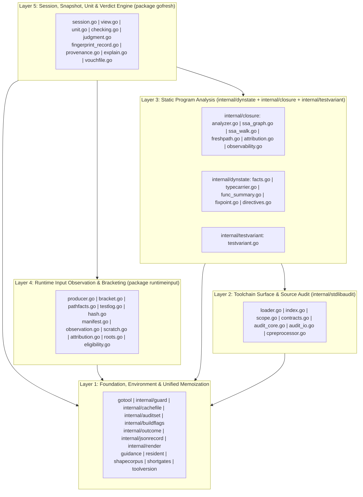

# Pillar 2 Blueprint: First-Principles Coherent Internal Architecture

This document synthesizes the findings of all eight codebase audits ([`audit-01`](file:///home/nikolas/repos/github.com/greatliontech/gofresh/docs/notes/audit-01-specs-and-consumers.md) through [`audit-06`](file:///home/nikolas/repos/github.com/greatliontech/gofresh/docs/notes/audit-06-runtimeinput-and-subpackages.md)) into a first-principles internal architecture for `gofresh`. It diagnoses why the current production codebase grew to **76,077 lines across 101 non-test, non-fixture `.go` files**, defines the target **5-layer acyclic package and file architecture (~32,500 lines across 58 files — a ~57.3% reduction in production code with zero loss of soundness or specification coverage)**, specifies the exact algorithmic and data-structure consolidations within each layer, and catalogues every latent behavioral, soundness, completeness, and performance defect surfaced by the audit.

---

## 1. Root Architectural Diagnosis

### 1.1 Where the 76,077 Production Lines Live Today

Excluding the 127 test-fixture directories under `closure/fixtures/` (222 `.go` files, 4,102 lines) and `shapecorpus/fixtures/` (2 `.go` files, 20 lines), the production codebase spans **101 `.go` files and 76,077 lines**:

| Subsystem / Package | Current Prod Files | Current Prod Lines | Share of Codebase | Biggest Monoliths | Target Prod Lines | Reduction |
| :--- | ---: | ---: | ---: | :--- | ---: | ---: |
| **Toolchain Surface & Source Audit** (`closure/toolchain*.go`) | 6 | 22,160 | 29.1% | [`toolchainaudit.go`](file:///home/nikolas/repos/github.com/greatliontech/gofresh/closure/toolchainaudit.go) (21,306L), [`toolchainsource.go`](file:///home/nikolas/repos/github.com/greatliontech/gofresh/closure/toolchainsource.go) (802L) | ~4,200 | **-81.0%** |
| **AST/Types Dynamic-State & Purity Engine** (root `purity.go` + `dynamicstate.go`) | 2 | 12,788 | 16.8% | [`purity.go`](file:///home/nikolas/repos/github.com/greatliontech/gofresh/purity.go) (9,892L), [`dynamicstate.go`](file:///home/nikolas/repos/github.com/greatliontech/gofresh/dynamicstate.go) (2,896L) | ~4,800 | **-62.5%** |
| **SSA Callgraph, Provenance, Fresh-Path & Attribution** (`closure/` non-toolchain [23 files, 19,551L] + `closure/testvariant` [1 file, 677L] + `closure/internal/*` [9 files, 2,566L]) | 33 | 22,794 | 30.0% | [`freshpath.go`](file:///home/nikolas/repos/github.com/greatliontech/gofresh/closure/freshpath.go) (5,221L), [`attribution.go`](file:///home/nikolas/repos/github.com/greatliontech/gofresh/closure/attribution.go) (3,693L), [`observability.go`](file:///home/nikolas/repos/github.com/greatliontech/gofresh/closure/observability.go) (2,414L), [`analyzer.go`](file:///home/nikolas/repos/github.com/greatliontech/gofresh/closure/analyzer.go) (2,101L), [`maximal.go`](file:///home/nikolas/repos/github.com/greatliontech/gofresh/closure/maximal.go) (1,701L), [`closure.go`](file:///home/nikolas/repos/github.com/greatliontech/gofresh/closure/closure.go) (1,401L) | ~9,600 | **-57.9%** |
| **Root Session, Snapshot, View & Verdict Engine** (root `gofresh` non-purity) | 17 | 7,547 | 9.9% | [`view.go`](file:///home/nikolas/repos/github.com/greatliontech/gofresh/view.go) (1,922L), [`gofresh.go`](file:///home/nikolas/repos/github.com/greatliontech/gofresh/gofresh.go) (1,409L), [`unit.go`](file:///home/nikolas/repos/github.com/greatliontech/gofresh/unit.go) (677L), [`explain.go`](file:///home/nikolas/repos/github.com/greatliontech/gofresh/explain.go) (591L), [`checking.go`](file:///home/nikolas/repos/github.com/greatliontech/gofresh/checking.go) (557L), [`session.go`](file:///home/nikolas/repos/github.com/greatliontech/gofresh/session.go) (528L) | ~5,000 | **-33.7%** |
| **Runtime Input Observation & Bracketing** (`runtimeinput/`) | 7 | 5,101 | 6.7% | [`runtimeinput.go`](file:///home/nikolas/repos/github.com/greatliontech/gofresh/runtimeinput/runtimeinput.go) (3,013L), [`bracket.go`](file:///home/nikolas/repos/github.com/greatliontech/gofresh/runtimeinput/bracket.go) (924L), [`pathfacts.go`](file:///home/nikolas/repos/github.com/greatliontech/gofresh/runtimeinput/pathfacts.go) (495L) | ~3,900 | **-23.5%** |
| **Foundation, Environment & Fleet Subpackages** (`gotool` [10 files, 1,323L], `guard` [5 files, 594L], `guidance` [1 file, 1,150L], `resident` [7 files, 788L], `shapecorpus` [1 file, 284L], `shortgates` [1 file, 235L], `toolversion` [1 file, 89L], `internal/*` [9 files, 1,224L]) | 36 | 5,687 | 7.5% | [`guidance.go`](file:///home/nikolas/repos/github.com/greatliontech/gofresh/guidance/guidance.go) (1,150L), [`auditset.go`](file:///home/nikolas/repos/github.com/greatliontech/gofresh/internal/auditset/auditset.go) (699L), [`gotool.go`](file:///home/nikolas/repos/github.com/greatliontech/gofresh/gotool/gotool.go) (540L) | ~5,000 | **-12.1%** |
| **Total Production Code** | **101** | **76,077** | **100.0%** | **10 files = 53,663 lines (70.5% of codebase)** | **~32,500** | **-57.3%** |

Ten monolithic files—[`closure/toolchainaudit.go`](file:///home/nikolas/repos/github.com/greatliontech/gofresh/closure/toolchainaudit.go) (21,306L), [`purity.go`](file:///home/nikolas/repos/github.com/greatliontech/gofresh/purity.go) (9,892L), [`closure/freshpath.go`](file:///home/nikolas/repos/github.com/greatliontech/gofresh/closure/freshpath.go) (5,221L), [`closure/attribution.go`](file:///home/nikolas/repos/github.com/greatliontech/gofresh/closure/attribution.go) (3,693L), [`runtimeinput/runtimeinput.go`](file:///home/nikolas/repos/github.com/greatliontech/gofresh/runtimeinput/runtimeinput.go) (3,013L), [`dynamicstate.go`](file:///home/nikolas/repos/github.com/greatliontech/gofresh/dynamicstate.go) (2,896L), [`closure/observability.go`](file:///home/nikolas/repos/github.com/greatliontech/gofresh/closure/observability.go) (2,414L), [`closure/analyzer.go`](file:///home/nikolas/repos/github.com/greatliontech/gofresh/closure/analyzer.go) (2,101L), [`view.go`](file:///home/nikolas/repos/github.com/greatliontech/gofresh/view.go) (1,922L), and [`closure/maximal.go`](file:///home/nikolas/repos/github.com/greatliontech/gofresh/closure/maximal.go) (1,701L)—account for **54,159 lines (71.2%)** of the entire production codebase.

---

### 1.2 The Four Root Causes of Structural Fragmentation

#### Cause 1: The Root `gofresh` vs. `closure` Split-Brain Across Static Analysis
Static program analysis in `gofresh` consists of two tightly coupled phases over the same loaded `golang.org/x/tools/go/packages` graph:
1. **AST + `go/types` Dynamic-State & Purity Derivation** ([`purity.go`](file:///home/nikolas/repos/github.com/greatliontech/gofresh/purity.go) + [`dynamicstate.go`](file:///home/nikolas/repos/github.com/greatliontech/gofresh/dynamicstate.go), 12,788 lines): Scans package declarations, `//gofresh:pure` directives, package-global mutations, environment-free functions, read-only receiver methods, fresh-producing constructors, and parameter-mutation hazards across the package graph.
2. **SSA + RTA Callgraph, Fresh-Path & Boundary Attribution** ([`closure/`](file:///home/nikolas/repos/github.com/greatliontech/gofresh/closure/analyzer.go), 22,794 non-toolchain lines including `closure/testvariant` and `closure/internal/*`): Builds `go/ssa`, computes RTA / maximal reachable closures, proves fresh-path immunity for globals/cells/callbacks/formatted sinks, and attributes boundary hazards (`NonHermetic`, `Incomplete`, `Environment`, `Filesystem`, `Synchronization`).

Because Phase 1 was placed in the root `gofresh` package while Phase 2 was placed in `closure/`, and `closure/` cannot import `gofresh` without creating a circular dependency, the codebase suffered severe structural distortion:
- **`closure` had to export 76 symbols across 20 types, 19 functions, and 37 methods (68 of which have zero external callers)** solely so root `gofresh` could call internal plumbing across the package boundary: raw disk-cache helpers ([`LoadDynamicStateFacts`](file:///home/nikolas/repos/github.com/greatliontech/gofresh/closure/dynamicstate.go#L41-L43), [`StoreDynamicStateFacts`](file:///home/nikolas/repos/github.com/greatliontech/gofresh/closure/dynamicstate.go#L46-L48), [`LoadScanFacts`](file:///home/nikolas/repos/github.com/greatliontech/gofresh/closure/dynamicstate.go#L51-L53), [`StoreScanFacts`](file:///home/nikolas/repos/github.com/greatliontech/gofresh/closure/dynamicstate.go#L56-L58)), package-graph loaders ([`ViewLoad`](file:///home/nikolas/repos/github.com/greatliontech/gofresh/closure/scope.go#L28-L55), [`GraphMetadata`](file:///home/nikolas/repos/github.com/greatliontech/gofresh/closure/analyzer.go#L511-L526), [`ComputeRootedFunctions`](file:///home/nikolas/repos/github.com/greatliontech/gofresh/closure/rooted.go#L54-L90)), and internal `types.Type` predicates ([`SignatureOpenWorldTerm`](file:///home/nikolas/repos/github.com/greatliontech/gofresh/closure/attribution.go#L2704-L2732), [`AuditedAtomicPointerElem`](file:///home/nikolas/repos/github.com/greatliontech/gofresh/closure/attribution.go#L2734-L2753), [`WalkDynamicCarrier`](file:///home/nikolas/repos/github.com/greatliontech/gofresh/closure/attribution.go#L2837-L2865), [`TypeParamBoundsAwayFromDynamic`](file:///home/nikolas/repos/github.com/greatliontech/gofresh/closure/attribution.go#L2867-L2882)).
- **A 22-map serialization bridge (`closure.PolicyInput` in [`closure/policymemo.go`](file:///home/nikolas/repos/github.com/greatliontech/gofresh/closure/policymemo.go#L18-L99))** had to be invented just to ship the output of `dynamicstate.go` back into `closure` on every subject analysis call—cloning and SHA-256 hashing all 22 maps on every call.
- **Both sides independently implemented overlapping analyses**: AST local alias/escape/mutation tracking in [`purity.go`](file:///home/nikolas/repos/github.com/greatliontech/gofresh/purity.go) vs. SSA alias/cell/mutation tracking in [`closure/freshpath.go`](file:///home/nikolas/repos/github.com/greatliontech/gofresh/closure/freshpath.go); `types.Type` dynamic-carrier walkers in both [`purity.go`](file:///home/nikolas/repos/github.com/greatliontech/gofresh/purity.go) and [`closure/attribution.go`](file:///home/nikolas/repos/github.com/greatliontech/gofresh/closure/attribution.go#L2704-L2882); and duplicate monotone fixed-point engines inside [`purity.go`](file:///home/nikolas/repos/github.com/greatliontech/gofresh/purity.go) (intra-package) and [`dynamicstate.go`](file:///home/nikolas/repos/github.com/greatliontech/gofresh/dynamicstate.go) (cross-package).

#### Cause 2: Hand-Unwrapped Statement-Index AST Auditing Instead of a General Lexical/Mutation Engine
To avoid loading `go/types` + `go/ssa` for the entire standard library on every cold run, [`closure/toolchainaudit.go`](file:///home/nikolas/repos/github.com/greatliontech/gofresh/closure/toolchainaudit.go) (21,306 lines) verifies that the active Go 1.25–1.27 `GOROOT` stdlib implementation of audited packages (`sync`, `sync/atomic`, `reflect`, `fmt`, `time`, `math/rand`, `net/url`, `flag`, `context`, `path/filepath`, `os`, `bufio`, `crypto/fips140`, plus pure packages) satisfies `gofresh`'s soundness contracts using AST-only inspection.
Instead of building a single reusable AST lexical-scope binder and transitive effect/mutation analyzer over parsed stdlib packages, `toolchainaudit.go` grew by copy-pasting specialized AST walkers for every stdlib package and method:
- **9 separate AST lexical scope, reference, and mutation walkers** that each re-implement parameter shadowing, local variable assignment tracking, and selector/index/unary-star mutation detection.
- **5 separate file import and package-level declaration indexers** and **4 separate `//go:linkname` directive scanners**.
- **15 duplicate stdlib selector/method maps and a 16-way `else if` cascade** in [`toolchainaudit.go`](file:///home/nikolas/repos/github.com/greatliontech/gofresh/closure/toolchainaudit.go) that duplicate [`internal/auditset/auditset.go`](file:///home/nikolas/repos/github.com/greatliontech/gofresh/internal/auditset/auditset.go).
- **6,573 lines of fragile statement-index AST unwrappers** (`verifyOS*` = 5,719 lines; `verifyBufio*` = 854 lines; [`verifyOSGetwd`](file:///home/nikolas/repos/github.com/greatliontech/gofresh/closure/toolchainaudit.go#L14086-L15760) alone = **1,675 lines**) that manually index `fn.Body.List[0]`, `fn.Body.List[1]`, `ifStmt.Body.List[2]` to pattern-match exact Go 1.25–1.27 stdlib statement sequences instead of checking the semantic dataflow contract.
- **Triple file reads on cold cache** in [`toolchainsource.go`](file:///home/nikolas/repos/github.com/greatliontech/gofresh/closure/toolchainsource.go): every stdlib `.go` file is read from disk in `digestListing`, read again by `parser.ParseFile`, and read a third time by `digestListedPackageUntraced`.

#### Cause 3: Ad-Hoc God-Structs, String-Packed Datalog Keys, and Cloned Graph Walkers
Across both `purity.go`/`dynamicstate.go` and `closure/freshpath.go`/`attribution.go`, relational facts and graph traversals were built through incremental accretion rather than algebraic data types:
- [`dynamicStateFact`](file:///home/nikolas/repos/github.com/greatliontech/gofresh/dynamicstate.go#L41-L92) encodes cross-package relational facts as **39 fields of `\x00`, `\x01`, and `\x02` delimited strings**, accompanied by **19 bespoke string-packing and string-splitting helpers** (`splitNullPair`, `splitNullTriple`, `splitNullQuad`, `splitCallbackKey`, `splitFieldTriggerFact`, etc.) that allocate and re-parse strings inside inner fixed-point loops.
- [`freshParamAnalysis`](file:///home/nikolas/repos/github.com/greatliontech/gofresh/closure/freshpath.go#L52-L132) is a **51-field god-struct** mixing immutable program-wide indices, per-subject state, Tarjan SCC traversal state, mode flags (`allowTestingBMut`, `allowFormattedSink`, `allowCallbackTarget`, `ignoreContainerLoad`), and 8 memo maps—forcing **18+ shallow struct copies (`fpCopy := *fp`)** that selectively nil out subsets of caches to avoid cross-mode cache poisoning.
- [`walkDynamicValue`](file:///home/nikolas/repos/github.com/greatliontech/gofresh/closure/freshpath.go#L1060-L1484) is a **425-line, 4-mode multiplexer**, while [`inMemoryFormattedSinkUncached`](file:///home/nikolas/repos/github.com/greatliontech/gofresh/closure/freshpath.go#L1798-L1953) is a **156-line copy-paste of `walkDynamicValue`** that is 100% redundant because `walkDynamicValue` already supports `allowFormattedSink: true`!
- [`closure/freshpath.go`](file:///home/nikolas/repos/github.com/greatliontech/gofresh/closure/freshpath.go) and [`closure/attribution.go`](file:///home/nikolas/repos/github.com/greatliontech/gofresh/closure/attribution.go) contain **7 backward SSA value walkers** and **12 forward SSA referrer walkers**, including character-for-character clones ([`walkCellFieldReferrersWithFP`](file:///home/nikolas/repos/github.com/greatliontech/gofresh/closure/freshpath.go#L3374-L3436) vs [`walkFreeVarFieldReferrersWithFP`](file:///home/nikolas/repos/github.com/greatliontech/gofresh/closure/freshpath.go#L3505-L3567)) and near-identical container load walkers (`walkSliceCellLoadsWithFP`, `walkMapCellLoadsWithFP`, `walkMapSliceCellLoadsWithFP`).

#### Cause 4: Unretired Multi-Generational Surfaces in Root `gofresh`, `closure`, and `runtimeinput`
- **8 fragmented memoization files in `closure/`** (`memo.go`, `effectmemo.go`, `filememo.go`, `canonical.go`, `dynamicstate.go`, `listingmemo.go`, `scope.go`, `policymemo.go`) plus `closure/internal/cachefile` and 7 ad-hoc `sync.Map`s in `toolchainaudit.go` and `purity.go`.
- **Two coexisting orchestration generations in root `gofresh`**: Generation 1 manual `Snapshot` methods (`Capture`, `CaptureObserved`, `CaptureObservedBatch`, `AttachObservation`, `Check`, `CheckBatch`, `CheckObserved`, `CheckObservedBatch`, `CheckInertTestVariantExtension`, `CheckObservedInertTestVariantExtension`, `PrepareOutcomeSupport`, `Sibling`, `Validate`) alongside Generation 2 `Session -> Snapshot -> RuntimeBinding -> Unit / CheckingUnit` (used by `pew` and `stipulator`), plus the unconsumed `artifact.go` surface (`ArtifactDescription`, `BindArtifact`, `BindArtifactByDigest`, `CompileTestBinary`, `BuildBinding` accessors — zero external callers), the 4 unused `RuntimeBinding` wrappers (`CheckInertExtension`, `CheckWithLedger`, `Execute`, `ExecutePackage`), duplicate `Unit` vs `PackageUnit`, duplicate `CheckingUnit` vs `CheckingPackageUnit`, duplicate `ProvisionalCheck` vs `CheckedCandidate`, 2 `observationFacts` comparators, and 3 validation-close pipelines.

---

### 1.3 How the Domains Actually Relate (First-Principles Model)

At its core, `gofresh` answers two domain questions over a Go workspace and toolchain:
1. **Static Closure & Hermeticity**: Given a Go package view and a test/benchmark/package subject, what is its canonical static dependency digest, and does any reachable execution path observe or mutate unbracketing external state (`NonHermetic`), rely on unmodeled open-world/reflection/linkname/assembly features (`Incomplete`), or read/write trackable runtime inputs (`Environment`, `Filesystem`, `Synchronization`)?
2. **Runtime Input & Guard Equivalence**: Given a recorded baseline fingerprint (static closure digest + environment/machine guards + observed runtime input manifest) and a candidate view or post-execution testlog + filesystem bracket, is the baseline fresh, stale, or refused, and why?

Under **Option B** (aligned with Pillar 1 in [`blueprint-public-surface.md`](file:///home/nikolas/repos/github.com/greatliontech/gofresh/docs/notes/blueprint-public-surface.md)), `closure`, `closure/testvariant`, and `guard` move under `internal/`, and the entire system decomposes cleanly into **five strictly layered, bottom-up architectural tiers**:



---

## 2. Target Layered Package & File Architecture

### 2.1 Strictly Acyclic Bottom-Up Package Dependency DAG

Every package in the target architecture belongs to exactly one layer `L1`–`L5`, and imports only packages from strictly lower layers (or sibling leaf utilities inside `L1`):

| Layer | Package | Allowed Internal Imports | External Fleet Consumers | Target Prod Lines |
| :--- | :--- | :--- | :--- | ---: |
| **L1** | `toolversion` | *(none — standalone `go.mod`)* | `pew` | ~90 |
| **L1** | `shapecorpus` | *(none)* | `pew`, `gomutant`, `stipulator` | ~285 |
| **L1** | `shortgates` | *(none)* | `pew`, `gomutant`, `stipulator` | ~235 |
| **L1** | `guidance` | *(none)* | `pew`, `gomutant`, `stipulator` | ~1,150 |
| **L1** | `resident` | *(none)* | `pew`, `gomutant` | ~790 |
| **L1** | `internal/render` | *(none)* | *(internal)* | ~25 |
| **L1** | `internal/outcome` | *(none)* | *(internal)* | ~65 |
| **L1** | `internal/jsonrecord` | *(none)* | *(internal)* | ~130 |
| **L1** | `internal/buildflags` | *(none)* | *(internal)* | ~100 |
| **L1** | `internal/auditset` | *(none — absorbs `internal/generatedmark`)* | *(internal)* | ~720 |
| **L1** | `internal/cachefile` | *(none — promoted from `closure/internal/cachefile`)* | *(internal)* | ~280 |
| **L1** | `gotool` | `internal/buildflags` | `pew`, `gomutant` | ~1,320 |
| **L1** | `internal/guard` | `gotool`, `internal/buildflags` | *(internal — called by `runtimeinput` & root `gofresh`)* | ~570 |
| **L2** | `internal/stdlibaudit` | `gotool`, `internal/auditset`, `internal/cachefile` | *(internal — called by `internal/closure`)* | ~4,200 |
| **L3** | `internal/dynstate` | `gotool`, `internal/auditset`, `internal/cachefile`, `internal/stdlibaudit` | *(internal — called by `internal/closure` & root `gofresh`)* | ~4,800 |
| **L3** | `internal/testvariant` | *(stdlib `go/ast`, `go/types` only)* | *(internal — called by `internal/closure` & root `gofresh`)* | ~650 |
| **L3** | `internal/closure` | `gotool`, `internal/auditset`, `internal/buildflags`, `internal/cachefile`, `internal/outcome`, `internal/stdlibaudit`, `internal/dynstate`, `internal/testvariant`, `internal/closure/internal/*` | *(internal — called by root `gofresh`)* | ~8,950 |
| **L4** | `runtimeinput` | `gotool`, `internal/guard`, `internal/jsonrecord`, `internal/outcome`, `internal/render` | `pew` (`ScratchNamespace`, `ValidateScratchNamespace`), `gomutant` | ~3,900 |
| **L5** | `gofresh` (root) | `gotool`, `internal/guard`, `runtimeinput`, `internal/closure`, `internal/dynstate`, `internal/testvariant`, `internal/auditset`, `internal/buildflags`, `internal/jsonrecord`, `internal/outcome`, `internal/render` | `pew`, `gomutant`, `stipulator` | ~5,000 |

---

### 2.2 Layer 1: Foundation, Environment & Unified Memoization

#### 2.2.1 Unified Two-Tier Process + Disk Memo Engine (`internal/cachefile`)
- **Current State (Fragmented across 9 locations)**:
  1. [`closure/internal/cachefile/cachefile.go`](file:///home/nikolas/repos/github.com/greatliontech/gofresh/closure/internal/cachefile/cachefile.go) (212 lines): Low-level `Load`/`Store` for XDG cache files with SHA-256 verification.
  2. [`closure/memo.go`](file:///home/nikolas/repos/github.com/greatliontech/gofresh/closure/memo.go) (136 lines): `loadCachedSummary` / `storeCachedSummary` + `summaryCache` (`sync.Map`).
  3. [`closure/effectmemo.go`](file:///home/nikolas/repos/github.com/greatliontech/gofresh/closure/effectmemo.go) (86 lines): `loadCachedEffectSummary` / `storeCachedEffectSummary`.
  4. [`closure/filememo.go`](file:///home/nikolas/repos/github.com/greatliontech/gofresh/closure/filememo.go) (62 lines): `digestSourceFiles` / `digestSourceFile` + `fileDigestMemo` (`sync.Map`).
  5. [`closure/canonical.go`](file:///home/nikolas/repos/github.com/greatliontech/gofresh/closure/canonical.go) (49 lines): `canonicalPath` + `canonicalPathMemo` (`sync.Map`).
  6. [`closure/dynamicstate.go`](file:///home/nikolas/repos/github.com/greatliontech/gofresh/closure/dynamicstate.go) (58 lines): Exported `LoadDynamicStateFacts` / `StoreDynamicStateFacts` / `LoadScanFacts` / `StoreScanFacts` wrappers exist only because `cachefile` was trapped inside `closure/internal/cachefile`.
  7. [`closure/listingmemo.go`](file:///home/nikolas/repos/github.com/greatliontech/gofresh/closure/listingmemo.go) (298 lines): `runMemo` (`sync.Map` keyed by `envRunKey`) + `loadDiskListing` / `storeDiskListing` for `go list` outputs.
  8. [`closure/scope.go`](file:///home/nikolas/repos/github.com/greatliontech/gofresh/closure/scope.go) (421 lines): `viewRunCache` (`sync.Map` of `viewRunEntry` with `sync.Once`) + `goEnvSnapshot` + `moduleRootFor`.
  9. [`closure/policymemo.go`](file:///home/nikolas/repos/github.com/greatliontech/gofresh/closure/policymemo.go) (99 lines) + 5 `sync.Map`s in [`closure/toolchainaudit.go`](file:///home/nikolas/repos/github.com/greatliontech/gofresh/closure/toolchainaudit.go#L413-L619) (`toolchainDigestsMemo`, `verifiedListedPkgMemo`, `verifiedPureDelegateMemo`, `verifiedOffSurfacePkgMemo`, `mutatedGlobalsCache`) + `processFactCache` in [`dynamicstate.go:195-198`](file:///home/nikolas/repos/github.com/greatliontech/gofresh/dynamicstate.go#L195-L198).
- **Target Design**:
  1. Promote `closure/internal/cachefile` to `internal/cachefile` so `internal/stdlibaudit`, `internal/dynstate`, and `internal/closure` can all use it directly without `LoadDynamicStateFacts`, `StoreDynamicStateFacts`, `LoadScanFacts`, or `StoreScanFacts` wrapper functions.
  2. Provide a single generic two-tier cache primitive in `internal/cachefile`:
     ```go
     type Store[K comparable, V any] struct {
         namespace string
         version   string
         mem       sync.Map // K -> *entry[V] with sync.Once singleflight
     }
     func (s *Store[K, V]) Get(key K, diskKey string, compute func() (V, bool, error)) (V, error)
     ```
     This single primitive provides in-process singleflight deduplication (`sync.Once` per key, avoiding duplicate concurrent AST/SSA/disk work) backed by optional XDG disk persistence with `auditset.Identity()` + schema-version keying.
  3. **Retire `closure/policymemo.go` completely**: Instead of cloning and SHA-256 hashing 22 maps on every `Analyze` call (`in.key()`), attach the derived `Policy` directly to the per-view `ViewState` object in `internal/dynstate` (which is computed once per `View`).

#### 2.2.2 `internal/auditset`, `internal/buildflags`, `gotool`, and `internal/guard` Consolidations
1. **`internal/auditset/auditset.go`**:
   - **Fix `Identity()` completeness defect** ([`internal/auditset/auditset.go:25-40`](file:///home/nikolas/repos/github.com/greatliontech/gofresh/internal/auditset/auditset.go#L25-L40)): Include `flagSurface` (sorted by symbol name and encoding `FlagRole`), `standardSentinelGlobals`, `reflectImmutableTypes`, and `constantImmutableTypes` in `Identity()`, rather than only hashing `flagSymbols` (`FlagRoleAudited`).
   - **Eliminate hardcoded `ReceiverPackages()` drift risk** ([`internal/auditset/auditset.go:229-L231`](file:///home/nikolas/repos/github.com/greatliontech/gofresh/internal/auditset/auditset.go#L229-L231)): Derive `ReceiverPackages()` at init time from `symbolTables` + `purePackages` (or a single unified package-descriptor table) so adding a new audited package cannot leave `ReceiverPackages()` stale.
   - **Absorb `internal/generatedmark`** ([`internal/generatedmark/generatedmark.go`](file:///home/nikolas/repos/github.com/greatliontech/gofresh/internal/generatedmark/generatedmark.go), 20 lines): Move `IsMarker` into `internal/auditset` right beside `BoundedToken` (both inspect source comment prefixes and share the exact same caller set), deleting `internal/generatedmark`.
2. **`internal/buildflags/buildflags.go`**:
   - **Fix `Validate` quoted-field splitting** ([`internal/buildflags/buildflags.go:28-29`](file:///home/nikolas/repos/github.com/greatliontech/gofresh/internal/buildflags/buildflags.go#L28-L29)): Parse `GOFLAGS` via `buildflags.Fields(goFlags)` ([`internal/buildflags/quoted.go:11-34`](file:///home/nikolas/repos/github.com/greatliontech/gofresh/internal/buildflags/quoted.go#L11-L34)) instead of `strings.Fields` + `strings.Trim`, eliminating false-positive `-overlay` rejections inside quoted flag values and rejecting unterminated quotes consistently with `go`.
3. **`internal/testenv/cache.go` & `gotool.PreserveBuildCache`**:
   - Delete the 24-line passthrough [`internal/testenv/cache.go`](file:///home/nikolas/repos/github.com/greatliontech/gofresh/internal/testenv/cache.go) and route its 3 test callers directly to `gotool.PreserveBuildCache` (which remains exported on `gotool` per `REQ-fresh-go-command-policy`).
4. **`internal/guard/`**:
   - **Move `guard/` to `internal/guard/`** (zero external callers in `pew`, `gomutant`, or `stipulator`).
   - **Eliminate redundant `json.Unmarshal` in `buildConfigDigest`** ([`guard/guard.go:301-328`](file:///home/nikolas/repos/github.com/greatliontech/gofresh/guard/guard.go#L301-L328)): Pass `*gotool.EnvSnapshot` directly into `buildConfigDigest` and read `snapshot.Value(k)` instead of unmarshaling `snapshot.JSON` a second time, and pass `normalizedRuntime` directly to `captureRuntimeFor` without a closure wrapper.
   - **Fold `guard/machine_current.go` (7 lines) into `guard/machine.go` (25 lines)**.
   - **Harden `guard.parseMemTotal`** ([`guard/machine_linux.go:169-186`](file:///home/nikolas/repos/github.com/greatliontech/gofresh/guard/machine_linux.go#L169-L186)): Enforce `len(fields) == 2 && fields[1] == "kB"`, `kb > 0`, and `kb <= math.MaxUint64/1024` to match [`resident.kibibyteLines`](file:///home/nikolas/repos/github.com/greatliontech/gofresh/resident/resident.go#L133-L163).

---

### 2.3 Layer 2: Toolchain Surface & Source Audit (`internal/stdlibaudit`)

Extracting [`closure/toolchainaudit.go`](file:///home/nikolas/repos/github.com/greatliontech/gofresh/closure/toolchainaudit.go) (21,306 lines) and [`closure/toolchainsource*.go`](file:///home/nikolas/repos/github.com/greatliontech/gofresh/closure/toolchainsource.go) (854 lines across 5 files) into a dedicated Layer 2 package `internal/stdlibaudit` and replacing its copy-pasted AST walkers and statement-index unwrappers shrinks **22,160 lines down to ~4,200 lines across 7 cohesive files**:

| Target File in `internal/stdlibaudit` | Responsibility | Replaces in Current `closure/toolchain*.go` | Current Lines | Target Lines |
| :--- | :--- | :--- | ---: | ---: |
| `loader.go` | Single-pass `go list` + file reader + SHA-256 digester + post-parse stat/dir verification + unified `cachefile.Store` memo | `toolchainsource*.go` (854L) + memo wrappers (`toolchainaudit.go:322-620`) | ~1,320 | ~450 |
| `index.go` | `parsedPkgIndex`: single-pass AST index of imports, funcs, methods, types, vars, consts, init bodies, and `//go:linkname` directives | 5 import/decl indexers + 4 linkname scanners + AST unwrapping utilities | ~2,400 | ~550 |
| `scope.go` | `bindPackageAST`: unified lexical scope binder (`*ast.Ident` → `declTarget`) + transitive read/write/call/escape summary over package AST | 9 separate AST scope/mutation/reference walkers across `toolchainaudit.go` | ~3,800 | ~700 |
| `contracts.go` | Declarative contract engine (`PureFunc`, `ReadOnlyReceiver`, `MutexGuardedGlobalCache`, `BufferedSink`, `AllowedCallsOnly`) + direct `internal/auditset` dispatch | 15 duplicate selector maps + 16-way `else if` cascade + boilerplate verifiers | ~2,600 | ~550 |
| `audit_core.go` | Verifiers for `sync`, `sync/atomic`, `reflect`, `fmt`, `time`, `math/rand`, `net/url`, `flag`, `context`, `path/filepath`, `crypto/fips140`, `testing` (including `B.Loop` fix in `verifyTestingBMethodsAST`), and pure stdlib packages | `toolchainaudit.go` lines 1,422–13,125 | ~5,100 | ~1,050 |
| `audit_io.go` | Effect/dataflow contract verifiers for `os`, `bufio`, `internal/oserror`, `internal/filepathlite`, `syscall`, `internal/syscall/unix` | `verifyOS*` (5,719L) + `verifyBufio*` (854L) + `auditInternalOSerror` (`toolchainaudit.go:13126-21306`) | ~6,650 | ~650 |
| `cpreprocessor.go` | Cgo/assembly preprocessor & macro directive verifier | C preprocessor / macro helpers in `toolchainaudit.go` | ~290 | ~250 |
| **Total** | **7 files** | **6 files (`toolchainaudit.go` + `toolchainsource*.go`)** | **22,160** | **~4,200** |

#### Key Consolidations in Layer 2:
1. **Eliminate the 3x Cold-Cache File Read (`loader.go`)**:
   - Currently, verifying a stdlib package reads every `.go` file three times: (1) `digestListing` (`toolchainsource.go:295`) reads bytes to compute SHA-256; (2) `parser.ParseFile` (`toolchainaudit.go`) reads bytes again to parse the AST; (3) `digestListedPackageUntraced` (`toolchainsource.go:349`) reads bytes a third time to guard against concurrent GOROOT mutation.
   - **Target**: `loadListedPackageSource` reads each file's `[]byte` once, hashes the buffer into the package digest, passes the same `[]byte` buffer to `parser.ParseFile(fset, path, buf, parser.ParseComments)`, and verifies pre/post directory listing + `os.Lstat` metadata `(dev, ino, size, mtime, mode)` (re-reading only if metadata changed).
2. **Replace the 5 Import/Decl Indexers and 4 `//go:linkname` Scanners with `parsedPkgIndex` (`index.go`)**:
   - Build one `parsedPkgIndex` per parsed package in a single top-level pass over `files []*ast.File`, recording:
     - per-file import alias → import path map (`fileImports[*ast.File]map[string]string`),
     - package-level declarations (`funcs map[string]*ast.FuncDecl`, `methods map[recvMethodKey]*ast.FuncDecl`, `vars map[string]*ast.ValueSpec`, `consts map[string]*ast.ValueSpec`, `types map[string]*ast.TypeSpec`, `inits []*ast.FuncDecl`),
     - all `//go:linkname` directives (both 1-arg and 2-arg forms, comments in `f.Comments` and `decl.Doc`).
3. **Replace the 9 Separate AST Scope/Mutation Walkers with `bindPackageAST` (`scope.go`)**:
   - Audit 05a & 05b identified 9 separate AST walkers (`packageGlobalMutatedByFiles`, `AuditPackageGlobalImmutability`, `functionReadsGlobalOrCall`, `stmtLeavesVarClean`, `funcLitUsesOnlyLocalState`, `exprIsPureLocal`, `auditInternalOSerror` scope tracker, `verifyOS*` local trackers, `verifyBufio*` local trackers) that each hand-roll lexical scope shadowing and lvalue mutation rules.
   - **Target**: `bindPackageAST(idx *parsedPkgIndex)` performs a single standard Go lexical scope walk over every function/method/init body (maintaining a stack of block scopes for receiver, params, named results, `:=`, `var`, `const`, `type`, `range`, `switch` type-assign, and `FuncLit` params), binding every `*ast.Ident` to its resolved `declTarget` (`localParam`, `localVar`, `pkgFunc`, `pkgVar`, `pkgConst`, `pkgType`, `importPkg`, `builtin`, `fieldOrSelector`).
   - On top of `bindPackageAST`, compute a per-function `astEffectSummary` (which package globals are read/written/address-taken, which receiver fields are read/written, which package/imported functions are called, and whether any dynamic dispatch / unsafe pointer write / channel op occurs) and close it transitively over the intra-package callgraph.
4. **Replace the 6,573-Line `verifyOS*` and `verifyBufio*` Statement-Index Unwrappers with Semantic Dataflow Contracts (`audit_io.go`)**:
   - Instead of indexing `fn.Body.List[0..14]` in `verifyOSGetwd` (1,675 lines) or `verifyBufioWriter*` (854 lines) to match exact statement syntax across Go 1.25, 1.26, and 1.27, express each entry's verification as a contract over `bindPackageAST` + `astEffectSummary`:
     - **`os.Getwd` contract**: Reads/writes only the `getwdCache` mutex-guarded global, calls only `syscall.Getwd`, `os.Stat(".")`, `os.SameFile`, and internal error wrappers, and returns a `string, error` derived from those calls.
     - **`bufio.Writer` contract**: Mutates only receiver struct fields (`err`, `buf`, `n`) and writes only to receiver `wr io.Writer`, with zero package-global reads or mutations.
5. **Eliminate the 15 Duplicate Selector Maps & 16-Way `else if` Cascade (`contracts.go`)**:
   - Query [`internal/auditset`](file:///home/nikolas/repos/github.com/greatliontech/gofresh/internal/auditset/auditset.go) directly via `auditset.Symbol(pkg, name)`, `auditset.ReceiverMethod(pkg, typeName, method)`, `auditset.PurePackage(pkg)`, and `auditset.StandardSentinelGlobal(pkg, name)`.

---

### 2.4 Layer 3: Static Program Analysis (`internal/dynstate` + `internal/closure` + `internal/testvariant`)

Moving the AST/`go/types` dynamic-state & purity engine out of root `gofresh` into `internal/dynstate` and moving `closure` + `closure/testvariant` to `internal/closure` + `internal/testvariant` heals the root-vs-`closure` split-brain and internalizes all 76 previously exported `closure` symbols.

#### 2.4.1 `internal/dynstate`: Compressing `purity.go` (9,892L) + `dynamicstate.go` (2,896L) from 12,788 Lines to ~4,800 Lines

| Target File in `internal/dynstate` | Responsibility | Replaces in Current Root `purity.go` + `dynamicstate.go` | Current Lines | Target Lines |
| :--- | :--- | :--- | ---: | ---: |
| `facts.go` | Typed relational fact structs (`FuncKey`, `MethodKey`, `ParamKey`, `FieldKey`, `CallbackHazard`, `FieldTrigger`, `PackageFacts`, `ViewState`) + `cachefile.Store` persistence | `dynamicStateFact` 39 string-packed fields + 19 `\x00`/`\x01`/`\x02` split/pack helpers (`dynamicstate.go:41-550`, `purity.go:8800-9350`) | ~1,850 | ~550 |
| `typecarrier.go` | Unified `types.Type` structural fold (`DynamicCarrier`, `OpenWorldTerm`, `CanCarryFunc`, `ExposesFuncField`, `TypeParamBounds`, `AuditedAtomicPointerElem`) | 5 duplicate `types.Type` walkers across `purity.go`, `dynamicstate.go`, and `closure/attribution.go:2704-2882` | ~950 | ~350 |
| `func_summary.go` | Single-pass per-function AST + `types.Info` abstract interpreter computing local aliases, param escapes/writes, receiver field reads/writes, fresh allocations, and callback edges | 6 separate intra-procedural AST alias/taint loops in `purity.go` (`initAliasedLocals`, `environmentFreeFuncLitJudged`, `computeLocalAliases`, `returnEnvFreeFunctions`, `boundValueJudged`, `receiverReadOnlyMethods`) | ~5,400 | ~1,900 |
| `fixpoint.go` | Generic monotone fixed-point solver (unified descending optimism / ascending hazard propagation) used for both intra-package and cross-package resolution | Duplicated intra-package fixed-point loops in `purity.go` + cross-package fixed-point loops in `dynamicstate.go` | ~3,200 | ~1,200 |
| `directives.go` | `//gofresh:pure` directive scanner, signature validator, and fast per-package `ScanPureDirectives` (no dead cross-package fixed-point work) | Directive scanning & validation in `purity.go:1-650` | ~1,388 | ~800 |
| **Total** | **5 files** | **`purity.go` (9,892L) + `dynamicstate.go` (2,896L)** | **12,788** | **~4,800** |

##### Key Consolidations in `internal/dynstate`:
1. **Replace `\x00`/`\x01`/`\x02` String-Packed Datalog Keys with Typed Structs (`facts.go`)**:
   - Currently, [`dynamicStateFact`](file:///home/nikolas/repos/github.com/greatliontech/gofresh/dynamicstate.go#L41-L92) packs 3-tuples, 4-tuples, and 5-tuples into strings using `\x00`, `\x01`, and `\x02` separators, requiring 19 custom string-splitting functions (`splitNullPair`, `splitNullTriple`, `splitNullQuad`, `splitCallbackKey`, `splitFieldTriggerFact`, etc.) that repeatedly scan and allocate strings inside fixed-point iterations.
   - **Target**: Represent all keys and relational edges as comparable Go structs (`FuncKey{Pkg, Name string}`, `MethodKey{Pkg, Recv, Method string}`, `ParamKey{Func FuncKey, Index int}`, `FieldKey{Pkg, Type, Field string}`, `CallbackEdge`, `FieldTriggerEdge`). `encoding/json` or `encoding/gob` in `internal/cachefile` serializes typed slices directly to disk without manual delimiter packing.
2. **Collapse the 6 Intra-Procedural AST Alias/Taint Loops into One `funcSummary` Pass (`func_summary.go`)**:
   - Audit 03 proved that [`purity.go`](file:///home/nikolas/repos/github.com/greatliontech/gofresh/purity.go) walks the same function AST bodies 6 separate times with slightly different local-alias maps:
     1. `initAliasedLocals` (`L1606-L1854`)
     2. `environmentFreeFuncLitJudged` (`L2901-L3218`)
     3. `computeLocalAliases` (`L4298-L4502`)
     4. `returnEnvFreeFunctions` (`L5072-L5612`)
     5. `boundValueJudged` (`L5614-L6015`)
     6. `receiverReadOnlyMethods` (`L6868-L7518`)
   - **Target**: A single intra-procedural AST abstract interpreter over `ast.FuncDecl` / `ast.FuncLit` + `types.Info` computes a unified `funcSummary` recording for each parameter, receiver, local variable, and return slot:
     - origin set (`Param(i)`, `Receiver`, `FreshAlloc`, `Global(g)`, `CallResult(fn)`),
     - mutation set (direct write, field write `Field(f)`, element write, address-taken escape),
     - conditional call/callback/field-read dependencies on other functions/methods.
   - All 6 properties (`init` global aliasing, env-free functions, env-free returned closures, fresh-producing functions, parameter-mutation hazards, and read-only receiver methods) become projections of `funcSummary`.
3. **Unify Intra-Package and Cross-Package Monotone Fixed-Point Solvers (`fixpoint.go`)**:
   - Because intra-package functions and cross-package exported symbols obey the exact same monotone lattice rules (greatest fixed point for optimistic purity/read-only/fresh-return claims; least fixed point for reachable global/field/callback hazards), a single solver operates over a `SymbolGraph` of `funcSummary` nodes—first closing strongly connected components within a package to produce the cacheable `PackageFacts`, and then closing across packages in topological import order to produce `ViewState`.
4. **Eliminate Dead `deriveViewDynamicState` Work in `ScanPureDirectives` (`directives.go`)**:
   - Currently, [`ScanPureDirectives`](file:///home/nikolas/repos/github.com/greatliontech/gofresh/purity.go#L257-L291) calls `deriveViewDynamicState(loaded, runner)`—running the entire cross-package fixed-point solver across all packages—and then **discards all cross-package facts**, reading only per-package `scan.directiveErrors`.
   - **Target**: When all `//gofresh:pure` directives in a package depend only on intra-package declarations (the common case), validate them directly from `PackageFacts`; only invoke cross-package resolution for the specific dependencies reachable from a `//gofresh:pure` function.

#### 2.4.2 `internal/closure`: Compressing the 23 Non-Toolchain Files in `closure/` from 19,551 Lines to ~7,050 Lines

*(Note: `internal/testvariant` [677L] and the retained subpackages `internal/closure/internal/{compartment,digest,listing,program,rta}` [~1,900L after promoting `cachefile`] account for the remaining ~2,550 lines of Layer 3, bringing total Layer 3 `internal/closure` + `internal/testvariant` to ~9,600 lines, down from 22,794 lines).*

| Target File in `internal/closure` | Responsibility | Replaces in Current `closure/` (23 Non-Toolchain Files, 19,551L) | Current Lines | Target Lines |
| :--- | :--- | :--- | ---: | ---: |
| `analyzer.go` | `Hasher`, `Analyze*` entrypoints, package selection, canonical digest assembly, compartment ledger & testvariant wiring | `analyzer.go` (2,101L), `closure.go` (1,377L), `listingmemo.go` (480L), `filememo.go` (270L), `canonical.go` (267L), `memo.go` (265L), `effectmemo.go` (182L), `scope.go` (125L), `dependencies.go` (120L), `viewload.go` (89L), `frontend.go` (21L), `programfacade.go` (9L) | 5,306 | ~1,450 |
| `ssa_graph.go` | SSA program construction, RTA + maximal reachability, `userTestMainDecl` harness analysis, rooted functions | `maximal.go` (1,538L), `rooted.go` (414L), `maximal_facts.go` (142L), `dynamicstate.go` (125L), `policymemo.go` (79L) | 2,298 | ~900 |
| `ssa_walk.go` | Unified backward SSA value-origin classifier (`classifyValueOrigin`) + unified forward SSA referrer walker (`walkReferrers`) + container load walker | Duplicated backward/forward SSA walkers scattered across `freshpath.go` and `attribution.go` | ~3,400 | ~1,100 |
| `freshpath.go` | Decomposed `ssaProgramIndex` + `subjectQuery` + `walkFrame`, fresh parameter/cell/global/callback/formatted-sink immunity proofs | Remaining `freshpath.go` (5,221L total) + `freshparam.go` (443L) | ~3,264 | ~1,800 |
| `attribution.go` | Boundary hazard classification (`NonHermetic`, `Incomplete`, `Environment`, `Filesystem`, `Synchronization`), observability classification, provenance BFS, effect & property helpers | `attribution.go` (3,693L total), `observability.go` (1,656L), `effects.go` (557L), `propertyharness.go` (293L) | ~5,283 | ~1,800 |
| **Total** | **5 files** | **23 non-toolchain files in `closure/`** | **19,551** | **~7,050** |

##### Key Consolidations in `internal/closure`:
1. **Break Up the 51-Field `freshParamAnalysis` God-Struct (`freshpath.go`)**:
   - Currently, [`freshParamAnalysis`](file:///home/nikolas/repos/github.com/greatliontech/gofresh/closure/freshpath.go#L52-L132) bundles 51 fields of different lifetimes into one struct, forcing **18+ shallow struct copies (`fpCopy := *fp`)** that manually reset subsets of memo maps (`freshValueMemo`, `freshOriginMemo`, `freshReceiverMemo`, `freshCallMemo`, `cellLoadMemo`, `globalStoreMemo`, etc.) whenever a mode flag changes.
   - **Target**: Split into three clean structs with explicit lifetimes:
     1. `ssaProgramIndex` (immutable, built once per SSA program/view): `prog`, `rtaReachable`, `callersByCallee`, `globalStores`, `freeVarReferrers`, `viewDynState`, and mode-indexed memo tables (`map[originQueryKey]bool`).
     2. `subjectQuery` (immutable per subject): `subjectFn`, `reachableFns`, `allowTestingBMut`.
     3. `walkFrame` (ephemeral per-traversal Tarjan SCC / cycle-detection state): `visiting`, `sccStack`, `sccIndex`.
   - Because mode flags (`originMode`: `modeStrictFresh`, `modeAllowTestingB`, `modeFormattedSink`, `modeCallbackTarget`) become part of the `originQueryKey` in `ssaProgramIndex`, **zero shallow `*fp` copies or cache resets are ever needed**, and memoized results are safely shared across queries.
2. **Unify `walkDynamicValue` and Delete `inMemoryFormattedSinkUncached` (`ssa_walk.go`)**:
   - Delete [`inMemoryFormattedSinkUncached`](file:///home/nikolas/repos/github.com/greatliontech/gofresh/closure/freshpath.go#L1798-L1953) (156 lines), which is a verbatim subset of [`walkDynamicValue`](file:///home/nikolas/repos/github.com/greatliontech/gofresh/closure/freshpath.go#L1060-L1484) with `allowFormattedSink: true`.
   - Factor `walkDynamicValue` into a single backward SSA value-unwrapping step (`stepBackwardValue(v ssa.Value) (origins []ssa.Value, leafKind originLeafKind)`) composed with small per-mode leaf predicates.
3. **Deduplicate Forward SSA Referrer & Container-Load Walkers (`ssa_walk.go`)**:
   - Merge the character-for-character clones [`walkCellFieldReferrersWithFP`](file:///home/nikolas/repos/github.com/greatliontech/gofresh/closure/freshpath.go#L3374-L3436) and [`walkFreeVarFieldReferrersWithFP`](file:///home/nikolas/repos/github.com/greatliontech/gofresh/closure/freshpath.go#L3505-L3567) into a single `walkFieldReferrers`.
   - Merge [`walkSliceCellLoadsWithFP`](file:///home/nikolas/repos/github.com/greatliontech/gofresh/closure/freshpath.go#L3569-L3649), [`walkMapCellLoadsWithFP`](file:///home/nikolas/repos/github.com/greatliontech/gofresh/closure/freshpath.go#L3651-L3727), and [`walkMapSliceCellLoadsWithFP`](file:///home/nikolas/repos/github.com/greatliontech/gofresh/closure/freshpath.go#L3729-L3825) into a single parameterized `walkContainerLoads(containerKind, elemVisitor)`.
   - Merge [`provenanceReachable`](file:///home/nikolas/repos/github.com/greatliontech/gofresh/closure/attribution.go#L3160-L3225) and [`provenanceReachableStartup`](file:///home/nikolas/repos/github.com/greatliontech/gofresh/closure/attribution.go#L3227-L3298) into a single `provenanceBFS(roots, edgeFilter)`.
4. **Clean Up `analyzer.go` and `maximal.go`**:
   - Unify `subjectPackages` and `selectPackage` in [`closure/analyzer.go`](file:///home/nikolas/repos/github.com/greatliontech/gofresh/closure/analyzer.go#L418-L509); eliminate the duplicate `selectMainAndTestPackages` call in `analyzeLoadedSubject` (`L350-L416`); replace the 4-pass `collectReachable` in [`closure/maximal.go`](file:///home/nikolas/repos/github.com/greatliontech/gofresh/closure/maximal.go#L95-L310) with a single worklist pass; and replace custom `lastColon` with `strings.LastIndexByte`.

---

### 2.5 Layer 4: Runtime Input Observation & Bracketing (`runtimeinput`)

Decomposing the 3,013-line [`runtimeinput/runtimeinput.go`](file:///home/nikolas/repos/github.com/greatliontech/gofresh/runtimeinput/runtimeinput.go) monolith into cohesive domain files and eliminating duplicated I/O and path-classification logic reduces `runtimeinput` from **5,101 lines across 7 files to ~3,900 lines across 11 focused files**:

| Target File in `runtimeinput` | Responsibility | Replaces in Current `runtimeinput/` (7 Files, 5,101L) | Current Lines | Target Lines |
| :--- | :--- | :--- | ---: | ---: |
| `producer.go` | `ProducerFrame`, `CaptureProducerFrame`, `Observe`, `ObserveInputs`, `ProducerIngest`, `CompletionReceipt`, `OutcomeSupport` | `producer.go` (316L) + `outcome.go` (61L) | 377 | ~340 |
| `roots.go` | `Roots`, `resolveRoots`, `pathWithin` (unifying `contains` and `underPath`) | `roots.go` (194L) | 194 | ~180 |
| `bracket.go` | `Bracket`, `CaptureBracket`, `revalidate`, `bracketCoverage`, `fingerprintBracketRoot` | `bracket.go` (lines 1–784 of 924L) | ~784 | ~680 |
| `pathfacts.go` | `pathFacts`, `movedBracketRoot`, fine-grained scalar/namespace/listing fact comparison | `pathfacts.go` (495L) | 495 | ~460 |
| `scratch.go` | `ScratchNamespace`, `ValidateScratchNamespace`, `MatchesPath`, `WithScratchNamespace`, `bracketEphemera`, `ephemeralScratch` | Scattered across `producer.go`, `runtimeinput.go:462-753`, and `bracket.go:785-924` | ~431 | ~340 |
| `eligibility.go` | `FileInputEligibility` + shared single-path classification pipeline (`classifyObservedPath`) used by both preflight and `fromTestLog` | `file_eligibility.go` (98L) + duplicated ladder in `runtimeinput.go` | ~198 | ~150 |
| `testlog.go` | `FromTestLog`, `fromTestLog`, `guardCovered`, `ambiguousTraversal`, `congruentTraversal` | `runtimeinput.go` lines 754–1,497 | ~744 | ~540 |
| `hash.go` | `hashPath`, `dirHashFiltered`, `fileHash`, `writeStat`, `resolvedTarget` | `runtimeinput.go` lines 1,555–2,240 | ~685 | ~480 |
| `manifest.go` | `manifest`, `envInput`, `pathID`, `pathInput`, `populateManifestDigests` + pure in-memory `finalizeManifestState`, `Current`, `Describe`, `MovedInputs`, `ModuleRelPaths` | `runtimeinput.go` lines 1,498–1,554 & 2,600–3,013 | ~470 | ~340 |
| `observation.go` | `State`, `Observation`, `CompletedState`, `Incomplete`, `Adopt`, `Merge`, `Absolute`, `Relative`, process provenance sealing | `runtimeinput.go` lines 1–361 | ~361 | ~200 |
| `attribution.go` | `RefusalClause`, `RefusalAttribution`, `MovedBracketClause`, `CanonicalMovedBracketClause`, `bracketMoveAttribution` | `runtimeinput.go` lines 2,241–2,599 | ~362 | ~190 |
| **Total** | **11 files** | **7 files (dominated by 3,013L `runtimeinput.go`)** | **5,101** | **~3,900** |

#### Key Consolidations in Layer 4:
1. **Eliminate the Double Filesystem Walk & SHA-256 Pass on Bracket Movement (`manifest.go` / `testlog.go`)**:
   - Currently, [`fromTestLog`](file:///home/nikolas/repos/github.com/greatliontech/gofresh/runtimeinput/runtimeinput.go#L1179-L1209) calls `stateFromManifest(ctx, m, moduleDir, normalized)` by value (walking and hashing every file and directory on disk), calls `cfg.bracket.revalidate(ctx, moduleDir)`, and when `!unchanged`, mutates `m.BracketMoved` / `m.Unverifiable` and calls `stateFromManifest(ctx, m, moduleDir, normalized)` **a second time from scratch**—re-reading and re-hashing every file and directory on disk!
   - **Target**: Split `stateFromManifest` into (a) `populateManifestDigests(ctx, &m, moduleDir, normalized)` (which performs all disk reads and SHA-256 calculations once, mutating `m.Env` and `m.Paths` in place) and (b) a pure in-memory `finalizeManifestState(m, pathUnverifiable, pathReason) (State, error)` (which sorts `m`, encodes JSON+base64url, and hashes the manifest bytes). When `!unchanged`, update `m.BracketMoved` / `m.Unverifiable` and call `finalizeManifestState` in memory with **zero extra disk I/O**.
2. **Unify `underPath(p, root)` and `contains(dir, path)` into `pathWithin(root, target)` (`roots.go`)**:
   - Delete [`underPath(p, root)`](file:///home/nikolas/repos/github.com/greatliontech/gofresh/runtimeinput/runtimeinput.go#L1898-L1900) (which reverses parameter order relative to `contains` and fails when `root == "/"`) and standardize on `pathWithin(root, target string) bool` with proper `root == string(filepath.Separator)` handling across the entire package.
3. **Deduplicate Exclusion & Path-Eligibility Logic (`eligibility.go` / `testlog.go`)**:
   - Replace the inline loop in [`bracketStatCover.covers`](file:///home/nikolas/repos/github.com/greatliontech/gofresh/runtimeinput/runtimeinput.go#L1757-L1767) with `excludesIdentity(c.exclusions, id)`.
   - Extract a single `classifyObservedPath` helper shared by `FileInputEligibility` and `fromTestLog`, and remove the redundant post-`classifyPath` `cfg.excludes(id)` check on already-clean absolute paths.
4. **Narrow `runtimeinput` Exported Surface (43 -> 18 Symbols)**:
   - Unexport the 25 producer/bracket/context-duplicate symbols in `runtimeinput` (`CaptureProducerFrame`, `ProducerFrame`, `Observe`, `ObserveInputs`, `ProducerIngest`, `CompletionReceipt`, `OutcomeSupport`, `CaptureBracket`, `Bracket`, `FileInputEligibility`, `Incomplete`, `Adopt`, `Merge`, `Absolute`, `Relative`, `FromTestLog`, `Paths`) once `gomutant` migrates `execute.go`, `reconcile.go`, and `seams.go` to `RuntimeBinding` / `Unit` / `CheckingUnit`, leaving only the 18 public symbols documented in [`blueprint-public-surface.md`](file:///home/nikolas/repos/github.com/greatliontech/gofresh/docs/notes/blueprint-public-surface.md#L260-L272).

---

### 2.6 Layer 5: Session, Snapshot, Unit & Verdict Engine (Root `gofresh`)

Root `gofresh` (currently 17 non-purity files, 7,547 lines) is the orchestration and verdict layer. Retiring the unconsumed `artifact.go` surface and Generation 1 manual `Snapshot` methods, unifying `Unit` and `PackageUnit`, and collapsing duplicate validation pipelines reduces Layer 5 from **17 non-purity files (7,547 lines) to 9 cohesive files (~5,000 lines)**:

| Target File in Root `gofresh` | Responsibility | Replaces in Current Root `gofresh` (17 Non-Purity Files, 7,547L) | Current Lines | Target Lines |
| :--- | :--- | :--- | ---: | ---: |
| `session.go` | `Session`, `NewSession`, `SessionPolicy`, `BuildDescription`, `RuntimeDescription`, `Snapshot`, `RuntimeBinding`, `ProcessAccount`, `OutcomeSupport` | `session.go` (528L), `gofresh.go` (1,409L), `outcome.go` (75L), `processaccount.go` (119L), `artifact.go` (322L — retired) | 2,453 | ~1,150 |
| `view.go` | `View` construction, `packages.Load` orchestration, `internal/dynstate` integration, single `compareObservationFacts` comparator | `view.go` (1,922L), `membership.go` (136L), `subject_facts.go` (66L), `builddescription.go` (190L) | 2,314 | ~1,350 |
| `unit.go` | Unified `Unit`, `Finalized` (with `PackageUnit` / `FinalizedPackage` sharing its core implementation and retired as separate types) | `unit.go` (677L) | 677 | ~500 |
| `checking.go` | Unified `CheckingUnit`, `CheckedCandidate` (with `CheckingPackageUnit` / `ProvisionalCheck` / `PackageProvisionalCheck` / `CheckedPackageCandidate` unified) + single validation-close pipeline (`closeObservedCandidate`) | `checking.go` (557L), `applicability.go` (243L) | 800 | ~600 |
| `judgment.go` | `Verdict`, `Status`, `JudgmentGround`, `Cause` | `judgment.go` (209L) | 209 | ~200 |
| `fingerprint_record.go` | `Fingerprint`, `EncodeFingerprintRecord`, `DecodeFingerprintRecord`, schema validation | `fingerprint_record.go` (234L) | 234 | ~220 |
| `provenance.go` | `ToolchainProvenance`, `ToolchainSelection`, `ResolveToolchainSelection`, `TestVariantBindingStrategy`, `CaptureGuards` | `provenance.go` (170L) | 170 | ~220 |
| `explain.go` | `ExplainDynamicState`, `ExplainDynamicStateContext`, `Chain`, `ChainLink`, attribution witness formatting (with per-`Session` hooks instead of global mutex/atomic) | `explain.go` (591L) | 591 | ~560 |
| `vouchfile.go` | `WriteVouchesFile`, `ReadVouchesFile`, `.gofresh/vouches` parsing and validation | `vouchfile.go` (99L) | 99 | ~100 |
| **Total** | **9 files** | **17 non-purity files in root `gofresh`** | **7,547** | **~5,000** |

#### Key Consolidations in Layer 5:
1. **Retire Unconsumed `artifact.go`, Unused `RuntimeBinding` Wrappers & Generation 1 `Snapshot` Methods**:
   - Delete [`artifact.go`](file:///home/nikolas/repos/github.com/greatliontech/gofresh/artifact.go) (`ArtifactDescription`, `BindArtifact`, `BindArtifactByDigest`, `CompileTestBinary`, `BuildBinding` accessors — zero external callers) and the 4 unused `RuntimeBinding` wrappers (`CheckInertExtension`, `CheckWithLedger`, `Execute`, `ExecutePackage`).
   - Once `gomutant` migrates (`reconcile.go`, `execute.go`, `gomutant.go`, `prepare.go`, `schedule.go`, `run.go`, `cacheprune.go`, `ledger.go`, `seams.go`) from Generation 1 `Snapshot` methods to `RuntimeBinding` / `Unit` / `CheckingUnit` (matching `pew` and `stipulator`), retire the 13 Generation 1 `Snapshot` methods (`Capture`, `CaptureObserved`, `CaptureObservedBatch`, `AttachObservation`, `Check`, `CheckBatch`, `CheckObserved`, `CheckObservedBatch`, `CheckInertTestVariantExtension`, `CheckObservedInertTestVariantExtension`, `PrepareOutcomeSupport`, `Sibling`, `Validate`).
2. **Unify `Unit` + `PackageUnit`, `CheckingUnit` + `CheckingPackageUnit`, and `ProvisionalCheck` + `CheckedCandidate`**:
   - Audit 02 demonstrated that `PackageUnit` ([`unit.go:356-677`](file:///home/nikolas/repos/github.com/greatliontech/gofresh/unit.go#L356-L677)) and `CheckingPackageUnit` ([`checking.go:258-557`](file:///home/nikolas/repos/github.com/greatliontech/gofresh/checking.go#L258-L557)) duplicate `Unit` and `CheckingUnit`, and that `ProvisionalCheck` and `CheckedCandidate` ([`checking.go:28-140`](file:///home/nikolas/repos/github.com/greatliontech/gofresh/checking.go#L28-L140)) hold identical state. Sharing their underlying implementation removes ~350 lines of parallel plumbing.
3. **Collapse the 2 `observationFacts` Comparators and 3 Validation-Close Pipelines**:
   - Unify the duplicated `observationFacts` comparison logic in [`view.go:newViewFor`](file:///home/nikolas/repos/github.com/greatliontech/gofresh/view.go#L412-L520) and [`view.go:compareFactsContext`](file:///home/nikolas/repos/github.com/greatliontech/gofresh/view.go#L1120-L1240) into a single `compareObservationFacts` function.
   - Unify the 3 post-run validation-close pipelines (`validateObserved` in [`view.go`](file:///home/nikolas/repos/github.com/greatliontech/gofresh/view.go#L1350-L1520), `validateApplicabilityBatches` in [`applicability.go`](file:///home/nikolas/repos/github.com/greatliontech/gofresh/applicability.go#L110-L240), and `CheckingUnit.close` in [`checking.go`](file:///home/nikolas/repos/github.com/greatliontech/gofresh/checking.go#L150-L255)) into a single parameterized `closeObservedCandidate` pipeline.
4. **Remove Global `explainMu` + `explainHooks` Atomic Pointer Seam**:
   - Replace the process-wide [`explainMu` and `explainHooks` `atomic.Pointer`](file:///home/nikolas/repos/github.com/greatliontech/gofresh/explain.go#L28-L65) with an unexported field on `Session` / `Snapshot` (enabling parallel fault-injection tests without global state serialization).

---

## 3. Concrete Behavioral, Soundness, Completeness & Performance Bugs Surfaced by the Audit

Every defect below was verified with a concrete reachable path in the current implementation and must be fixed as part of the architectural consolidation:

### 3.1 Soundness, Completeness & Behavioral Defects

| ID | Severity | Location | Violated Invariant & Reachable Fault Path | Causal Fix |
| :--- | :--- | :--- | :--- | :--- |
| **BUG-1** | **High (Soundness)** | [`closure/toolchainaudit.go:10841-10891`](file:///home/nikolas/repos/github.com/greatliontech/gofresh/closure/toolchainaudit.go#L10841-L10891) (`verifyTestingBMethodsAST`) vs [`closure/freshpath.go:336`](file:///home/nikolas/repos/github.com/greatliontech/gofresh/closure/freshpath.go#L336) | **`testing.B.Loop` Purity Assumption Without Toolchain Verification**: `closure/freshpath.go:336` treats `(*testing.B).Loop` as an audited pure benchmark helper (`allowTestingBMut`), assuming it only mutates benchmark-internal state. However, `verifyTestingBMethodsAST` in `toolchainaudit.go:10841-10891` only checks `B.Loop`'s receiver/parameter/return signature (`func (b *B) Loop() bool`) and **never inspects its body or callees (`b.loopSlow`)**, unlike `T.TempDir`/`B.ReportAllocs` which verify internal effects. If a toolchain overlay or future Go version adds an unaudited side effect inside `B.Loop`, `toolchainaudit` silently passes it while `freshpath` treats it as pure. | Verify `(*testing.B).Loop` (and its helper `(*testing.B).loopSlow`) in `verifyTestingBMethodsAST` / `internal/stdlibaudit` against the benchmark-state effect contract (mutating only `*testing.B` fields and synchronization primitives). |
| **BUG-2** | **Medium (Completeness / False Refusal)** | [`purity.go:7932-7971`](file:///home/nikolas/repos/github.com/greatliontech/gofresh/purity.go#L7932-L7971) (`argumentCallbackKeys`) | **Method Values Missing From Higher-Order Callback Tracking**: When a function passes a method value `obj.Method` as a callback argument to a higher-order call `apply(obj.Method)` (where `obj.Method` is an `*ast.SelectorExpr` with `info.Selections[sel].Kind() == types.MethodVal`), `argumentCallbackKeys` only recognizes `*ast.Ident` and qualified package functions, ignoring `types.MethodVal` selectors and unwrapping generic `*ast.IndexExpr`/`*ast.IndexListExpr`. As a result, callback purity / parameter-mutation propagation fails to resolve the method value, causing false impurities or false non-hermetic refusals. | In `argumentCallbackKeys` (and the unified `funcSummary` builder), resolve `types.MethodVal` selections on `*ast.SelectorExpr` (including receiver read-only / purity obligations) and unwrap `*ast.IndexExpr` / `*ast.IndexListExpr`. |
| **BUG-3** | **Medium (Completeness / False Refusal)** | [`purity.go:7309-7350`](file:///home/nikolas/repos/github.com/greatliontech/gofresh/purity.go#L7309-L7350) (`exprReadsOrWritesParam`) | **Receiver Field-Write Immunity Lost Inside Local Closures (`*ast.FuncLit`)**: During per-field receiver read-only fixed-point analysis (`checkReceiverFieldKey != ""`), direct statements in a method body that write to a different field of the receiver (`r.other = x`) are exempted via `fieldWriteTargetParam`. However, if the method writes `r.other = x` inside an immediately invoked local closure (`func() { r.other = x }()`), `exprReadsOrWritesParam` calls `funcLitWritesParam` (`L7325`), which treats **any** write to `r` as a disqualifying parameter write without checking `fieldWriteTargetParam` for `checkReceiverFieldKey`. | Thread `checkReceiverFieldKey` into `funcLitWritesParam` (and unify in `funcSummary` so closure bodies record per-field write sets `Field(f)` rather than coarse boolean parameter writes). |
| **BUG-4** | **Medium (Completeness / False Refusal)** | [`purity.go:6364`](file:///home/nikolas/repos/github.com/greatliontech/gofresh/purity.go#L6364) (`callTargets`) & [`dynamicstate.go:2586`](file:///home/nikolas/repos/github.com/greatliontech/gofresh/dynamicstate.go#L2586) (`calledGlobalKeysFromPackage`) | **Explicitly Instantiated Generic Calls (`f[T](x)`, `obj.M[T, U](x)`) Missed by AST Call-Target Resolution**: Both `callTargets` in `purity.go` and `calledGlobalKeysFromPackage` in `dynamicstate.go` switch on `call.Fun` handling only `*ast.Ident` and `*ast.SelectorExpr`, without unwrapping `*ast.IndexExpr` (`f[T]`) or `*ast.IndexListExpr` (`f[T, U]`), even though `typeutil.Callee` / `info.Uses` resolves the underlying `*types.Func` on the inner expression. Consequently, explicit generic instantiations fail to match `funcDeclByObj` or `calledGlobalKeysFromPackage`. | Unwrap `*ast.IndexExpr` (`X`) and `*ast.IndexListExpr` (`X`) before matching `*ast.Ident` / `*ast.SelectorExpr` (or use a single `resolveASTCallee(info, call.Fun)` helper everywhere). |
| **BUG-5** | **Medium (Cache Soundness)** | [`internal/auditset/auditset.go:25-40`](file:///home/nikolas/repos/github.com/greatliontech/gofresh/internal/auditset/auditset.go#L25-L40) & [`L229-L231`](file:///home/nikolas/repos/github.com/greatliontech/gofresh/internal/auditset/auditset.go#L229-L231) | **`auditset.Identity()` Omits `flagSurface` Roles & Hardcodes `ReceiverPackages()`**: `auditset.Identity()` hashes `symbolTables["flag"]` (`flagSymbols`, which only includes `FlagRoleAudited` symbols) and completely omits `flagSurface` entries with `FlagRoleRefused`, `FlagRoleValueRegistration`, or `FlagRolePointerRegistration`, as well as `standardSentinelGlobals`, `reflectImmutableTypes`, and `constantImmutableTypes`. Modifying any of those tables fails to change `auditset.Identity()`, leaving stale disk caches in `cachefile` valid! Additionally, `ReceiverPackages()` (`L229-L231`) returns a hardcoded 6-element slice literal instead of deriving from the method tables. | Hash all policy tables in `auditset.Identity()` (`flagSurface` with role values, `standardSentinelGlobals`, `reflectImmutableTypes`, `constantImmutableTypes`, and all method tables) and derive `ReceiverPackages()` dynamically. |
| **BUG-6** | **Medium (Input Parsing Bug)** | [`internal/buildflags/buildflags.go:28-29`](file:///home/nikolas/repos/github.com/greatliontech/gofresh/internal/buildflags/buildflags.go#L28-L29) vs [`internal/buildflags/quoted.go:11-34`](file:///home/nikolas/repos/github.com/greatliontech/gofresh/internal/buildflags/quoted.go#L11-L34) | **`buildflags.Validate` Splits `GOFLAGS` With `strings.Fields` Instead of `buildflags.Fields`**: `Validate` splits `GOFLAGS` on raw whitespace via `strings.Fields` + `strings.Trim(flag, "\"'")`, ignoring its own package's `buildflags.Fields` parser. A quoted `GOFLAGS` token containing whitespace followed by `-overlay=...` (e.g. `GOFLAGS="-ldflags=-X=pkg.v=' -overlay=foo'"`) is falsely rejected as an `-overlay` build flag, and unterminated quotes are silently stripped instead of rejected. | Replace `strings.Fields(goFlags)` + `strings.Trim` in `buildflags.Validate` with `fields, err := Fields(goFlags)`. |
| **BUG-7** | **Medium (Path Containment Bug)** | [`runtimeinput/runtimeinput.go:1898-1900`](file:///home/nikolas/repos/github.com/greatliontech/gofresh/runtimeinput/runtimeinput.go#L1898-L1900) vs [`runtimeinput/roots.go:154-162`](file:///home/nikolas/repos/github.com/greatliontech/gofresh/runtimeinput/roots.go#L154-L162) | **Divergent `/` Handling and Reversed Parameter Order Between `underPath(p, root)` and `contains(dir, path)`**: `underPath(p, root)` checks `strings.HasPrefix(p, root+string(filepath.Separator))`, which evaluates to `"//"` and returns `false` when `root == "/"` and `p == "/tmp"`, whereas `contains(dir, path)` explicitly handles `dir == string(filepath.Separator)`. Worse, `underPath` takes `(child, root)` while `contains` takes `(root, child)` in the same package. | Delete `underPath` and standardize on `pathWithin(root, target string) bool` with explicit `root == string(filepath.Separator)` handling. |
| **BUG-8** | **Low (Parser Validation Gap)** | [`guard/machine_linux.go:169-186`](file:///home/nikolas/repos/github.com/greatliontech/gofresh/guard/machine_linux.go#L169-L186) (`parseMemTotal`) | **`guard.parseMemTotal` Ignores Unit Token and Overflow**: Unlike [`resident.kibibyteLines`](file:///home/nikolas/repos/github.com/greatliontech/gofresh/resident/resident.go#L133-L163) (which validates `len(fields) == 2 && fields[1] == "kB"`, `kb > 0`, and `kb <= math.MaxUint64/1024`), `guard.parseMemTotal` accepts any `len(fields) >= 1` regardless of unit token, allows `0`, and multiplies `kb * 1024` without overflow bounds. | Harden `guard.parseMemTotal` to enforce `len(fields) == 2 && fields[1] == "kB" && kb > 0 && kb <= math.MaxUint64/1024`. |

---

### 3.2 High-Impact Performance & Redundant-Work Defects

| ID | Severity | Location | Redundant Work / Bottleneck | Causal Fix |
| :--- | :--- | :--- | :--- | :--- |
| **PERF-1** | **High** | [`purity.go:257-291`](file:///home/nikolas/repos/github.com/greatliontech/gofresh/purity.go#L257-L291) (`ScanPureDirectives`) | **`ScanPureDirectives` Runs Full Cross-Package Fixed-Point Solver and Discards Results**: `ScanPureDirectives` calls `deriveViewDynamicState(loaded, runner)` across the entire loaded package graph, only to discard the returned `*viewDynamicState` and read per-package `scan.directiveErrors`. | Compute per-package `scanPackageDynamicState` only for packages containing `//gofresh:pure` directives, and run cross-package resolution only for external dependencies of those directives. |
| **PERF-2** | **High** | [`runtimeinput/runtimeinput.go:1179-1209`](file:///home/nikolas/repos/github.com/greatliontech/gofresh/runtimeinput/runtimeinput.go#L1179-L1209) (`fromTestLog`) | **Double Disk Walk & SHA-256 Pass When Bracket Moves or Is Unverifiable**: `fromTestLog` calls `stateFromManifest` by value before `bracket.revalidate`, and when `!unchanged`, calls `stateFromManifest` a second time from scratch, re-opening and re-hashing every observed file and directory on disk. | Split `stateFromManifest` into `populateManifestDigests(ctx, &m, ...)` (run once) and pure in-memory `finalizeManifestState(m, ...)` (re-run on bracket movement with zero I/O). |
| **PERF-3** | **High** | [`closure/toolchainsource.go:295-365`](file:///home/nikolas/repos/github.com/greatliontech/gofresh/closure/toolchainsource.go#L295-L365) & [`closure/toolchainaudit.go`](file:///home/nikolas/repos/github.com/greatliontech/gofresh/closure/toolchainaudit.go) | **Triple Stdlib File Read on Cold Cache**: Every stdlib `.go` file is read 3 times on a cold cache: once in `digestListing`, once in `parser.ParseFile`, and once in `digestListedPackageUntraced`. | Read each `.go` file once into a `[]byte` buffer, compute its SHA-256 and parse its `*ast.File` from the same buffer, and verify post-parse `os.Lstat` metadata `(dev, ino, size, mtime, mode)` before re-reading. |
| **PERF-4** | **Medium** | [`closure/policymemo.go:18-99`](file:///home/nikolas/repos/github.com/greatliontech/gofresh/closure/policymemo.go#L18-L99) (`derivePolicy`) | **Cloning and Hashing 22 Maps on Every `Analyze` Call**: `PolicyInput.key()` clones and SHA-256 hashes all 22 maps in `PolicyInput` on every call just to look up a cached `Policy` whose `derive()` merely clones those same 22 maps. | Delete `policymemo.go`; store the derived `Policy` directly on the per-view `ViewState` (`internal/dynstate`) computed once per `View`. |
| **PERF-5** | **Medium** | [`guard/guard.go:147-166, 301-328`](file:///home/nikolas/repos/github.com/greatliontech/gofresh/guard/guard.go#L301-L328) (`Capture` / `buildConfigDigest`) | **Double `json.Unmarshal` of `go env -json` Output**: `gotool.EnvReader.Snapshot` already unmarshals `go env -json` into `EnvSnapshot.values`, yet `buildConfigDigest` runs `json.Unmarshal(snapshot.JSON, &env)` a second time. | Pass `*gotool.EnvSnapshot` into `buildConfigDigest` and read `snapshot.Value(k)` directly. |

---

## 4. Phased Execution & Migration Sequence

To land this architecture in reviewable, commit-sized chunks with green verification gates at every step (matching Phase 3 Chunks 3.1–3.5 and Phase 5 Chunk 5.1 in [`docs/plans/plan.md`](file:///home/nikolas/repos/github.com/greatliontech/gofresh/docs/plans/plan.md)):

1. **Chunk 3.1 — Layer 1 Foundation & Bug Fixes**:
   - Promote `closure/internal/cachefile` to `internal/cachefile` with generic `Store[K, V]`.
   - Fix **BUG-5** (`auditset.Identity()` completeness + dynamic `ReceiverPackages()`), **BUG-6** (`buildflags.Validate` using `buildflags.Fields`), **BUG-8** (`guard.parseMemTotal` strictness), and **PERF-5** (`guard.buildConfigDigest` using `EnvSnapshot.Value`); fold `internal/generatedmark` into `internal/auditset`, delete `internal/testenv/cache.go` (routing callers to `gotool.PreserveBuildCache`), and document `internal/outcome/outcome.go`.
2. **Chunk 3.2 — Layer 4 `runtimeinput` Consolidation**:
   - Fix **PERF-2** (split `populateManifestDigests` from `finalizeManifestState`), **BUG-7** (`pathWithin` replacing `underPath` and `contains`), deduplicate `excludesIdentity` and `classifyObservedPath`, and split the 3,013-line `runtimeinput.go` into `manifest.go`, `observation.go`, `attribution.go`, `scratch.go`, `hash.go`, `testlog.go`, and `eligibility.go`.
3. **Chunk 3.3 — Layer 2 `internal/stdlibaudit` Decomposition**:
   - Fix **BUG-1** (`testing.B.Loop` body/callee verification in `verifyTestingBMethodsAST`) and **PERF-3** (single-pass file read + parse + stat check).
   - Introduce `parsedPkgIndex` (`index.go`), `bindPackageAST` (`scope.go`), and declarative `internal/auditset` contracts (`contracts.go`), replacing the 9 AST scope walkers, 5 import/decl indexers, 4 linkname scanners, 15 duplicate selector maps, and 6,573 lines of `verifyOS*` / `verifyBufio*` statement-index unwrappers.
4. **Chunk 3.4 — Layer 3 `internal/dynstate` & `internal/closure` Unification**:
   - Move `purity.go` + `dynamicstate.go` into `internal/dynstate`; fix **BUG-2** (method values in `argumentCallbackKeys`), **BUG-3** (receiver field-write immunity in `FuncLit`), **BUG-4** (generic `IndexExpr`/`IndexListExpr` callees), **PERF-1** (`ScanPureDirectives`), and **PERF-4** (`policymemo.go`).
   - Replace `\x00`/`\x01`/`\x02` string keys with typed structs (`facts.go`), collapse the 6 AST alias/taint loops into `funcSummary` (`func_summary.go`), and unify intra-package and cross-package fixed-point solvers (`fixpoint.go`).
   - Decompose `freshParamAnalysis` into `ssaProgramIndex` + `subjectQuery` + `walkFrame`, delete `inMemoryFormattedSinkUncached`, and deduplicate the forward/backward SSA walkers (`ssa_walk.go`).
5. **Chunk 3.5 & Chunk 5.1 — Layer 5 Root `gofresh` Unification, Option B Package Boundary Migration & Consumer Alignment**:
   - Unify `Unit`/`PackageUnit`, `CheckingUnit`/`CheckingPackageUnit`, and `ProvisionalCheck`/`CheckedCandidate`; collapse the 2 `observationFacts` comparators and 3 validation-close pipelines; remove global `explainHooks`.
   - Move `guard` -> `internal/guard`, `closure` -> `internal/closure`, and `closure/testvariant` -> `internal/testvariant`; delete `artifact.go` and the 4 unused `RuntimeBinding` wrappers; and in Chunk 5.1 migrate `gomutant`, `pew`, and `stipulator` to retire the remaining 13 Generation 1 `Snapshot` methods and 25 `runtimeinput` producer/bracket symbols.
