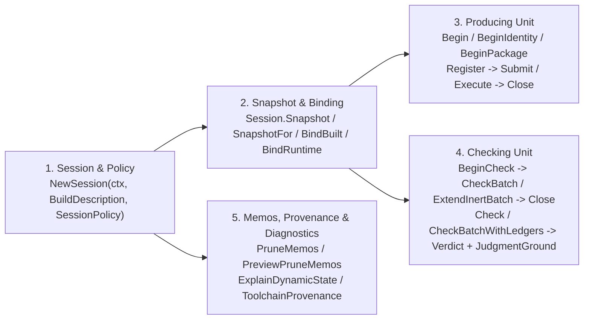

# Pillar 1 Blueprint: First-Principles Public Surface & Package Topology

## Executive Summary

Across `gofresh` and its subpackages (`closure`, `closure/testvariant`, `runtimeinput`, `guard`, `gotool`, `guidance`, `resident`, `shapecorpus`, `shortgates`, `toolversion`), the repository currently exports **346 public symbols** across **11 intentional packages**, plus **135 accidental public Go packages** under `closure/fixtures/*` (127 directories, 222 `.go` files).

Cross-referencing every exported symbol against the governing specifications (`docs/specs/*.md`) and all 3 external fleet consumers (`stipulator`, `pew`, `gomutant`) in [`audit-01-specs-and-consumers.md`](file:///home/nikolas/repos/github.com/greatliontech/gofresh/docs/notes/audit-01-specs-and-consumers.md) and [`audit-02-root-session-view-verdict.md`](file:///home/nikolas/repos/github.com/greatliontech/gofresh/docs/notes/audit-02-root-session-view-verdict.md) reveals three structural root causes of surface bloat:

1. **Two Coexisting Generations of Root API (`Snapshot` Manual Plumbing vs. `Session` / `RuntimeBinding` / `Unit` Lifecycle)**:
   - `stipulator` and `pew` exclusively consume the Generation 2 capability-bound lifecycle ([`NewSession`](file:///home/nikolas/repos/github.com/greatliontech/gofresh/session.go#L94) → [`(*Session).Snapshot`](file:///home/nikolas/repos/github.com/greatliontech/gofresh/session.go#L312) → [`(*Snapshot).BindRuntime`](file:///home/nikolas/repos/github.com/greatliontech/gofresh/session.go#L236) / [`(*Snapshot).BindBuilt`](file:///home/nikolas/repos/github.com/greatliontech/gofresh/session.go#L361) → `RuntimeBinding.Begin` / `BeginIdentity` / `BeginPackage` / `BeginCheck`).
   - `gomutant` (`reconcile.go`, `execute.go`, `gomutant.go`, `prepare.go`, `schedule.go`, `run.go`, `cacheprune.go`, `ledger.go`, `seams.go`) is the **sole remaining consumer** of Generation 1 (`Snapshot.Capture`, `Snapshot.CaptureObservedBatch`, `Snapshot.AttachObservation`, `Snapshot.Check`, `Snapshot.CheckObserved`, `Snapshot.CheckObservedBatch`, `Snapshot.Sibling`, `Snapshot.Validate`) and of manual `runtimeinput` producer/bracket orchestration (`CaptureProducerFrame`, `ProducerFrame.Observe`, `CaptureBracket`).
   - Additionally, a third unconsumed surface in [`artifact.go`](file:///home/nikolas/repos/github.com/greatliontech/gofresh/artifact.go#L20-L198)—`ArtifactDescription`, `(*Snapshot).BindArtifact`, `(*Snapshot).BindArtifactByDigest`, `(*Snapshot).CompileTestBinary`, and all 6 inspection methods on `BuildBinding` (`Package`, `Identity`, `Path`, `Digest`, `Bytes`, `Validate`)—has **0 external callers** across the entire fleet.

2. **Accidental Subpackage Exposure Driven by Internal Package Placement**:
   - `github.com/greatliontech/gofresh/closure` exports **76 symbols** across 29 files. Yet `gomutant` imports **0**, `pew` production code imports **0**, and `stipulator` production code uses only **4 symbols** (`NewAt`, `ToolchainSelectionNoticeResolved`, `(*Hasher).ToolchainContent`, `(*Hasher).AdmissionPolicy`) solely for preflight toolchain/admission checks before opening a `gofresh.Session`. Worse, 8 symbols (`SignatureOpenWorldTerm`, `AuditedAtomicPointerElem`, `CarrierWalkPolicy` + 3 constants, `WalkDynamicCarrier`, `TypeParamBoundsAwayFromDynamic`) in [`closure/attribution.go`](file:///home/nikolas/repos/github.com/greatliontech/gofresh/closure/attribution.go) and 4 memo helpers (`LoadDynamicStateFacts`, `StoreDynamicStateFacts`, `LoadScanFacts`, `StoreScanFacts`) in [`closure/dynamicstate.go`](file:///home/nikolas/repos/github.com/greatliontech/gofresh/closure/dynamicstate.go) are exported on `closure` only because `purity.go` and `dynamicstate.go` live in root `gofresh` instead of an internal analysis package.
   - `github.com/greatliontech/gofresh/closure/testvariant` ([`closure/testvariant/testvariant.go`](file:///home/nikolas/repos/github.com/greatliontech/gofresh/closure/testvariant/testvariant.go)) exports **15 symbols**, 12 of which are already re-exported as type aliases and wrapper functions in [`gofresh.go:46-69`](file:///home/nikolas/repos/github.com/greatliontech/gofresh/gofresh.go#L46-L69); external consumers import `closure/testvariant` only for the `BindingStrategy` constant (`"gofresh/test-variant-bindings@1"`).
   - `github.com/greatliontech/gofresh/guard` exports **21 symbols**, **18 of which have 0 external callers**. Consumers only touch the `Guards` value struct (embedded on `gofresh.Fingerprint.Guards`), `Kind` (`CodeResult`, `Measurement`, already aliased on root `gofresh`), and a single `guard.Capture` call in `pew/cmd/pew/ab.go`.

3. **Unconsolidated Mirror Types and Duplicate Context Wrappers**:
   - Root `gofresh` duplicates [`Unit`](file:///home/nikolas/repos/github.com/greatliontech/gofresh/unit.go#L131) vs. [`PackageUnit`](file:///home/nikolas/repos/github.com/greatliontech/gofresh/unit.go#L139) (and [`Finalized`](file:///home/nikolas/repos/github.com/greatliontech/gofresh/unit.go#L413) vs. [`FinalizedProcess`](file:///home/nikolas/repos/github.com/greatliontech/gofresh/unit.go#L437)) with 100% identical method sets (`Register`, `Submit`, `Abort`, `Account`, `Close`, `Execute`) over the same `*producingUnit` implementation, [`ProvisionalCheck`](file:///home/nikolas/repos/github.com/greatliontech/gofresh/checking.go#L36) vs. [`CheckedCandidate`](file:///home/nikolas/repos/github.com/greatliontech/gofresh/checking.go#L46) with byte-for-byte identical struct fields, and [`ExecutionModel`](file:///home/nikolas/repos/github.com/greatliontech/gofresh/session.go#L53) (`uint8` enum) vs. [`ExecutionAssertions`](file:///home/nikolas/repos/github.com/greatliontech/gofresh/judgment.go#L60) (2-bool struct).
   - `runtimeinput` exports 6 pairs of duplicate functions (`Adopt`/`AdoptContext`, `Incomplete`/`IncompleteContext`, `Merge`/`MergeContext`, `Absolute`/`AbsoluteContext`, `Relative`/`RelativeContext`, `FromTestLog`/`FromTestLogContext` — where all 6 `*Context` variants have 0 external callers!), plus an exported method `ProducerFrame.OutcomeBinding` ([`runtimeinput/outcome.go:39`](file:///home/nikolas/repos/github.com/greatliontech/gofresh/runtimeinput/outcome.go#L39)) whose return type (`internal/outcome.Binding`) is an unnameable internal type.

This blueprint defines the irreducible first-principles public contract of `gofresh`, establishes the target package topology (Option B), catalogues all exported symbols against ground truth from `audit-01` and `audit-02`, and specifies the exact consumer alignment changes across `gomutant`, `stipulator`, and `pew`.

---

## 1. First-Principles Domain Model of `gofresh`'s Public Contract

From first principles, `gofresh` is a **sound static-and-runtime freshness oracle for Go subjects and packages**. Every consumer (`stipulator` for test/requirement verification, `pew` for benchmark freshness, `gomutant` for mutation test reuse) interacts with `gofresh` through **five irreducible domain phases**:

### 1.1 Phase 1: Configure & Open a Freshness Session

A consumer declares the build coordinate ([`BuildDescription`](file:///home/nikolas/repos/github.com/greatliontech/gofresh/session.go#L22): `Directory`, `Package`, `Environment`, `Flags`, `Inputs`) and the static/runtime policy ([`SessionPolicy`](file:///home/nikolas/repos/github.com/greatliontech/gofresh/session.go#L71): `EvidenceRoot`, `Vouches`, `PureSubjects`, `AssumePure`, `Execution`, `AnalysisBudget`, `Runner`, `Progress`). [`NewSession`](file:///home/nikolas/repos/github.com/greatliontech/gofresh/session.go#L94) validates build flags, normalizes the build environment, validates vouches, and primes session-scoped `runtimeinput.Roots` and `engine` state.

In addition, consumers check binary-vs-ambient toolchain language-series skew via [`ToolchainProvenance`](file:///home/nikolas/repos/github.com/greatliontech/gofresh/provenance.go#L121) / [`NewToolchainProvenance`](file:///home/nikolas/repos/github.com/greatliontech/gofresh/provenance.go#L134) / [`ToolchainSkew`](file:///home/nikolas/repos/github.com/greatliontech/gofresh/provenance.go#L51). To replace the 4 `closure` preflight calls in `stipulator` (`closure.NewAt`, `ToolchainSelectionNoticeResolved`, `ToolchainContent`, `AdmissionPolicy`) without colliding with `ToolchainProvenance` in `provenance.go`, root `gofresh` exposes `ToolchainSelection` (`{ToolchainContent, AdmissionPolicy, SelectionNotice string}`), `(*Session).ToolchainSelection() ToolchainSelection`, and `ResolveToolchainSelection(ctx, dir, env, buildFlags...) (ToolchainSelection, error)`.

- **Irreducible Types & Functions**:
  - [`NewSession(ctx context.Context, build BuildDescription, policy SessionPolicy) (*Session, error)`](file:///home/nikolas/repos/github.com/greatliontech/gofresh/session.go#L94)
  - [`BuildDescription`](file:///home/nikolas/repos/github.com/greatliontech/gofresh/session.go#L22), [`(BuildDescription).TestCompileArgs(outputPath string, extraFlags ...string) []string`](file:///home/nikolas/repos/github.com/greatliontech/gofresh/session.go#L32)
  - [`SessionPolicy`](file:///home/nikolas/repos/github.com/greatliontech/gofresh/session.go#L71), [`ExecutionModel`](file:///home/nikolas/repos/github.com/greatliontech/gofresh/session.go#L53) (`GeneralExecution`, `PackageExecution`, `SingleSubjectExecution`)
  - [`Kind`](file:///home/nikolas/repos/github.com/greatliontech/gofresh/gofresh.go#L36) (`CodeResult`, `Measurement`)
  - [`ToolchainProvenance`](file:///home/nikolas/repos/github.com/greatliontech/gofresh/provenance.go#L121), [`NewToolchainProvenance`](file:///home/nikolas/repos/github.com/greatliontech/gofresh/provenance.go#L134), [`(*ToolchainProvenance).Check`](file:///home/nikolas/repos/github.com/greatliontech/gofresh/provenance.go#L158), [`ToolchainSampler`](file:///home/nikolas/repos/github.com/greatliontech/gofresh/provenance.go#L96), [`SampleFunc`](file:///home/nikolas/repos/github.com/greatliontech/gofresh/provenance.go#L101), [`ToolchainProvenanceError`](file:///home/nikolas/repos/github.com/greatliontech/gofresh/provenance.go#L87), [`ToolchainSkew`](file:///home/nikolas/repos/github.com/greatliontech/gofresh/provenance.go#L51)
  - `ToolchainSelection`, `(*Session).ToolchainSelection() ToolchainSelection`, `ResolveToolchainSelection(ctx context.Context, dir string, env []string, buildFlags ...string) (ToolchainSelection, error)`

### 1.2 Phase 2: Bind a Source/Runtime Snapshot & Compiled Binary

From an open `Session`, the consumer captures a point-in-time [`Snapshot`](file:///home/nikolas/repos/github.com/greatliontech/gofresh/view.go#L67) via [`(*Session).Snapshot(ctx, subjects, kind)`](file:///home/nikolas/repos/github.com/greatliontech/gofresh/session.go#L312) (or [`(*Session).SnapshotFor(ctx, subjects, moduleDir, kind)`](file:///home/nikolas/repos/github.com/greatliontech/gofresh/session.go#L322) for multi-module workspaces). To produce or check runtime-bound evidence, the consumer binds:
1. A [`RuntimeBinding`](file:///home/nikolas/repos/github.com/greatliontech/gofresh/session.go#L211) via [`(*Snapshot).BindRuntime(ctx, RuntimeDescription)`](file:///home/nikolas/repos/github.com/greatliontech/gofresh/session.go#L236), and
2. An opaque [`BuildBinding`](file:///home/nikolas/repos/github.com/greatliontech/gofresh/session.go#L352) via [`(*Snapshot).BindBuilt(pkg, identity)`](file:///home/nikolas/repos/github.com/greatliontech/gofresh/session.go#L361).

- **Irreducible Types & Methods**:
  - [`(*Session).Snapshot(ctx context.Context, subjects []Subject, kind Kind) (*Snapshot, error)`](file:///home/nikolas/repos/github.com/greatliontech/gofresh/session.go#L312)
  - [`(*Session).SnapshotFor(ctx context.Context, subjects []Subject, moduleDir string, kind Kind) (*Snapshot, error)`](file:///home/nikolas/repos/github.com/greatliontech/gofresh/session.go#L322)
  - [`(*Snapshot).BuildDescription(pkg string) (BuildDescription, error)`](file:///home/nikolas/repos/github.com/greatliontech/gofresh/session.go#L337)
  - [`(*Snapshot).SourceFiles() []string`](file:///home/nikolas/repos/github.com/greatliontech/gofresh/view.go#L584), [`(*Snapshot).SourceFilesFor(subject Subject) ([]string, error)`](file:///home/nikolas/repos/github.com/greatliontech/gofresh/view.go#L595)
  - [`(*Snapshot).TestVariantLedger(subject Subject) (TestVariantLedger, bool)`](file:///home/nikolas/repos/github.com/greatliontech/gofresh/view.go#L615)
  - [`(*Snapshot).CaptureBatch(ctx context.Context) (map[Subject]Fingerprint, error)`](file:///home/nikolas/repos/github.com/greatliontech/gofresh/view.go#L632)
  - [`(*Snapshot).BindBuilt(pkg, identity string) (BuildBinding, error)`](file:///home/nikolas/repos/github.com/greatliontech/gofresh/session.go#L361)
  - [`(*Snapshot).BindRuntime(ctx context.Context, execution RuntimeDescription) (*RuntimeBinding, error)`](file:///home/nikolas/repos/github.com/greatliontech/gofresh/session.go#L236)
  - [`RuntimeDescription`](file:///home/nikolas/repos/github.com/greatliontech/gofresh/session.go#L47): `{ Directory string; Environment []string }`
  - [`(*RuntimeBinding).Snapshot() *Snapshot`](file:///home/nikolas/repos/github.com/greatliontech/gofresh/session.go#L225)
  - [`BuildBinding`](file:///home/nikolas/repos/github.com/greatliontech/gofresh/session.go#L352): opaque capability token (all 6 unconsumed methods in `artifact.go` are removed).

### 1.3 Phase 3: Produce Freshness Fingerprints (Single-Subject or Package Execution)

From a `RuntimeBinding`, the consumer opens a producing [`Unit`](file:///home/nikolas/repos/github.com/greatliontech/gofresh/unit.go#L131):
- [`(*RuntimeBinding).Begin(subject Subject)`](file:///home/nikolas/repos/github.com/greatliontech/gofresh/unit.go#L156) for a single subject with full outcome support.
- [`(*RuntimeBinding).BeginIdentity(subject Subject)`](file:///home/nikolas/repos/github.com/greatliontech/gofresh/unit.go#L167) for identity-only runtime-input observation (e.g., benchmarks in `pew`).
- [`(*RuntimeBinding).BeginPackage(subjects []Subject)`](file:///home/nikolas/repos/github.com/greatliontech/gofresh/unit.go#L179) for a multi-subject package test process.

> [!IMPORTANT]
> **Consolidation of `Unit` and `PackageUnit` / `Finalized` and `FinalizedProcess`**:
> In [`unit.go`](file:///home/nikolas/repos/github.com/greatliontech/gofresh/unit.go#L131-L538) and [`processaccount.go`](file:///home/nikolas/repos/github.com/greatliontech/gofresh/processaccount.go#L49-L58), `Unit` and `PackageUnit` both wrap `*producingUnit` and expose the exact same 6 methods (`Register`, `Submit`, `Abort`, `Account`, `Close`, `Execute`). Merging `PackageUnit` into `Unit` and unifying `Finalized` / `FinalizedProcess` eliminates 2 redundant public wrapper types and 6 duplicate method forwarders.

- **Irreducible Types & Methods**:
  - [`(*RuntimeBinding).Begin(subject Subject) (*Unit, error)`](file:///home/nikolas/repos/github.com/greatliontech/gofresh/unit.go#L156)
  - [`(*RuntimeBinding).BeginIdentity(subject Subject) (*Unit, error)`](file:///home/nikolas/repos/github.com/greatliontech/gofresh/unit.go#L167)
  - [`(*RuntimeBinding).BeginPackage(subjects []Subject) (*Unit, error)`](file:///home/nikolas/repos/github.com/greatliontech/gofresh/unit.go#L179)
  - [`ProcessDescription`](file:///home/nikolas/repos/github.com/greatliontech/gofresh/unit.go#L32), [`Contribution`](file:///home/nikolas/repos/github.com/greatliontech/gofresh/unit.go#L64) (`Subjects`, `Environment`, `Directory`, `Capture`)
  - [`TerminalKind`](file:///home/nikolas/repos/github.com/greatliontech/gofresh/unit.go#L42) (`NormalCompletion`, `AbnormalCompletion`, `NeverStarted`), [`Terminal`](file:///home/nikolas/repos/github.com/greatliontech/gofresh/unit.go#L57)
  - [`ObservationDisposition`](file:///home/nikolas/repos/github.com/greatliontech/gofresh/unit.go#L450) (`UnknownObservation`, `SupportedObservation`, `IdentityObservation`, `IncompleteObservation`)
  - [`(*Unit).Register(ctx context.Context, build BuildBinding, process ProcessDescription) (Contribution, error)`](file:///home/nikolas/repos/github.com/greatliontech/gofresh/unit.go#L203)
  - [`(*Unit).Submit(c Contribution, terminal Terminal) error`](file:///home/nikolas/repos/github.com/greatliontech/gofresh/unit.go#L345)
  - [`(*Unit).Account() (ProcessAccount, bool)`](file:///home/nikolas/repos/github.com/greatliontech/gofresh/processaccount.go#L49)
  - [`(*Unit).Abort()`](file:///home/nikolas/repos/github.com/greatliontech/gofresh/unit.go#L382)
  - [`(*Unit).Close(ctx context.Context) (Finalized, error)`](file:///home/nikolas/repos/github.com/greatliontech/gofresh/unit.go#L470)
  - [`(*Unit).Execute(ctx context.Context, build BuildBinding, process ProcessDescription, run func(context.Context, Contribution) (Terminal, error)) (Finalized, error)`](file:///home/nikolas/repos/github.com/greatliontech/gofresh/unit.go#L493)
  - [`Finalized`](file:///home/nikolas/repos/github.com/greatliontech/gofresh/unit.go#L413), [`FinalizedSubject`](file:///home/nikolas/repos/github.com/greatliontech/gofresh/unit.go#L426), [`ProcessAccount`](file:///home/nikolas/repos/github.com/greatliontech/gofresh/processaccount.go#L33), [`RuntimeInputSpanError`](file:///home/nikolas/repos/github.com/greatliontech/gofresh/processaccount.go#L8)

### 1.4 Phase 4: Check Recorded Fingerprints & Inert Test-Variant Extensions

To verify whether recorded [`Fingerprint`](file:///home/nikolas/repos/github.com/greatliontech/gofresh/gofresh.go#L485) records remain [`Valid`](file:///home/nikolas/repos/github.com/greatliontech/gofresh/gofresh.go#L563) against the current `Snapshot` and `RuntimeBinding`, the consumer either opens a [`CheckingUnit`](file:///home/nikolas/repos/github.com/greatliontech/gofresh/checking.go#L285) via [`(*RuntimeBinding).BeginCheck(subjects)`](file:///home/nikolas/repos/github.com/greatliontech/gofresh/checking.go#L304) or calls [`(*RuntimeBinding).Check`](file:///home/nikolas/repos/github.com/greatliontech/gofresh/session.go#L374) / [`(*RuntimeBinding).CheckBatchWithLedgers`](file:///home/nikolas/repos/github.com/greatliontech/gofresh/session.go#L446).

> [!IMPORTANT]
> **Consolidation of `ProvisionalCheck` and `CheckedCandidate`, and `ExecutionModel` and `ExecutionAssertions`**:
> - [`ProvisionalCheck`](file:///home/nikolas/repos/github.com/greatliontech/gofresh/checking.go#L36) and [`CheckedCandidate`](file:///home/nikolas/repos/github.com/greatliontech/gofresh/checking.go#L46) have **byte-for-byte identical fields** (`Index int`, `Subject Subject`, `Verdict Verdict`, `Extension *CheckedExtension`). Merging them into `CheckedCandidate` eliminates a duplicate exported struct.
> - [`JudgmentScope.ExecutionModel`](file:///home/nikolas/repos/github.com/greatliontech/gofresh/judgment.go#L68-L72) currently uses [`ExecutionAssertions`](file:///home/nikolas/repos/github.com/greatliontech/gofresh/judgment.go#L60-L63) (`{SingleSubject, PackageProcess bool}`), which is a redundant representation of [`ExecutionModel`](file:///home/nikolas/repos/github.com/greatliontech/gofresh/session.go#L53) (`GeneralExecution`, `PackageExecution`, `SingleSubjectExecution`). Replacing `ExecutionAssertions` with `ExecutionModel` makes `{SingleSubject: true, PackageProcess: true}` unrepresentable.

- **Irreducible Types & Methods**:
  - [`(*RuntimeBinding).BeginCheck(subjects []Subject) (*CheckingUnit, error)`](file:///home/nikolas/repos/github.com/greatliontech/gofresh/checking.go#L304)
  - [`(*CheckingUnit).CheckBatch(ctx context.Context, candidates []Candidate) ([]CheckedCandidate, error)`](file:///home/nikolas/repos/github.com/greatliontech/gofresh/checking.go#L314)
  - [`(*CheckingUnit).ExtendInertBatch(ctx context.Context, requests []InertRequest) ([]CheckedCandidate, error)`](file:///home/nikolas/repos/github.com/greatliontech/gofresh/checking.go#L330)
  - [`(*CheckingUnit).Abort()`](file:///home/nikolas/repos/github.com/greatliontech/gofresh/checking.go#L446)
  - [`(*CheckingUnit).Close(ctx context.Context) ([]CheckedCandidate, error)`](file:///home/nikolas/repos/github.com/greatliontech/gofresh/checking.go#L463)
  - [`(*RuntimeBinding).Check(ctx context.Context, subject Subject, recorded Fingerprint) (Verdict, error)`](file:///home/nikolas/repos/github.com/greatliontech/gofresh/session.go#L374)
  - [`(*RuntimeBinding).CheckBatchWithLedgers(ctx context.Context, candidates []Candidate, ledgers map[Subject]TestVariantLedger) ([]CheckedCandidate, error)`](file:///home/nikolas/repos/github.com/greatliontech/gofresh/session.go#L446)
  - [`(*RuntimeBinding).CurrentFacts(ctx context.Context, subject Subject) (Fingerprint, error)`](file:///home/nikolas/repos/github.com/greatliontech/gofresh/session.go#L393)
  - [`Candidate`](file:///home/nikolas/repos/github.com/greatliontech/gofresh/checking.go#L14), [`InertRequest`](file:///home/nikolas/repos/github.com/greatliontech/gofresh/checking.go#L22), [`CheckedExtension`](file:///home/nikolas/repos/github.com/greatliontech/gofresh/checking.go#L29), [`CheckedCandidate`](file:///home/nikolas/repos/github.com/greatliontech/gofresh/checking.go#L46)
  - [`Fingerprint`](file:///home/nikolas/repos/github.com/greatliontech/gofresh/gofresh.go#L485), [`(Fingerprint).Validate()`](file:///home/nikolas/repos/github.com/greatliontech/gofresh/fingerprint_record.go#L62), [`(Fingerprint).MarshalJSON()`](file:///home/nikolas/repos/github.com/greatliontech/gofresh/fingerprint_record.go#L72), [`(*Fingerprint).UnmarshalJSON()`](file:///home/nikolas/repos/github.com/greatliontech/gofresh/fingerprint_record.go#L123), [`(Fingerprint).EffectiveTestVariantClosure()`](file:///home/nikolas/repos/github.com/greatliontech/gofresh/applicability.go#L27), [`ObservationProof`](file:///home/nikolas/repos/github.com/greatliontech/gofresh/gofresh.go#L466), [`InertTestVariantApplicability`](file:///home/nikolas/repos/github.com/greatliontech/gofresh/applicability.go#L19)
  - [`Verdict`](file:///home/nikolas/repos/github.com/greatliontech/gofresh/gofresh.go#L579), [`Status`](file:///home/nikolas/repos/github.com/greatliontech/gofresh/gofresh.go#L560) (`Valid`, `Stale`, `Unverifiable`), [`JudgmentGround`](file:///home/nikolas/repos/github.com/greatliontech/gofresh/judgment.go#L131), [`Cause`](file:///home/nikolas/repos/github.com/greatliontech/gofresh/judgment.go#L52), [`CauseKind`](file:///home/nikolas/repos/github.com/greatliontech/gofresh/judgment.go#L12) (17 constants), [`CauseCondition`](file:///home/nikolas/repos/github.com/greatliontech/gofresh/judgment.go#L37) (6 constants), [`JudgmentScope`](file:///home/nikolas/repos/github.com/greatliontech/gofresh/judgment.go#L68), [`PurityAttribution`](file:///home/nikolas/repos/github.com/greatliontech/gofresh/judgment.go#L75) (4 constants), [`PurityAuthority`](file:///home/nikolas/repos/github.com/greatliontech/gofresh/judgment.go#L86), [`ObservationAuthority`](file:///home/nikolas/repos/github.com/greatliontech/gofresh/judgment.go#L97), [`AcceptedAuthority`](file:///home/nikolas/repos/github.com/greatliontech/gofresh/judgment.go#L112)
  - `TestVariantBindingStrategy = "gofresh/test-variant-bindings@1"` *(promoted to root `gofresh`)*, [`TestVariantLedger`](file:///home/nikolas/repos/github.com/greatliontech/gofresh/gofresh.go#L46) (+ 7 companion types), [`DiffTestVariantLedgers`](file:///home/nikolas/repos/github.com/greatliontech/gofresh/gofresh.go#L61)

### 1.5 Phase 5: Manage Memos, Guards, & Diagnostics

- **Memo Lifecycle** ([`gofresh.go:90-109`](file:///home/nikolas/repos/github.com/greatliontech/gofresh/gofresh.go#L90-L109)):
  - `DefaultMemoMaxBytes`, `MemoPruneReport`, `PruneMemos(maxBytes int64) (MemoPruneReport, error)`, `PreviewPruneMemos(maxBytes int64) (MemoPruneReport, error)`
- **Guard Capture (Standalone A/B Comparison)**:
  - `Guards` (promoted from `guard.Guards`), `CaptureGuards(ctx context.Context, r *gotool.EnvReader, env []string, kind Kind) (Guards, error)` *(replaces the single `guard.Capture` call in `pew/cmd/pew/ab.go`)*
- **Progress, Explain, Membership & Vouch Helpers**:
  - [`Progress`](file:///home/nikolas/repos/github.com/greatliontech/gofresh/gofresh.go#L747), [`(Progress).IsUnit()`](file:///home/nikolas/repos/github.com/greatliontech/gofresh/gofresh.go#L778), [`(Progress).Diagnostic()`](file:///home/nikolas/repos/github.com/greatliontech/gofresh/gofresh.go#L798), [`DiagnosticsTo`](file:///home/nikolas/repos/github.com/greatliontech/gofresh/gofresh.go#L818), [`UnitPhases`](file:///home/nikolas/repos/github.com/greatliontech/gofresh/gofresh.go#L772)
  - [`(*Snapshot).ExplainDynamicState(ctx context.Context, pkgPath, varName string) (Chain, error)`](file:///home/nikolas/repos/github.com/greatliontech/gofresh/explain.go#L129), [`CulpritFromReason(reason string) (Subject, bool)`](file:///home/nikolas/repos/github.com/greatliontech/gofresh/explain.go#L103), [`Chain`](file:///home/nikolas/repos/github.com/greatliontech/gofresh/explain.go#L53), [`ChainLink`](file:///home/nikolas/repos/github.com/greatliontech/gofresh/explain.go#L32)
  - [`SubjectScope`](file:///home/nikolas/repos/github.com/greatliontech/gofresh/membership.go#L13) (`SelectedSource`, `SelectedView`, `ParentView`), [`UnknownSubjectsError`](file:///home/nikolas/repos/github.com/greatliontech/gofresh/membership.go#L26), [`RecordedRefusalKind`](file:///home/nikolas/repos/github.com/greatliontech/gofresh/membership.go#L90) (`RecordShapeRefusal`, `RecordKindRefusal`), [`RecordedFailure`](file:///home/nikolas/repos/github.com/greatliontech/gofresh/membership.go#L99), [`RecordedBatchError`](file:///home/nikolas/repos/github.com/greatliontech/gofresh/membership.go#L108)
  - [`RepositoryVouchFile`](file:///home/nikolas/repos/github.com/greatliontech/gofresh/vouchfile.go#L18), [`ReadVouchFile`](file:///home/nikolas/repos/github.com/greatliontech/gofresh/vouchfile.go#L25), [`ParseVouchEntry`](file:///home/nikolas/repos/github.com/greatliontech/gofresh/vouchfile.go#L64), [`ParseVouchEntries`](file:///home/nikolas/repos/github.com/greatliontech/gofresh/vouchfile.go#L88)

---

## 2. Package Topology Decision & Rationale

### 2.1 Rigorous Evaluation: Subpackage Retention (Option A) vs. Internalization (Option B)

| Dimension | Current State | Option A: Keep `closure`, `closure/testvariant`, `guard`, `runtimeinput` Public with Narrowed Exports | Option B (Adopted): Move `closure`, `closure/testvariant`, `guard` to `internal/`; Keep Only Root `gofresh` + Narrowed `runtimeinput` |
| :--- | :--- | :--- | :--- |
| **Non-Fleet Public Packages** | **5 packages** (`gofresh`, `closure`, `closure/testvariant`, `guard`, `runtimeinput`) + **135 fixture packages** | **5 packages** (`gofresh`, `closure`, `closure/testvariant`, `guard`, `runtimeinput`) | **2 packages** (`gofresh`, `runtimeinput`) |
| **`closure` Public Surface** | **76 exported symbols** | **4 exported symbols** (`Hasher`, `NewAt`, `ToolchainSelectionNoticeResolved`, `(*Hasher).ToolchainContent`, `(*Hasher).AdmissionPolicy`) | **0 public symbols** (`internal/closure`). The 4 preflight queries used by `stipulator` become `gofresh.ResolveToolchainSelection` + `(*Session).ToolchainSelection()` on root `gofresh`. |
| **`closure/testvariant` Public Surface** | **15 exported symbols** (12 already aliased in root `gofresh`) | **1 exported symbol** (`BindingStrategy`) or 13 duplicated symbols | **0 public symbols** (`internal/testvariant`). Root `gofresh` already defines the 8 ledger/delta types and `DiffTestVariantLedgers`; adding `TestVariantBindingStrategy` to root `gofresh` eliminates the subpackage import completely. |
| **`guard` Public Surface** | **21 exported symbols** (18 have 0 external callers) | **3 exported symbols** (`Guards`, `Kind`, `Capture`) | **0 public symbols** (`internal/guard`). Root `gofresh` already aliases `Kind` and embeds `Guards` in `Fingerprint`; promoting `Guards` and `CaptureGuards` to root `gofresh` eliminates `pew`'s single `guard.Capture` import. |
| **`runtimeinput` Public Surface** | **43 exported symbols** | **18 exported symbols** (after `gomutant` migrates to `RuntimeBinding`/`Unit`) | **18 exported symbols** (manifest inspection `Describe`/`Description`/`MovedInputs`/`ModuleRelPaths`, refusal attribution `RefusalClause`/`RefusalAttribution`/`MovedBracketClause`/`CanonicalMovedBracketClause`, scratch config `ScratchNamespace`/`ValidateScratchNamespace`/`MatchesPath`, explicit-file preflight `FileInputEligibility`/`FileEligibility`/`FileInputContext`/`FileInputKind`, and `Current`/`State`/`Roots`). All producer/bracket/outcome plumbing becomes unexported or internal. |
| **Internal Coupling & Encapsulation** | Root `gofresh` (`purity.go`, `dynamicstate.go`) imports `closure` via 12 leaked public helpers (`WalkDynamicCarrier`, `LoadDynamicStateFacts`, etc.); `runtimeinput` exports `OutcomeBinding` returning `internal/outcome.Binding`. | Still requires `internal/` bridge packages if `closure` is public, or leaves `closure` as a semi-public package for 2 consumer files. | Moving `closure`, `closure/testvariant`, and `guard` under `internal/` allows the static analysis engine (`internal/closure` + `internal/dynstate` + `internal/stdlibaudit`) to be unified cleanly without exposing any SSA/RTA/AST machinery to external callers. |

### 2.2 Role & Disposition of the 6 Fleet-Shared Infrastructure Packages

| Package | Prod Consumers | Test Consumers | Architectural Role & Surface Disposition |
| :--- | :--- | :--- | :--- |
| **`gotool`** | `gofresh`, `stipulator`, `pew`, `gomutant` | `gofresh`, `stipulator`, `pew`, `gomutant` | **Keep Public (Narrow 31 → 26 symbols)**: Essential fleet execution substrate (`Runner`, `Containment`, `EnvReader`, `EnvSnapshot`, `Sampler`, `SnapshotSampler`, `RunMemo`, `Coordinate`, `NormalizeEnv`, `ParseGoVersion`, `ReleaseTags`, `GoBuildCache`, `PreserveBuildCache`). Unexport/delete 5 zero-caller symbols (`LanguageSeries`, `LoadPackages`, `MemoKey`, `ReleaseTagsBound`, `(*Runner).SampleGoVersion`). Note: `PreserveBuildCache` is retained exported per `REQ-fresh-go-command-policy` (`docs/specs/overview.md:386`). |
| **`guidance`** | `stipulator`, `pew`, `gomutant` | `gofresh`, `stipulator`, `pew`, `gomutant` | **Keep Public (Narrow 25 → 18 symbols)**: Fleet CLI/MCP documentation parser and drift-coverage verifier. Unexport 7 zero-caller symbols (`(*Embedded).Document`, `(*Embedded).Registration`, `(*Document).Knob`, `(*Document).DescribeSchema`, `(Knob).Clause`, `(Knob).Usage`, `KnobUsage`). |
| **`resident`** | `stipulator`, `gomutant` | `gofresh`, `stipulator`, `gomutant` | **Keep Public (Narrow 13 → 12 symbols)**: Fleet `/proc` + cgroup v2 resident memory monitor and soft `GOMEMLIMIT` ceiling installer. Unexport `CeilingFloor` (0 external callers). |
| **`shapecorpus`** | None | `gofresh`, `stipulator`, `pew`, `gomutant` | **Keep Public (4 symbols)**: Shared 12-entry Go language-shape canary corpus (`Entries`, `Entry`, `TestFiles`, `BenchFiles`). 100% consumed. |
| **`shortgates`** | None | `gofresh`, `stipulator`, `pew`, `gomutant` | **Keep Public (Narrow 6 → 1 symbol)**: Fleet test-hygiene AST linter enforcing `if testing.Short()` placement. All 4 repositories call only `shortgates.Pin(t, root)`; unexport `Walk`, `WalkReport`, `Check`, `Report`, and `Failer`. |
| **`toolversion`** | `stipulator`, `pew`, `gomutant` | `gofresh`, `stipulator`, `pew`, `gomutant` | **Keep Public Submodule (1 symbol)**: Standalone `toolversion/go.mod` exporting `Identity() string`. 100% consumed. |

---

## 3. Complete Symbol-by-Symbol Disposition Table (Ground-Truth Inventory)

### 3.1 Root Package: `github.com/greatliontech/gofresh` (19 Production Files)

#### A. Constants & Sentinel Errors
| Symbol | Declaration | External Refs (`stipulator` / `pew` / `gomutant`) | Disposition | Target / Rationale |
| :--- | :--- | :--- | :--- | :--- |
| `CodeResult`, `Measurement` | [`gofresh.go:39-40`](file:///home/nikolas/repos/github.com/greatliontech/gofresh/gofresh.go#L39-L40) | 34 / 33 / 104 | `KEEP` | Core `Kind` constants. |
| `ClosureStrategy` | [`gofresh.go:249`](file:///home/nikolas/repos/github.com/greatliontech/gofresh/gofresh.go#L249) | 13 / 6 / 2 | `KEEP` | Strategy identifier `"gofresh/closure@1"`. |
| `DynamicStateStrategy` | [`gofresh.go:239`](file:///home/nikolas/repos/github.com/greatliontech/gofresh/gofresh.go#L239) | 10 / 9 / 1 | `KEEP` | Strategy identifier `"gofresh/dynamic-state@48"`. |
| `ObservationRTA` | [`gofresh.go:462`](file:///home/nikolas/repos/github.com/greatliontech/gofresh/gofresh.go#L462) | 2 / 0 / 4 (test only) | `KEEP` | Strategy identifier `"gofresh/observation-rta@57"` on `ObservationProof.Strategy`. |
| `InertTestVariantExtension` | [`applicability.go:14`](file:///home/nikolas/repos/github.com/greatliontech/gofresh/applicability.go#L14) | 5 / 5 / 0 (test only) | `KEEP` | Strategy identifier `"gofresh/inert-test-variant-extension@1"` on `InertTestVariantApplicability.Strategy`. |
| `ReasonTestVariants` | [`gofresh.go:572`](file:///home/nikolas/repos/github.com/greatliontech/gofresh/gofresh.go#L572) | 3 / 1 / 1 | `KEEP` | `"test variants"` reason constant. |
| `RepositoryVouchFile` | [`vouchfile.go:18`](file:///home/nikolas/repos/github.com/greatliontech/gofresh/vouchfile.go#L18) | 0 / 0 / 2 | `KEEP` | Used by `gomutant`. |
| `DefaultMemoMaxBytes` | [`gofresh.go:90`](file:///home/nikolas/repos/github.com/greatliontech/gofresh/gofresh.go#L90) | 1 / 0 / 0 | `KEEP` | Used by `stipulator`. |
| `ErrViewChanged` | [`view.go:28`](file:///home/nikolas/repos/github.com/greatliontech/gofresh/view.go#L28) | 8 / 2 / 2 | `KEEP` | Drift detection sentinel. |
| `ErrAnalysisUnavailable` | [`view.go:43`](file:///home/nikolas/repos/github.com/greatliontech/gofresh/view.go#L43) | 0 / 3 / 9 | `KEEP` | Analysis budget/load unavailability sentinel. |
| `ErrViewSealed` | [`view.go:31`](file:///home/nikolas/repos/github.com/greatliontech/gofresh/view.go#L31) | 0 / 0 / 0 | `UNEXPORT/INTERNAL` | Zero external callers. |
| `ErrUnitClosed` | [`unit.go:15`](file:///home/nikolas/repos/github.com/greatliontech/gofresh/unit.go#L15) | 0 / 0 / 0 | `UNEXPORT/INTERNAL` | Zero external callers. |
| `ErrUnitIncomplete` | [`unit.go:19`](file:///home/nikolas/repos/github.com/greatliontech/gofresh/unit.go#L19) | 0 / 1 / 0 | `KEEP` | Sentinel when `Unit.Close` / `CheckingUnit.Close` is called on incomplete work. |
| `ErrUnitAborted` | [`unit.go:23`](file:///home/nikolas/repos/github.com/greatliontech/gofresh/unit.go#L23) | 0 / 0 / 0 | `UNEXPORT/INTERNAL` | Zero external callers. |
| `ErrNoSampler` | [`provenance.go:128`](file:///home/nikolas/repos/github.com/greatliontech/gofresh/provenance.go#L128) | 0 / 1 / 0 | `KEEP` | Sentinel returned by `NewToolchainProvenance(nil)`. |

#### B. Top-Level Functions
| Function | Declaration | External Refs (`stipulator` / `pew` / `gomutant`) | Disposition | Target / Rationale |
| :--- | :--- | :--- | :--- | :--- |
| `NewSession` | [`session.go:94`](file:///home/nikolas/repos/github.com/greatliontech/gofresh/session.go#L94) | 13 / 2 / 4 | `KEEP` | Primary session constructor. |
| `NewToolchainProvenance` | [`provenance.go:134`](file:///home/nikolas/repos/github.com/greatliontech/gofresh/provenance.go#L134) | 1 / 1 / 1 | `KEEP` | Constructs `ToolchainProvenance` skew checker. |
| `ToolchainSkew` | [`provenance.go:51`](file:///home/nikolas/repos/github.com/greatliontech/gofresh/provenance.go#L51) | 3 / 2 / 1 | `KEEP` | Binary-vs-ambient language series check. |
| `DiagnosticsTo` | [`gofresh.go:818`](file:///home/nikolas/repos/github.com/greatliontech/gofresh/gofresh.go#L818) | 1 / 3 / 0 | `KEEP` | Progress writer helper. |
| `UnitPhases` | [`gofresh.go:772`](file:///home/nikolas/repos/github.com/greatliontech/gofresh/gofresh.go#L772) | 0 / 0 / 4 | `KEEP` | Used by `gomutant` progress rendering. |
| `CulpritFromReason` | [`explain.go:103`](file:///home/nikolas/repos/github.com/greatliontech/gofresh/explain.go#L103) | 1 / 1 / 0 | `KEEP` | Parses culprit subject from diagnostic reason. |
| `ReadVouchFile`, `ParseVouchEntry`, `ParseVouchEntries` | [`vouchfile.go:25-88`](file:///home/nikolas/repos/github.com/greatliontech/gofresh/vouchfile.go#L25-L88) | 1 / 3 / 3 | `KEEP` | Vouch file parsing helpers. |
| `DiffTestVariantLedgers` | [`gofresh.go:61`](file:///home/nikolas/repos/github.com/greatliontech/gofresh/gofresh.go#L61) | 0 / 1 / 2 | `KEEP` | Used by `gomutant` and `pew`. |
| `InertTestVariantLedgersForSubject` | [`gofresh.go:67`](file:///home/nikolas/repos/github.com/greatliontech/gofresh/gofresh.go#L67) | 0 / 0 / 0 | `UNEXPORT/INTERNAL` | Zero external callers; internal to `prepareInertExtension`. |
| `PruneMemos`, `PreviewPruneMemos` | [`gofresh.go:103-107`](file:///home/nikolas/repos/github.com/greatliontech/gofresh/gofresh.go#L103-L107) | 1 / 0 / 2 | `KEEP` | Memo cache pruning entry points. |
| `SetMemoMaxBytes` | [`gofresh.go:99`](file:///home/nikolas/repos/github.com/greatliontech/gofresh/gofresh.go#L99) | 0 / 0 / 0 | `DELETE (dead/legacy)` | Zero external callers; update `REQ-closure-observability-memo` in `docs/specs/closure.md`. |
| `SetMemoRoot` | [`gofresh.go:86`](file:///home/nikolas/repos/github.com/greatliontech/gofresh/gofresh.go#L86) | 0 / 0 / 0 | `UNEXPORT/INTERNAL` | Zero external callers; test-only memo dir override. |
| `ScanPureDirectives` | [`purity.go:36`](file:///home/nikolas/repos/github.com/greatliontech/gofresh/purity.go#L36) | 0 / 0 / 0 | `UNEXPORT/INTERNAL` | Zero external callers; moves to `internal/dynstate`. |

#### C. Lifecycle Types & Methods (`Session`, `Snapshot`, `RuntimeBinding`, `Unit`, `PackageUnit`, `CheckingUnit`, `BuildBinding`)
| Type / Method | Declaration | External Refs (`stipulator` / `pew` / `gomutant`) | Disposition | Target / Rationale |
| :--- | :--- | :--- | :--- | :--- |
| `BuildDescription`, `(BuildDescription).TestCompileArgs`, `RuntimeDescription`, `ExecutionModel` (`GeneralExecution`, `PackageExecution`, `SingleSubjectExecution`), `SessionPolicy`, `Session` | [`session.go:22-89`](file:///home/nikolas/repos/github.com/greatliontech/gofresh/session.go#L22-L89) | All 3 consumers | `KEEP` | Core session & policy types. |
| `(*Session).Snapshot`, `(*Session).SnapshotFor` | [`session.go:312-322`](file:///home/nikolas/repos/github.com/greatliontech/gofresh/session.go#L312-L322) | 17 / 2 / 5 | `KEEP` | Primary snapshot constructors. |
| `(*Snapshot).BindRuntime`, `(*Snapshot).BindBuilt`, `(*Snapshot).BuildDescription`, `(*Snapshot).ExplainDynamicState`, `(*Snapshot).SourceFiles`, `(*Snapshot).SourceFilesFor`, `(*Snapshot).TestVariantLedger`, `(*Snapshot).CaptureBatch` | [`session.go:236-369`](file:///home/nikolas/repos/github.com/greatliontech/gofresh/session.go#L236-L369), [`view.go:584-632`](file:///home/nikolas/repos/github.com/greatliontech/gofresh/view.go#L584-L632), [`explain.go:129`](file:///home/nikolas/repos/github.com/greatliontech/gofresh/explain.go#L129) | All 3 consumers | `KEEP` | Core Generation 2 `Snapshot` methods. |
| `ArtifactDescription`, `(*Snapshot).BindArtifact`, `(*Snapshot).BindArtifactByDigest`, `(*Snapshot).CompileTestBinary`, `(BuildBinding).Package` / `Identity` / `Path` / `Digest` / `Bytes` / `Validate` | [`artifact.go:20-198`](file:///home/nikolas/repos/github.com/greatliontech/gofresh/artifact.go#L20-L198) | 0 / 0 / 0 | `DELETE (dead/legacy)` | Zero external callers; update `REQ-fresh-inspected-artifact` in `docs/specs/evidence.md`. |
| `(*Snapshot).CaptureObserved`, `(*Snapshot).CheckInertTestVariantExtension`, `(*Snapshot).CheckObservedInertTestVariantExtension`, `(*Snapshot).PrepareOutcomeSupport` | [`view.go:670`](file:///home/nikolas/repos/github.com/greatliontech/gofresh/view.go#L670), [`applicability.go:47-55`](file:///home/nikolas/repos/github.com/greatliontech/gofresh/applicability.go#L47-L55), [`outcome.go:22`](file:///home/nikolas/repos/github.com/greatliontech/gofresh/outcome.go#L22) | 0 / 0 / 0 | `DELETE (dead/legacy)` | Zero external callers. |
| `(*Snapshot).Capture`, `(*Snapshot).CaptureObservedBatch`, `(*Snapshot).AttachObservation`, `(*Snapshot).Check`, `(*Snapshot).CheckBatch`, `(*Snapshot).CheckObserved`, `(*Snapshot).CheckObservedBatch`, `(*Snapshot).Sibling`, `(*Snapshot).Validate` | [`view.go:564-1025`](file:///home/nikolas/repos/github.com/greatliontech/gofresh/view.go#L564-L1025) | `gomutant` only | `UNEXPORT/INTERNAL` | Generation 1 `View` methods; unexported once `gomutant` migrates to `RuntimeBinding` / `Unit` / `CheckingUnit` in Chunk 5.1. |
| `(*RuntimeBinding).Snapshot`, `(*RuntimeBinding).Begin`, `(*RuntimeBinding).BeginIdentity`, `(*RuntimeBinding).BeginPackage`, `(*RuntimeBinding).BeginCheck`, `(*RuntimeBinding).Check`, `(*RuntimeBinding).CheckBatchWithLedgers`, `(*RuntimeBinding).CurrentFacts` | [`session.go:225-513`](file:///home/nikolas/repos/github.com/greatliontech/gofresh/session.go#L225-L513), [`unit.go:156-185`](file:///home/nikolas/repos/github.com/greatliontech/gofresh/unit.go#L156-L185), [`checking.go:304`](file:///home/nikolas/repos/github.com/greatliontech/gofresh/checking.go#L304) | `stipulator` & `pew` | `KEEP` | Core Generation 2 `RuntimeBinding` surface (`BeginPackage` returns unified `*Unit`). |
| `(*RuntimeBinding).CheckInertExtension`, `(*RuntimeBinding).CheckWithLedger`, `(*RuntimeBinding).Execute`, `(*RuntimeBinding).ExecutePackage` | [`session.go:418, 518`](file:///home/nikolas/repos/github.com/greatliontech/gofresh/session.go#L418), [`unit.go:542-558`](file:///home/nikolas/repos/github.com/greatliontech/gofresh/unit.go#L542-L558) | 0 prod callers | `DELETE (dead/legacy)` | Zero production callers across all 3 consumers. |
| `Unit` (`Register`, `Submit`, `Abort`, `Account`, `Close`, `Execute`), `ProcessDescription`, `TerminalKind`, `Terminal`, `Contribution`, `Finalized`, `FinalizedSubject`, `ObservationDisposition`, `ProcessAccount`, `RuntimeInputSpanError` | [`unit.go:32-538`](file:///home/nikolas/repos/github.com/greatliontech/gofresh/unit.go#L32-L538), [`processaccount.go:8-58`](file:///home/nikolas/repos/github.com/greatliontech/gofresh/processaccount.go#L8-L58) | `stipulator` & `pew` | `KEEP` | Core producing unit types; `PackageUnit` and `FinalizedProcess` are merged into `Unit` and `Finalized`. |
| `PackageUnit`, `FinalizedProcess` | [`unit.go:139, 437`](file:///home/nikolas/repos/github.com/greatliontech/gofresh/unit.go#L139) | `stipulator` | `CONSOLIDATE/RENAME (Unit, Finalized)` | 100% identical backing struct (`*producingUnit`) and method sets as `Unit` / `Finalized`. |
| `CheckingUnit` (`CheckBatch`, `ExtendInertBatch`, `Abort`, `Close`), `Candidate`, `InertRequest`, `CheckedExtension`, `CheckedCandidate` | [`checking.go:14-502`](file:///home/nikolas/repos/github.com/greatliontech/gofresh/checking.go#L14-L502) | `stipulator` & `pew` | `KEEP` | Core checking unit types; `ProvisionalCheck` is merged into `CheckedCandidate`. |
| `ProvisionalCheck` | [`checking.go:36`](file:///home/nikolas/repos/github.com/greatliontech/gofresh/checking.go#L36) | `stipulator` | `CONSOLIDATE/RENAME (CheckedCandidate)` | Byte-for-byte identical struct fields to `CheckedCandidate`. |

#### D. Fingerprints, Verdicts, Judgment, Explain, Membership & Purity Types
| Symbol | Declaration | Disposition | Target / Rationale |
| :--- | :--- | :--- | :--- |
| `Subject`, `ObservationProof`, `Fingerprint` (+ `Validate`, `MarshalJSON`, `UnmarshalJSON`, `EffectiveTestVariantClosure`), `InertTestVariantApplicability`, `Status` (`Valid`, `Stale`, `Unverifiable`), `Verdict`, `Progress` (+ `IsUnit`, `Diagnostic`), `MemoPruneReport` | [`gofresh.go:73-807`](file:///home/nikolas/repos/github.com/greatliontech/gofresh/gofresh.go#L73-L807), [`fingerprint_record.go:62-185`](file:///home/nikolas/repos/github.com/greatliontech/gofresh/fingerprint_record.go#L62-L185), [`applicability.go:19-32`](file:///home/nikolas/repos/github.com/greatliontech/gofresh/applicability.go#L19-L32) | `KEEP` | Core fingerprint, verdict, and progress records. |
| `CauseKind` (17 consts), `CauseCondition` (6 consts), `Cause`, `JudgmentScope`, `PurityAttribution` (4 consts), `PurityAuthority`, `ObservationAuthority`, `AcceptedAuthority`, `JudgmentGround` | [`judgment.go:12-135`](file:///home/nikolas/repos/github.com/greatliontech/gofresh/judgment.go#L12-L135) | `KEEP` | Core semantic judgment accounting. |
| `ExecutionAssertions` | [`judgment.go:60`](file:///home/nikolas/repos/github.com/greatliontech/gofresh/judgment.go#L60) | `CONSOLIDATE/RENAME (ExecutionModel)` | Replace `{SingleSubject, PackageProcess bool}` with `ExecutionModel` on `JudgmentScope`. |
| `Chain`, `ChainLink` | [`explain.go:32-62`](file:///home/nikolas/repos/github.com/greatliontech/gofresh/explain.go#L32-L62) | `KEEP` | Dynamic-state explanation chain types. |
| `SubjectScope` (`SelectedSource`, `SelectedView`, `ParentView`), `UnknownSubjectsError`, `RecordedRefusalKind` (`RecordShapeRefusal`, `RecordKindRefusal`), `RecordedFailure`, `RecordedBatchError` | [`membership.go:13-136`](file:///home/nikolas/repos/github.com/greatliontech/gofresh/membership.go#L13-L136) | `KEEP` | Membership and batch preparation error types. |
| `PureDirectiveIssue`, `PureDirectiveReport` | [`purity.go:19-31`](file:///home/nikolas/repos/github.com/greatliontech/gofresh/purity.go#L19-L31) | `UNEXPORT/INTERNAL` | Zero external callers; moves to `internal/dynstate`. |

---

### 3.2 `github.com/greatliontech/gofresh/closure` (76 Symbols → Move Package to `internal/closure`)

As established in [`audit-01-specs-and-consumers.md` Section 3.3](file:///home/nikolas/repos/github.com/greatliontech/gofresh/docs/notes/audit-01-specs-and-consumers.md#L449-L458) and [`audit-04a-closure-pipeline-and-maximal.md`](file:///home/nikolas/repos/github.com/greatliontech/gofresh/docs/notes/audit-04a-closure-pipeline-and-maximal.md), `closure` exports **76 symbols** across 29 files (`analyzer.go`, `attribution.go`, `canonical.go`, `closure.go`, `dependencies.go`, `dynamicstate.go`, `effectmemo.go`, `effects.go`, `filememo.go`, `freshparam.go`, `freshpath.go`, `frontend.go`, `listingmemo.go`, `maximal.go`, `maximal_facts.go`, `memo.go`, `observability.go`, `policymemo.go`, `programfacade.go`, `propertyharness.go`, `rooted.go`, `scope.go`, `toolchainaudit.go`, `toolchainsource.go`, `toolchainsource_ctim.go`, `toolchainsource_ctimespec.go`, `toolchainsource_other.go`, `toolchainsource_unix.go`, `viewload.go`):

| Symbol Group in `closure` | Exported Symbols | External Refs (`stipulator` / `pew` / `gomutant`) | Disposition | Target / Rationale |
| :--- | :--- | :--- | :--- | :--- |
| Toolchain selection & content helpers | `ToolchainSelectionNoticeResolved`, `NewAt`, `(*Hasher).ToolchainContent`, `(*Hasher).AdmissionPolicy`, `AnalyzingFrontend` | `stipulator`: 2 prod files (`freshness.go`, `gate.go`) + 1 test file (`AnalyzingFrontend`) | `CONSOLIDATE/RENAME (gofresh.ResolveToolchainSelection, (*Session).ToolchainSelection)` | Expose `ToolchainSelection` on root `gofresh` so `stipulator` never imports `closure`. |
| Memo pruning (already re-exported on root `gofresh`) | `PruneMemos`, `PreviewPruneMemos`, `SetMemoMaxBytes`, `SetMemoRoot`, `DefaultMemoMaxBytes`, `MemoPruneReport` | `pew`: 1 test file (`PruneMemos`) | `CONSOLIDATE/RENAME (gofresh.PruneMemos)` | Already re-exported on root `gofresh`; `pew` test calls `gofresh.PruneMemos`. |
| Internal Root<->Closure Plumbing Types & Functions (**65 symbols**) | `AnalysisScope` (+ 5 methods), `Blocker`, `BlockerKind` (+ 13 consts), `CarrierWalkPolicy` (+ 3 consts), `Closure`, `GraphPackage`, `Hasher` (+ 20 other methods), `MaximalFacts` (+ 3 methods), `MaximalIdentity`, `Observability`, `PackageClass` (+ 3 consts), `RefusalKind` (+ 4 consts), `RootedFunctions`, `Subject`, `ViewLoad` (+ `LoadViewGraph`, `LoadViewPackages`, `Packages`), `IdentityStrategy`, `ImmutableEnvironmentOutcomes`, `PurityResponsibility`, `AttributeSelection`, `AuditedAtomicPointerElem`, `LoadDynamicStateFacts`, `StoreDynamicStateFacts`, `LoadScanFacts`, `StoreScanFacts`, `SignatureOpenWorldTerm`, `TypeParamBoundsAwayFromDynamic`, `WalkDynamicCarrier`, `NewBracketAt` | **0 / 0 / 0** | `UNEXPORT/INTERNAL` | Move `closure` to `internal/closure` and unexport the 12 cross-package helpers that existed only because `purity.go`/`dynamicstate.go` lived in root `gofresh`. |

---

### 3.3 `github.com/greatliontech/gofresh/closure/testvariant` (15 Symbols → Move Package to `internal/testvariant`)

Defined in [`closure/testvariant/testvariant.go`](file:///home/nikolas/repos/github.com/greatliontech/gofresh/closure/testvariant/testvariant.go):
- `BindingStrategy` ([`testvariant.go:20`](file:///home/nikolas/repos/github.com/greatliontech/gofresh/closure/testvariant/testvariant.go#L20)): **Promote to `gofresh.TestVariantBindingStrategy`**.
- `TestVariantLedger` (+ `Clone`), `TestVariantDeclaration`, `TestVariantFileHeader`, `TestVariantFileBindings`, `TestVariantImport`, `TestVariantDelta` (+ `Inert`), `TestVariantDeclarationChange`, `TestVariantHeaderChange`, `DiffTestVariantLedgers`, `InertForSubject` ([`testvariant.go:39-649`](file:///home/nikolas/repos/github.com/greatliontech/gofresh/closure/testvariant/testvariant.go#L39-L649)): **Already re-exported in [`gofresh.go:46-69`](file:///home/nikolas/repos/github.com/greatliontech/gofresh/gofresh.go#L46-L69)** (`InertForSubject` becomes internal).
- `EmptyTestVariantClosure` ([`testvariant.go:29`](file:///home/nikolas/repos/github.com/greatliontech/gofresh/closure/testvariant/testvariant.go#L29)), `LessDeclaration` ([`testvariant.go:633`](file:///home/nikolas/repos/github.com/greatliontech/gofresh/closure/testvariant/testvariant.go#L633)): **0 external callers → `internal/testvariant`**.

---

### 3.4 `github.com/greatliontech/gofresh/guard` (21 Symbols → Move Package to `internal/guard`)

Defined in [`guard/guard.go`](file:///home/nikolas/repos/github.com/greatliontech/gofresh/guard/guard.go) and [`guard/machine.go`](file:///home/nikolas/repos/github.com/greatliontech/gofresh/guard/machine.go):
- `Guards` (`Toolchain`, `BuildConfig`, `RuntimeConfig`, `CPUModel`, `Kernel`, `Governor`): **Promote to `gofresh.Guards`**.
- `Capture`: **Promote to `gofresh.CaptureGuards`** (used in 1 place: `pew/cmd/pew/ab.go`).
- `Kind`, `CodeResult`, `Measurement`: **Already aliased on root `gofresh` ([`gofresh.go:36-40`](file:///home/nikolas/repos/github.com/greatliontech/gofresh/gofresh.go#L36-L40))**.
- Remaining 16 symbols (`Axis`, `NoAxis`..`RuntimeConfigAxis`, `Mismatch`, `CompareFacts`, `Compare`, `RuntimeGuards`, `CaptureRuntime`, `MachineFacts`, `(MachineFacts).Fingerprint`, `CurrentMachineFacts`, `MachineFactSources`, `VolatileOSRoots`): **0 external callers → `internal/guard`**.

---

### 3.5 `github.com/greatliontech/gofresh/runtimeinput` (43 Symbols → Narrow to 18 Public Symbols)

As catalogued in [`audit-01-specs-and-consumers.md` Section 3.5](file:///home/nikolas/repos/github.com/greatliontech/gofresh/docs/notes/audit-01-specs-and-consumers.md#L472-L487):
- **`KEEP` (18 symbols)**:
  - Scratch configuration: `ScratchNamespace`, `ValidateScratchNamespace`, `(ScratchNamespace).MatchesPath`.
  - Explicit-file preflight: `FileInputEligibility`, `FileInputContext`, `FileEligibility`, `FileInputKind` (+ 5 constants `UnknownFileInput`, `RawFileInput`, `ElidedFileInput`, `ProjectedFileInput`, `UnverifiableFileInput`).
  - Manifest inspection & refusal attribution: `Describe`, `Description`, `MovedInputs`, `Paths`, `ModuleRelPaths`, `RefusalClause`, `RefusalAttribution`, `MovedBracketClause`, `CanonicalMovedBracketClause`.
  - Live state & roots memo: `Current`, `State`, `Roots`.
- **`UNEXPORT/INTERNAL` (25 symbols)**:
  - `AdoptContext`, `IncompleteContext`, `MergeContext`, `AbsoluteContext`, `RelativeContext`, `FromTestLogContext` (0 external callers anywhere; collapse with `Adopt`, `Incomplete`, `Merge`, `Absolute`, `Relative`, `FromTestLog`).
  - `ProducerFrame.OutcomeBinding`, `CompletionReceipt`, `OutcomeSupport`, `HasOutcomeSupport` (0 external prod callers; `OutcomeBinding` returns unnameable `internal/outcome.Binding`).
  - Once `gomutant` migrates to `RuntimeBinding`/`Unit`: `Observation`, `CompletedState`, `CaptureProducerFrame`, `ProducerFrame`, `FrameOptions`, `ProducerIngest`, `CaptureBracket`, `Bracket`, `BracketOption`, `WithBracketExcludedPaths`, `FromTestLog`, `TestLogOption`, `WithBracket`, `WithCompletedProcess`, `WithExcludedPaths`, `WithScratchNamespace`.

---

## 4. Consumer Alignment Map (`gomutant`, `stipulator`, `pew`)

### 4.1 `gomutant`: Migrate from Generation 1 `Snapshot` + Manual `runtimeinput` to `RuntimeBinding` / `Unit` / `CheckingUnit`

As audited in [`audit-01-specs-and-consumers.md` Section 3.1–3.5](file:///home/nikolas/repos/github.com/greatliontech/gofresh/docs/notes/audit-01-specs-and-consumers.md#L335-L487), `gomutant` calls `gofresh` and `runtimeinput` in its root package files (`reconcile.go`, `execute.go`, `gomutant.go`, `prepare.go`, `schedule.go`, `run.go`, `cacheprune.go`, `ledger.go`, `seams.go`):

| `gomutant` File | Current Legacy Call (`gofresh` / `runtimeinput`) | Target Generation 2 Replacement |
| :--- | :--- | :--- |
| `reconcile.go`, `prepare.go`, `schedule.go`, `run.go` | `view.Capture`, `view.CaptureObservedBatch`, `view.Check`, `view.CheckObserved`, `view.CheckObservedBatch`, `view.Sibling`, `view.Validate` | Bind runtime via `rb, err := view.BindRuntime(ctx, gofresh.RuntimeDescription{Directory: dir, Environment: env})` and check via `rb.Check` / `rb.CheckBatchWithLedgers` / `rb.BeginCheck`. |
| `execute.go`, `reconcile.go`, `seams.go` | Manual `runtimeinput.CaptureProducerFrame`, `frame.Observe`, `runtimeinput.CaptureBracket`, `view.AttachObservation`, `runtimeinput.Adopt`, `runtimeinput.Incomplete`, `runtimeinput.Merge`, `runtimeinput.Absolute`, `runtimeinput.Relative` | Bind compiled binary via `view.BindBuilt(pkg, identity)` and produce fingerprints via `rb.BeginPackage(subjects)` / `rb.Begin(subject)` → `unit.Register` → `unit.Submit` → `unit.Close`. |
| `ledger_test.go` / `reconcile_test.go` | `testvariant.BindingStrategy` (`closure/testvariant`) | Replace with `gofresh.TestVariantBindingStrategy` and remove the `closure/testvariant` import. |

### 4.2 `stipulator`: Replace 4 `closure.*` Preflight Calls & `testvariant.BindingStrategy` with Root `gofresh`

| `stipulator` File | Current Subpackage Call | Target Root `gofresh` Replacement |
| :--- | :--- | :--- |
| `internal/engine/freshness.go` | `closure.NewAt`, `closure.ToolchainSelectionNoticeResolved`, `h.ToolchainContent()`, `h.AdmissionPolicy()` | Call `session.ToolchainSelection()` on the opened `*gofresh.Session`, eliminating the redundant `closure.NewAt` instantiation and duplicate toolchain hash pass. |
| `internal/samplergate/gate.go` | `closure.NewAt`, `h.ToolchainContent()`, `h.AdmissionPolicy()` | Call `gofresh.ResolveToolchainSelection(ctx, dir, env, flags...)` and drop the `gofresh/closure` import. |
| `internal/engine/test_runner.go`, `internal/engine/verify.go`, `internal/manifest/manifest.go` | `testvariant.BindingStrategy` (`closure/testvariant`) | Replace with `gofresh.TestVariantBindingStrategy` and drop the `gofresh/closure/testvariant` import. |

### 4.3 `pew`: Replace 1 `guard.Capture` Call and 1 Test `closure.PruneMemos` Call with Root `gofresh`

| `pew` File | Current Subpackage Call | Target Root `gofresh` Replacement |
| :--- | :--- | :--- |
| `cmd/pew/ab.go` | `guard.Capture(ctx, r, env, guard.Measurement)` | Call `gofresh.CaptureGuards(ctx, r, env, gofresh.Measurement)` and remove the `gofresh/guard` import. |
| `internal/cache/prune_test.go` | `closure.PruneMemos(maxBytes)` | Replace with `gofresh.PruneMemos(maxBytes)` and remove the `gofresh/closure` import. |
