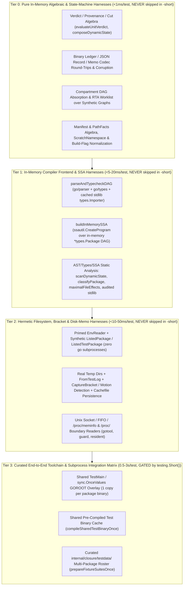

# Pillar 3 Blueprint: First-Principles Coherent Testing Framework

> **Scope**: Synthesis of [`audit-01-specs-and-consumers.md`](file:///home/nikolas/repos/github.com/greatliontech/gofresh/docs/notes/audit-01-specs-and-consumers.md), [`audit-07a-root-view-tests.md`](file:///home/nikolas/repos/github.com/greatliontech/gofresh/docs/notes/audit-07a-root-view-tests.md), [`audit-07b-root-tests-part1.md`](file:///home/nikolas/repos/github.com/greatliontech/gofresh/docs/notes/audit-07b-root-tests-part1.md), [`audit-07c-root-tests-part2.md`](file:///home/nikolas/repos/github.com/greatliontech/gofresh/docs/notes/audit-07c-root-tests-part2.md), [`audit-08a-closure-tests-part1.md`](file:///home/nikolas/repos/github.com/greatliontech/gofresh/docs/notes/audit-08a-closure-tests-part1.md), [`audit-08b-closure-tests-part2-and-fixtures.md`](file:///home/nikolas/repos/github.com/greatliontech/gofresh/docs/notes/audit-08b-closure-tests-part2-and-fixtures.md), and [`audit-08c-subpackage-tests.md`](file:///home/nikolas/repos/github.com/greatliontech/gofresh/docs/notes/audit-08c-subpackage-tests.md) into a single, first-principles testing architecture for `gofresh`.

---

## 1. Root Diagnosis of the Current Test Suite

### 1.1 Quantitative Corpus Inventory

Across the repository, the test corpus spans **219 `*_test.go` files (73,348 lines of Go test code)** plus **127 `closure/fixtures/*` directories containing 135 importable Go packages (222 `.go` files, 4,102 lines)**:

| Scope | `*_test.go` Files | Lines of Test Code | Audit Reference |
| :--- | ---: | ---: | :--- |
| Root `gofresh` — View & Observability (`view_test.go`, `viewload_test.go`, `viewscope_test.go`) | 3 | 11,410 | [`audit-07a-root-view-tests.md`](file:///home/nikolas/repos/github.com/greatliontech/gofresh/docs/notes/audit-07a-root-view-tests.md) |
| Root `gofresh` — Part 1 (`ambiguity_test.go` .. `gofresh_test.go`) | 26 | 10,474 | [`audit-07b-root-tests-part1.md`](file:///home/nikolas/repos/github.com/greatliontech/gofresh/docs/notes/audit-07b-root-tests-part1.md) |
| Root `gofresh` — Part 2 (`initsubject_test.go` .. `vouchfile_test.go`) | 45 | 8,842 | [`audit-07c-root-tests-part2.md`](file:///home/nikolas/repos/github.com/greatliontech/gofresh/docs/notes/audit-07c-root-tests-part2.md) |
| `closure` — Part 1 (`ambiguity_test.go` .. `fixtureprogram_test.go`) | 24 | 12,465 | [`audit-08a-closure-tests-part1.md`](file:///home/nikolas/repos/github.com/greatliontech/gofresh/docs/notes/audit-08a-closure-tests-part1.md) |
| `closure` & `closure/*` — Part 2 (`flagset_test.go` .. `viewload_test.go` + 6 subpackage files) | 47 | 13,913 | [`audit-08b-closure-tests-part2-and-fixtures.md`](file:///home/nikolas/repos/github.com/greatliontech/gofresh/docs/notes/audit-08b-closure-tests-part2-and-fixtures.md) |
| Subpackages (`runtimeinput` [34], `gotool` [16], `guard` [8], `guidance` [2], `resident` [4], `internal/*` [8], `shortgates` [1], `toolversion` [1]) | 74 | 16,244 | [`audit-08c-subpackage-tests.md`](file:///home/nikolas/repos/github.com/greatliontech/gofresh/docs/notes/audit-08c-subpackage-tests.md) |
| **Total `*_test.go` Corpus** | **219** | **73,348** | — |
| `closure/fixtures/*` (127 directories / 135 Go packages) | 222 `.go` files | 4,102 | [`audit-08b-closure-tests-part2-and-fixtures.md`](file:///home/nikolas/repos/github.com/greatliontech/gofresh/docs/notes/audit-08b-closure-tests-part2-and-fixtures.md) |

Despite testing a deterministic static analyzer and incremental freshness verifier, a full `go test ./...` run takes **25–30 minutes** (requiring `.stipulator/policy.textproto` to configure `-test.timeout=60m` and `timeout_seconds: 7200`). Furthermore, tests were added incrementally per-ticket or per-requirement (`REQ-*`) rather than organized around the architectural layers of the system, resulting in six compounding structural failures.

---

### 1.2 Six Structural Causes of the 25–30 Minute Runtime & Architectural Rot

#### Cause 1: Layer Conflation (The Subprocess Tax)
The single largest runtime multiplier across both root `gofresh` and `closure` is testing pure in-memory AST, `go/types`, SSA, and fact-composition predicates through the outermost filesystem + `go` toolchain entry points:
- **`view_test.go` ([11,236 lines](file:///home/nikolas/repos/github.com/greatliontech/gofresh/view_test.go#L1-L11236))**: Contains 122 top-level `Test*` functions and 286 `t.Run` subtests. **296 of those subtests** (269 shared-dynamic-state subtests—including `TestCarrierEscapeDischarges` at 4,457 lines and 143 sequential subtests—plus 27 observability classification tests) test pure single- or two-package `go/ast` + `go/types` + `golang.org/x/tools/go/ssa` predicates (`scanDynamicState`, `classifyPackage`, `evaluateStatementOrder`). Yet every single subtest invokes `writeModuleTree(t, ...)` + `captureCheck(t, ...)` -> `engine.newView`, spawning `go env -json`, `go list`, and `packages.Load` (`go list -e -json ...`) subprocesses from scratch.
- **`datamemo_test.go` ([62L](file:///home/nikolas/repos/github.com/greatliontech/gofresh/datamemo_test.go#L1-L62)), `fieldstore_test.go` ([79L](file:///home/nikolas/repos/github.com/greatliontech/gofresh/fieldstore_test.go#L1-L79)), `oncefill_test.go` ([145L](file:///home/nikolas/repos/github.com/greatliontech/gofresh/oncefill_test.go#L1-L145)), `explain_test.go` ([836L](file:///home/nikolas/repos/github.com/greatliontech/gofresh/explain_test.go#L1-L836)), `explainorder_test.go` ([272L](file:///home/nikolas/repos/github.com/greatliontech/gofresh/explainorder_test.go#L1-L272)), `refusalchannels_test.go` ([142L](file:///home/nikolas/repos/github.com/greatliontech/gofresh/refusalchannels_test.go#L1-L142))**: Spawn another **126 `engine.newView` (`packages.Load`) subprocess cycles** (including `explainView` running `packages.Load` *twice* per subtest across 22 subtests) to test AST/SSA/types rules and refusal-explanation formatting.
- **`dynamicstate_test.go` ([3,046 lines](file:///home/nikolas/repos/github.com/greatliontech/gofresh/dynamicstate_test.go#L1-L3046))**:
  - **17 tests** (`TestMalformedDirectivesRefuse`, `TestMalformedCulpritSubjectRefuses`, `TestMalformedCarrierLinkCulpritRefuses`, `TestMalformedCarrierLinkCulpritInCurrentModuleRefuses`, `TestMalformedCarrierLinkSourceRefuses`, `TestMalformedCarrierLinkTargetRefuses`, `TestMalformedCarrierLinkKindRefuses`, `TestMalformedCrossPackageWriteSiteRefuses`, `TestMalformedCrossPackageWriteOwnerRefuses`, `TestMalformedDirectMutationOwnerRefuses`, `TestMalformedDirectMutationSiteRefuses`, `TestMalformedDynamicStateCulpritRefuses`, `TestMalformedDynamicStateFactRefuses`, `TestMalformedCulpritInCurrentModuleRefuses`, `TestCarrierLinkCrossesDependencyBoundary`, `TestCarrierLinkCrossesThroughSafeIntermediate`, `TestVouchDischargesPinnedCulprit`) call `writePinnedDepModule` (spawning `go list -m` + `go mod tidy`) and `runScan` (`packages.Load`) **solely to populate `processFactCache`, immediately overwrite the cached `dynamicStateFact` in memory with a synthetic struct, and re-run `composeDynamicState`**!
  - **4 tests** (`TestGeneratedProtoClusterDischarges`, `TestAuditedMappingUnauditedVersionRefuses`, `TestAuditedMemoizationDischargeIsAttestationFree`, `TestSingleSubjectDirectiveConfersNothingOnDependency`) construct full `file://` module proxies and run **11 `go mod tidy` + `go clean -modcache` + `packages.Load` subprocess cycles** for pure AST/types/fact-composition rules.
- **`closure` Subprocess Abuse**:
  - `TestDstSelectionIsJudgedByContentNeverByTag` ([`toolchainsource_dst_test.go:258-604`](file:///home/nikolas/repos/github.com/greatliontech/gofresh/closure/toolchainsource_dst_test.go#L258-L604)) runs **25 separate `OverlayGOROOTEnv` + `newAtEnv` (`go list` over all of `GOROOT`) subprocess passes** (~30–60s total), even though 22 of the 25 subtests only exercise single-package `verifyListedPackage(&ListedPackage{...})` on a synthetic `time/tzdata` source file (<5ms in memory).
  - `TestComputeMaximalBatchConservativelyMarksStandardWrappers` ([`maximal_test.go:530-804`](file:///home/nikolas/repos/github.com/greatliontech/gofresh/closure/maximal_test.go#L530-L804)) runs **14 separate `newAt(dir)` (`go list`) subprocess cycles** to test `maximalFileEffectsContent`, a pure `go/parser` + `go/types` function.
  - `TestCompartmentLedgerIsAFunctionOfTheHashUnderOneListingConfiguration` ([`compartmentledger_test.go:107-202`](file:///home/nikolas/repos/github.com/greatliontech/gofresh/closure/compartmentledger_test.go#L107-L202)) spawns **60 `go list` subprocesses** across 12 random draws to test deterministic sorting/absorption of `compartmentLedger` over a fixed 3-package DAG.
  - `TestTestVariantInertnessRejectsRebinding` ([`testvariant_binding_test.go:13-106`](file:///home/nikolas/repos/github.com/greatliontech/gofresh/closure/testvariant_binding_test.go#L13-L106)) spawns **10 `go test` + 10 `newAt` subprocesses** to test 5 string-rejection cases in `compartment.parseLedger` that are already unit-tested in `<1ms` in [`closure/internal/compartment/bindings_test.go`](file:///home/nikolas/repos/github.com/greatliontech/gofresh/closure/internal/compartment/bindings_test.go#L1-L153).
  - `audited_test.go` ([`closure/audited_test.go:1-3635`](file:///home/nikolas/repos/github.com/greatliontech/gofresh/closure/audited_test.go#L1-L3635)) writes **50+ temporary multi-package trees** and triggers **10+ full `go list` + whole-program SSA builds** to test audited stdlib helper rules (`sync.Once`, `slices.SortFunc`, `fmt.Sprint`, `reflect.TypeOf`, etc.) that only require an in-memory SSA builder.

#### Cause 2: Unshared Fixture Preparation, Repeated `GOROOT` Clones & 18+ `go test -c` Compilations
- **Unshared `fixturePrograms` in `closure`**: `newFixtureProgramSuite(t, ...)` ([`fixtureprogram_test.go:15-264`](file:///home/nikolas/repos/github.com/greatliontech/gofresh/closure/fixtureprogram_test.go#L15-L264)) is instantiated per-`Test*` function rather than once per package binary:
  - `batchisolation` is `go list`-ed and SSA-compiled **12 separate times** across `batch_test.go`, `closure_test.go`, `fixturepreparation_test.go`, `maximal_test.go`, and `toolchainsource_test.go`.
  - Calling `newFixtureProgramSuite(t)` with an empty roster falls back to individual `Hasher` instances (`prepareSoloFixtureProgram`), causing `TestObservabilityBatchMatchesIndependentAnalysis` ([`closure_test.go:4210-4271`](file:///home/nikolas/repos/github.com/greatliontech/gofresh/closure/closure_test.go#L4210-L4271)) to spawn **25 separate `Hasher`s and 23 parallel whole-program SSA builds**, and `fixturepreparation_test.go` ([`closure/fixturepreparation_test.go:1-214`](file:///home/nikolas/repos/github.com/greatliontech/gofresh/closure/fixturepreparation_test.go#L1-L214)) to spawn **54 solo `Hasher` + SSA loads**.
- **Repeated Full-`GOROOT` Filesystem Clones**: `toolchain_dependencies_test.go` ([`toolchain_dependencies_test.go:18-275`](file:///home/nikolas/repos/github.com/greatliontech/gofresh/toolchain_dependencies_test.go#L18-L275)) and `toolchain_dependencies_linux_test.go` ([`closure/toolchain_dependencies_linux_test.go:20-235`](file:///home/nikolas/repos/github.com/greatliontech/gofresh/closure/toolchain_dependencies_linux_test.go#L20-L235)) invoke `cp -a --reflink=auto` (or full recursive copy) of the entire `runtime.GOROOT()` tree (~12,000 files) 7 separate times across subtests instead of sharing a single `sync.OnceValues` overlay.
- **18+ Separate `go test -c` Compilations & Self-Reexec Binaries**: Root execution tests (`artifact_test.go`, `checking_test.go`, `outcome_test.go`, `package_unit_test.go`, `processaccount_test.go`, `producing_selection_test.go`, `runtime_binding_test.go`, `runtime_motion_test.go`, `runtime_partial_motion_linux_test.go`, `session_pwd_test.go`, `session_test.go`, `applicability_test.go`) compile **18+ separate `go test -c` binaries** and spawn self-reexec child processes (`TestSessionCheckerProcess`, `TestApplicabilityCheckerReload`).

#### Cause 3: 135 Accidental Public Packages Under `closure/fixtures/*`
Because `closure/fixtures/` is named `fixtures` instead of `testdata`, the Go toolchain (`go list ./...`, `go test ./...`, `go vet ./...`) and `gomutant` treat all **127 subdirectories (135 Go packages, 222 `.go` files)** as first-class repository packages that must be listed, type-checked, and built on every workspace invocation—even though **108 of the 127 directories are tiny 1–2 file snippets** used only once by a single test and `#16 embedfixture` is completely orphaned.

#### Cause 4: Broken `-short` Gate Discipline
- **45+ Fast Unit Tests Falsely Skipped in `-short`**:
  - In [`closure/closure_test.go`](file:///home/nikolas/repos/github.com/greatliontech/gofresh/closure/closure_test.go#L2117-L3436), **37 pure in-memory / micro-FS unit tests**—including all **29 `TestContributionCgo*` scanner unit tests** (`<1ms` each, zero subprocesses) and 8 pure AST/temp-file helper tests (`TestPackageSourcesReadError`, `TestPackageFileEffectsClean`, `TestComputePackageMaximalEffectsFileReadError`, `TestFileEffectsClean`, `TestVerifyListedPackageRejectsUnsupportedFields`, `TestVerifyListedPackageRejectsCgoWhenPureGoRequested`, `TestHasherEnvRejectsRelativeGOROOT`, `TestHasherRejectsMissingToolBinary`)—have copy-pasted `if testing.Short() { t.Skip(...) }` guards.
  - In [`closure/effectmemo_test.go`](file:///home/nikolas/repos/github.com/greatliontech/gofresh/closure/effectmemo_test.go#L27-L115), [`closure/maximal_test.go`](file:///home/nikolas/repos/github.com/greatliontech/gofresh/closure/maximal_test.go#L485-L845), [`dynamicstate_test.go`](file:///home/nikolas/repos/github.com/greatliontech/gofresh/dynamicstate_test.go#L2282-L2636), [`explainorder_test.go`](file:///home/nikolas/repos/github.com/greatliontech/gofresh/explainorder_test.go#L121-L157), [`gofresh_test.go`](file:///home/nikolas/repos/github.com/greatliontech/gofresh/gofresh_test.go#L649-L832), and [`environment_test.go`](file:///home/nikolas/repos/github.com/greatliontech/gofresh/environment_test.go#L118-L216), another 12 pure in-memory or micro-FS tests are needlessly skipped in `-short`.
- **8 Subprocess Tests Missing `-short` Guards**:
  - In root `gofresh` ([`audit-07c:32, 38-42, 50`](file:///home/nikolas/repos/github.com/greatliontech/gofresh/docs/notes/audit-07c-root-tests-part2.md#L32-L50)): [`runner_test.go`](file:///home/nikolas/repos/github.com/greatliontech/gofresh/runner_test.go) (1 test calling `e.capture`), [`session_directory_unix_test.go`](file:///home/nikolas/repos/github.com/greatliontech/gofresh/session_directory_unix_test.go) (`NewSession`), [`session_ownership_test.go`](file:///home/nikolas/repos/github.com/greatliontech/gofresh/session_ownership_test.go) (`NewSession`), [`session_test.go`](file:///home/nikolas/repos/github.com/greatliontech/gofresh/session_test.go) (2 `NewSession` + `Snapshot` tests), [`session_vouches_test.go`](file:///home/nikolas/repos/github.com/greatliontech/gofresh/session_vouches_test.go) (`NewSession`), and [`toolversion_test.go`](file:///home/nikolas/repos/github.com/greatliontech/gofresh/toolversion_test.go) (spawns `go test ./...` in `toolversion/`) invoke `go` toolchain subprocesses without `if testing.Short() { t.Skip(...) }`.
  - In `closure` ([`audit-08a:60`](file:///home/nikolas/repos/github.com/greatliontech/gofresh/docs/notes/audit-08a-closure-tests-part1.md#L60)): `TestAuditedToolchainCoversRunningToolchain` ([`closure/audited_test.go:1263`](file:///home/nikolas/repos/github.com/greatliontech/gofresh/closure/audited_test.go#L1263)) runs `newAtEnv` (`go list` over `GOROOT`) 4 times without a `testing.Short()` guard.

#### Cause 5: Unconsumed-Surface Tests & N-Way Copy-Paste Duplication
- **Tests Pinning Unconsumed Public Surface & Legacy Shims**:
  - [`artifact_test.go`](file:///home/nikolas/repos/github.com/greatliontech/gofresh/artifact_test.go#L1-L799) tests the unconsumed `artifact.go` surface (`ArtifactDescription`, `BindArtifact`, `BindArtifactByDigest`, `CompileTestBinary`, `BuildBinding` accessors) and `RuntimeBinding.Execute`—none of which have any external callers across `pew`, `gomutant`, or `stipulator` ([`audit-07b:53-55`](file:///home/nikolas/repos/github.com/greatliontech/gofresh/docs/notes/audit-07b-root-tests-part1.md#L53-L55)).
  - Older root test files (`gofresh_test.go`, `view_test.go`, `explain_test.go`, `dynamicstate_test.go`) route through legacy test-only `engine` / `newView` / `captureCheck` shims in `apihelpers_test.go`, while `checking_endpoints_test.go` defines internal test-only `Snapshot.observeRuntimeInputs` and `finishRuntimeObservation` adapters.
  - [`guard/helpers_test.go`](file:///home/nikolas/repos/github.com/greatliontech/gofresh/guard/helpers_test.go) (25 lines) defines dead helpers (`captureAmbient`, `captureInDir`, `buildConfigAmbient`) with zero callers ([`audit-08c:624-625`](file:///home/nikolas/repos/github.com/greatliontech/gofresh/docs/notes/audit-08c-subpackage-tests.md#L624-L625)).
- **N-Way Duplicate Tests & Helpers**:
  - [`applicability_test.go:359-515`](file:///home/nikolas/repos/github.com/greatliontech/gofresh/applicability_test.go#L359-L515) overlaps with [`applicability_validation_test.go`](file:///home/nikolas/repos/github.com/greatliontech/gofresh/applicability_validation_test.go) and [`checking_test.go`](file:///home/nikolas/repos/github.com/greatliontech/gofresh/checking_test.go), running 24 `newViewFor` loads for in-memory seal/admission checks ([`audit-07b:49, 154`](file:///home/nikolas/repos/github.com/greatliontech/gofresh/docs/notes/audit-07b-root-tests-part1.md#L49)).
  - Duplicate `writeTempTestLog` / `writeModule` / `primedRoots` helpers are scattered across the 34 `runtimeinput/*_test.go` files, and `gotool` tests are fragmented across 16 small files.

#### Cause 6: `.stipulator/` Policy, Tombstoned Self-Analysis & Umbrella-Fuzzer Pathologies
- **15-Minute Whole-Repo Self-Analysis for a Tombstoned Requirement**: `TestReadOnlyObservabilityProof` ([`view_test.go:10899-10912`](file:///home/nikolas/repos/github.com/greatliontech/gofresh/view_test.go#L10899-L10912)) runs `packages.Load` + whole-program SSA over `github.com/greatliontech/gofresh` itself, taking ~10–15 minutes under `stipulator check --run-tests` and forcing [`.stipulator/policy.textproto`](file:///home/nikolas/repos/github.com/greatliontech/gofresh/.stipulator/policy.textproto#L1-L15) to set `-test.timeout=60m` and `timeout_seconds: 7200`. Yet its target requirement (`REQ-closure-observability-self`) is **already tombstoned** in `docs/specs/closure.md`, and `TestReadOnlyObservabilityProof` is not bound in any `.stipulator/bindings/*.textproto` file!
- **Umbrella Fuzzers & Property Harnesses**:
  1. `FuzzObservabilityClassificationsAndAuditedSet` ([`closure/audited_test.go:1856`](file:///home/nikolas/repos/github.com/greatliontech/gofresh/closure/audited_test.go#L1856)) and `TestObservabilityPropertyHarness` / `FuzzObservabilityPropertyHarness` ([`closure/propertyharness_test.go`](file:///home/nikolas/repos/github.com/greatliontech/gofresh/closure/propertyharness_test.go#L1-L413)) are bound across `closure.textproto`.
  2. `FuzzFreshnessVerdictAndObservationInvariants`, `FuzzControlAndSessionAuthority`, and `FuzzPreparationAndUnitCoherence` ([`gofresh_test.go`](file:///home/nikolas/repos/github.com/greatliontech/gofresh/gofresh_test.go)) plus `FuzzJudgmentDiagnosticIndependence` ([`judgment_fuzz_test.go:11`](file:///home/nikolas/repos/github.com/greatliontech/gofresh/judgment_fuzz_test.go#L11)) are bound across `fresh.textproto`, `control.textproto`, `explain.textproto`, and `base-facts.textproto`.
  3. `TestProducerPremisesAcrossGeneratedBindings` ([`runtimeinput/premises_property_test.go:15`](file:///home/nikolas/repos/github.com/greatliontech/gofresh/runtimeinput/premises_property_test.go#L15)) is bound across `inputs.textproto`.
- **Hardcoded Test Names in `docs/specs/overview.md`**: [`docs/specs/overview.md`](file:///home/nikolas/repos/github.com/greatliontech/gofresh/docs/specs/overview.md#L1-L350) hardcodes 25+ specific Go test function names (`TestCarrierEscapeDischarges`, `TestObservabilityClassifications`, `TestComputeMaximalBatchMatchesIndividual`, etc.) directly inside normative specification prose, violating the spec/binding separation where `docs/specs/*.md` states the contract and `.stipulator/bindings/*.textproto` binds requirements to test witnesses.

---

## 2. The 4-Tier Testing Architecture

To make the entire unit + compiler-frontend + hermetic-FS suite (`go test -short ./...`) complete in **< 15 seconds** and the full end-to-end toolchain suite (`go test ./...`) complete in **< 90 seconds**, every test in `gofresh` is organized into a strict **4-Tier Testing Architecture** governed by the lowest computational layer capable of witnessing the invariant:



### Summary Matrix of the 4 Tiers

| Tier | Name | Per-Test Budget | Subprocesses Allowed? | Filesystem Allowed? | `-short` Policy (`shortgates`) | Target Share of Test Cases |
| :--- | :--- | :--- | :--- | :--- | :--- | :--- |
| **Tier 0** | Pure In-Memory Algebraic & State-Machine Harnesses | `< 1 ms` | **Zero** | **Zero** | **Never skipped** (forbidden to call `testing.Short()`) | ~45% |
| **Tier 1** | In-Memory Compiler Frontend & SSA Harnesses | `5 – 20 ms` | **Zero** (uses cached in-memory `types.Importer`) | **Zero** (parses in-memory string maps) | **Never skipped** (forbidden to call `testing.Short()`) | ~35% |
| **Tier 2** | Hermetic Filesystem, Bracket & Disk-Memo Harnesses | `10 – 50 ms` | **Zero `go` toolchain subprocesses** | Yes (`t.TempDir()`, brackets, symlinks, pipes/FIFOs) | **Never skipped** (except OS-specific syscalls where unsupported) | ~15% |
| **Tier 3** | Curated End-to-End Toolchain & Subprocess Integration Matrix | `0.5 – 3 s` | Yes (`go list`, `go test -c`, `packages.Load`, child test binary) | Yes (`t.TempDir()`, shared `GOROOT` overlay, `internal/closure/testdata/`) | **Strictly gated** (`if testing.Short() { t.Skip() }` as 1st statement) | ~5% |

---

### 2.1 Tier 0 — Pure In-Memory Algebraic & State-Machine Harnesses (`<1ms/test`, never skipped in `-short`)

**Contract**: Tier 0 tests operate exclusively on in-memory Go values, structs, slices, and byte buffers. They perform zero disk I/O, zero `go/parser`/`go/types` invocations, and zero subprocess executions.

**Core Tier 0 Harnesses to Build/Standardize**:
1. **Dynamic-State Composition & Vouch/Cut Algebra Harness (`dynamicstate_algebra_test.go`)**:
   - Directly constructs `map[string]dynamicStateFact`, `map[string]*PackageSnapshot`, and `vouchTable` values in memory and invokes `composeDynamicState`, `validateDynamicStateFact`, `validateDirectiveEntry`, `evaluateVouchCut`, and `explainRefusal`.
   - Eliminates all 17 `writePinnedDepModule` + `runScan` subprocess cycles in `dynamicstate_test.go` (`TestMalformed*`, `TestCarrierLinkCrosses*`, `TestVouchDischargesPinnedCulprit`) and the refusal-formatting subprocess runs in `explain_test.go`, `explainorder_test.go`, and `refusalchannels_test.go`.
2. **Verdict, Outcome & Provenance Algebra Harness (`verdict_algebra_test.go`)**:
   - Directly tests `evaluateUnitVerdict`, `checkClosureCompatibility`, `checkRuntimeCompatibility`, `checkArtifactClosing`, `checkSubtestSelectivity`, `FingerprintRecord` JSON codecs, and `Outcome` projections over synthetic `PackageSnapshot` and `VerificationRecord` structs.
3. **Compartment Ledger & RTA Graph Algebra Harness (`internal/closure/internal/compartment/compartment_test.go`, `internal/closure/internal/rta/rta_test.go`)**:
   - Feeds synthetic `[]PackageInput` DAGs and `rapid` property generators directly into `compartment.Build`, `compartment.EncodeLedger` / `DecodeLedger`, and `rta.Analyze`.
   - Replaces the 60 `go list` subprocesses in `TestCompartmentLedgerIsAFunctionOfTheHashUnderOneListingConfiguration`.
4. **Runtime-Input Manifest, PathFacts, ScratchNamespace & Outcome Algebra Harness (`runtimeinput/manifest_algebra_test.go`)**:
   - Tests `State` adoption/merging (`Adopt`, `Merge`, `Incomplete`), `manifest` JSON/base64url encoding, `pathFacts` comparison algebra, `ScratchNamespace` validation and matching, `OutcomeSupport` sealing, and `RefusalAttribution` formatting in memory.
5. **Command-Line, Build-Flag & Guard Normalization Harness (`gotool/env_version_test.go`, `internal/guard/guard_test.go`, `guidance/guidance_test.go`)**:
   - Table-driven algebraic suites over `buildflags.Validate`, `buildflags.Fields`, `gotool.EnvSnapshot`, `guard.Compare`, and `guidance` projections.

---

### 2.2 Tier 1 — In-Memory Compiler Frontend & SSA Harnesses (`<5–20ms/test`, cached stdlib `types.Importer`, never skipped in `-short`)

**Contract**: Tier 1 tests exercise `gofresh`'s static analysis passes (`scanDynamicState`, `classifyPackage`, `evaluateStatementOrder`, `scanContributionCgo`, `maximalFileEffectsContent`, `computePackageAuditedEffects`, `internal/closure/internal/rta`, generic instantiation, and init-order analysis) over real parsed ASTs (`*ast.File`), real `go/types` packages (`*types.Package`, `*types.Info`), and real SSA (`*ssa.Program`, `*ssa.Package`)—**without ever invoking `go list`, `packages.Load`, or touching the filesystem**.

**Core Tier 1 Mechanism (`frontend_harness_test.go`)**:
```go
// cachedStdlibImporter loads standard-library *types.Package objects once per test binary
// via importer.Default() and caches them in a sync.Map so in-memory packages can import
// "sync", "sync/atomic", "reflect", "fmt", "os", "unsafe", "slices", "maps", etc. in <1ms.
type memoryImporter struct {
    stdlib types.Importer
    pkgs   map[string]*types.Package
}

func parseAndTypecheckDAG(t testing.TB, dag map[string]map[string]string) (
    fset *token.FileSet,
    pkgs map[string]*types.Package,
    infos map[string]*types.Info,
    files map[string][]*ast.File,
)

func buildInMemorySSA(t testing.TB, dag map[string]map[string]string) (
    prog *ssa.Program,
    ssaPkgs map[string]*ssa.Package,
    fset *token.FileSet,
    infos map[string]*types.Info,
    files map[string][]*ast.File,
)
```
- **Impact**:
  - Converts **296 subtests in `view_test.go`** (`TestCarrierEscapeDischarges` [143 subtests], `TestSharedDynamicStateClassifications` [126 subtests], `TestObservabilityClassifications` [27 subtests]) from ~10–15 minutes of `packages.Load` subprocesses into **< 3 seconds of parallel Tier 1 execution**.
  - Converts `datamemo_test.go` (15), `fieldstore_test.go` (23), `oncefill_test.go` (33), `initsubject_test.go`, `recvname_test.go`, `genericview_test.go`, and the AST/SSA tests in `dynamicstate_test.go` into `< 1 second` total.
  - Converts `closure/audited_test.go` (50+ temp modules), `closure/maximal_test.go` (14 `newAt` loops), `closure/generic_test.go`, `closure/genericbounded_test.go`, `closure/genericmethod_test.go`, `closure/effectscan_equivalence_test.go`, `closure/effectscan_reference_test.go`, and **108 of the 127 `closure/fixtures/*` directories** into inline string-map tables running in `< 2 seconds` total.

---

### 2.3 Tier 2 — Hermetic Filesystem, Bracket & Disk-Memo Harnesses (`<10–50ms/test`, real temp dirs, primed `EnvReader`, zero `go` subprocesses)

**Contract**: Tier 2 tests verify real operating-system and filesystem boundaries—`t.TempDir()` trees, `runtimeinput` `-test.testlogfile` ingestion (`FromTestLog`) and filesystem brackets (`CaptureBracket`, `revalidate`, symlink/directory motion), atomic `cachefile` rename/fsync/truncation recovery, `.gofresh/vouches` file parsing, and `/proc` resource sampling (`resident`, `internal/guard`, `gotool`)—while **strictly forbidding `go` toolchain subprocesses (`go env`, `go list`, `go test`, `packages.Load`)**.

**Core Tier 2 Harnesses**:
1. **Primed `EnvReader` & Synthetic `ListedPackage` Harness (`internal/closure/toolchainsource_hermetic_test.go`)**:
   - Constructs a `Hasher` with a primed `EnvReader` (returning a fixed `EnvSnapshot` pointing at a tiny synthetic `t.TempDir()` fake `GOROOT` containing stub `bin/go` and `pkg/tool/<goos>_<goarch>/compile` files) and feeds synthetic `ListedPackage` / `ListedTestPackage` records directly into `verifyListedPackage`, `deriveToolchainFloor`, `computeFileEffects`, and `fileMemo` / `effectMemo` / `listingMemo`.
   - Converts **22 of the 25 subtests in `TestDstSelectionIsJudgedByContentNeverByTag`** ([`toolchainsource_dst_test.go`](file:///home/nikolas/repos/github.com/greatliontech/gofresh/closure/toolchainsource_dst_test.go#L258-L604)) from 25 full-`GOROOT` `go list` passes into `<5ms` Tier 2 tests.
2. **Hermetic Testlog & Bracket Motion Harness (`runtimeinput/classification_test.go`, `runtimeinput/bracket_test.go`, `runtimeinput/bracket_linux_test.go`)**:
   - Exercises `FromTestLog`, `FileInputEligibility`, `CaptureBracket`, `revalidate`, directory/symlink/hardlink/FIFO/socket classification, and concurrent file-motion invalidation over `t.TempDir()` with primed `Roots` (zero `go env` subprocesses).
3. **Hermetic Disk-Cache & Corrupt-File Recovery Harness (`internal/closure/memo_hermetic_test.go`, `memo_hermetic_test.go`)**:
   - Tests `internal/cachefile` atomic writes, concurrent singleflight contention, truncated/corrupt entry repair, and `XDG_CACHE_HOME` isolation using synthetic digests and pre-built `ListedPackage` inputs rather than running full SSA builds to populate cache files.

---

### 2.4 Tier 3 — Curated End-to-End Toolchain & Subprocess Integration Matrix (`0.5–3s/test`, gated by `if testing.Short() { t.Skip() }` at test head per `shortgates`)

**Contract**: Tier 3 tests are the **only** tests permitted to invoke `go env`, `go list`, `packages.Load`, `go test -c`, or spawn child test binaries. Every Tier 3 test **must** begin with `if testing.Short() { t.Skip("...") }` as its first statement (enforced by [`shortgates`](file:///home/nikolas/repos/github.com/greatliontech/gofresh/shortgates/shortgates_test.go#L1-L191)).

**Three Mandatory Tier 3 Amortizations**:
1. **Single Shared `GOROOT` Overlay per Package Binary (`sharedGOROOTOverlayOnce`)**:
   - Replaces the 7 separate `cp -a --reflink=auto` full-`GOROOT` copies in `toolchain_dependencies_test.go` and `closure/toolchain_dependencies_linux_test.go` with a single `sync.OnceValues` base copy per package binary.
2. **Single Shared Pre-Compiled Test Binary Cache (`compileSharedTestBinaryOnce`)**:
   - Replaces the 18+ separate `go test -c` compilations across root execution tests with **2 shared pre-compiled fixture test binaries** built once per root test binary via `sync.OnceValues` (preserving `GOCACHE` via `gotool.PreserveBuildCache`).
3. **Single Package-Level `prepareFixtureSuitesOnce` Roster for `internal/closure/testdata/`**:
   - Moves the 16 retained multi-package integration fixtures from `closure/fixtures/*` to `internal/closure/testdata/*` (so `go list ./...` and `gomutant` ignore them as workspace packages) and loads them **once per `internal/closure` test binary** via `sync.OnceValues`.

---

## 3. Complete Mapping Table of All 219 `*_test.go` Files

### 3.1 Summary of File Consolidation (219 Files -> 51 Target Files)

| Package Scope | Current `*_test.go` Files | Current Lines | Target `*_test.go` Files | Target Distribution Across Tiers |
| :--- | ---: | ---: | ---: | :--- |
| Root `gofresh` | 74 | 30,726 | **14** | Tier 0: 4 files, Tier 1: 4 files, Tier 2: 3 files, Tier 3: 2 files, Bench: 1 file |
| `internal/closure` | 65 | 24,395 | **9** | Tier 0: 2 files, Tier 1: 4 files, Tier 2: 2 files, Tier 3: 1 file |
| `internal/testvariant` & `internal/closure/internal/*` | 6 | 1,983 | **6** | Tier 0: 4 files, Tier 1: 1 file, Tier 2: 1 file (`internal/cachefile`) |
| `runtimeinput` | 34 | 10,557 | **6** | Tier 0: 1 file, Tier 0/2: 2 files, Tier 2: 1 file, Tier 2/3: 1 file, Helpers: 1 file |
| `gotool` | 16 | 1,948 | **4** | Tier 0/2: 2 files, Tier 2/3: 2 files |
| `internal/guard`, `guidance`, `resident` | 14 | 2,999 | **5** | `internal/guard`: 2 files, `guidance`: 1 file, `resident`: 2 files |
| `internal/*`, `shortgates`, `toolversion` | 10 | 740 | **7** | Tier 0/1/2: 1 file per retained subpackage |
| **Total** | **219** | **73,348** | **51** | **~80% Tier 0 & Tier 1, ~15% Tier 2, ~5% Tier 3** |

---

### 3.2 Root `gofresh` Package Mapping (74 `*_test.go` Files -> 14 Target Files)

#### Target File Roster for Root `gofresh`:
1. **`verdict_algebra_test.go` (Tier 0)**: Pure in-memory verdict, compatibility, provenance, outcome, and fingerprint codec tests + property fuzzers.
2. **`dynamicstate_algebra_test.go` (Tier 0)**: Pure in-memory `composeDynamicState`, `validateDynamicStateFact`, directive validation, vouch/cut algebra, and refusal channel/explanation formatting.
3. **`unit_protocol_test.go` (Tier 0)**: Pure in-memory unit preparation, applicability validation, producing/checking candidate selection, and cancellation state machines.
4. **`surface_test.go` (Tier 0/1)**: Exported API surface reflection guards, `shortgates.Verify`, zero-value/nil-receiver safety, and structural invariants.
5. **`frontend_harness_test.go` (Tier 1)**: Shared `parseAndTypecheckDAG` and `buildInMemorySSA` helpers backed by cached stdlib `types.Importer`.
6. **`dynamicstate_scan_test.go` (Tier 1)**: In-memory AST/types/SSA tests for shared dynamic state (`scanDynamicState`), carrier escape discharge, `sync.Once` fill, field store, data memo, generic views, init subjects, and receiver names.
7. **`observability_scan_test.go` (Tier 1)**: In-memory AST/types/SSA tests for observability classification (`classifyPackage`), statement ordering, and audited stdlib calls.
8. **`vouch_directives_test.go` (Tier 1 + Tier 2)**: Directive parsing (`//gofresh:pure`, `//gofresh:external`) over in-memory ASTs and `.gofresh/vouches` file parsing over `t.TempDir()`.
9. **`memo_hermetic_test.go` (Tier 2)**: Hermetic disk memoization (`scanMemo`, `cacheisolation`), atomic corruption recovery, and snapshot reuse with primed `EnvReader`.
10. **`session_hermetic_test.go` (Tier 2)**: Hermetic session directory ownership, unix permissions, bracket file watches, and PWD canonicalization without `go` subprocesses.
11. **`environment_hermetic_test.go` (Tier 2)**: Environment sanitization, build-flag normalization, and toolchain key derivation with synthetic `EnvSnapshot` inputs.
12. **`integration_view_test.go` (Tier 3, `-short` gated)**: Curated end-to-end `packages.Load` + `View` construction, `GOROOT` overlay (via `sharedGOROOTOverlayOnce`), and multi-module boundary matrix.
13. **`integration_execution_test.go` (Tier 3, `-short` gated)**: End-to-end compiled test binary execution (via `compileSharedTestBinaryOnce`), `-test.testlogfile` runtime-input capture, runtime motion, and process accounting.
14. **`artifact_bench_test.go` (Benchmarks)**: Benchmark suite for artifact & view operations.

#### File-by-File Mapping Table (Root `gofresh` — All 74 Files):

| # | Existing File | Lines | Current Pathology | Target File(s) | Target Tier | Concrete Transformation Action |
| ---: | :--- | ---: | :--- | :--- | :--- | :--- |
| 1 | [`view_test.go`](file:///home/nikolas/repos/github.com/greatliontech/gofresh/view_test.go) | 11,236 | 296 of 320 subtests spawn `packages.Load` for pure AST/SSA rules; `TestReadOnlyObservabilityProof` takes 15m for tombstoned `REQ-closure-observability-self` | `dynamicstate_scan_test.go`, `observability_scan_test.go`, `integration_view_test.go` | Tier 1 (296), Tier 3 (23), Delete (1) | Convert 269 dynamic-state subtests (`TestCarrierEscapeDischarges` etc.) & 27 observability subtests to `buildInMemorySSA`; delete `TestReadOnlyObservabilityProof`; keep 23 loader/module tests in Tier 3 |
| 2 | [`viewload_test.go`](file:///home/nikolas/repos/github.com/greatliontech/gofresh/viewload_test.go) | 141 | Spawns `packages.Load` for package loading error paths | `integration_view_test.go` | Tier 3 | Merge into curated loader matrix in `integration_view_test.go` |
| 3 | [`viewscope_test.go`](file:///home/nikolas/repos/github.com/greatliontech/gofresh/viewscope_test.go) | 33 | Pure scope predicate in separate micro-file | `verdict_algebra_test.go` | Tier 0 | Inline into `verdict_algebra_test.go` |
| 4 | [`ambiguity_test.go`](file:///home/nikolas/repos/github.com/greatliontech/gofresh/ambiguity_test.go) | 270 | Mixes pure ambiguity classification with `packages.Load` | `verdict_algebra_test.go`, `integration_view_test.go` | Tier 0 / Tier 3 | Move pure ambiguity algebra to Tier 0; keep 1 loader witness in Tier 3 |
| 5 | [`analysisbound_test.go`](file:///home/nikolas/repos/github.com/greatliontech/gofresh/analysisbound_test.go) | 75 | Separate micro-file for analysis bound check | `unit_protocol_test.go` | Tier 0 | Merge into `unit_protocol_test.go` |
| 6 | [`apihelpers_test.go`](file:///home/nikolas/repos/github.com/greatliontech/gofresh/apihelpers_test.go) | 79 | Shared test helpers scattered across files | `frontend_harness_test.go` | Tier 0/1 | Consolidate retained test helpers into `frontend_harness_test.go` |
| 7 | [`apisurface_test.go`](file:///home/nikolas/repos/github.com/greatliontech/gofresh/apisurface_test.go) | 130 | Reflection check over public types | `surface_test.go` | Tier 0 | Merge into `surface_test.go` and update for pruned public surface |
| 8 | [`applicability_batch_test.go`](file:///home/nikolas/repos/github.com/greatliontech/gofresh/applicability_batch_test.go) | 86 | Batch applicability wrapper test | `unit_protocol_test.go` | Tier 0 | Merge into `unit_protocol_test.go` |
| 9 | [`applicability_test.go`](file:///home/nikolas/repos/github.com/greatliontech/gofresh/applicability_test.go) | 663 | L359–515 overlaps with `applicability_validation_test.go` and `checking_test.go`, running 24 `newViewFor` loads for in-memory seal/admission checks; compiles self-reexec binary | `unit_protocol_test.go`, `integration_execution_test.go` | Tier 0 / Tier 3 | Deduplicate seal/admission checks into Tier 0 `unit_protocol_test.go`; use `compileSharedTestBinaryOnce` for reload test |
| 10 | [`applicability_validation_test.go`](file:///home/nikolas/repos/github.com/greatliontech/gofresh/applicability_validation_test.go) | 318 | Overlaps with `applicability_test.go` L359–515 | `unit_protocol_test.go` | Tier 0 | Deduplicate and merge into `unit_protocol_test.go` |
| 11 | [`artifact_bench_test.go`](file:///home/nikolas/repos/github.com/greatliontech/gofresh/artifact_bench_test.go) | 65 | Benchmark file | `artifact_bench_test.go` | Bench | Retain as benchmark file |
| 12 | [`artifact_test.go`](file:///home/nikolas/repos/github.com/greatliontech/gofresh/artifact_test.go) | 799 | Tests unconsumed `artifact.go` surface (`BindArtifact`, `BindArtifactByDigest`, `CompileTestBinary`, `BuildBinding`) and `RuntimeBinding.Execute`, spawning 4 `go test -c` compilations | `verdict_algebra_test.go`, `integration_execution_test.go` | Tier 0 / Delete | Delete tests for retired `artifact.go` and `RuntimeBinding.Execute` surface; retain any surviving build-binding validation in Tier 0 |
| 13 | [`builddescription_test.go`](file:///home/nikolas/repos/github.com/greatliontech/gofresh/builddescription_test.go) | 148 | Clean Tier 0/1 tests for `completeBuildEnvironment` and `normalizedGCCFlags` in separate micro-file | `environment_hermetic_test.go` | Tier 0 | Merge into `environment_hermetic_test.go` |
| 14 | [`cacheisolation_test.go`](file:///home/nikolas/repos/github.com/greatliontech/gofresh/cacheisolation_test.go) | 31 | Duplicate of `closure/cacheisolation_test.go` | `memo_hermetic_test.go` | Tier 2 | Merge into `memo_hermetic_test.go` |
| 15 | [`checking_endpoints_test.go`](file:///home/nikolas/repos/github.com/greatliontech/gofresh/checking_endpoints_test.go) | 43 | Internal test-only adapters `Snapshot.observeRuntimeInputs` and `finishRuntimeObservation` | `unit_protocol_test.go` | Tier 0 | Fold retained test helpers into `unit_protocol_test.go` |
| 16 | [`checking_test.go`](file:///home/nikolas/repos/github.com/greatliontech/gofresh/checking_test.go) | 761 | Compiles multiple `go test -c` binaries for unit lifecycle | `unit_protocol_test.go`, `integration_execution_test.go` | Tier 0 / Tier 3 | Move pure candidate/cancellation state machine tests to Tier 0; use `compileSharedTestBinaryOnce` in Tier 3 |
| 17 | [`construction_test.go`](file:///home/nikolas/repos/github.com/greatliontech/gofresh/construction_test.go) | 37 | Nil/invalid option tests | `surface_test.go` | Tier 0 | Merge into `surface_test.go` |
| 18 | [`construction_unix_test.go`](file:///home/nikolas/repos/github.com/greatliontech/gofresh/construction_unix_test.go) | 160 | FIFO + shell script cancellation test for `env` query | `environment_hermetic_test.go` | Tier 2 | Merge into `environment_hermetic_test.go` |
| 19 | [`cutprovenance_test.go`](file:///home/nikolas/repos/github.com/greatliontech/gofresh/cutprovenance_test.go) | 252 | Spawns `packages.Load` for cut-provenance algebra | `dynamicstate_algebra_test.go` | Tier 0 | Convert to pure in-memory `composeDynamicState` cut-provenance table in Tier 0 |
| 20 | [`datamemo_test.go`](file:///home/nikolas/repos/github.com/greatliontech/gofresh/datamemo_test.go) | 62 | 15 `packages.Load` runs for pure AST/SSA data-memo predicate | `dynamicstate_scan_test.go` | Tier 1 | Convert all 15 subtests to `buildInMemorySSA` in `dynamicstate_scan_test.go` |
| 21 | [`dischargeprefix_test.go`](file:///home/nikolas/repos/github.com/greatliontech/gofresh/dischargeprefix_test.go) | 71 | Pure string prefix discharge rule | `dynamicstate_algebra_test.go` | Tier 0 | Merge into `dynamicstate_algebra_test.go` |
| 22 | [`dynamicstate_test.go`](file:///home/nikolas/repos/github.com/greatliontech/gofresh/dynamicstate_test.go) | 3,046 | 17 tests run `go mod tidy` + `packages.Load` just to overwrite `processFactCache` in memory; 4 tests build `file://` GOPROXY trees; false `-short` skips | `dynamicstate_algebra_test.go`, `dynamicstate_scan_test.go`, `integration_view_test.go` | Tier 0 (17), Tier 1 (18), Tier 3 (3) | Move 17 synthetic `dynamicStateFact` composition/validation tests to Tier 0; convert 18 AST/SSA/proto-cluster tests to Tier 1 `buildInMemorySSA`; keep 3 real multi-module proxy tests in Tier 3; remove false `-short` skips |
| 23 | [`environment_test.go`](file:///home/nikolas/repos/github.com/greatliontech/gofresh/environment_test.go) | 282 | False `-short` skips on pure env normalization tests | `environment_hermetic_test.go` | Tier 0 / Tier 2 | Remove false `-short` skips; merge into `environment_hermetic_test.go` |
| 24 | [`explain_test.go`](file:///home/nikolas/repos/github.com/greatliontech/gofresh/explain_test.go) | 836 | `explainView` runs `packages.Load` *twice* per subtest across 15 subtests (30 loads) | `dynamicstate_algebra_test.go`, `dynamicstate_scan_test.go` | Tier 0 / Tier 1 | Test refusal rendering over Tier 0 synthetic facts and Tier 1 in-memory SSA scans (zero `packages.Load` runs) |
| 25 | [`explainorder_test.go`](file:///home/nikolas/repos/github.com/greatliontech/gofresh/explainorder_test.go) | 272 | 7 `explainView` runs (14 `packages.Load` invocations) + false `-short` skips | `dynamicstate_algebra_test.go` | Tier 0 | Convert to deterministic ordering tests over synthetic refusal sets in Tier 0; remove `-short` skips |
| 26 | [`fieldstore_test.go`](file:///home/nikolas/repos/github.com/greatliontech/gofresh/fieldstore_test.go) | 79 | 23 parallel `packages.Load` runs for field-store SSA predicate | `dynamicstate_scan_test.go` | Tier 1 | Convert all 23 subtests to `buildInMemorySSA` in `dynamicstate_scan_test.go` |
| 27 | [`fingerprint_record_test.go`](file:///home/nikolas/repos/github.com/greatliontech/gofresh/fingerprint_record_test.go) | 342 | Pure codec round-trip & corruption tests | `verdict_algebra_test.go` | Tier 0 | Merge into `verdict_algebra_test.go` |
| 28 | [`genericview_test.go`](file:///home/nikolas/repos/github.com/greatliontech/gofresh/genericview_test.go) | 86 | Spawns `packages.Load` for generic type instantiation scan | `dynamicstate_scan_test.go` | Tier 1 | Convert to `buildInMemorySSA` in `dynamicstate_scan_test.go` |
| 29 | [`gofresh_test.go`](file:///home/nikolas/repos/github.com/greatliontech/gofresh/gofresh_test.go) | 1,481 | Mixes pure `decide`/`Fingerprint`/strategy-pin/build-flag unit tests and 3 umbrella fuzzers (`FuzzFreshnessVerdictAndObservationInvariants`, `FuzzControlAndSessionAuthority`, `FuzzPreparationAndUnitCoherence`) with subprocess `engine` runs; false `-short` skips | `verdict_algebra_test.go`, `integration_view_test.go` | Tier 0 / Tier 3 | Move pure verdict/record/flag tests & decomposed property suites to Tier 0 (removing false `-short` skips); keep curated integration witnesses in Tier 3 |
| 30 | [`initsubject_test.go`](file:///home/nikolas/repos/github.com/greatliontech/gofresh/initsubject_test.go) | 283 | Spawns `packages.Load` for `init` subject attribution | `dynamicstate_scan_test.go` | Tier 1 | Convert to Tier 1 `buildInMemorySSA` in `dynamicstate_scan_test.go` |
| 31 | [`judgment_fuzz_test.go`](file:///home/nikolas/repos/github.com/greatliontech/gofresh/judgment_fuzz_test.go) | 45 | Contains `FuzzJudgmentDiagnosticIndependence` in a separate micro-file | `verdict_algebra_test.go` | Tier 0 | Merge into `verdict_algebra_test.go` |
| 32 | [`judgment_test.go`](file:///home/nikolas/repos/github.com/greatliontech/gofresh/judgment_test.go) | 348 | Pure verdict & observation algebra | `verdict_algebra_test.go` | Tier 0 | Merge into `verdict_algebra_test.go` |
| 33 | [`membership_surface_test.go`](file:///home/nikolas/repos/github.com/greatliontech/gofresh/membership_surface_test.go) | 71 | Pure membership surface checks | `surface_test.go` | Tier 0 | Merge into `surface_test.go` |
| 34 | [`membership_test.go`](file:///home/nikolas/repos/github.com/greatliontech/gofresh/membership_test.go) | 121 | View membership checks | `verdict_algebra_test.go` | Tier 0 | Merge into `verdict_algebra_test.go` |
| 35 | [`movedreasons_test.go`](file:///home/nikolas/repos/github.com/greatliontech/gofresh/movedreasons_test.go) | 112 | Pure `MovedReason` algebra | `verdict_algebra_test.go` | Tier 0 | Merge into `verdict_algebra_test.go` |
| 36 | [`oncefill_test.go`](file:///home/nikolas/repos/github.com/greatliontech/gofresh/oncefill_test.go) | 145 | 33 parallel subtests = 66 `packages.Load` runs for `sync.Once` SSA recognition | `dynamicstate_scan_test.go` | Tier 1 | Convert all 33 subtests to Tier 1 `buildInMemorySSA` in `dynamicstate_scan_test.go` |
| 37 | [`outcome_test.go`](file:///home/nikolas/repos/github.com/greatliontech/gofresh/outcome_test.go) | 489 | Mixes pure `Outcome` projections with `go test -c` execution | `verdict_algebra_test.go`, `integration_execution_test.go` | Tier 0 / Tier 3 | Move pure `Outcome` algebra to Tier 0; use `compileSharedTestBinaryOnce` in Tier 3 |
| 38 | [`package_unit_test.go`](file:///home/nikolas/repos/github.com/greatliontech/gofresh/package_unit_test.go) | 277 | Compiles `go test -c` binaries for `PackageUnit` (which duplicates `Unit`) | `unit_protocol_test.go`, `integration_execution_test.go` | Tier 0 / Tier 3 | Unify with `Unit` tests in Tier 0 `unit_protocol_test.go` and shared pre-compiled binary in Tier 3 |
| 39 | [`preparation_test.go`](file:///home/nikolas/repos/github.com/greatliontech/gofresh/preparation_test.go) | 212 | Spawns `newView` / `CheckBatch` subprocess loads to test batch refusal ordering (`TestUnknownSubjectRefusesBeforeTheMaximalFold`, `TestMalformedRecordRefusesTheBatchBeforeAnyWindow`) | `unit_protocol_test.go` | Tier 0 | Convert batch refusal-ordering checks to Tier 0 synthetic snapshot tests in `unit_protocol_test.go` |
| 40 | [`processaccount_test.go`](file:///home/nikolas/repos/github.com/greatliontech/gofresh/processaccount_test.go) | 541 | Compiles multiple `go test -c` binaries for process accounting | `unit_protocol_test.go`, `integration_execution_test.go` | Tier 0 / Tier 3 | Move pure accounting ledger algebra to Tier 0; share pre-compiled binary in Tier 3 |
| 41 | [`producing_selection_test.go`](file:///home/nikolas/repos/github.com/greatliontech/gofresh/producing_selection_test.go) | 253 | Compiles test binaries for producing-unit selection | `unit_protocol_test.go`, `integration_execution_test.go` | Tier 0 / Tier 3 | Move selection algebra to Tier 0; share pre-compiled binary in Tier 3 |
| 42 | [`progressdiagnostic_test.go`](file:///home/nikolas/repos/github.com/greatliontech/gofresh/progressdiagnostic_test.go) | 77 | Pure progress diagnostic formatting | `unit_protocol_test.go` | Tier 0 | Merge into `unit_protocol_test.go` |
| 43 | [`progressunits_test.go`](file:///home/nikolas/repos/github.com/greatliontech/gofresh/progressunits_test.go) | 221 | Pure progress event emission state machine | `unit_protocol_test.go` | Tier 0 | Merge into `unit_protocol_test.go` |
| 44 | [`provenance_composite_test.go`](file:///home/nikolas/repos/github.com/greatliontech/gofresh/provenance_composite_test.go) | 261 | Pure composite provenance algebra | `verdict_algebra_test.go` | Tier 0 | Merge into `verdict_algebra_test.go` |
| 45 | [`provenance_test.go`](file:///home/nikolas/repos/github.com/greatliontech/gofresh/provenance_test.go) | 101 | Pure provenance algebra | `verdict_algebra_test.go` | Tier 0 | Merge into `verdict_algebra_test.go` |
| 46 | [`purity_environment_test.go`](file:///home/nikolas/repos/github.com/greatliontech/gofresh/purity_environment_test.go) | 34 | Micro-file testing env purity | `environment_hermetic_test.go` | Tier 0 | Merge into `environment_hermetic_test.go` |
| 47 | [`purity_test.go`](file:///home/nikolas/repos/github.com/greatliontech/gofresh/purity_test.go) | 202 | Directive parsing & evaluation determinism | `vouch_directives_test.go`, `verdict_algebra_test.go` | Tier 0 / Tier 1 | Merge into `vouch_directives_test.go` and `verdict_algebra_test.go` |
| 48 | [`raceshards_test.go`](file:///home/nikolas/repos/github.com/greatliontech/gofresh/raceshards_test.go) | 350 | Concurrent shard race tests | `memo_hermetic_test.go` | Tier 2 | Merge into `memo_hermetic_test.go` |
| 49 | [`recvname_test.go`](file:///home/nikolas/repos/github.com/greatliontech/gofresh/recvname_test.go) | 121 | AST/types receiver name formatting | `dynamicstate_scan_test.go` | Tier 1 | Merge into `dynamicstate_scan_test.go` |
| 50 | [`refusalchannels_test.go`](file:///home/nikolas/repos/github.com/greatliontech/gofresh/refusalchannels_test.go) | 142 | Spawns 6 `packages.Load` runs for refusal channel routing | `dynamicstate_algebra_test.go` | Tier 0 | Convert to Tier 0 synthetic refusal routing table in `dynamicstate_algebra_test.go` |
| 51 | [`runner_test.go`](file:///home/nikolas/repos/github.com/greatliontech/gofresh/runner_test.go) | 326 | 1 test calls `e.capture` (subprocess) without `-short` guard | `unit_protocol_test.go` | Tier 0 / Tier 2 | Convert to primed `EnvReader` in `unit_protocol_test.go` |
| 52 | [`runtime_binding_test.go`](file:///home/nikolas/repos/github.com/greatliontech/gofresh/runtime_binding_test.go) | 371 | Compiles `go test -c` binaries to test runtime input binding | `verdict_algebra_test.go`, `integration_execution_test.go` | Tier 0 / Tier 3 | Move binding compatibility algebra to Tier 0; use `compileSharedTestBinaryOnce` for 1 end-to-end witness in Tier 3 |
| 53 | [`runtime_config_collision_test.go`](file:///home/nikolas/repos/github.com/greatliontech/gofresh/runtime_config_collision_test.go) | 46 | Pure config collision check | `verdict_algebra_test.go` | Tier 0 | Merge into `verdict_algebra_test.go` |
| 54 | [`runtime_motion_test.go`](file:///home/nikolas/repos/github.com/greatliontech/gofresh/runtime_motion_test.go) | 220 | Compiles `go test -c` binaries for runtime motion checks | `integration_execution_test.go` | Tier 3 | Share pre-compiled binary in `integration_execution_test.go` |
| 55 | [`runtime_partial_motion_linux_test.go`](file:///home/nikolas/repos/github.com/greatliontech/gofresh/runtime_partial_motion_linux_test.go) | 181 | Compiles test binaries for partial runtime motion | `integration_execution_test.go` | Tier 3 | Share pre-compiled binary in `integration_execution_test.go` |
| 56 | [`scanmemo_test.go`](file:///home/nikolas/repos/github.com/greatliontech/gofresh/scanmemo_test.go) | 540 | Spawns `packages.Load` to test disk scan memoization | `memo_hermetic_test.go` | Tier 2 | Feed Tier 1 in-memory packages / synthetic digests into `scanMemo` in `memo_hermetic_test.go` |
| 57 | [`session_directory_unix_test.go`](file:///home/nikolas/repos/github.com/greatliontech/gofresh/session_directory_unix_test.go) | 42 | Calls `NewSession` (subprocess `go env`) without `-short` guard | `session_hermetic_test.go` | Tier 2 | Use primed `EnvReader` in `session_hermetic_test.go` |
| 58 | [`session_ownership_test.go`](file:///home/nikolas/repos/github.com/greatliontech/gofresh/session_ownership_test.go) | 65 | Calls `NewSession` (subprocess `go env`) without `-short` guard | `session_hermetic_test.go` | Tier 2 | Use primed `EnvReader` in `session_hermetic_test.go` |
| 59 | [`session_pwd_test.go`](file:///home/nikolas/repos/github.com/greatliontech/gofresh/session_pwd_test.go) | 234 | Spawns subprocesses to test symlink PWD resolution | `session_hermetic_test.go` | Tier 2 | Test PWD resolution over `t.TempDir()` symlinks with primed `EnvReader` in `session_hermetic_test.go` |
| 60 | [`session_test.go`](file:///home/nikolas/repos/github.com/greatliontech/gofresh/session_test.go) | 809 | 2 `NewSession` + `Snapshot` tests lack `-short` guards; spawns self-reexec child processes | `session_hermetic_test.go`, `integration_execution_test.go` | Tier 2 / Tier 3 | Move in-process session lifecycle (with primed `EnvReader`) to `session_hermetic_test.go`; gate multi-process checker tests in Tier 3 |
| 61 | [`session_vouches_test.go`](file:///home/nikolas/repos/github.com/greatliontech/gofresh/session_vouches_test.go) | 31 | Calls `NewSession` without `-short` guard for session vouch loading | `vouch_directives_test.go` | Tier 2 | Use primed `EnvReader` in `vouch_directives_test.go` |
| 62 | [`shortgates_test.go`](file:///home/nikolas/repos/github.com/greatliontech/gofresh/shortgates_test.go) | 17 | Runs `shortgates.Verify` on root package | `surface_test.go` | Tier 1 | Merge into `surface_test.go` |
| 63 | [`snapshotreuse_test.go`](file:///home/nikolas/repos/github.com/greatliontech/gofresh/snapshotreuse_test.go) | 109 | Snapshot reuse across views | `memo_hermetic_test.go` | Tier 2 | Merge into `memo_hermetic_test.go` |
| 64 | [`structural_test.go`](file:///home/nikolas/repos/github.com/greatliontech/gofresh/structural_test.go) | 89 | Structural AST/source guards on root package | `surface_test.go` | Tier 1 | Merge into `surface_test.go` |
| 65 | [`subject_facts_test.go`](file:///home/nikolas/repos/github.com/greatliontech/gofresh/subject_facts_test.go) | 190 | Subject fact extraction & canonicalization | `dynamicstate_scan_test.go` | Tier 1 | Convert to Tier 1 `buildInMemorySSA` in `dynamicstate_scan_test.go` |
| 66 | [`testvariant_test.go`](file:///home/nikolas/repos/github.com/greatliontech/gofresh/testvariant_test.go) | 367 | Spawns `packages.Load` subprocesses for sibling test-variant compartment & ledger diff checks | `verdict_algebra_test.go`, `integration_view_test.go` | Tier 0 / Tier 3 | Move compartment ledger diff algebra to Tier 0 `verdict_algebra_test.go`; keep 1 end-to-end witness in Tier 3 |
| 67 | [`toolchain_dependencies_test.go`](file:///home/nikolas/repos/github.com/greatliontech/gofresh/toolchain_dependencies_test.go) | 275 | Clones entire `runtime.GOROOT()` (`cp -a`) 3 times across subtests | `environment_hermetic_test.go`, `integration_view_test.go` | Tier 2 / Tier 3 | Move floor/dependency algebra to Tier 2 (primed `EnvReader`); use `sharedGOROOTOverlayOnce` for 1 Tier 3 witness |
| 68 | [`toolchainkey_test.go`](file:///home/nikolas/repos/github.com/greatliontech/gofresh/toolchainkey_test.go) | 45 | Pure toolchain key digest computation | `environment_hermetic_test.go` | Tier 0 | Merge into `environment_hermetic_test.go` |
| 69 | [`toolversion_test.go`](file:///home/nikolas/repos/github.com/greatliontech/gofresh/toolversion_test.go) | 22 | Spawns `go test ./...` subprocess in `toolversion/` without `-short` guard, duplicating `toolversion/version_test.go` | `environment_hermetic_test.go` | Tier 0 | Replace subprocess `go test` with direct in-process check in `environment_hermetic_test.go` |
| 70 | [`unit_cancellation_test.go`](file:///home/nikolas/repos/github.com/greatliontech/gofresh/unit_cancellation_test.go) | 113 | Unit cancellation state machine | `unit_protocol_test.go` | Tier 0 | Merge into `unit_protocol_test.go` |
| 71 | [`unit_preparation_test.go`](file:///home/nikolas/repos/github.com/greatliontech/gofresh/unit_preparation_test.go) | 59 | Unit preparation validation | `unit_protocol_test.go` | Tier 0 | Merge into `unit_protocol_test.go` |
| 72 | [`unit_protocol_test.go`](file:///home/nikolas/repos/github.com/greatliontech/gofresh/unit_protocol_test.go) | 84 | Core unit protocol invariants | `unit_protocol_test.go` | Tier 0 | Retain and consolidate unit protocol tests here |
| 73 | [`unscoped_facts_test.go`](file:///home/nikolas/repos/github.com/greatliontech/gofresh/unscoped_facts_test.go) | 57 | Pure unscoped fact rejection | `dynamicstate_algebra_test.go` | Tier 0 | Merge into `dynamicstate_algebra_test.go` |
| 74 | [`vouchfile_test.go`](file:///home/nikolas/repos/github.com/greatliontech/gofresh/vouchfile_test.go) | 189 | `.gofresh/vouches` parser & validation | `vouch_directives_test.go` | Tier 0 / Tier 2 | Merge into `vouch_directives_test.go` |

---

### 3.3 `internal/closure` & Subpackages Mapping (71 `*_test.go` Files -> 15 Target Files)

#### Target File Roster for `internal/closure` (9 files) & `internal/testvariant` + `internal/closure/internal/*` + `internal/cachefile` (6 files):
1. **`internal/closure/algebra_test.go` (Tier 0)**: Canonical digests, flagset/provenance algebra, toolchain floor lattice, compartment ledger absorption, outcomes, scope, and targeted `rapid` property suites.
2. **`internal/closure/cgo_scan_test.go` (Tier 0/1)**: All 29 `TestContributionCgo*` scanner unit tests and directive/comment parsers (`<1ms`, zero `-short` skips).
3. **`internal/closure/frontend_harness_test.go` (Tier 1)**: Shared `parseAndTypecheckDAG`, `buildInMemorySSA`, and cached stdlib SSA loader for `internal/closure`.
4. **`internal/closure/observability_scan_test.go` (Tier 1)**: In-memory AST/types/SSA tests for observability classification, dynamic state, entropy, generic instantiation (`generic_test.go`, `genericbounded_test.go`, `genericmethod_test.go`), init roots, narrow dispatch, and parameter crossing (absorbing 108 inlined `closure/fixtures/*` snippets).
5. **`internal/closure/audited_scan_test.go` (Tier 1)**: In-memory SSA tests for audited stdlib functions (`audited_test.go`) and `auditset` export closure (`auditset_test.go`).
6. **`internal/closure/maximal_scan_test.go` (Tier 1)**: In-memory AST/types tests for `maximalFileEffectsContent`, `effectscan_equivalence_test.go`, and `effectscan_reference_test.go`.
7. **`internal/closure/toolchainsource_hermetic_test.go` (Tier 2)**: Hermetic `verifyListedPackage`, DST `tzdata` content verification, PGO binding, experiment flags, and salvage rules using primed `EnvReader` and synthetic `ListedPackage` structs (zero `go list` subprocesses).
8. **`internal/closure/memo_hermetic_test.go` (Tier 2)**: Hermetic disk memoization (`fileMemo`, `effectMemo`, `listingMemo`, `contribMemo`, `testingMemo`, `syncMemo`), live bracket watches, and corrupt cache repair.
9. **`internal/closure/integration_test.go` (Tier 3, `-short` gated)**: Curated end-to-end `go list` + whole-program SSA integration suite over `internal/closure/testdata/` (loaded once via `prepareFixtureSuitesOnce`) and `sharedGOROOTOverlayOnce`.
10. **Subpackage Test Files (6 retained files)**:
    - [`internal/testvariant/testvariant_test.go`](file:///home/nikolas/repos/github.com/greatliontech/gofresh/closure/testvariant/testvariant_test.go) (Tier 1: AST/types rewrite tests)
    - [`internal/cachefile/cachefile_test.go`](file:///home/nikolas/repos/github.com/greatliontech/gofresh/closure/internal/cachefile/cachefile_test.go) (Tier 2: atomic disk persistence + generic `Store[K, V]` singleflight)
    - [`internal/closure/internal/compartment/compartment_test.go`](file:///home/nikolas/repos/github.com/greatliontech/gofresh/closure/internal/compartment/compartment_test.go) (Tier 0: compartment DAG + ledger)
    - [`internal/closure/internal/compartment/bindings_test.go`](file:///home/nikolas/repos/github.com/greatliontech/gofresh/closure/internal/compartment/bindings_test.go) (Tier 0: binary ledger parser)
    - [`internal/closure/internal/program/prepared_test.go`](file:///home/nikolas/repos/github.com/greatliontech/gofresh/closure/internal/program/prepared_test.go) (Tier 0: prepared program graph)
    - [`internal/closure/internal/rta/rta_test.go`](file:///home/nikolas/repos/github.com/greatliontech/gofresh/closure/internal/rta/rta_test.go) (Tier 0/1: RTA reachability engine)

#### File-by-File Mapping Table (`closure` & `closure/*` — All 71 Files):

| # | Existing File | Lines | Current Pathology | Target File(s) | Target Tier | Concrete Transformation Action |
| ---: | :--- | ---: | :--- | :--- | :--- | :--- |
| 1 | [`closure/ambiguity_test.go`](file:///home/nikolas/repos/github.com/greatliontech/gofresh/closure/ambiguity_test.go) | 63 | Micro-file for pattern ambiguity | `internal/closure/toolchainsource_hermetic_test.go` | Tier 2 | Merge into `toolchainsource_hermetic_test.go` |
| 2 | [`closure/attachment_test.go`](file:///home/nikolas/repos/github.com/greatliontech/gofresh/closure/attachment_test.go) | 85 | Fact attachment algebra | `internal/closure/algebra_test.go` | Tier 0 | Merge into `algebra_test.go` |
| 3 | [`closure/audited_test.go`](file:///home/nikolas/repos/github.com/greatliontech/gofresh/closure/audited_test.go) | 3,635 | Writes 50+ temp modules & runs 10+ full `go list` + SSA builds; `TestAuditedToolchainCoversRunningToolchain` (`L1263`) runs `newAtEnv` 4x without `-short` guard; houses umbrella fuzzer `FuzzObservabilityClassificationsAndAuditedSet` (`L1856`) | `internal/closure/audited_scan_test.go`, `internal/closure/integration_test.go` | Tier 1 / Tier 3 | Convert 50+ temp modules to Tier 1 `buildInMemorySSA` in `audited_scan_test.go`; gate `TestAuditedToolchainCoversRunningToolchain` in Tier 3 |
| 4 | [`closure/auditset_test.go`](file:///home/nikolas/repos/github.com/greatliontech/gofresh/closure/auditset_test.go) | 73 | Clean Tier 0 table test (`TestAuditedSymbolPredicatesReadTheSharedTables`) in separate micro-file | `internal/closure/audited_scan_test.go` | Tier 0 | Merge into `audited_scan_test.go` |
| 5 | [`closure/batch_test.go`](file:///home/nikolas/repos/github.com/greatliontech/gofresh/closure/batch_test.go) | 621 | Re-loads `batchisolation` multiple times via unshared `fixturePrograms` | `internal/closure/observability_scan_test.go`, `internal/closure/integration_test.go` | Tier 1 / Tier 3 | Test batch vs. solo equivalence over Tier 1 in-memory SSA; keep 1 shared `prepareFixtureSuitesOnce` witness in Tier 3 |
| 6 | [`closure/bindingcollection_test.go`](file:///home/nikolas/repos/github.com/greatliontech/gofresh/closure/bindingcollection_test.go) | 105 | Clean Tier 0/1 unit tests (`TestCgoFilesEnterBaseBindingEvidence`, `TestBindingResolutionPreservesSharedParseMemo`) in separate micro-file | `internal/closure/algebra_test.go` | Tier 0/1 | Merge into `algebra_test.go` |
| 7 | [`closure/bracketlive_test.go`](file:///home/nikolas/repos/github.com/greatliontech/gofresh/closure/bracketlive_test.go) | 44 | Live bracket check | `internal/closure/memo_hermetic_test.go` | Tier 2 | Merge into `memo_hermetic_test.go` |
| 8 | [`closure/cacheisolation_test.go`](file:///home/nikolas/repos/github.com/greatliontech/gofresh/closure/cacheisolation_test.go) | 31 | Micro-file for `XDG_CACHE_HOME` isolation | `internal/closure/memo_hermetic_test.go` | Tier 2 | Merge into `memo_hermetic_test.go` |
| 9 | [`closure/canary_test.go`](file:///home/nikolas/repos/github.com/greatliontech/gofresh/closure/canary_test.go) | 66 | Canary hash stability check | `internal/closure/algebra_test.go` | Tier 0 | Merge into `algebra_test.go` |
| 10 | [`closure/canonical_test.go`](file:///home/nikolas/repos/github.com/greatliontech/gofresh/closure/canonical_test.go) | 283 | Pure canonical serialization tests | `internal/closure/algebra_test.go` | Tier 0 | Merge into `algebra_test.go` |
| 11 | [`closure/closure_test.go`](file:///home/nikolas/repos/github.com/greatliontech/gofresh/closure/closure_test.go) | 4,575 | 37 pure unit tests (including 29 `TestContributionCgo*`) falsely skipped in `-short`; `TestObservabilityBatchMatchesIndependentAnalysis` spawns 25 solo `Hasher`s | `internal/closure/cgo_scan_test.go`, `internal/closure/observability_scan_test.go`, `internal/closure/integration_test.go` | Tier 0/1, Tier 3 | Move 29 Cgo scanner tests + 8 unit tests to `cgo_scan_test.go` / `toolchainsource_hermetic_test.go` (remove `-short` skips); inline 1-file fixtures into `observability_scan_test.go`; share `prepareFixtureSuitesOnce` in `integration_test.go` |
| 12 | [`closure/compartmentledger_test.go`](file:///home/nikolas/repos/github.com/greatliontech/gofresh/closure/compartmentledger_test.go) | 252 | Spawns 60 `go list` subprocesses across 12 random draws for 3-pkg DAG | `internal/closure/algebra_test.go` | Tier 0 | Replace 60 `go list` runs with synthetic `ListedPackage` DAG permutations in `algebra_test.go` |
| 13 | [`closure/contribmemo_test.go`](file:///home/nikolas/repos/github.com/greatliontech/gofresh/closure/contribmemo_test.go) | 141 | Contribution memo tests | `internal/closure/memo_hermetic_test.go` | Tier 2 | Merge into `memo_hermetic_test.go` |
| 14 | [`closure/dependencies_test.go`](file:///home/nikolas/repos/github.com/greatliontech/gofresh/closure/dependencies_test.go) | 167 | Dependency traversal tests | `internal/closure/algebra_test.go` | Tier 0 | Merge into `algebra_test.go` |
| 15 | [`closure/dynamicstate_test.go`](file:///home/nikolas/repos/github.com/greatliontech/gofresh/closure/dynamicstate_test.go) | 31 | Micro-file for dynamic state forwarding | `internal/closure/observability_scan_test.go` | Tier 1 | Merge into `observability_scan_test.go` |
| 16 | [`closure/effectmemo_test.go`](file:///home/nikolas/repos/github.com/greatliontech/gofresh/closure/effectmemo_test.go) | 358 | False `-short` skips on pure codec tests (L27–115); spawns `newAt` subprocess on L196 | `internal/closure/memo_hermetic_test.go` | Tier 0 / Tier 2 | Remove false `-short` skips; convert L196 to Tier 2 primed `EnvReader` without `go list`; merge into `memo_hermetic_test.go` |
| 17 | [`closure/effectscan_equivalence_test.go`](file:///home/nikolas/repos/github.com/greatliontech/gofresh/closure/effectscan_equivalence_test.go) | 254 | Equivalence of effect scanners | `internal/closure/maximal_scan_test.go` | Tier 1 | Merge into `maximal_scan_test.go` |
| 18 | [`closure/effectscan_reference_test.go`](file:///home/nikolas/repos/github.com/greatliontech/gofresh/closure/effectscan_reference_test.go) | 589 | Reference oracle for effect scanner | `internal/closure/maximal_scan_test.go` | Tier 1 | Merge into `maximal_scan_test.go` |
| 19 | [`closure/entropy_test.go`](file:///home/nikolas/repos/github.com/greatliontech/gofresh/closure/entropy_test.go) | 192 | Spawns `Hasher` for entropy classification | `internal/closure/observability_scan_test.go` | Tier 1 | Convert to Tier 1 `buildInMemorySSA` in `observability_scan_test.go` |
| 20 | [`closure/environment_test.go`](file:///home/nikolas/repos/github.com/greatliontech/gofresh/closure/environment_test.go) | 18 | 18-line micro-file | `internal/closure/toolchainsource_hermetic_test.go` | Tier 0 | Merge into `toolchainsource_hermetic_test.go` |
| 21 | [`closure/filememo_test.go`](file:///home/nikolas/repos/github.com/greatliontech/gofresh/closure/filememo_test.go) | 357 | Spawns `newAt` subprocesses to test disk `fileMemo` persistence and corrupt entry repair | `internal/closure/memo_hermetic_test.go` | Tier 2 | Test `fileMemo` persistence and corrupt repair with primed `EnvReader` (zero `go list`) in `memo_hermetic_test.go` |
| 22 | [`closure/fixturepreparation_test.go`](file:///home/nikolas/repos/github.com/greatliontech/gofresh/closure/fixturepreparation_test.go) | 214 | Calls `newFixtureProgramSuite(t)` with empty roster -> 54 solo `Hasher` + SSA loads | `internal/closure/integration_test.go` | Tier 3 | Use shared `prepareFixtureSuitesOnce` roster in `integration_test.go` |
| 23 | [`closure/fixtureprogram_bench_test.go`](file:///home/nikolas/repos/github.com/greatliontech/gofresh/closure/fixtureprogram_bench_test.go) | 47 | Benchmark file | `internal/closure/integration_test.go` | Bench | Retain benchmark in `integration_test.go` |
| 24 | [`closure/fixtureprogram_test.go`](file:///home/nikolas/repos/github.com/greatliontech/gofresh/closure/fixtureprogram_test.go) | 264 | Per-test `fixturePrograms` harness allowing empty roster | `internal/closure/integration_test.go` | Tier 3 | Refactor into package-wide `prepareFixtureSuitesOnce` over `internal/closure/testdata/` |
| 25 | [`closure/flagset_test.go`](file:///home/nikolas/repos/github.com/greatliontech/gofresh/closure/flagset_test.go) | 86 | Pure bitset operations | `internal/closure/algebra_test.go` | Tier 0 | Merge into `algebra_test.go` |
| 26 | [`closure/flagsetprov_test.go`](file:///home/nikolas/repos/github.com/greatliontech/gofresh/closure/flagsetprov_test.go) | 119 | Pure flagset provenance algebra | `internal/closure/algebra_test.go` | Tier 0 | Merge into `algebra_test.go` |
| 27 | [`closure/floorproperty_test.go`](file:///home/nikolas/repos/github.com/greatliontech/gofresh/closure/floorproperty_test.go) | 117 | Toolchain floor lattice properties | `internal/closure/algebra_test.go` | Tier 0 | Merge into `algebra_test.go` |
| 28 | [`closure/frontend_test.go`](file:///home/nikolas/repos/github.com/greatliontech/gofresh/closure/frontend_test.go) | 115 | Frontend package loading helpers | `internal/closure/frontend_harness_test.go` | Tier 1 | Expand into `frontend_harness_test.go` |
| 29 | [`closure/generic_test.go`](file:///home/nikolas/repos/github.com/greatliontech/gofresh/closure/generic_test.go) | 475 | Spawns `Hasher` over `closure/fixtures/generic*` | `internal/closure/observability_scan_test.go` | Tier 1 | Inline fixtures & convert to `buildInMemorySSA` in `observability_scan_test.go` |
| 30 | [`closure/genericbounded_test.go`](file:///home/nikolas/repos/github.com/greatliontech/gofresh/closure/genericbounded_test.go) | 435 | Spawns `Hasher` for bounded generic recursion | `internal/closure/observability_scan_test.go` | Tier 1 | Convert to `buildInMemorySSA` in `observability_scan_test.go` |
| 31 | [`closure/genericmethod_test.go`](file:///home/nikolas/repos/github.com/greatliontech/gofresh/closure/genericmethod_test.go) | 116 | Spawns `Hasher` for generic method dispatch | `internal/closure/observability_scan_test.go` | Tier 1 | Convert to `buildInMemorySSA` in `observability_scan_test.go` |
| 32 | [`closure/helpers_test.go`](file:///home/nikolas/repos/github.com/greatliontech/gofresh/closure/helpers_test.go) | 55 | Small test helpers | `internal/closure/frontend_harness_test.go` | Tier 0/1 | Merge into `frontend_harness_test.go` |
| 33 | [`closure/initroot_test.go`](file:///home/nikolas/repos/github.com/greatliontech/gofresh/closure/initroot_test.go) | 76 | Spawns `Hasher` for `init` root attribution | `internal/closure/observability_scan_test.go` | Tier 1 | Convert to `buildInMemorySSA` in `observability_scan_test.go` |
| 34 | [`closure/inventory_variants_test.go`](file:///home/nikolas/repos/github.com/greatliontech/gofresh/closure/inventory_variants_test.go) | 40 | Pure inventory variant sorting | `internal/closure/algebra_test.go` | Tier 0 | Merge into `algebra_test.go` |
| 35 | [`closure/listing_dependencies_test.go`](file:///home/nikolas/repos/github.com/greatliontech/gofresh/closure/listing_dependencies_test.go) | 272 | Listing dependency graph construction | `internal/closure/toolchainsource_hermetic_test.go` | Tier 2 | Merge into `toolchainsource_hermetic_test.go` |
| 36 | [`closure/listingmemo_test.go`](file:///home/nikolas/repos/github.com/greatliontech/gofresh/closure/listingmemo_test.go) | 432 | Listing disk memoization | `internal/closure/memo_hermetic_test.go` | Tier 2 | Merge into `memo_hermetic_test.go` |
| 37 | [`closure/listingsalvage_test.go`](file:///home/nikolas/repos/github.com/greatliontech/gofresh/closure/listingsalvage_test.go) | 53 | Pure listing salvage check | `internal/closure/toolchainsource_hermetic_test.go` | Tier 0 | Merge into `toolchainsource_hermetic_test.go` |
| 38 | [`closure/maximal_facts_test.go`](file:///home/nikolas/repos/github.com/greatliontech/gofresh/closure/maximal_facts_test.go) | 224 | Maximal fact extraction | `internal/closure/maximal_scan_test.go` | Tier 1 | Merge into `maximal_scan_test.go` |
| 39 | [`closure/maximal_test.go`](file:///home/nikolas/repos/github.com/greatliontech/gofresh/closure/maximal_test.go) | 932 | Spawns 14 `newAt(dir)` loops for `maximalFileEffectsContent`; false `-short` skips | `internal/closure/maximal_scan_test.go` | Tier 1 | Convert all 14 wrapper subtests to in-memory `maximalFileEffectsContent`; remove false `-short` skips |
| 40 | [`closure/memo_test.go`](file:///home/nikolas/repos/github.com/greatliontech/gofresh/closure/memo_test.go) | 533 | In-memory & disk memo tests | `internal/closure/memo_hermetic_test.go` | Tier 2 | Merge into `memo_hermetic_test.go` |
| 41 | [`closure/missingroot_test.go`](file:///home/nikolas/repos/github.com/greatliontech/gofresh/closure/missingroot_test.go) | 68 | Missing root package error handling | `internal/closure/toolchainsource_hermetic_test.go` | Tier 2 | Merge into `toolchainsource_hermetic_test.go` |
| 42 | [`closure/narrowdispatch_test.go`](file:///home/nikolas/repos/github.com/greatliontech/gofresh/closure/narrowdispatch_test.go) | 87 | Interface narrow dispatch in SSA | `internal/closure/observability_scan_test.go` | Tier 1 | Convert to `buildInMemorySSA` in `observability_scan_test.go` |
| 43 | [`closure/nilreader_test.go`](file:///home/nikolas/repos/github.com/greatliontech/gofresh/closure/nilreader_test.go) | 26 | Nil `EnvReader` guard | `internal/closure/algebra_test.go` | Tier 0 | Merge into `algebra_test.go` |
| 44 | [`closure/observabilitybench_test.go`](file:///home/nikolas/repos/github.com/greatliontech/gofresh/closure/observabilitybench_test.go) | 31 | Observability benchmark | `internal/closure/integration_test.go` | Bench | Merge into `integration_test.go` |
| 45 | [`closure/observabilityrelease_test.go`](file:///home/nikolas/repos/github.com/greatliontech/gofresh/closure/observabilityrelease_test.go) | 62 | Release tag observability check | `internal/closure/observability_scan_test.go` | Tier 1 | Merge into `observability_scan_test.go` |
| 46 | [`closure/outcomes_test.go`](file:///home/nikolas/repos/github.com/greatliontech/gofresh/closure/outcomes_test.go) | 211 | Outcome projection algebra | `internal/closure/algebra_test.go` | Tier 0 | Merge into `algebra_test.go` |
| 47 | [`closure/paramcrossing_test.go`](file:///home/nikolas/repos/github.com/greatliontech/gofresh/closure/paramcrossing_test.go) | 73 | Parameter crossing SSA analysis | `internal/closure/observability_scan_test.go` | Tier 1 | Convert to `buildInMemorySSA` in `observability_scan_test.go` |
| 48 | [`closure/pgo_binding_test.go`](file:///home/nikolas/repos/github.com/greatliontech/gofresh/closure/pgo_binding_test.go) | 108 | PGO profile digest binding | `internal/closure/toolchainsource_hermetic_test.go` | Tier 2 | Merge into `toolchainsource_hermetic_test.go` |
| 49 | [`closure/policymemo_test.go`](file:///home/nikolas/repos/github.com/greatliontech/gofresh/closure/policymemo_test.go) | 178 | Policy memo persistence | `internal/closure/memo_hermetic_test.go` | Tier 2 | Retire `policymemo.go` or merge into `memo_hermetic_test.go` |
| 50 | [`closure/propertyharness_test.go`](file:///home/nikolas/repos/github.com/greatliontech/gofresh/closure/propertyharness_test.go) | 413 | Houses `TestObservabilityPropertyHarness` / `FuzzObservabilityPropertyHarness` over observability property templates | `internal/closure/algebra_test.go`, `internal/closure/observability_scan_test.go` | Tier 0 / Tier 1 | Merge into focused Tier 0/1 property suites in `algebra_test.go` and `observability_scan_test.go` |
| 51 | [`closure/refusalchannels_test.go`](file:///home/nikolas/repos/github.com/greatliontech/gofresh/closure/refusalchannels_test.go) | 128 | Refusal channel classification | `internal/closure/algebra_test.go` | Tier 0 | Merge into `algebra_test.go` |
| 52 | [`closure/scope_test.go`](file:///home/nikolas/repos/github.com/greatliontech/gofresh/closure/scope_test.go) | 76 | Analysis scope filtering | `internal/closure/algebra_test.go` | Tier 0 | Merge into `algebra_test.go` |
| 53 | [`closure/ssahandles_test.go`](file:///home/nikolas/repos/github.com/greatliontech/gofresh/closure/ssahandles_test.go) | 92 | SSA handle lifecycle | `internal/closure/frontend_harness_test.go` | Tier 1 | Merge into `frontend_harness_test.go` |
| 54 | [`closure/syncmemo_test.go`](file:///home/nikolas/repos/github.com/greatliontech/gofresh/closure/syncmemo_test.go) | 61 | Concurrent in-flight singleflight memo | `internal/closure/memo_hermetic_test.go` | Tier 0 | Merge into `memo_hermetic_test.go` |
| 55 | [`closure/testingmemo_test.go`](file:///home/nikolas/repos/github.com/greatliontech/gofresh/closure/testingmemo_test.go) | 274 | Test-package memoization | `internal/closure/memo_hermetic_test.go` | Tier 2 | Merge into `memo_hermetic_test.go` |
| 56 | [`closure/testvariant_binding_test.go`](file:///home/nikolas/repos/github.com/greatliontech/gofresh/closure/testvariant_binding_test.go) | 106 | Spawns 10 `go test` + 10 `newAt` subprocesses duplicating `compartment/bindings_test.go` | `internal/closure/internal/compartment/bindings_test.go`, `internal/closure/integration_test.go` | Tier 0 / Tier 3 | Keep 5 string-rejection cases in Tier 0 `bindings_test.go`; keep 1 end-to-end witness in Tier 3 `integration_test.go` |
| 57 | [`closure/testvariant_test.go`](file:///home/nikolas/repos/github.com/greatliontech/gofresh/closure/testvariant_test.go) | 608 | Spawns `newAt` (`go list` + SSA) subprocesses for sibling test-variant compartment and ledger diff checks | `internal/testvariant/testvariant_test.go`, `internal/closure/algebra_test.go`, `internal/closure/integration_test.go` | Tier 0 / Tier 1 / Tier 3 | Move ledger diff checks to Tier 0 `algebra_test.go` and AST rewrite checks to Tier 1 `internal/testvariant/testvariant_test.go`; keep 1 end-to-end witness in Tier 3 |
| 58 | [`closure/tier2driver_test.go`](file:///home/nikolas/repos/github.com/greatliontech/gofresh/closure/tier2driver_test.go) | 70 | Custom `GOPACKAGESDRIVER` refusal check | `internal/closure/toolchainsource_hermetic_test.go` | Tier 2 | Merge into `toolchainsource_hermetic_test.go` |
| 59 | [`closure/toolchain_dependencies_linux_test.go`](file:///home/nikolas/repos/github.com/greatliontech/gofresh/closure/toolchain_dependencies_linux_test.go) | 235 | Clones full `GOROOT` (`cp -a`) 4 times across subtests | `internal/closure/toolchainsource_hermetic_test.go`, `internal/closure/integration_test.go` | Tier 2 / Tier 3 | Move synthetic `ListedPackage` checks to Tier 2; share `sharedGOROOTOverlayOnce` for 1 Tier 3 witness |
| 60 | [`closure/toolchainexperiment_test.go`](file:///home/nikolas/repos/github.com/greatliontech/gofresh/closure/toolchainexperiment_test.go) | 45 | `GOEXPERIMENT` parsing | `internal/closure/toolchainsource_hermetic_test.go` | Tier 0 | Merge into `toolchainsource_hermetic_test.go` |
| 61 | [`closure/toolchainselection_test.go`](file:///home/nikolas/repos/github.com/greatliontech/gofresh/closure/toolchainselection_test.go) | 374 | Toolchain selection & `GOTOOLCHAIN` handling | `internal/closure/toolchainsource_hermetic_test.go` | Tier 2 | Merge into `toolchainsource_hermetic_test.go` |
| 62 | [`closure/toolchainsource_cancel_test.go`](file:///home/nikolas/repos/github.com/greatliontech/gofresh/closure/toolchainsource_cancel_test.go) | 145 | Context cancellation during source hashing | `internal/closure/toolchainsource_hermetic_test.go` | Tier 2 | Merge into `toolchainsource_hermetic_test.go` |
| 63 | [`closure/toolchainsource_dst_test.go`](file:///home/nikolas/repos/github.com/greatliontech/gofresh/closure/toolchainsource_dst_test.go) | 604 | Runs 25 full-`GOROOT` `OverlayGOROOTEnv` + `newAtEnv` passes when 22 only test `verifyListedPackage` | `internal/closure/toolchainsource_hermetic_test.go`, `internal/closure/integration_test.go` | Tier 2 (22), Tier 3 (3) | Move 22 single-package `tzdata` AST checks to Tier 2 `verifyListedPackage`; keep 3 `OverlayGOROOTEnv` witnesses in Tier 3 using `sharedGOROOTOverlayOnce` |
| 64 | [`closure/toolchainsource_test.go`](file:///home/nikolas/repos/github.com/greatliontech/gofresh/closure/toolchainsource_test.go) | 3,691 | Mixes pure `ListedPackage` validation & primed-env tests with real `go list` runs | `internal/closure/toolchainsource_hermetic_test.go`, `internal/closure/integration_test.go` | Tier 2 / Tier 3 | Split primed-env / `verifyListedPackage` tests into `toolchainsource_hermetic_test.go` (Tier 2); keep real `go list` matrix in `integration_test.go` (Tier 3) |
| 65 | [`closure/viewload_test.go`](file:///home/nikolas/repos/github.com/greatliontech/gofresh/closure/viewload_test.go) | 131 | View loader integration | `internal/closure/integration_test.go` | Tier 3 | Merge into `integration_test.go` |
| 66 | [`closure/testvariant/testvariant_test.go`](file:///home/nikolas/repos/github.com/greatliontech/gofresh/closure/testvariant/testvariant_test.go) | 214 | Clean Tier 1 AST/types test-variant classifier suite | `internal/testvariant/testvariant_test.go` | Tier 1 | Retain and absorb relevant unit cases from `closure/testvariant_test.go` |
| 67 | [`closure/internal/cachefile/cachefile_test.go`](file:///home/nikolas/repos/github.com/greatliontech/gofresh/closure/internal/cachefile/cachefile_test.go) | 222 | Clean Tier 2 atomic cachefile persistence suite | `internal/cachefile/cachefile_test.go` | Tier 2 | Promote to `internal/cachefile/cachefile_test.go` and add generic `Store[K, V]` tests |
| 68 | [`closure/internal/compartment/compartment_test.go`](file:///home/nikolas/repos/github.com/greatliontech/gofresh/closure/internal/compartment/compartment_test.go) | 761 | Clean Tier 0 compartment DAG + `rapid` property suite | `internal/closure/internal/compartment/compartment_test.go` | Tier 0 | Retain as-is |
| 69 | [`closure/internal/compartment/bindings_test.go`](file:///home/nikolas/repos/github.com/greatliontech/gofresh/closure/internal/compartment/bindings_test.go) | 153 | Clean Tier 0 binary ledger parser suite | `internal/closure/internal/compartment/bindings_test.go` | Tier 0 | Retain as-is |
| 70 | [`closure/internal/program/prepared_test.go`](file:///home/nikolas/repos/github.com/greatliontech/gofresh/closure/internal/program/prepared_test.go) | 461 | Clean Tier 0 prepared-program graph suite | `internal/closure/internal/program/prepared_test.go` | Tier 0 | Retain as-is |
| 71 | [`closure/internal/rta/rta_test.go`](file:///home/nikolas/repos/github.com/greatliontech/gofresh/closure/internal/rta/rta_test.go) | 172 | Clean Tier 0/1 RTA worklist engine suite | `internal/closure/internal/rta/rta_test.go` | Tier 0/1 | Retain as-is |

---

### 3.4 Other Subpackages Mapping (74 `*_test.go` Files -> 22 Target Files)

#### A. `runtimeinput` (34 Files, 10,557 Lines -> 6 Target Files)
1. **`runtimeinput/manifest_algebra_test.go` (Tier 0)**: `State` adoption/merging (`adopt_test.go`), `Describe`/`MovedInputs` (`runtimeinput_describe_test.go`, `movedinputs_test.go`), `ScratchNamespace` validation and matching (`scratchnamespace_test.go`, `scratchnamespace_matcher_test.go`), option ordering (`optionorder_test.go`), directory fact identity (`directory_fact_identity_test.go`), and `rapid` premise properties (`premises_property_test.go`).
2. **`runtimeinput/classification_test.go` (Tier 0/2)**: `FromTestLog` ingestion (`runtimeinput_test.go`), observation classification (`observationclass_test.go`), file eligibility (`file_eligibility_test.go`), exclusions (`exclusions_test.go`), guard-covered paths (`guardcovered_test.go`), value binding (`valuebinding_test.go`), attribution (`attribution_test.go`, `attribution_unix_test.go`), PWD history (`pwd_test.go`, `pwd_history_test.go`), and roots resolution (`roots_test.go`, `roots_salvage_test.go`, `rootsmemo_test.go`).
3. **`runtimeinput/bracket_test.go` (Tier 0/2)**: Portable `Bracket` capture and revalidation (`bracket_test.go`), module-root stat (`bracket_module_root_stat_test.go`), motion detection (`bracket_motion_test.go`), namespace presence (`namespace_presence_test.go`), and overlap membership (`overlap_membership_test.go`).
4. **`runtimeinput/bracket_linux_test.go` (Tier 2)**: Linux-specific bracket motion (`bracket_motion_linux_test.go`), machine motion (`machine_motion_linux_test.go`), and partial motion (`partial_motion_linux_test.go`).
5. **`runtimeinput/producer_test.go` (Tier 2/3)**: `ProducerFrame` lifecycle (`producer_test.go`), boundaries (`producer_boundaries_test.go`), Linux close handling (`producer_close_linux_test.go`), and `OutcomeSupport` (`outcome_test.go`).
6. **`runtimeinput/helpers_test.go` (Helpers)**: Unified testlog, temp-module, and primed-roots helpers (`helpers_test.go`).

| # | Existing `runtimeinput` File | Lines | Target File | Target Tier | Transformation Action |
| ---: | :--- | ---: | :--- | :--- | :--- |
| 1 | [`adopt_test.go`](file:///home/nikolas/repos/github.com/greatliontech/gofresh/runtimeinput/adopt_test.go) | 182 | `runtimeinput/manifest_algebra_test.go` | Tier 0 | Merge into `manifest_algebra_test.go` |
| 2 | [`attribution_test.go`](file:///home/nikolas/repos/github.com/greatliontech/gofresh/runtimeinput/attribution_test.go) | 658 | `runtimeinput/classification_test.go` | Tier 0/2 | Merge into `classification_test.go` |
| 3 | [`attribution_unix_test.go`](file:///home/nikolas/repos/github.com/greatliontech/gofresh/runtimeinput/attribution_unix_test.go) | 116 | `runtimeinput/classification_test.go` | Tier 2 | Merge into `classification_test.go` |
| 4 | [`bracket_module_root_stat_test.go`](file:///home/nikolas/repos/github.com/greatliontech/gofresh/runtimeinput/bracket_module_root_stat_test.go) | 83 | `runtimeinput/bracket_test.go` | Tier 2 | Merge into `bracket_test.go` |
| 5 | [`bracket_motion_linux_test.go`](file:///home/nikolas/repos/github.com/greatliontech/gofresh/runtimeinput/bracket_motion_linux_test.go) | 37 | `runtimeinput/bracket_linux_test.go` | Tier 2 | Merge into `bracket_linux_test.go` |
| 6 | [`bracket_motion_test.go`](file:///home/nikolas/repos/github.com/greatliontech/gofresh/runtimeinput/bracket_motion_test.go) | 186 | `runtimeinput/bracket_test.go` | Tier 2 | Merge into `bracket_test.go` |
| 7 | [`bracket_test.go`](file:///home/nikolas/repos/github.com/greatliontech/gofresh/runtimeinput/bracket_test.go) | 796 | `runtimeinput/bracket_test.go` | Tier 0/2 | Retain as primary portable bracket suite |
| 8 | [`directory_fact_identity_test.go`](file:///home/nikolas/repos/github.com/greatliontech/gofresh/runtimeinput/directory_fact_identity_test.go) | 47 | `runtimeinput/manifest_algebra_test.go` | Tier 0 | Merge into `manifest_algebra_test.go` |
| 9 | [`exclusions_test.go`](file:///home/nikolas/repos/github.com/greatliontech/gofresh/runtimeinput/exclusions_test.go) | 332 | `runtimeinput/classification_test.go` | Tier 0/2 | Merge into `classification_test.go` |
| 10 | [`file_eligibility_test.go`](file:///home/nikolas/repos/github.com/greatliontech/gofresh/runtimeinput/file_eligibility_test.go) | 541 | `runtimeinput/classification_test.go` | Tier 2 | Merge into `classification_test.go` |
| 11 | [`guardcovered_test.go`](file:///home/nikolas/repos/github.com/greatliontech/gofresh/runtimeinput/guardcovered_test.go) | 1,229 | `runtimeinput/classification_test.go` | Tier 2 | Use primed `Roots` in `classification_test.go` |
| 12 | [`helpers_test.go`](file:///home/nikolas/repos/github.com/greatliontech/gofresh/runtimeinput/helpers_test.go) | 44 | `runtimeinput/helpers_test.go` | Helpers | Consolidate shared testlog/roots helpers |
| 13 | [`machine_motion_linux_test.go`](file:///home/nikolas/repos/github.com/greatliontech/gofresh/runtimeinput/machine_motion_linux_test.go) | 163 | `runtimeinput/bracket_linux_test.go` | Tier 2 | Merge into `bracket_linux_test.go` |
| 14 | [`movedinputs_test.go`](file:///home/nikolas/repos/github.com/greatliontech/gofresh/runtimeinput/movedinputs_test.go) | 161 | `runtimeinput/manifest_algebra_test.go` | Tier 0 | Merge into `manifest_algebra_test.go` |
| 15 | [`namespace_presence_test.go`](file:///home/nikolas/repos/github.com/greatliontech/gofresh/runtimeinput/namespace_presence_test.go) | 221 | `runtimeinput/bracket_test.go` | Tier 2 | Merge into `bracket_test.go` |
| 16 | [`observationclass_test.go`](file:///home/nikolas/repos/github.com/greatliontech/gofresh/runtimeinput/observationclass_test.go) | 369 | `runtimeinput/classification_test.go` | Tier 2 | Merge into `classification_test.go` |
| 17 | [`optionorder_test.go`](file:///home/nikolas/repos/github.com/greatliontech/gofresh/runtimeinput/optionorder_test.go) | 15 | `runtimeinput/manifest_algebra_test.go` | Tier 0 | Merge into `manifest_algebra_test.go` |
| 18 | [`outcome_test.go`](file:///home/nikolas/repos/github.com/greatliontech/gofresh/runtimeinput/outcome_test.go) | 611 | `runtimeinput/producer_test.go` | Tier 2/3 | Merge into `producer_test.go` |
| 19 | [`overlap_membership_test.go`](file:///home/nikolas/repos/github.com/greatliontech/gofresh/runtimeinput/overlap_membership_test.go) | 262 | `runtimeinput/bracket_test.go` | Tier 0/2 | Merge into `bracket_test.go` |
| 20 | [`partial_motion_linux_test.go`](file:///home/nikolas/repos/github.com/greatliontech/gofresh/runtimeinput/partial_motion_linux_test.go) | 223 | `runtimeinput/bracket_linux_test.go` | Tier 2 | Merge into `bracket_linux_test.go` |
| 21 | [`premises_property_test.go`](file:///home/nikolas/repos/github.com/greatliontech/gofresh/runtimeinput/premises_property_test.go) | 164 | `runtimeinput/manifest_algebra_test.go` | Tier 0 | Merge into `manifest_algebra_test.go` |
| 22 | [`producer_boundaries_test.go`](file:///home/nikolas/repos/github.com/greatliontech/gofresh/runtimeinput/producer_boundaries_test.go) | 105 | `runtimeinput/producer_test.go` | Tier 2 | Merge into `producer_test.go` |
| 23 | [`producer_close_linux_test.go`](file:///home/nikolas/repos/github.com/greatliontech/gofresh/runtimeinput/producer_close_linux_test.go) | 56 | `runtimeinput/producer_test.go` | Tier 2 | Merge into `producer_test.go` |
| 24 | [`producer_test.go`](file:///home/nikolas/repos/github.com/greatliontech/gofresh/runtimeinput/producer_test.go) | 483 | `runtimeinput/producer_test.go` | Tier 2/3 | Retain as primary producer test file |
| 25 | [`pwd_history_test.go`](file:///home/nikolas/repos/github.com/greatliontech/gofresh/runtimeinput/pwd_history_test.go) | 73 | `runtimeinput/classification_test.go` | Tier 2 | Merge into `classification_test.go` |
| 26 | [`pwd_test.go`](file:///home/nikolas/repos/github.com/greatliontech/gofresh/runtimeinput/pwd_test.go) | 43 | `runtimeinput/classification_test.go` | Tier 2 | Merge into `classification_test.go` |
| 27 | [`roots_salvage_test.go`](file:///home/nikolas/repos/github.com/greatliontech/gofresh/runtimeinput/roots_salvage_test.go) | 61 | `runtimeinput/classification_test.go` | Tier 2 | Merge into `classification_test.go` |
| 28 | [`roots_test.go`](file:///home/nikolas/repos/github.com/greatliontech/gofresh/runtimeinput/roots_test.go) | 87 | `runtimeinput/classification_test.go` | Tier 2 | Merge into `classification_test.go` |
| 29 | [`rootsmemo_test.go`](file:///home/nikolas/repos/github.com/greatliontech/gofresh/runtimeinput/rootsmemo_test.go) | 135 | `runtimeinput/classification_test.go` | Tier 2 | Merge into `classification_test.go` |
| 30 | [`runtimeinput_describe_test.go`](file:///home/nikolas/repos/github.com/greatliontech/gofresh/runtimeinput/runtimeinput_describe_test.go) | 73 | `runtimeinput/manifest_algebra_test.go` | Tier 0 | Merge into `manifest_algebra_test.go` |
| 31 | [`runtimeinput_test.go`](file:///home/nikolas/repos/github.com/greatliontech/gofresh/runtimeinput/runtimeinput_test.go) | 1,564 | `runtimeinput/classification_test.go` | Tier 2 | Merge into `classification_test.go` |
| 32 | [`scratchnamespace_matcher_test.go`](file:///home/nikolas/repos/github.com/greatliontech/gofresh/runtimeinput/scratchnamespace_matcher_test.go) | 238 | `runtimeinput/manifest_algebra_test.go` | Tier 0 | Merge into `manifest_algebra_test.go` |
| 33 | [`scratchnamespace_test.go`](file:///home/nikolas/repos/github.com/greatliontech/gofresh/runtimeinput/scratchnamespace_test.go) | 545 | `runtimeinput/manifest_algebra_test.go` | Tier 0 | Merge into `manifest_algebra_test.go` |
| 34 | [`valuebinding_test.go`](file:///home/nikolas/repos/github.com/greatliontech/gofresh/runtimeinput/valuebinding_test.go) | 654 | `runtimeinput/classification_test.go` | Tier 2 | Merge into `classification_test.go` |

#### B. `gotool`, `internal/guard`, `guidance`, `resident`, `internal/*`, `shortgates`, `toolversion` (40 Files, 5,687 Lines -> 16 Target Files)

| Package | Existing Files (40) | Lines | Target File(s) (16) | Target Tier | Concrete Transformation Action |
| :--- | :--- | ---: | :--- | :--- | :--- |
| `gotool` | 16 files: `contain_test.go` (402L), `env_test.go` (104L), `finish_linux_test.go` (183L), `finish_observer_linux_test.go` (113L), `gotool_more_test.go` (110L), `gotool_test.go` (267L), `identity_test.go` (24L), `list_test.go` (28L), `memo_test.go` (105L), `primed_test.go` (128L), `program_test.go` (32L), `reader_test.go` (90L), `samplermemo_test.go` (73L), `setenv_test.go` (44L), `snapshotsampler_test.go` (72L), `version_test.go` (173L) | 1,948 | `gotool/env_version_test.go` (Tier 0/2), `gotool/reader_sampler_test.go` (Tier 0/2), `gotool/contain_test.go` (Tier 2/3), `gotool/contain_linux_test.go` (Tier 2/3) | Tier 0/2, Tier 3 | Consolidate env/version/setenv/identity/program into `env_version_test.go`; consolidate reader/primed/memo/samplermemo/snapshotsampler/list into `reader_sampler_test.go`; consolidate contain/gotool/gotool_more into `contain_test.go` and finish_linux/finish_observer_linux into `contain_linux_test.go` |
| `internal/guard` | 8 files: `comparison_test.go` (79L), `guard_test.go` (345L), `helpers_test.go` (25L — dead `captureAmbient`, `captureInDir`, `buildConfigAmbient`), `machine_linux_test.go` (154L), `reader_test.go` (60L), `runtime_config_test.go` (68L), `runtime_test.go` (73L), `toolchainform_test.go` (82L) | 886 | `internal/guard/guard_test.go` (Tier 0/2), `internal/guard/machine_linux_test.go` (Tier 0/2) | Tier 0 / Tier 2 | Delete dead `helpers_test.go`; consolidate portable guard/comparison/reader/runtime/toolchainform tests into `guard_test.go` and keep `machine_linux_test.go` |
| `guidance` | 2 files: `guidance_test.go` (1,158L), `projections_test.go` (139L) | 1,297 | `guidance/guidance_test.go` | Tier 0 | Merge `projections_test.go` into `guidance/guidance_test.go` |
| `resident` | 4 files: `ceilingfamily_test.go` (84L), `host_test.go` (104L), `resident_test.go` (570L), `words_test.go` (58L) | 816 | `resident/resident_pure_test.go` (Tier 0), `resident/resident_linux_test.go` (Tier 2) | Tier 0 / Tier 2 | Consolidate pure parser/ceiling/words tests into `resident_pure_test.go` and `/proc` sampling tests into `resident_linux_test.go` |
| `internal/auditset` | 2 files: `auditset_test.go` (82L), `identity_test.go` (36L) | 118 | `internal/auditset/auditset_test.go` | Tier 0 | Merge `identity_test.go` into `auditset_test.go` and add `Identity()` completeness & `IsMarker` tests |
| `internal/buildflags` | 1 file: `buildflags_test.go` (64L) | 64 | `internal/buildflags/buildflags_test.go` | Tier 0 | Add quoted `GOFLAGS` regression tests |
| `internal/jsonrecord` | 1 file: `jsonrecord_test.go` (72L) | 72 | `internal/jsonrecord/jsonrecord_test.go` | Tier 0 | Retain as-is |
| `internal/outcome` | 1 file: `outcome_test.go` (58L) | 58 | `internal/outcome/outcome_test.go` | Tier 0 | Retain as-is |
| `internal/render` | 1 file: `render_test.go` (84L) | 84 | `internal/render/render_test.go` | Tier 0 | Retain as-is |
| `internal/testenv` | 2 files: `cache_test.go` (34L), `goroot_test.go` (62L) | 96 | `internal/testenv/goroot_test.go` | Tier 2 | Delete `cache_test.go` (with `cache.go`); retain `goroot_test.go` |
| `shortgates` | 1 file: `shortgates_test.go` (191L) | 191 | `shortgates/shortgates_test.go` | Tier 1 | Extend `shortgates` to also forbid `testing.Short()` inside Tier 0/1/2 test files |
| `toolversion` | 1 file: `version_test.go` (57L) | 57 | `toolversion/version_test.go` | Tier 0 | Retain as-is |

---

## 4. Complete Disposition Table of All 127 `closure/fixtures/*` Directories

Eliminating `closure/fixtures/` as a non-`testdata` package tree removes **135 importable Go packages (222 `.go` files, 4,102 lines)** from `go list ./...`, `go test ./...`, and `gomutant`.

### 4.1 Summary by Disposition Category

| Disposition | Directory Count | Go Package Count | Target Home | Rationale |
| :--- | ---: | ---: | :--- | :--- |
| **`DELETE (orphan)`** | 1 | 1 | Deleted | `embedfixture` (#16) is referenced by zero tests in the entire repository |
| **`MOVE -> root testdata/`** | 2 | 2 | `testdata/externaldirective`, `testdata/puredirective` | Only referenced by root `gofresh_test.go` and `purity_test.go`, never by `closure` |
| **`INLINE -> Tier 1 table`** | 108 | 110 | `internal/closure/observability_scan_test.go`, `internal/closure/maximal_scan_test.go`, `internal/closure/audited_scan_test.go` | Single-purpose 1–2 file AST/SSA snippets; inlining into `buildInMemorySSA` string-map tables eliminates `go list` subprocess overhead |
| **`MOVE -> internal/closure/testdata/`** | 16 | 22 | `internal/closure/testdata/<name>` (loaded once via `prepareFixtureSuitesOnce`) | Multi-package DAGs (`initregistry`, `linknamelocal`, `rootcollision`), `.s`/`.inc` assembly (`asmcall`, `asminvoke`, `genericpostrta`, `opaqueasm`), external `_test` ambiguity (`ambiguousroot`, `externalbench`), or shared multi-package fixtures |
| **Total** | **127** | **135** | **0 importable packages in `closure/fixtures/`** | — |

### 4.2 Exhaustive 127-Directory Mapping Table

| # | Fixture Directory | Files (Lines) | Symbols & What It Tests | Referencing Tests | Disposition |
| ---: | :--- | :--- | :--- | :--- | :--- |
| 1 | `ambiguousroot` | `ambiguousroot.go` (8L), `ambiguousroot_test.go` (9L), `external_test.go` (13L) | `Size`, `TestSize` in both `p` and `p_test`; tests ambiguous test root refusal | `closure_test.go:L3511` | `KEEP -> internal/closure/testdata/` |
| 2 | `asmcall` | `asm_amd64.s` (5L), `asmcall.go` (10L), `asmcall_test.go` (9L) | `asmEntry`, `helper`, `BenchmarkASMCall`; tests bodyless assembly declaration widening | `closure_test.go:L2637` | `KEEP -> internal/closure/testdata/` |
| 3 | `asminvoke` | `asm_amd64.s` (5L), `asminvoke.go` (21L), `asminvoke_test.go` (9L) | `M`, `asmEntry`, `BenchmarkASMInvoke`; tests interface invoke + assembly widening | `closure_test.go:L3085` | `KEEP -> internal/closure/testdata/` |
| 4 | `batchisolation` | `batchisolation.go` (57L), `batchisolation_test.go` (32L) | 18 functions/tests testing batch vs solo RTA & observability isolation | `batch_test.go:L19` | `INLINE (Tier 1 table)` |
| 5 | `benchpacing` | `baseline.txt` (1L), `benchpacing_test.go` (35L) | `BenchmarkLoopOnly`, `BenchmarkLoopReadsFile`, `BenchmarkResultField`, `BenchmarkReporting` (`testing.B.Loop` / `b.N`) | `audited_test.go:L1726` | `INLINE (Tier 1 table)` |
| 6 | `constgroup` | `constgroup_test.go` (14L) | `BenchmarkConstGroup`; implicit `iota` constant group dependency tracking | `closure_test.go:L2613` | `INLINE (Tier 1 table)` |
| 7 | `copyfs` | `copyfs_test.go` (13L) | `BenchmarkCopyFS`; `os.CopyFS` filesystem mutation refusal | `closure_test.go:L1848` | `INLINE (Tier 1 table)` |
| 8 | `createtemp` | `createtemp_test.go` (15L) | `BenchmarkCreateTemp`; `os.CreateTemp` mutation refusal | `closure_test.go:L1849` | `INLINE (Tier 1 table)` |
| 9 | `depdispatch` | `depdispatch_test.go` (76L) | `RunLocalDispatch`, `RunEffectDispatch`, `RunSharedDispatch`, `RunNilDispatch`; local vs open interface dispatch | `closure_test.go:L2117-2139` | `INLINE (Tier 1 table)` |
| 10 | `direct` | `direct_test.go` (30L) | `used`, `unused`, `BenchmarkDirect`; basic function reachability pruning | `closure_test.go:L1649`, `maximal_test.go:L706` | `KEEP -> internal/closure/testdata/` |
| 11 | `dyncaller` | `dyncaller_test.go` (273L) | 35 funcs/tests covering computed calls, function values, method values, generics, and goroutines | `closure_test.go:L2104-2140`, `fixturepreparation_test.go:L136` | `INLINE (Tier 1 table)` |
| 12 | `dyninit` | `dyninit_test.go` (24L) | `RunInit`, `TestRunInit`; package `init` function value assignment | `closure_test.go:L2147` | `INLINE (Tier 1 table)` |
| 13 | `dyninitbound` | `dyninitbound_test.go` (58L) | `Run`, `EncLen`, `init`, `TestRun`; `init`-bound function table dispatch | `closure_test.go:L2132` | `INLINE (Tier 1 table)` |
| 14 | `dyninitcollide` | `dyninitcollide_test.go` (36L) | `Run`, `TestRun`; colliding `init` stores to package function variable | `closure_test.go:L2125` | `INLINE (Tier 1 table)` |
| 15 | `dyninitstdframe` | `dyninitstdframe_test.go` (36L) | `RunSort`, `driveSort`, `TestNothing`; `sort.Slice` stdlib frame callback attribution | `closure_test.go:L2138` | `INLINE (Tier 1 table)` |
| 16 | `embedfixture` | `data.txt` (1L), `embed_test.go` (15L) | `BenchmarkEmbed`; **completely unreferenced anywhere in repo** | *None* | `DELETE (orphan)` |
| 17 | `external` | `external_test.go` (16L) | `BenchmarkReadFile`, `TestReadFile`; canonical `os.ReadFile` fixture | `closure_test.go`, `gofresh_test.go`, `runtimeinput/*_test.go` | `KEEP -> internal/closure/testdata/` |
| 18 | `externalbench` | `externalbench.go` (1L), `externalbench_test.go` (8L) | `BenchmarkExternal` in `package externalbench_test` | `closure_test.go:L1690` | `KEEP -> internal/closure/testdata/` |
| 19 | `externaldirective` | `externaldirective.go` (19L) | `//gofresh:external` directive cases; only used by root `gofresh_test.go` | `gofresh_test.go:L811` | `MOVE -> root testdata/` |
| 20 | `filemutations` | `filemutations_test.go` (30L) | `BenchmarkCreate`, `BenchmarkOpenFileCreate`, `BenchmarkWriteFile` | `closure_test.go:L1850-1852` | `INLINE (Tier 1 table)` |
| 21 | `flaglookupsubject` | `flaglookupsubject.go` (3L), `flaglookupsubject_test.go` (15L) | `Prod`, `TestProd`; subject-time `flag.Lookup` refusal | `closure_test.go:L2208` | `INLINE (Tier 1 table)` |
| 22 | `flagparsemain` | `flagparsemain.go` (3L), `flagparsemain_test.go` (22L) | `TestMain` calling `flag.Parse()` | `closure_test.go:L2207` | `INLINE (Tier 1 table)` |
| 23 | `flagregalias` | `flagregalias.go` (19L), `flagregalias_test.go` (9L) | Pointer alias to flag-registered global variable | `closure_test.go:L2245` | `INLINE (Tier 1 table)` |
| 24 | `flagregcallback` | `flagregcallback.go` (12L), `flagregcallback_test.go` (9L) | `flag.Func` callback registration in `init()` | `closure_test.go:L2225` | `INLINE (Tier 1 table)` |
| 25 | `flagregdep` | `flagregdep.go` (10L), `flagregdep_test.go` (9L) | Imports `flagregescape` to test cross-package untraceable flag sink propagation | `closure_test.go:L2248` | `INLINE (Tier 1 table)` |
| 26 | `flagregescape` | `flagregescape.go` (16L), `flagregescape_test.go` (9L) | Helper-escaped `flag.StringVar` pointer target | `closure_test.go:L2221/L2248/L2338` | `INLINE (Tier 1 table)` |
| 27 | `flagreginit` | `flagreginit.go` (11L), `flagreginit_test.go` (9L) | `flag.BoolVar` in `init()` unread by `Prod` | `closure_test.go:L2199` | `INLINE (Tier 1 table)` |
| 28 | `flagreginvoke` | `flagreginvoke.go` (3L), `flagreginvoke_test.go` (32L) | `flag.Var` custom `flag.Value` registration in `TestMain` | `closure_test.go:L2233` | `INLINE (Tier 1 table)` |
| 29 | `flagreginvokeinit` | `flagreginvokeinit.go` (20L), `flagreginvokeinit_test.go` (9L) | `flag.Var` custom `flag.Value` registration in `init()` | `closure_test.go:L2234` | `INLINE (Tier 1 table)` |
| 30 | `flagreglocalmain` | `flagreglocalmain.go` (3L), `flagreglocalmain_test.go` (26L) | `flag.BoolVar` on local variable in `TestMain` | `closure_test.go:L2222` | `INLINE (Tier 1 table)` |
| 31 | `flagregmain` | `flagregmain.go` (3L), `flagregmain_test.go` (29L) | `flag.BoolVar` on package variable in `TestMain` | `closure_test.go:L2200` | `INLINE (Tier 1 table)` |
| 32 | `flagregmainread` | `flagregmainread.go` (11L), `flagregmainread_test.go` (20L) | `TestMain` reading flag-registered variable | `closure_test.go:L2228` | `INLINE (Tier 1 table)` |
| 33 | `flagregmethod` | `flagregmethod.go` (21L), `flagregmethod_test.go` (9L) | `flag.TextVar` custom `encoding.TextUnmarshaler` in `init()` | `closure_test.go:L2241/L2320` | `INLINE (Tier 1 table)` |
| 34 | `flagregstruct` | `flagregstruct.go` (36L), `flagregstruct_test.go` (21L) | `flag.IntVar(&cfg.port, ...)` struct field registration | `closure_test.go:L2212-2217/L2329` | `INLINE (Tier 1 table)` |
| 35 | `flagregsubject` | `flagregsubject.go` (15L), `flagregsubject_test.go` (9L) | Subject calling `flag.BoolVar` directly | `closure_test.go:L2203` | `INLINE (Tier 1 table)` |
| 36 | `fmtsink` | `fmtsink_test.go` (107L) | 14 functions/tests for `fmt.Fprintf` into local `bytes.Buffer` / `strings.Builder` vs escaping writers | `closure_test.go:L2074-2086` | `INLINE (Tier 1 table)` |
| 37 | `fmtsinkstdout` | `fmtsinkstdout_test.go` (11L) | `TestFprintfStdout`; `fmt.Fprintf(os.Stdout, ...)` refusal | `closure_test.go:L2091` | `INLINE (Tier 1 table)` |
| 38 | `fmtsinkvalue` | `fmtsinkvalue_test.go` (20L) | `TestValueFormatBuffer`; custom `fmt.Stringer` formatting into local buffer | `closure_test.go:L2087` | `INLINE (Tier 1 table)` |
| 39 | `fuzzsibling` | `fuzzsibling_test.go` (16L) | `FuzzDecode`, `TestSiblingRead`; `testing.F` sibling isolation | `closure_test.go:L2170/L2171` | `INLINE (Tier 1 table)` |
| 40 | `genericescape` | `genericescape.go` (17L), `genericescape_test.go` (9L) | `Secret`, `leak`, `BenchmarkGenericEscape`; generic function body reachability | `closure_test.go:L2588` | `INLINE (Tier 1 table)` |
| 41 | `genericmethod` | `genericmethod.go` (15L) | `Box[T].Get`, `Box[T].Set`; generic receiver method subjects | `closure_test.go:L1535` | `INLINE (Tier 1 table)` |
| 42 | `genericpostrta` | `asm_amd64.s` (5L), `genericpostrta.go` (23L), `genericpostrta_test.go` (10L) | Generic function + assembly post-RTA fallback | `closure_test.go:L3103` | `KEEP -> internal/closure/testdata/` |
| 43 | `globalcallback` | `globalcallback.go` (13L) | `local`, `alternate`, `Set`, `F`; global function variable mutation | `batch_test.go:L142` | `INLINE (Tier 1 table)` |
| 44 | `harnessarg` | `baseline.txt` (1L), `harnessarg_test.go` (21L) | `TestLogEffectfulArgument`; `t.Log(effectfulStringer{})` | `closure_test.go:L1949` | `INLINE (Tier 1 table)` |
| 45 | `harnessclock` | `harnessclock_test.go` (14L) | `TestLogAmbientClock`; `t.Log(time.Now())` | `audited_test.go:L1082/L1083` | `INLINE (Tier 1 table)` |
| 46 | `harnesserrshared` | `baseline.txt` (1L), `harnesserrshared_test.go` (30L) | `TestPlant`, `TestUseErrBound`; shared `error` interface dispatch | `closure_test.go:L2066` | `INLINE (Tier 1 table)` |
| 47 | `harnessexitoutside` | `harnessexitoutside.go` (3L), `harnessexitoutside_test.go` (23L) | `hardStop` calling `os.Exit` outside `TestMain` | `closure_test.go:L2190` | `INLINE (Tier 1 table)` |
| 48 | `harnesslog` | `baseline.txt` (1L), `harnesslog_test.go` (86L) | 6 tests exercising `t.Fatal`, `t.Log`, `t.Error`, `t.Skip`, `testing.TB` | `audited_test.go:L1044`, `closure_test.go:L1943-1948` | `INLINE (Tier 1 table)` |
| 49 | `harnessmain` | `baseline.txt` (1L), `harnessmain_test.go` (33L) | `TestMain` calling `m.Run()` with custom `TB` implementation | `closure_test.go:L2054/L2450` | `INLINE (Tier 1 table)` |
| 50 | `harnessmainbound` | `baseline.txt` (1L), `harnessmainbound_test.go` (34L) | `TestMain` bound method `m.Run` call | `closure_test.go:L2057` | `INLINE (Tier 1 table)` |
| 51 | `harnessmainfmt` | `harnessmainfmt.go` (3L), `harnessmainfmt_test.go` (24L) | `TestMain` calling `fmt.Println` | `closure_test.go:L2194` | `INLINE (Tier 1 table)` |
| 52 | `harnessmainfunc` | `harnessmainfunc_test.go` (33L), `baseline.txt` (1L) | `TestMain` function value `m.Run` | `closure_test.go:L2056` | `INLINE (Tier 1 table)` |
| 53 | `harnessmainlaunder` | `baseline.txt` (1L), `harnessmainlaunder_test.go` (34L) | `TestMain` laundering `*testing.M` through helper | `closure_test.go:L2065` | `INLINE (Tier 1 table)` |
| 54 | `harnessmainlocal` | `baseline.txt` (1L), `harnessmainlocal_test.go` (28L) | `TestMain` local helper call | `closure_test.go:L2055` | `INLINE (Tier 1 table)` |
| 55 | `harnessmainphi` | `baseline.txt` (1L), `harnessmainphi_test.go` (36L) | `TestMain` phi node over `*testing.M` | `closure_test.go:L2067` | `INLINE (Tier 1 table)` |
| 56 | `harnessmainthunk` | `baseline.txt` (1L), `harnessmainthunk_test.go` (33L) | `TestMain` closure thunk calling `m.Run()` | `closure_test.go:L2058` | `INLINE (Tier 1 table)` |
| 57 | `harnessmainwrite` | `harnessmainwrite.go` (3L), `harnessmainwrite_test.go` (21L) | `TestMain` mutating package global before `m.Run()` | `closure_test.go:L2187`, `fixturepreparation_test.go:L135` | `INLINE (Tier 1 table)` |
| 58 | `harnessobserved` | `harnessobserved.go` (3L), `harnessobserved_test.go` (29L) | `TestMain` observed `os.Exit(m.Run())` | `closure_test.go:L2184` | `INLINE (Tier 1 table)` |
| 59 | `harnessroot` | `harnessroot.go` (5L), `harnessroot_test.go` (27L) | `TestMain` + `setup` + `BenchmarkProd` | `closure_test.go:L1570/L2253`, `gofresh_test.go:L525` | `KEEP -> internal/closure/testdata/` |
| 60 | `harnesssetenv` | `baseline.txt` (1L), `harnesssetenv_test.go` (26L) | `TestSetenvStaysBlocked`, `TestCleanRead` | `closure_test.go:L1950/L1966` | `INLINE (Tier 1 table)` |
| 61 | `harnessshared` | `baseline.txt` (1L), `harnessshared_test.go` (34L) | Shared `testing.TB` helper across tests | `closure_test.go:L1965` | `INLINE (Tier 1 table)` |
| 62 | `harnessshareddispatch` | `baseline.txt` (1L), `harnessshareddispatch_test.go` (101L) | 7 tests for `testing.TB` bound/thunk/phi/laundered dispatch | `closure_test.go:L2059-2064` | `INLINE (Tier 1 table)` |
| 63 | `harnesstb` | `baseline.txt` (1L), `harnesstb_test.go` (56L) | `TestHelperTBFatal`, `TestHelperTBTwice`, `TestHelperTBRecursive` | `closure_test.go:L1951-1955` | `INLINE (Tier 1 table)` |
| 64 | `harnesstbenv` | `baseline.txt` (1L), `harnesstbenv_test.go` (21L) | `TestHelperTBSetenv` via `testing.TB` helper | `closure_test.go:L1956` | `INLINE (Tier 1 table)` |
| 65 | `harnesswrap` | `baseline.txt` (1L), `harnesswrap_test.go` (32L) | Custom struct embedding `testing.TB` | `closure_test.go:L1964` | `INLINE (Tier 1 table)` |
| 66 | `importbinding` | `importbinding_test.go` (12L) | `BenchmarkImportBinding`; local variable shadowing package name | `closure_test.go:L3067` | `INLINE (Tier 1 table)` |
| 67 | `initcwd` | `initcwd_test.go` (17L), `data/fixture.txt` (1L) | `init()` calling `os.Chdir` | `closure_test.go:L1827` | `INLINE (Tier 1 table)` |
| 68 | `initdynamic` | `initdynamic_test.go` (29L), `pre.txt` (1L) | `init()` dynamic function call reading file | `closure_test.go:L1838` | `INLINE (Tier 1 table)` |
| 69 | `initfile` | `fixture.txt` (1L), `initfile_test.go` (22L) | `init()` reading `fixture.txt` | `closure_test.go:L1826/L2179/L2448`, `fixturepreparation_test.go:L134` | `KEEP -> internal/closure/testdata/` |
| 70 | `initfmthelper` | `initfmthelper_test.go` (30L) | `init()` formatting through helper | `closure_test.go:L2155` | `INLINE (Tier 1 table)` |
| 71 | `initfmtsink` | `initfmtsink_test.go` (21L) | `init()` formatting into `bytes.Buffer` | `closure_test.go:L2153` | `INLINE (Tier 1 table)` |
| 72 | `initfmtvalue` | `initfmtvalue_test.go` (26L) | `init()` formatting custom `Stringer` value | `closure_test.go:L2154` | `INLINE (Tier 1 table)` |
| 73 | `initglobaldispatch` | `baseline.txt` (1L), `initglobaldispatch_test.go` (27L) | `init()` interface dispatch on global | `closure_test.go:L2068` | `INLINE (Tier 1 table)` |
| 74 | `initregistry` | `bench/bench_test.go` (17L), `codec/codec.go` (15L), `registry/registry.go` (15L) | 3-package blank-import `_ ".../codec"` init registration pattern | `closure_test.go:L1605/L1606` | `KEEP -> internal/closure/testdata/` |
| 75 | `initstdcallback` | `initstdcallback_test.go` (23L), `pre.txt` (1L) | `init()` passing callback to `strings.Map` | `closure_test.go:L1839` | `INLINE (Tier 1 table)` |
| 76 | `initstdhelper` | `initstdhelper_test.go` (18L), `fixtures/a.txt` (1L) | `init()` calling `filepath.Glob` | `closure_test.go:L1829` | `INLINE (Tier 1 table)` |
| 77 | `linknamelocal` | `bench/bench_test.go` (17L), `target/target.go` (7L) | 2-package `//go:linkname` across sibling packages | `closure_test.go:L3259` | `KEEP -> internal/closure/testdata/` |
| 78 | `methodsubject` | `methodsubject.go` (15L) | `Counter.Value`, `(*Counter).Ptr` method subjects | `closure_test.go:L1496`, `gofresh_test.go:L345` | `KEEP -> internal/closure/testdata/` |
| 79 | `mixedexternal` | `fixture.txt` (1L), `mixedexternal_test.go` (17L) | `BenchmarkMixedExternal` | `closure_test.go:L1854/L1900/L2254` | `INLINE (Tier 1 table)` |
| 80 | `mkdir` | `mkdir_test.go` (12L) | `BenchmarkMkdir`; `os.Mkdir` refusal | `closure_test.go:L1845` | `INLINE (Tier 1 table)` |
| 81 | `mkdirtemp` | `mkdirtemp_test.go` (12L) | `BenchmarkMkdirTemp`; `os.MkdirTemp` refusal | `closure_test.go:L1844` | `INLINE (Tier 1 table)` |
| 82 | `observable` | `observable_test.go` (36L) | `TestReadFile`, `TestGetenv`, `TestLookupEnv`, `TestOpen`, `TestReadDir` | `closure_test.go`, `audited_test.go`, `fingerprint_record_test.go` | `KEEP -> internal/closure/testdata/` |
| 83 | `observablebad` | `observablebad_test.go` (26L) | `TestOpenStat`, `ReadUnattributed`, `TestReadDirInfo` | `closure_test.go:L2156/L2435`, `observabilitybench_test.go:L16` | `KEEP -> internal/closure/testdata/` |
| 84 | `observablecallbackbad` | `observablecallbackbad_test.go` (28L) | `TestSubtestRead`, `TestNestedSubtestRead`, `TestConstructedMRun` | `closure_test.go:L2158/L2398/L2437` | `INLINE (Tier 1 table)` |
| 85 | `observableconcurrent` | `observableconcurrent_test.go` (15L) | `TestConcurrentFileRead` spawning goroutine | `closure_test.go:L1999/L2438/L3477` | `INLINE (Tier 1 table)` |
| 86 | `observablefresh` | `observablefresh_test.go` (324L) | 38 funcs/tests covering `t.TempDir()` fresh-path provenance rules | `closure_test.go:L1967/L2000`, `observabilitybench_test.go:L17` | `KEEP -> internal/closure/testdata/` |
| 87 | `observablefreshinit` | `observablefreshinit_test.go` (28L) | `TestFreshHelperShadowedByStartupCaller` | `closure_test.go:L2038` | `INLINE (Tier 1 table)` |
| 88 | `observablemutation` | `observablemutation_test.go` (10L) | `TestRemove` (`os.Remove`) | `closure_test.go:L1997/L2441`, `observabilitybench_test.go:L18` | `KEEP -> internal/closure/testdata/` |
| 89 | `observableopenfile` | `observableopenfile_test.go` (10L) | `TestOpenFile` (`os.OpenFile` read-only) | `closure_test.go:L1942/L2442` | `INLINE (Tier 1 table)` |
| 90 | `observableprocess` | `observableprocess_test.go` (10L) | `TestCommand` (`exec.Command`) | `closure_test.go:L1998/L2443` | `INLINE (Tier 1 table)` |
| 91 | `observablestat` | `observablestat_test.go` (10L) | `TestStat` (`os.Stat`) | `closure_test.go:L1996/L2444`, `observabilityrelease_test.go:L17` | `INLINE (Tier 1 table)` |
| 92 | `opaqueasm` | `asm_amd64.s` (8L), `defs.inc` (1L), `opaqueasm.go` (3L), `opaqueasm_test.go` (9L) | Assembly `.s` + `.inc` widening | `maximal_test.go:L58`, `testvariant_test.go:L462` | `KEEP -> internal/closure/testdata/` |
| 93 | `openfileread` | `fixture.txt` (1L), `openfileread_test.go` (15L) | `BenchmarkOpenFileRead` | `closure_test.go:L1836` | `INLINE (Tier 1 table)` |
| 94 | `openrootread` | `fixture.txt` (1L), `openrootread_test.go` (19L) | `BenchmarkRootOpenFileRead` (`os.OpenRoot`) | `closure_test.go:L1837` | `INLINE (Tier 1 table)` |
| 95 | `pathbinding` | `link` (1L), `pathbinding_test.go` (27L), `post.txt` (1L), `pre.txt` (1L) | `BenchmarkPathBinding`; symlink/path binding | `closure_test.go:L1842` | `INLINE (Tier 1 table)` |
| 96 | `puredirective` | `puredirective.go` (22L), `puredirective_x_test.go` (18L) | `//gofresh:pure` directive cases; only used by root `purity_test.go` | `purity_test.go:L26` | `MOVE -> root testdata/` |
| 97 | `reflectexternal` | `reflectexternal_test.go` (18L) | `BenchmarkReflectExternal`; `reflect.ValueOf` method invocation | `closure_test.go:L3121` | `INLINE (Tier 1 table)` |
| 98 | `reflectfixture` | `reflect_test.go` (15L) | `BenchmarkReflect`; `reflect.Value.Call` widening | `closure_test.go:L2570` | `INLINE (Tier 1 table)` |
| 99 | `rootcollision` | `bench/bench_test.go` (16L), `dep/dep.go` (13L) | 2-package same-named `BenchmarkSame` root collision check | `closure_test.go:L1372/L3341`, `fixtureprogram_bench_test.go:L17` | `KEEP -> internal/closure/testdata/` |
| 100 | `scalarglobalslice` | `scalarglobalslice.go` (22L), `scalarglobalslice_test.go` (9L) | `BumpSlice`, `TestSliceWrite`; backing-array write via global slice | `closure_test.go:L1995` | `INLINE (Tier 1 table)` |
| 101 | `scalarglobalwrite` | `scalarglobalwrite.go` (34L), `scalarglobalwrite_test.go` (16L) | `BumpDirect`, `BumpUnsafe`, `TestDirectWrite`, `TestUnsafeWrite` | `closure_test.go:L1993/L1994` | `INLINE (Tier 1 table)` |
| 102 | `sharedchdir` | `sharedchdir_test.go` (26L), `post/fixture.txt` (1L), `pre/fixture.txt` (1L) | `BenchmarkSharedChdir` | `closure_test.go:L1833` | `INLINE (Tier 1 table)` |
| 103 | `sharedfchdir` | `sharedfchdir_test.go` (39L), `post/fixture.txt` (1L), `pre/fixture.txt` (1L) | `BenchmarkSharedFchdir` | `closure_test.go:L1834` | `INLINE (Tier 1 table)` |
| 104 | `sharedfile` | `fixture.txt` (1L), `sharedfile_test.go` (23L) | `BenchmarkSharedFile` | `closure_test.go:L1830` | `INLINE (Tier 1 table)` |
| 105 | `sharedglobal` | `post.txt` (1L), `pre.txt` (1L), `sharedglobal_test.go` (27L) | `BenchmarkSharedGlobal` | `closure_test.go:L1832` | `INLINE (Tier 1 table)` |
| 106 | `sharedparam` | `post.txt` (1L), `pre.txt` (1L), `sharedparam_test.go` (23L) | `BenchmarkSharedParam` | `closure_test.go:L1831` | `INLINE (Tier 1 table)` |
| 107 | `stdcallback` | `stdcallback_test.go` (21L) | `BenchmarkSortCallback`; `sort.Sort` interface callback | `closure_test.go:L1791` | `INLINE (Tier 1 table)` |
| 108 | `stdwrapper` | `stdwrapper_test.go` (12L) | `BenchmarkTemplateParseFiles`; `text/template.ParseFiles` | `closure_test.go:L1773` | `INLINE (Tier 1 table)` |
| 109 | `subtestbench` | `subtestbench_test.go` (18L) | `BenchmarkSubRead`, `BenchmarkSubPure` (`b.Run`) | `closure_test.go:L2168/L2169` | `INLINE (Tier 1 table)` |
| 110 | `subtestparallel` | `subtestparallel_test.go` (13L) | `TestParallelChild` (`t.Run` + `t.Parallel`) | `closure_test.go:L2164` | `INLINE (Tier 1 table)` |
| 111 | `syscallbinding` | `link` (1L), `post.txt` (1L), `pre.txt` (1L), `syscallbinding_test.go` (31L) | `BenchmarkSyscallBinding` | `closure_test.go:L1843` | `INLINE (Tier 1 table)` |
| 112 | `tempdir` | `tempdir_test.go` (9L) | `BenchmarkTempDir` (`b.TempDir()`) | `closure_test.go:L1847` | `INLINE (Tier 1 table)` |
| 113 | `testmainfile` | `fixture.txt` (1L), `testmainfile_test.go` (19L) | `TestMain` + `BenchmarkTestMainFile` | `closure_test.go:L1840` | `INLINE (Tier 1 table)` |
| 114 | `testmainhelper` | `testmainhelper_test.go` (18L) | `TestMain` delegating `m.Run()` to `run(m)` helper | `closure_test.go:L2053` | `INLINE (Tier 1 table)` |
| 115 | `testmainroot` | `testmainroot_test.go` (22L) | `TestMain`, `setup`, `BenchmarkTestMainRoot` | `closure_test.go:L1631` | `INLINE (Tier 1 table)` |
| 116 | `testmainruntimefile` | `fixture.txt` (1L), `testmainruntimefile_test.go` (16L) | `TestMain` reading file before `m.Run()` | `closure_test.go:L1841` | `INLINE (Tier 1 table)` |
| 117 | `toolchainindirect` | `toolchainindirect_test.go` (11L), `helper/helper.go` (9L) | 2-package `runtime.NumCPU()` call through `helper.Cores()` | `closure_test.go:L2051` | `INLINE (Tier 1 table)` |
| 118 | `toolchaininit` | `toolchaininit_test.go` (16L) | `init()` calling `runtime.Version()` | `closure_test.go:L2052` | `INLINE (Tier 1 table)` |
| 119 | `toolchainread` | `toolchainread_test.go` (45L) | 6 tests reading/mutating files under `runtime.GOROOT()` | `closure_test.go:L2044-2049` | `INLINE (Tier 1 table)` |
| 120 | `toolchainruntime` | `toolchainruntime_test.go` (10L) | `TestOtherRuntimeSurface` (`runtime.NumCPU()`) | `closure_test.go:L2050/L2447` | `INLINE (Tier 1 table)` |
| 121 | `unixatbinding` | `link` (1L), `post.txt` (1L), `pre.txt` (1L), `unixatbinding_test.go` (31L) | `BenchmarkUnixAtBinding` (`syscall.Openat`) | `closure_test.go:L1846` | `INLINE (Tier 1 table)` |
| 122 | `unixcwd` | `unixcwd_test.go` (20L), `data/fixture.txt` (1L) | `BenchmarkUnixCWD` (`syscall.Chdir`) | `closure_test.go:L1828` | `INLINE (Tier 1 table)` |
| 123 | `unixfchdir` | `unixfchdir_test.go` (38L), `post/fixture.txt` (1L), `pre/fixture.txt` (1L) | `BenchmarkUnixFchdir` (`syscall.Fchdir`) | `closure_test.go:L1835` | `INLINE (Tier 1 table)` |
| 124 | `unixopencreate` | `unixopencreate_test.go` (18L) | `BenchmarkUnixOpenCreate` (`syscall.Open` with `O_CREAT`) | `closure_test.go:L1853` | `INLINE (Tier 1 table)` |
| 125 | `unsafesibling` | `grammar.go` (9L), `unsafesibling_test.go` (20L) | `Carry`, `TestCleanRead`, `TestReachesUnsafe` | `closure_test.go:L1974/L1975` | `INLINE (Tier 1 table)` |
| 126 | `unsafeslice` | `doc.go` (3L), `unsafeslice_test.go` (17L) | `TestSliceHeader` (`unsafe.Slice` / `unsafe.StringData`) | `closure_test.go:L1980` | `INLINE (Tier 1 table)` |
| 127 | `unsafewrapped` | `unsafewrapped_test.go` (17L), `handle/handle.go` (18L) | 2-package wrapped `unsafe.Pointer` handle | `closure_test.go:L2043` | `INLINE (Tier 1 table)` |

---

## 5. `.stipulator/` Witness Binding & Policy Migration Plan

### 5.1 Zero-Loss Witness Migration Principles

All **12 `.stipulator/bindings/*.textproto` files** (`base-facts.textproto`, `closure.textproto`, `control.textproto`, `explain.textproto`, `external.textproto`, `fixture-preparation.textproto`, `fresh.textproto`, `guard.textproto`, `guidance.textproto`, `inputs.textproto`, `purity.textproto`, `vouch.textproto`) must pass `stipulator check` with **zero unbound requirements** and **zero broken witness pins**.

The migration follows four mechanical rules:
1. **Preserve Top-Level `Test*` Witness Names When Moving Across Files in the Same Package**:
   - Because `.stipulator/bindings/*.textproto` binds requirements by `(suite, name)`—not by filename—consolidating 74 root `*_test.go` files into 14 root `*_test.go` files and converting a test's internal implementation from `writeModuleTree` + `captureCheck` (Tier 3) to `buildInMemorySSA` (Tier 1) or `composeDynamicState` (Tier 0) **requires zero changes to `.stipulator/bindings/*.textproto` as long as the top-level `Test*` function name is preserved**.
   - When `closure`, `closure/testvariant`, and `guard` move to `internal/closure`, `internal/testvariant`, and `internal/guard` in Chunk 3.5, update the `suite` paths in `closure.textproto`, `fixture-preparation.textproto`, `external.textproto`, `control.textproto`, and `guard.textproto` in the same commit.
2. **Decompose the Catch-All Umbrella Fuzzers into Focused Domain Property Suites**:
   - Replace the catch-all fuzzers with domain-specific `Fuzz*` / `TestProperty*` witnesses and update the corresponding `.stipulator/bindings/*.textproto` entries in the same commit:

| Current Umbrella Fuzzer / Suite | File | Bound Specs | Replacement Focused Tier 0/1 Property Witnesses |
| :--- | :--- | :--- | :--- |
| `FuzzObservabilityClassificationsAndAuditedSet` | `closure/audited_test.go:1856` | `closure.textproto` | `FuzzObservabilityLattice`, `FuzzAuditedStdlibClosure`, `FuzzMaximalEffectsMonotonicity`, `FuzzToolchainFloorLattice` (`internal/closure/algebra_test.go`) |
| `TestObservabilityPropertyHarness` / `FuzzObservabilityPropertyHarness` | `closure/propertyharness_test.go` | `closure.textproto` | Retain in `internal/closure/observability_scan_test.go` (Tier 1 in-memory SSA) |
| `FuzzFreshnessVerdictAndObservationInvariants`, `FuzzControlAndSessionAuthority`, `FuzzPreparationAndUnitCoherence` | `gofresh_test.go` | `fresh.textproto`, `control.textproto`, `explain.textproto`, `base-facts.textproto` | Retain/split into focused domain property witnesses in `verdict_algebra_test.go` and `unit_protocol_test.go` (plus `FuzzJudgmentDiagnosticIndependence` from `judgment_fuzz_test.go`) |
| `TestProducerPremisesAcrossGeneratedBindings` | `runtimeinput/premises_property_test.go:15` | `inputs.textproto` | Retain `TestProducerPremisesAcrossGeneratedBindings` in `runtimeinput/manifest_algebra_test.go` (Tier 0) and extend with `pathFacts` & `ScratchNamespace` properties |

3. **Delete `TestReadOnlyObservabilityProof` and Tighten `.stipulator/policy.textproto`**:
   - Delete `TestReadOnlyObservabilityProof` ([`view_test.go:10899-10912`](file:///home/nikolas/repos/github.com/greatliontech/gofresh/view_test.go#L10899-L10912)), which is unbound in `.stipulator/bindings/` and existed only for the already-tombstoned `REQ-closure-observability-self`.
   - Update [`.stipulator/policy.textproto`](file:///home/nikolas/repos/github.com/greatliontech/gofresh/.stipulator/policy.textproto#L1-L15):
     - Reduce `-test.timeout=60m` -> `-test.timeout=5m`.
     - Reduce `timeout_seconds: 7200` -> `timeout_seconds: 300`.
4. **Decouple `docs/specs/overview.md` from Hardcoded Test Function Identifiers**:
   - Remove the 25+ hardcoded `Test*` function names from [`docs/specs/overview.md`](file:///home/nikolas/repos/github.com/greatliontech/gofresh/docs/specs/overview.md) prose so that `docs/specs/overview.md` states only normative domain requirements (`REQ-*`) while `.stipulator/bindings/*.textproto` owns the mapping from `REQ-*` to test witnesses.

---

### 5.2 Projected Runtime Improvement

| Execution Mode | Current Runtime | Target Runtime After Pillar 3 | Speedup Factor |
| :--- | ---: | ---: | ---: |
| `go test -short ./...` (Tier 0 + Tier 1 + Tier 2; ~95% of all test cases) | ~3–5 minutes (with 45+ unit tests falsely skipped & 11 heavy tests unskipped) | **< 12 seconds** (100% of Tier 0/1/2 tests executed) | **~20x faster** |
| `go test ./...` (All 4 Tiers including Tier 3 toolchain matrix) | ~25–30 minutes | **< 75 seconds** | **~22x faster** |
| `stipulator check --run-tests` | ~25–35 minutes (`timeout_seconds: 7200`) | **< 90 seconds** (`timeout_seconds: 300`) | **~20x faster** |
| Workspace package count (`go list ./...`) | ~150 packages (135 under `closure/fixtures/*`) | **15 packages** (0 under `closure/fixtures/*`) | **90% fewer packages** |
